# paddock

<p align="center">
  <a href="docs/ecosystem.md"></a>
</p>

<p align="center"><a href="docs/ecosystem.md">Meet the family</a> · <a href="icons/README.md">Icons</a></p>

Everything the Paddock app family shares: **Debrief, Pitcrew, Pitwall, Dyno, Spotter, Sighter**. One repo, one semver tag
(`v0.1.0`, ...) that versions every part together.

| Part | Path | What | How apps consume it |
|---|---|---|---|
| UI package `@decryp7/paddock-ui` | [`ui/`](ui/README.md) | design tokens (dark/light, five accents, three densities), base styles, Angular components, ECharts theme, gallery | npm dependency from the Gitea npm registry |
| Rust crates | [`crates/`](crates/README.md) | Cargo workspace for shared Rust code (empty until the first crate is extracted) | git dependency pinned to a repo tag |
| Design guide | [`docs/design-guide.md`](docs/design-guide.md) | the Paddock design guide (principles, layout, type, colour, charts, components, motion, microcopy, polish checklist) | read; `ui/` is its executable form |
| Diagram kit | [`diagrams/`](diagrams/README.md) | the diagram style spec, draw.io shape library, starting templates, canonical export script | copy a template and the export script; apply the app's accent |
| Lessons | [`docs/lessons.md`](docs/lessons.md) | what Debrief and Pitcrew taught (build, window, service, native feel, tests, process) | read before starting an app |

## Consuming the UI package

```ini
# .npmrc (public package, no token needed to install)
@decryp7:registry=https://dev.decryptology.net/api/packages/decryp7/npm/
```

```json
"@decryp7/paddock-ui": "^0.1.0"
```

`npm ci` installs it from `package-lock.json` (which records the registry URL and the sha512). Usage, tokens, components and
migration notes per app are in [`ui/README.md`](ui/README.md).

## Consuming a crate (later)

```toml
paddock-foo = { git = "https://dev.decryptology.net/decryp7/paddock", tag = "v0.2.0" }
```

## Versioning and releases

One semver tag for the whole repo: `vMAJOR.MINOR.PATCH`. Pre-1.0 a minor bump may change tokens or component APIs (there is no
backward-compatibility promise before Paddock's v1: removed things are deleted, not deprecated). Pushing a `v*` tag runs CI,
which publishes `@decryp7/paddock-ui` to the Gitea npm registry and creates the Gitea release with notes (no asset). Releases
are made only by CI, never from a workstation. Steps: update the version in `ui/projects/paddock-ui/package.json` and
`CHANGELOG.md`, commit, tag, push the tag. Re-running a tag for an already published version is reported as "already
published" and is not an error. `cd ui && npm run release` is a local dry run (build and list the package contents).

## Layout

```
ui/                Angular workspace: projects/paddock-ui (library, scss, css), projects/gallery (demo), test/tokens, e2e
crates/            Cargo workspace (no members yet)
diagrams/          diagram kit: STYLE.md, paddock.xml (draw.io library), templates/, scripts/, tools/
docs/              design guide, lessons
.gitea/workflows/  ci.yml: UI tests and contrast checks now, Rust jobs later
```

Licence: MIT OR Apache-2.0.
