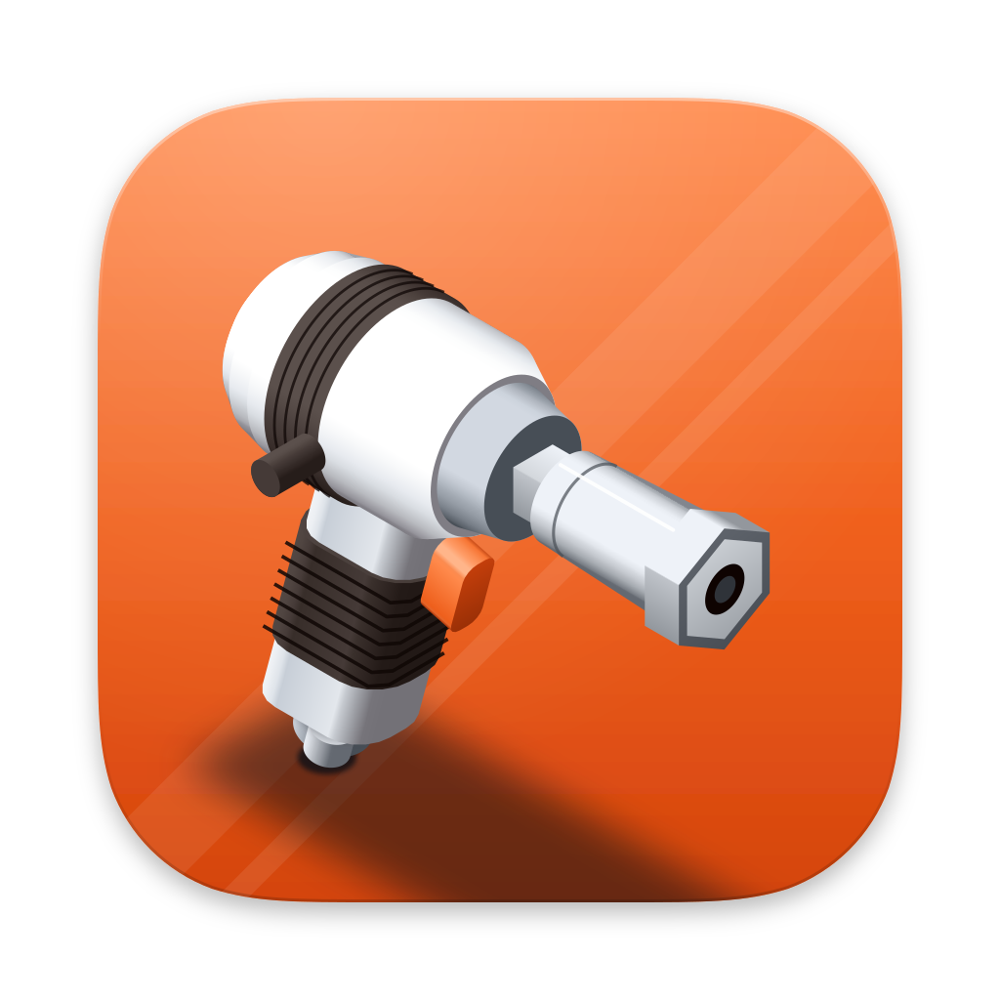
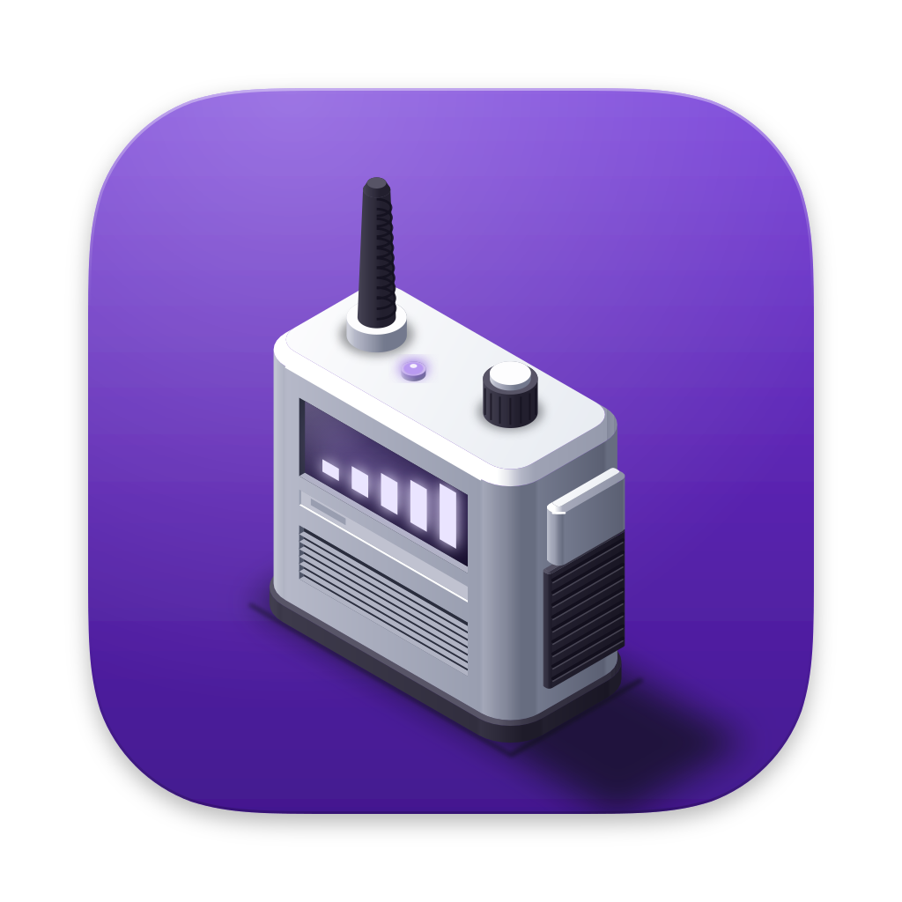
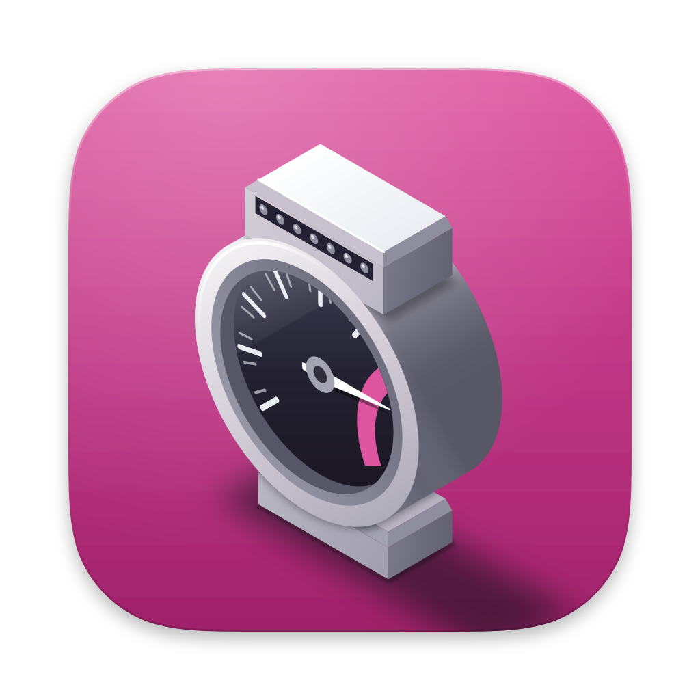
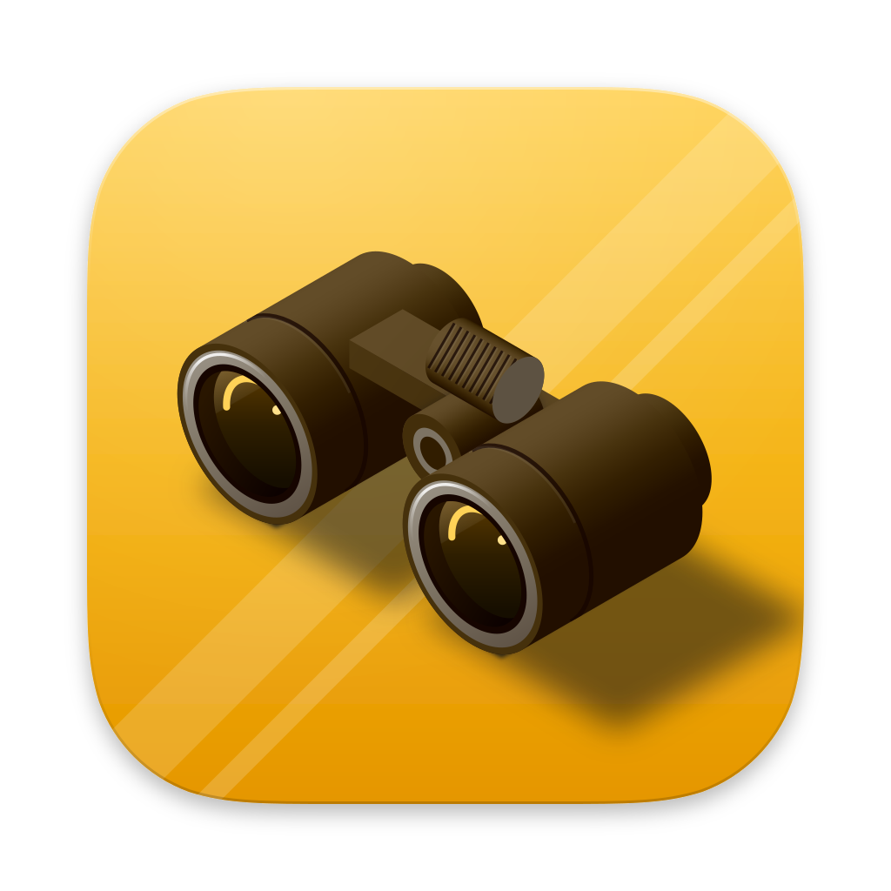
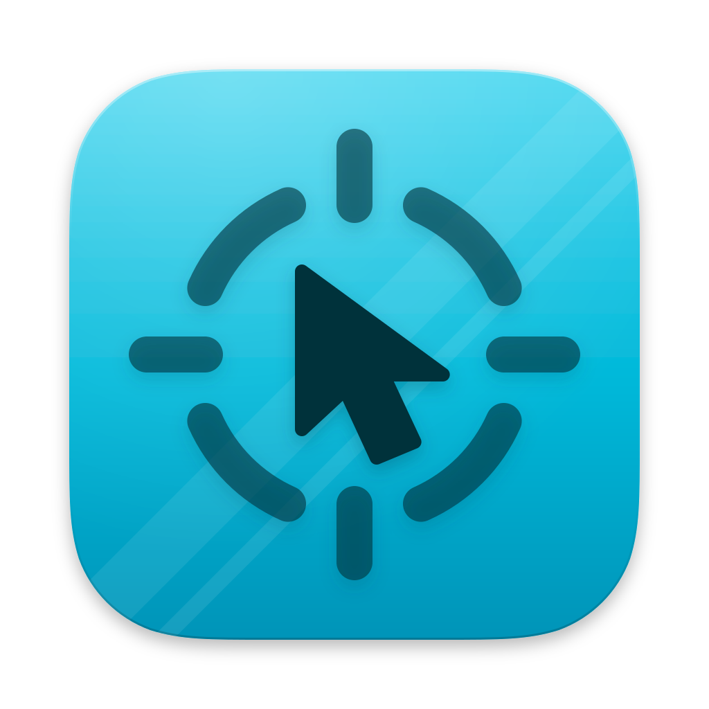
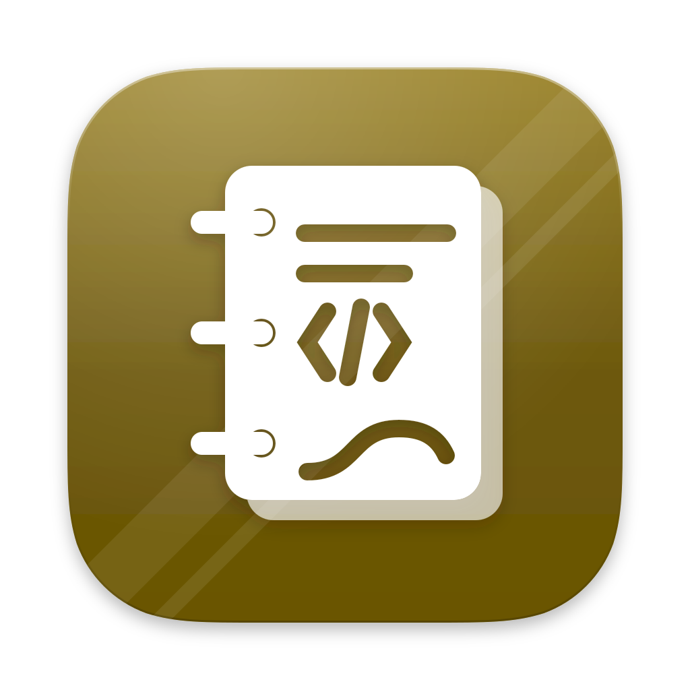

# Paddock

<p align="center">
  <a href="docs/ecosystem.md"></a>
</p>

<p align="center"><a href="docs/ecosystem.md">The ecosystem</a> · <a href="docs/ecosystem.md#integration-architecture">Integrations</a> · <a href="ui/README.md">UI kit</a> · <a href="docs/design-guide.md">Design guide</a> · <a href="icons/README.md">Icons</a></p>

Paddock is a family of seven desktop tools for people who keep software and the machines it runs on healthy, and the
foundation they share. Each app does one job well and is useful alone. Together they cover the loop from an incident in
production, through understanding the code and writing a test, to running it on CI. Everything runs on your computer: no
cloud, no account, no telemetry. Optional local AI, served by one app, makes each of them smarter without sending a byte
anywhere.

## The apps

| | App | What it does | Status |
|---|---|---|---|
|  | **[Debrief](https://dev.decryptology.net/decryp7/debrief)** | An IDE for analysing logs and diagnostic files: one merged timeline across processes and machines. | Releasing (the code still says IMT while the rename lands) |
|  | **[Pitcrew](https://dev.decryptology.net/decryp7/pitcrew)** | Keeps self-hosted CI runners alive, updated and clean. | **v1.0.0 released** |
|  | **[Pitwall](https://dev.decryptology.net/decryp7/pitwall)** | The private, local AI hub: OpenAI-, Anthropic- and Ollama-compatible APIs over models on your machine. | Release next (feature-complete) |
|  | **[Dyno](https://dev.decryptology.net/decryp7/dyno)** | Measures, explains and tunes your PC, observe first. | In development |
|  | **[Spotter](https://dev.decryptology.net/decryp7/spotter)** | Watches for new releases anywhere and tells you the moment one appears. | In development |
|  | **[Sighter](https://dev.decryptology.net/decryp7/sighter)** | Finds any UI element by sight, so UI tests work even without an accessibility tree. | In design |
|  | **[Pacenotes](https://dev.decryptology.net/decryp7/pacenotes)** | Everything code-related: a code index with an MCP server, plus plugins for review, diagrams, requirements and tests. | In design |

Per-app detail, audience and standout features: [docs/ecosystem.md](docs/ecosystem.md).

## How they work together

**A production incident.** Support gets a zip of logs from three machines. In **Debrief** the merged timeline shows the
crash and the errors it caused elsewhere. Debrief asks **Pitwall** to explain the stack trace; Pitwall calls **Pacenotes**
over MCP, which maps the frames to files, callers and recent commits, so the explanation is grounded
in the real code. A regression test is drafted from it, **Sighter** turns the reproduction into a UI test, and **Pitcrew**
keeps the runner that executes it on CI healthy. Sighter's run bundle opens next to the logs in Debrief.

**A vendor release.** **Spotter** sees a new version of a tool you depend on. **Pitwall** summarises the release notes
locally. A Sighter smoke test checks that your workflow still works on the new build, and **Dyno** watches CPU and memory
for a regression over the following days. Anything odd opens in Debrief with one click.

**A slow build machine.** **Dyno** explains in plain words that a background process is taking the runner's disk and CPU,
and shows it next to the runner in **Pitcrew**. A taming rule or cleanup you enable fixes it, with an undo. Pitcrew's
job logs open in **Debrief** when a build fails.

**No AI installed.** Nothing above stops working. Every app does its core job alone; AI features show "Needs local AI,
set up Pitwall" instead of an error. Install Pitwall later and they light up.

The wiring, protocols and diagram: [integration architecture](docs/ecosystem.md#integration-architecture).

## Principles

- **Local only and private.** No cloud, no telemetry. Nothing leaves your computer unless you ask for it.
- **Windows, macOS and Linux are all first-class**, with a native feel on each.
- **Rust engines, Angular UI, Tauri 2 shell.** The engine is the source of truth; the UI renders what it returns.
- **Pitwall is always optional.** Every app's core works without it; AI features appear when it is present.
- **Observe before acting.** Changes need a click or an enabled rule, and have an undo.
- **Calm by default.** Neutral surfaces, colour for action and the one thing that needs attention.

## What is in this repo

| Part | Path | What | Consume it |
|---|---|---|---|
| UI package `@decryp7/paddock-ui` | [`ui/`](ui/README.md) | design tokens (dark and light, five accents, three densities, a colour-vision-safe chart palette), Angular components, ECharts theme, gallery | npm, Gitea registry |
| Design guide | [`docs/design-guide.md`](docs/design-guide.md) | principles, layout, type, colour, charts, components, motion, microcopy, polish checklist | read; `ui/` is its executable form |
| Diagram kit | [`diagrams/`](diagrams/README.md) | style spec, draw.io shape library, templates, canonical export script | draw.io library URL |
| Icon set | [`icons/`](icons/README.md) | the family app icons per platform and the tooling that builds them | copy the app's folder |
| Release practices | [`docs/lessons.md`](docs/lessons.md), [`CHANGELOG.md`](CHANGELOG.md) | tag workflow, signed updates, `latest.json`, the release script | follow the lessons |
| Rust crates | [`crates/`](crates/README.md) | shared Rust code. Planned: the plugin platform (host, IPC and API, extracted from Debrief's ADR 0017 model), `paddock-pitwall` (the Pitwall client) and `paddock-testplan` (the `.sighterplan` format) | git dependency on a tag |
| Lessons | [`docs/lessons.md`](docs/lessons.md) | what building Debrief and Pitcrew taught | read before starting an app |

### Use the UI package

```ini
# .npmrc (public package, no token needed to install)
@decryp7:registry=https://dev.decryptology.net/api/packages/decryp7/npm/
```

```json
"@decryp7/paddock-ui": "^0.1.0"
```

`npm ci` installs it from `package-lock.json`. Tokens, components and migration notes: [`ui/README.md`](ui/README.md).

### Use the diagram kit

In draw.io choose File, Open Library from, URL, and paste:

```
https://dev.decryptology.net/decryp7/paddock/raw/branch/main/diagrams/paddock.xml
```

Then apply an app's accent with `node diagrams/tools/apply-accent.mjs <app> <template> <out>`; see
[`diagrams/README.md`](diagrams/README.md).

### Use a crate (planned)

```toml
# planned: paddock-pitwall, paddock-testplan, the plugin platform
paddock-pitwall = { git = "https://dev.decryptology.net/decryp7/paddock", tag = "v0.2.0" }
```

## Status and roadmap

Pitcrew v1.0.0 is released. The order of work:

1. Debrief v1 release (in progress).
2. Pitwall release.
3. The shared Paddock crates: the plugin platform and `paddock-pitwall`.
4. Debrief switches its AI to Pitwall.
5. Spotter and Dyno finish.
6. Pitcrew 1.1: local autoscaling.
7. Pacenotes and Sighter implementation.

Paddock itself is pre-1.0: a minor bump may change tokens or component APIs, and removed things are deleted rather than
deprecated.

## Versioning and releases

One semver tag for the whole repo (`vMAJOR.MINOR.PATCH`). Pushing a `v*` tag runs CI, which publishes
`@decryp7/paddock-ui` to the Gitea npm registry and creates the release notes. Releases are made only by CI. Steps: update
the version in `ui/projects/paddock-ui/package.json` and `CHANGELOG.md`, commit, tag, push the tag. `cd ui && npm run release`
is a local dry run.

## Licence

MIT OR Apache-2.0, at your option: [LICENSE-MIT](LICENSE-MIT), [LICENSE-APACHE](LICENSE-APACHE).
