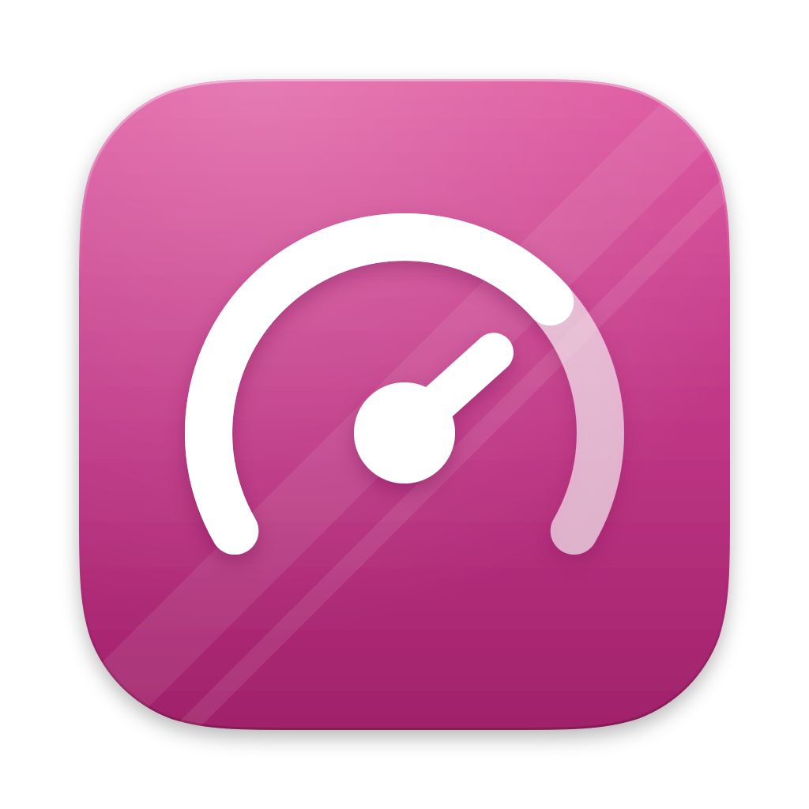
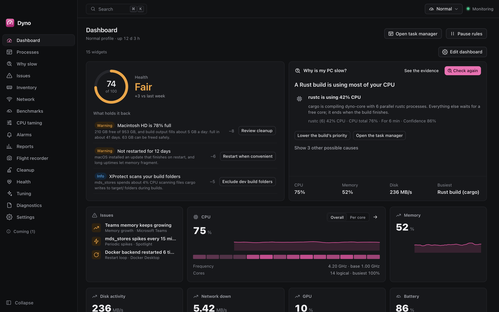
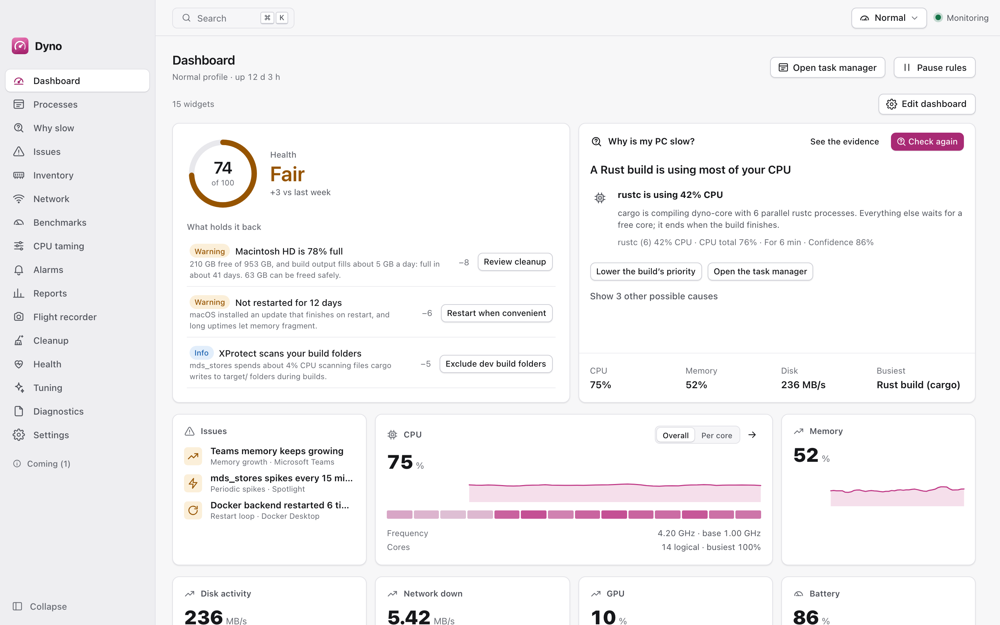
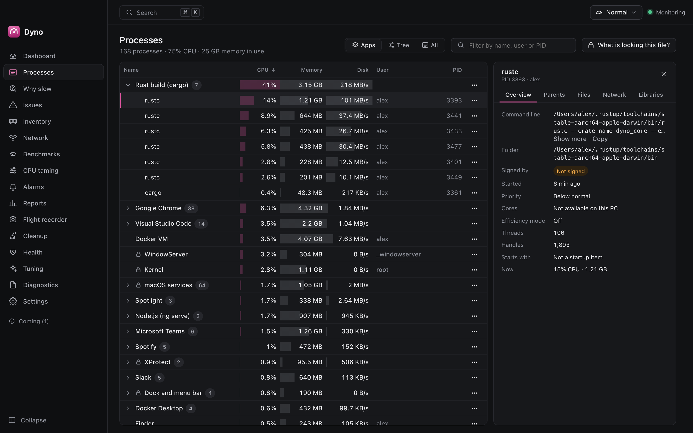
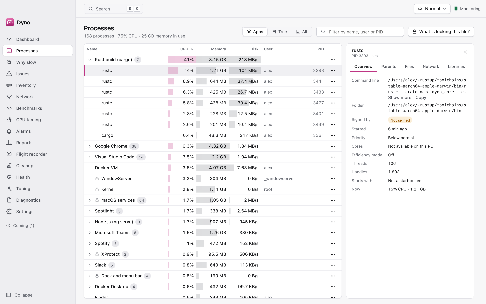
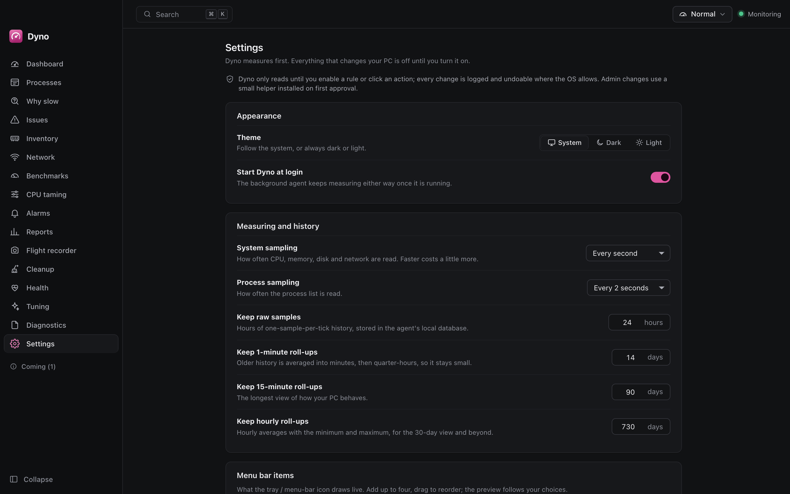
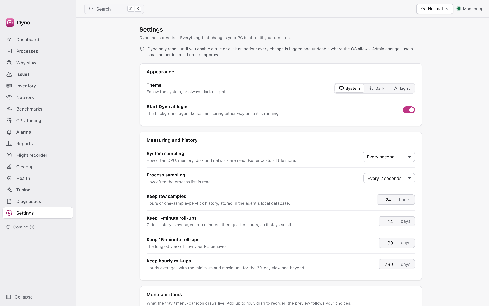
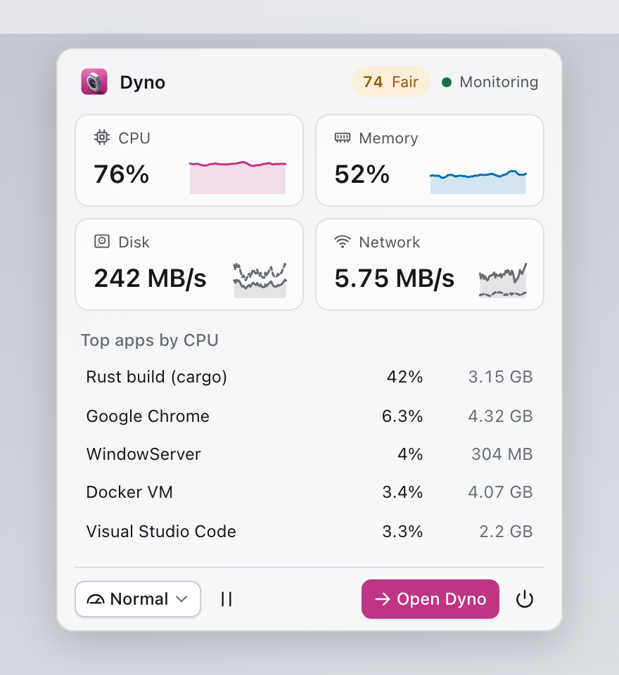

<div align="center">



# Dyno

**Measures, explains and tunes your PC.** A background agent samples the machine and keeps its history while the window
is closed; the app shows what is happening, says in plain words why it is slow, and can calm a runaway program, clean
up, tidy start-up and apply reversible tuning, but only when you enable a rule or click. On **Windows, macOS and Linux**.

A dynamometer measures an engine under load and shows where the power goes: Dyno does that for your computer.

</div>


> **Status: v0.1.0, unreleased.** The agent (sampling, history, process actions with undo, rules engine, diagnosis,
> health, startup list, service registration), the dashboard, processes, settings and tray are built and tested. CPU
> taming, Health and Cleanup screens may still be placeholders in the UI; cleanup, tuning and the privileged helper are not built. [docs/features.md](docs/features.md) says exactly what is real and
> [docs/roadmap.md](docs/roadmap.md) lists what is left.



## At a glance


A per-user **agent** measures and keeps the history whether or not the window is open; an unprivileged **app** (window
and tray) shows it and sends requests over one local IPC; a pure Rust **core** holds every rule (grouping, diagnosis,
the rules engine, protection, cleanup policy, health); thin **adapters** per OS read the counters and act on
processes. Details: [architecture](docs/architecture.md) and every diagram in [docs/design.md](docs/design.md).

## Why Dyno

Task managers show numbers; cleaners and "boosters" change things behind your back. Dyno aims at the middle:

- **Observe first.** After install Dyno only measures and explains. Nothing changes without a rule you switched on or a
  click, and every change is logged with an undo ([ADR 0006](docs/adr/0006-privileged-helper-and-observe-only.md)).
- **Explains, not just counts.** Processes are grouped into applications, the diagnosis names the likeliest cause with its
  evidence, anomalies are called out, and history keeps short spikes visible.
- **Safe by construction.** A protected list that nothing can override (critical OS processes, antivirus, audio engine,
  Dyno itself, your own entries), actions that name a process by id *and* start time, deletes that are recoverable.
- **Light.** Adaptive sampling, one SQLite writer, no web server. On the 14-core M4 Mac mini the agent used about 2 to
  3 % of one core and 24 MB (see [Dyno's own overhead](docs/architecture.md#dynos-own-overhead)).
- **Local only.** No telemetry, no cloud, no accounts.
- **Cross-platform.** Windows, macOS and Linux, each with its own service manager and process-control methods.

## Key features


Every feature, with its state, is in [docs/features.md](docs/features.md). Built today:

1. **Live dashboard.** CPU, memory, disk, network, plus GPU, battery, temperatures and fans where the OS tells (otherwise
   a reason, never a zero), with sparklines, a history chart, "Dyno: x % CPU, y MB" and a health score.
2. **History that survives closing the window.** Raw points for a day, then 1-minute, 15-minute and hourly rollups holding
   min, average and max ([ADR 0008](docs/adr/0008-storage-sqlite-and-retention.md)).
3. **Processes by application.** A tree grouped by app ([ADR 0003](docs/adr/0003-process-grouping.md)), sortable and
   searchable, with details (command line, modules, connections, signer), "what is locking this file", end, suspend,
   priority and efficiency mode, and an Activity list with **Undo**. Protected processes are locked with the reason.
4. **Why is it slow?** A diagnosis with causes, confidence, evidence and suggestions; anomalies; disk-full forecast.
5. **CPU taming engine.** Rules with an escalation ladder (priority, efficiency mode, a cap) and profiles (Gaming,
   Meeting, On battery, Building code), released automatically ([ADR 0004](docs/adr/0004-cpu-taming-and-throttling-methods.md)).
   The rules ship disabled; the UI for them is not built yet.
6. **Startup list** and **health score** with reasons and fixes that preview before anything changes.
7. **Tray** with a live metric and a compact dropdown; closing the window keeps Dyno measuring.
8. **Native feel** ([ADR 0009](docs/adr/0009-native-feel.md)), light and dark themes, a colour-vision-checked palette
   ([ADR 0011](docs/adr/0011-design-system.md)), a command palette (Ctrl or Cmd + K).
9. **Extensible in three tiers** ([ADR 0007](docs/adr/0007-extensibility-three-tiers.md)): the core, declarative TOML
   packs (planned) and out-of-process Rust plugins ([docs/plugins.md](docs/plugins.md)).
10. **Updates itself** with the Tauri updater: signed, opt-in ([docs/releasing.md](docs/releasing.md)).

Planned (see the roadmap): right-click search, watched folders,
benchmarks on click, a performance-counter browser, the tuning catalogue, cleanup with quarantine, backup health,
declarative packs, alerts and a weekly report, a local web API, multi-PC view.

### Screenshots

Taken against the mock backend (`docs/screenshots`, dark and light for every screen; `npm run screenshots` in `app/`).

| | |
| --- | --- |
|  |  |
|  |  |
|  |  |
|  |  |

CPU taming, Cleanup and Health may still be placeholder screens until their work packages are done
([roadmap](docs/roadmap.md)); their placeholder images are listed in the [screenshot checklist](docs/roadmap.md#screenshot-checklist).

## Quick start

No release is published yet; build it yourself ([Building from source](#building-from-source)) or take the CI artifacts
of a `v*` tag or the nightly run.

### Windows

Run the NSIS installer (`Dyno_<version>_x64-setup.exe`; per-user, no administrator rights). Dyno registers its agent as
a per-user **Run** entry (not a service: a service lives in session 0 and cannot see your idle time, foreground window
or per-user settings, [ADR 0010](docs/adr/0010-platforms-and-services.md)). Windows asks for administrator rights only
when you first approve a change that needs them (the helper, planned).

### macOS (13 or newer)

The build is **not notarised**; it is signed ad hoc. Open the `.dmg`, drag Dyno to Applications, open it the first time
with right-click > Open. Turn on **Settings > Launch at login**: Dyno registers its launch agent with `SMAppService` and
macOS may ask you to allow it under **System Settings > General > Login Items & Extensions**. Details and verification:
[docs/macos.md](docs/macos.md).

### Linux (systemd, x86-64 or ARM64)

Install the `.deb` (`sudo apt install ./Dyno_<version>_amd64.deb`) or run the AppImage. **Settings > Launch at login**
installs a systemd **user** unit (`~/.config/systemd/user/dyno-agent.service`); no root needed. The tray needs a
status-notifier host (GNOME: the AppIndicator extension). Details: [docs/linux.md](docs/linux.md).

## Status

| Area | State |
| --- | --- |
| Core | Built and unit-tested: model, grouping, protection, rules engine, diagnosis, anomalies, forecast, health, history, cleanup policy, protocol. |
| Agent | Sampling loop, SQLite history with rollups, process actions with undo, rules, startup list, plugin host, service install/ensure, `bench`. Cleanup, tuning, disk usage and the weekly report answer "not built yet". |
| Platform adapters | macOS and Linux: sensors, process control, details, locks, startup, facts, user activity (macOS tested on a real Mac, Linux in a container with `scripts/linux-verify.sh`). Windows: sensors, process control and user activity; details, locks, startup and facts are not wired yet. |
| App | Dashboard, processes, settings, tray, command palette, native feel against the real agent through the shell. |
| Helper | Action types and validation exist in the core; the executable is a stub. |
| Installers | CI builds NSIS, `.dmg`, `.deb` and AppImage on tags, nightly and manual runs. Not yet published. |

## Roadmap

[docs/roadmap.md](docs/roadmap.md): every remaining feature as a work package with scope, acceptance criteria,
dependencies and the files it touches, plus the known gaps in the foundation.

## Documentation

| Document | What it covers |
| --- | --- |
| [docs/features.md](docs/features.md) | Every feature and whether it is built |
| [docs/user-guide.md](docs/user-guide.md) | Installing, everyday use, the tray, settings, command line, troubleshooting |
| [docs/architecture.md](docs/architecture.md) | Overview, core, agent, app, state and files, security, Dyno's own overhead |
| [docs/design.md](docs/design.md) | All design diagrams on one page (C4, deployment, use cases, domain, flows, states) |
| [diagrams/STYLE.md](diagrams/STYLE.md) | The diagram style guide |
| [docs/macos.md](docs/macos.md) | Build, install and verify on macOS |
| [docs/linux.md](docs/linux.md) | Build, install and verify on Linux |
| [docs/development.md](docs/development.md) | Building, testing, CI/CD, layout, where to add things |
| [docs/releasing.md](docs/releasing.md) | Releases and signed updates |
| [docs/testing-manual.md](docs/testing-manual.md) | Manual tests that need a real desktop |
| [docs/plugins.md](docs/plugins.md) | Writing an out-of-process plugin |
| [docs/suite-lessons.md](docs/suite-lessons.md) | Pitfalls the sister apps already hit |
| [docs/adr/](docs/adr/README.md) | Architecture decision records 0001 to 0014 |

## Building from source

Prerequisites: Rust stable (1.88+), Node 24 (`app/.nvmrc`), and the [Tauri 2 prerequisites](https://v2.tauri.app/start/prerequisites/)
for your OS (WebView2 on Windows, Xcode command line tools on macOS; on Linux `libwebkit2gtk-4.1-dev` and friends).

```sh
cd app && npm ci && cd ..
cargo test --workspace                 # core, platform, agent, plugin and shell tests
(cd app && npx ng test --watch=false)  # UI unit tests
(cd app && npm start)                  # UI in a browser, against the mock backend (http://localhost:4200)
(cd app && npx tauri dev)              # the desktop app with the real agent
cargo run -p dyno-agent -- once        # one measurement as JSON, changes nothing
cargo run -p dyno-agent -- bench 25 processes   # Dyno's own overhead
```

More in [docs/development.md](docs/development.md).

## Contributing

Read [AGENTS.md](AGENTS.md) first: design principles, safety, security and robustness rules, quality gates. Use
[Conventional Commits](https://www.conventionalcommits.org/); releases are `v*` tags following semver
([docs/releasing.md](docs/releasing.md)).

## Security and privacy

- The agent never trusts the app and the app never trusts the webview: every request is parsed into a typed value and
  validated in Rust; the IPC is local only, token-authenticated and bounded.
- Dyno changes your machine only through an enabled rule or an explicit click, logs it and keeps an undo; deletes go to
  the Trash or a quarantine. The protected list is absolute.
- Nothing runs elevated except the optional helper (planned), installed on first use after the OS's own prompt.
- Tauri capabilities are least-privilege (checked in CI by `scripts/check-capabilities.mjs`) and the CSP has no
  `unsafe-eval` and no remote origins. Logs never contain file contents or command lines. No telemetry.
- Found a vulnerability? Please report it privately to the maintainers rather than in a public issue.

## Licence

Dyno is licensed under either of [MIT](LICENSE-MIT) or [Apache-2.0](LICENSE-APACHE), at your option.
