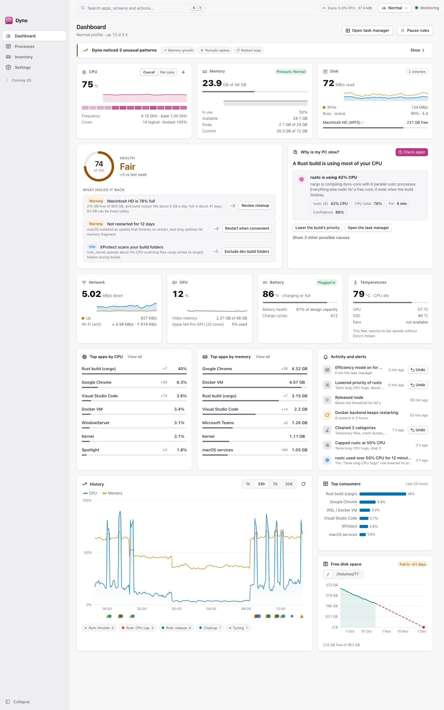
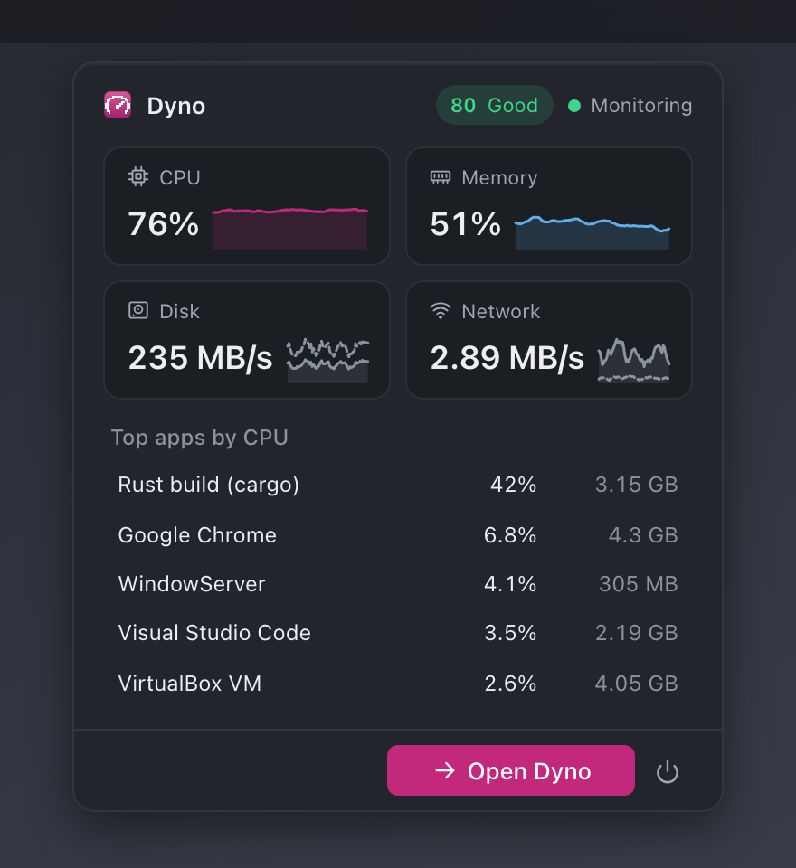

<div align="center">


# Dyno

**Watches your PC, read-only.** A background agent samples the machine and keeps its history while the window is
closed; the app shows what is happening, says in plain words why it is slow, raises alarms, maps the disk and runs
benchmarks on click. It never changes your machine ([ADR 0021](docs/adr/0021-monitoring-only.md)). On **Windows, macOS
and Linux**.

A dynamometer measures an engine under load and shows where the power goes: Dyno does that for your computer.

</div>


> **Status: 1.1.0.** Dyno is a monitor: live and history, processes and why it is slow,
> alarms, issues, a disk map, counters, extras, benchmarks and the command line, read-only apart from the opt-in keep awake, Wake-on-LAN and administrator helper. Taming, cleanup, tuning and
> every other way of changing the machine are dropped, not postponed
> ([ADR 0021](docs/adr/0021-monitoring-only.md)). [docs/features.md](docs/features.md) says exactly what is real and
> [docs/roadmap.md](docs/roadmap.md) lists what is left.

<picture>
  <source media="(prefers-color-scheme: dark)" srcset="docs/screenshots/dashboard-full-dark.png">
  
</picture>

## At a glance


A per-user **agent** measures and keeps the history whether or not the window is open; an unprivileged **app** (window
and tray) shows it and sends requests over one local IPC; a pure Rust **core** holds every rule (grouping, diagnosis,
alarms, health, forecasts); thin **adapters** per OS read the counters. Everything runs with your own rights: what the OS shows only to administrators is marked *Unavailable* with the reason. There is no privileged helper in 1.0. Details: [architecture](docs/architecture.md) and every diagram in
[docs/design.md](docs/design.md).

## Why Dyno

Task managers show numbers; cleaners and "boosters" change things behind your back. Dyno does the first well and never
does the second:

- **Read-only.** Dyno measures and explains. It ends nothing, deletes nothing and changes no setting
  ([ADR 0021](docs/adr/0021-monitoring-only.md)). Its own data (history, settings, alarm acknowledgements and notes) is all
  it writes.
- **Explains, not just counts.** Processes are grouped into applications, the diagnosis names the likeliest cause with its
  evidence, anomalies are called out, and history keeps short spikes visible.
- **Light.** Adaptive sampling, one SQLite writer, no web server. On the 14-core M4 Mac mini the agent used about 2 to
  3 % of one core and 24 MB (see [Dyno's own overhead](docs/architecture.md#dynos-own-overhead)).
- **Local only.** No telemetry, no cloud, no accounts.
- **Cross-platform.** Windows, macOS and Linux, each with its own service manager.

## Key features


Every feature, with its state, is in [docs/features.md](docs/features.md). Built today:

1. **Live dashboard.** CPU, memory, disk, network, plus GPU, battery, temperatures and fans where the OS tells (otherwise
   a reason, never a zero), with sparklines, a history chart, "Dyno: x % CPU, y MB" and a health score.
2. **History that survives closing the window.** Raw points for a day, then 1-minute, 15-minute and hourly rollups holding
   min, average and max ([ADR 0008](docs/adr/0008-storage-sqlite-and-retention.md)).
3. **Processes by application.** A tree grouped by app ([ADR 0003](docs/adr/0003-process-grouping.md)), sortable and
   searchable, with details (command line, modules, connections, signer), "what is locking this file", open location,
   snapshots and diffs.
4. **Why is it slow?** A diagnosis with causes, confidence, evidence and suggestions; anomalies; disk-full forecast;
   throttling, SSD and battery life ranges and learned baselines ([ADR 0018](docs/adr/0018-throttling-lifespan-and-baselines.md)).
5. **Alarms, issues and the weekly report.** Alarms that notify with an ISA-18.2 style lifecycle
   ([ADR 0013](docs/adr/0013-alarms-lifecycle.md)); crashes and errors from the OS logs with a stability score
   ([ADR 0017](docs/adr/0017-issues-and-the-program-baseline.md)); a report for any of the last 52 weeks.
6. **Health and startup items,** with reasons only: Dyno shows, it does not fix.
7. **Disk map, counters, extras and backup health.** A disk map (in progress for 1.0: the engine is built and the screen is being built; a ring chart of a volume or folder where a click drills in, with a live scan you can cancel), a performance-counter browser, what changed,
   sleep, boot, GPU, inventory, find files (view only) and backup checks
   ([ADR 0020](docs/adr/0020-extras-backup-checks-and-taming-proof.md)).
8. **Benchmarks on click,** network view, IP lookup, web and VirusTotal search (they only open your browser), the flight
   recorder and the problem report (a zip you look through and save yourself).
9. **Tray** with a live metric and a compact dropdown; closing the window keeps Dyno measuring.
10. **Native feel** ([ADR 0009](docs/adr/0009-native-feel.md)), light and dark themes, a colour-vision-checked palette
    ([ADR 0011](docs/adr/0011-design-system.md)).
11. **The `dyno` command line:** `status`, `why-slow`, `top`, `alarms`, `snapshot` and `counters` ([docs/cli.md](docs/cli.md)),
    shipped in the installers.
12. **Extensible with sensors:** the core and out-of-process Rust plugins that add sensors
    ([ADR 0007](docs/adr/0007-extensibility-three-tiers.md), [docs/plugins.md](docs/plugins.md)).
13. **Updates itself** with the Tauri updater: signed, opt-in ([docs/releasing.md](docs/releasing.md)).

Later, after 1.0 (see the roadmap): the disk map's largest, oldest and duplicate-hint lists and its hidden-space breakdown; the privileged helper and "start as administrator at login"; declarative read-only packs, an optional local web API, "Explain this" via Pitwall,
suite tie-ins, session recording, a multi-PC view.

### Screenshots

Taken against the mock backend (`docs/screenshots`, dark and light for every screen; `npm run screenshots` in `app/`).

| | |
| --- | --- |
|  |  |
|  |  |
|  |  |
|  |  |

## Quick start

No release is published yet; build it yourself ([Building from source](#building-from-source)) or take the CI artifacts
of a `dyno-v*` tag or the nightly run.

### Windows

Run the NSIS installer (`Dyno_<version>_x64-setup.exe`; per-user, no administrator rights). Dyno registers its agent as
a per-user **Run** entry (not a service: a service lives in session 0 and cannot see your idle time, foreground window
or per-user settings, [ADR 0010](docs/adr/0010-platforms-and-services.md)). Dyno never needs administrator rights to install or to run. Figures Windows shows only to administrators are marked *Unavailable* with the reason.

### macOS (13 or newer)

The build is **not notarised**; it is signed ad hoc. Open the `.dmg`, drag Dyno to Applications and open it from there. The first time macOS says "Not Opened": choose Done, then
System Settings > Privacy & Security > **Open Anyway**, **Open Anyway** again in the "Open “Dyno”?" dialog, and enter an
administrator's name and password (macOS 26 flow, once). Turn on **Settings > Launch at login**: Dyno registers its launch agent with `SMAppService` and
macOS may ask you to allow it under **System Settings > General > Login Items & Extensions**. Details and verification:
[docs/macos.md](docs/macos.md).

### Linux (systemd, x86-64 or ARM64)

Install the `.deb` (`sudo apt install ./Dyno_<version>_amd64.deb`) or run the AppImage. **Settings > Launch at login**
installs a systemd **user** unit (`~/.config/systemd/user/dyno-agent.service`); no root needed. The tray needs a
status-notifier host (GNOME: the AppIndicator extension). Details: [docs/linux.md](docs/linux.md).

## Status

| Area | State |
| --- | --- |
| Core | Built and unit-tested: model, grouping, diagnosis, anomalies, forecast, health, history, alarms, baselines, protocol. |
| Agent | Sampling loop, SQLite history with rollups, alarms, issues, flight recorder, weekly report, disk usage, benchmarks, startup list (view), plugin host (sensors), service install/ensure. |
| Platform adapters | macOS and Linux: sensors, details, locks, startup, facts, user activity (macOS tested on a real Mac, Linux in a container with `scripts/linux-verify.sh`). Windows: sensors and user activity; details, locks, startup and facts are not wired yet. |
| App | Dashboard, processes, why slow, alarms, issues, reports, counters, extras, benchmarks, network, settings, tray, native feel against the real agent through the shell. |
| Privileges | Dyno 1.0 has no privileged helper. Everything runs with your own rights; unreadable figures say why, other users' processes are one "Other users" row, and elevation (the helper and "start as administrator at login") is planned for 1.1 (ADR 0022). |
| Installers | CI builds NSIS, `.dmg`, `.deb` and AppImage on `dyno-v*` tags, nightly and manual runs. Not yet published. |

## Roadmap

[docs/roadmap.md](docs/roadmap.md): every remaining feature as a work package with scope, acceptance criteria,
dependencies and the files it touches, plus the known gaps in the foundation.

## Documentation

| Document | What it covers |
| --- | --- |
| [docs/features.md](docs/features.md) | Every feature and whether it is built |
| [docs/user-guide.md](docs/user-guide.md) | Installing, everyday use, the tray, settings, command line, troubleshooting |
| [docs/architecture.md](docs/architecture.md) | Overview, core, agent, app, state and files, security, Dyno's own overhead |
| [docs/design.md](docs/design.md) | All design diagrams on one page (C4, deployment, use cases, domain, flows, states) |
| [diagrams/STYLE.md](diagrams/STYLE.md) | The diagram style guide |
| [docs/macos.md](docs/macos.md) | Build, install and verify on macOS |
| [docs/linux.md](docs/linux.md) | Build, install and verify on Linux |
| [docs/development.md](docs/development.md) | Building, testing, CI/CD, layout, where to add things |
| [docs/releasing.md](docs/releasing.md) | Releases and signed updates |
| [docs/testing-manual.md](docs/testing-manual.md) | Manual tests that need a real desktop |
| [docs/plugins.md](docs/plugins.md) | Writing an out-of-process plugin |
| [docs/suite-lessons.md](docs/suite-lessons.md) | Pitfalls the sister apps already hit |
| [docs/adr/](docs/adr/README.md) | Architecture decision records 0001 to 0021 |

## Building from source

Prerequisites: Rust stable (1.89+), Node 24 (`app/.nvmrc`), and the [Tauri 2 prerequisites](https://v2.tauri.app/start/prerequisites/)
for your OS (WebView2 on Windows, Xcode command line tools on macOS; on Linux `libwebkit2gtk-4.1-dev` and friends).

```sh
cd app && npm ci && cd ..
cargo test --workspace                 # core, platform, agent, plugin and shell tests
(cd app && npx ng test --watch=false)  # UI unit tests
(cd app && npm start)                  # UI in a browser, against the mock backend (http://localhost:4200)
(cd app && npx tauri dev)              # the desktop app with the real agent
cargo run -p dyno-agent -- once        # one measurement as JSON, changes nothing
cargo run -p dyno-agent -- bench 25 processes   # Dyno's own overhead
```

More in [docs/development.md](docs/development.md).

## Contributing

Read [AGENTS.md](AGENTS.md) first: design principles, safety, security and robustness rules, quality gates. Use
[Conventional Commits](https://www.conventionalcommits.org/); releases are `dyno-vX.Y.Z` tags following semver
([docs/releasing.md](docs/releasing.md)).

## Security and privacy

- The agent never trusts the app and the app never trusts the webview: every request is parsed into a typed value and
  validated in Rust; the IPC is local only, token-authenticated and bounded.
- Dyno does not change your machine: no process actions, no deletes, no settings changes. It writes only its own data
  ([ADR 0021](docs/adr/0021-monitoring-only.md)).
- Nothing runs elevated: Dyno 1.0 runs only with your own rights and installs no privileged helper or service.
- Tauri capabilities are least-privilege (checked in CI by `scripts/check-capabilities.mjs`) and the CSP has no
  `unsafe-eval` and no remote origins. Logs never contain file contents or command lines. No telemetry.
- Found a vulnerability? Please report it privately to the maintainers rather than in a public issue.

## Licence

Dyno is licensed under either of [MIT](LICENSE-MIT) or [Apache-2.0](LICENSE-APACHE), at your option.
