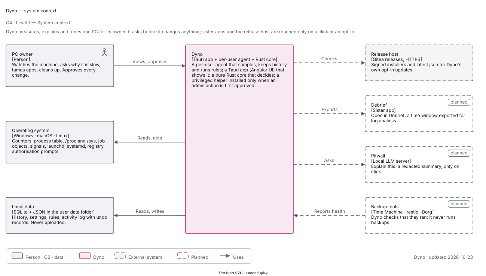
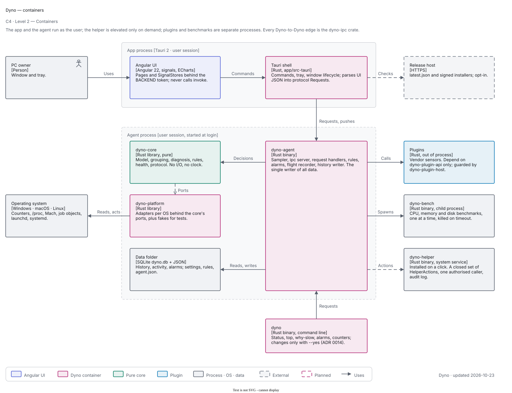
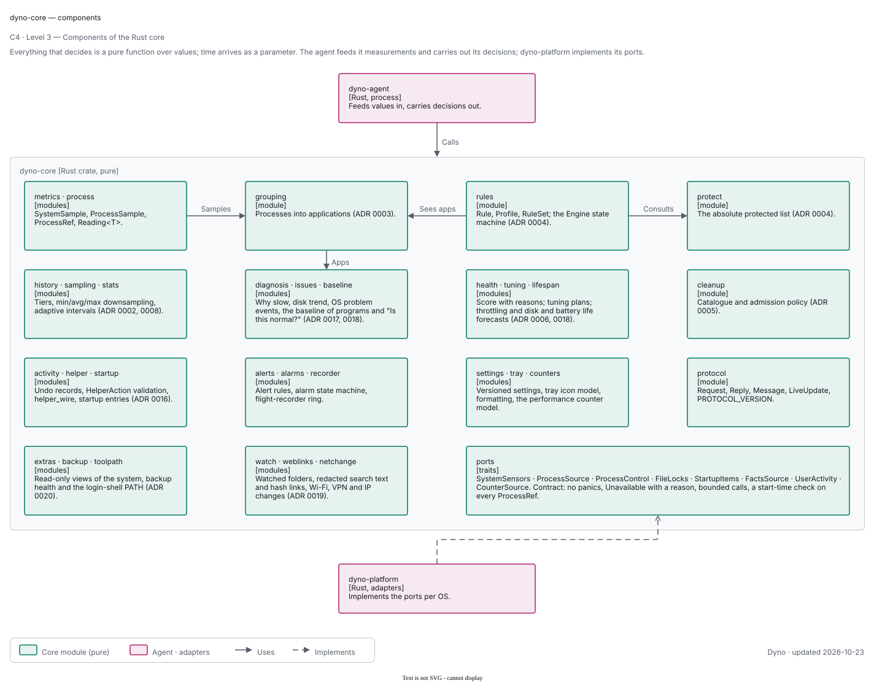

# Dyno architecture

Dyno is built from a pure Rust core, thin OS adapters, a per-user agent that measures and keeps history, a Tauri app that
shows it. Everything runs with the user's own rights; an optional administrator helper reads what needs administrator rights, sets Dyno's own scheduled wakes (macOS, Linux) and installs the pinned disk-health tool on request, with an audit log ([ADR 0027](adr/0027-helper-for-1-1-0.md)). Power actions (keep awake, Wake-on-LAN, scheduled wakes, and sleep, hibernate or shut-down after idle or at a set time) run as the owner sets them up ([ADR 0032](adr/0032-power-keep-awake-wake-on-lan-idle-actions-energy.md)). This page describes how the pieces fit and what is true today; the diagrams
are in [design.md](design.md) and the reasoning is in the [ADRs](adr/README.md). Anything marked *planned* is not in the
code.

## Overview

| Piece | Crate or path | Runs as | Responsibility |
| --- | --- | --- | --- |
| Core | `crates/dyno-core` | library | Every decision, as pure functions over values (no I/O, no clock) |
| Adapters | `crates/dyno-platform` | library | The core's ports per OS (Windows, macOS, Linux), plus fakes for tests |
| IPC | `crates/dyno-ipc` | library | The one local IPC: length-prefixed postcard frames, token handshake |
| Agent | `crates/dyno-agent` (`dyno-agent`) | user process, started at login | Sampling, SQLite history, alarms, request handlers |
| Plugin API and host | `crates/dyno-plugin-api`, `dyno-plugin-host`, `plugins/` | out-of-process | Vendor sensors; guarded (ADR 0007) |
| Shell | `app/src-tauri` | user process | Window and tray, commands, the link to the agent, native feel |
| UI | `app/src` | webview | Angular presentation: pages, SignalStores, charts |

## The pieces

### Core

`dyno_core` holds the model (`metrics`, `process`), `grouping` (ADR 0003), 
`diagnosis`, `anomaly`, `forecast`, `health`, `history` (tiers and min/avg/max downsampling), `sampling` (adaptive intervals), `startup` (view), `alerts`,
`report`, `issues` (OS problem events, the stability score), `unusual` (the baseline of programs), `extras` (parsers for the sleep, boot, energy, GPU, software, changes and file-finder views, and maintenance windows), `snapshot`, `settings` (versioned), `tray` and `units` (pure formatting), and `protocol` (the app-agent
contract, `PROTOCOL_VERSION`). The ports are in `ports.rs`: `SystemSensors`, `ProcessSource`,
`FileLocks`, `StartupItems`, `FactsSource`, `UserActivity`, with `PlatformError`. Their contract (no panics, unavailable
readings with a reason, bounded calls, start-time check on every `ProcessRef`) is documented there and binding on every
adapter.

### Adapters

`dyno_platform::platform()` wires the ports for the current OS:

- **Everywhere:** sysinfo-based sensors and process table.
- **Windows:** performance counters (PDH) behind the sensors, network and user activity (idle time, foreground
  window). Process details (`NoDetails`), file locks (Restart Manager), startup entries and facts are **not wired yet**:
  the Windows platform still uses the in-memory fakes for them, so those screens are empty on Windows.
- **macOS:** `lsof`, `codesign`, launch agents and login
  items for startup, `pmset`/`sw_vers` facts, CoreGraphics idle time.
- **Linux:** PSI, `/proc` and `/sys` through `HostPaths` (so tests use temporary trees), hwmon and GPU sensors, process
  details from `/proc`, locks, autostart and systemd user units, package facts.
Windows-only and macOS-only code stays in small modules; `unsafe` is denied workspace-wide except in those modules, each
block with a `// SAFETY:` comment.

### Agent

`dyno-agent` has these parts (see the component diagram in [design.md](design.md#level-3--agent-components)):

- **`sampler`**: one thread. Each tick it reads `SystemSensors` at the system interval and `ProcessSource` at the process
  interval (`sampling::intervals`: faster when someone is watching, slower when nobody is, doubled on battery,
  stretched when the agent's own CPU exceeds its budget), groups the processes, runs the
  diagnosis and anomaly checks, records history, and pushes a `LiveUpdate`. Slow facts (`FactsSource`: disk health, pending updates, power plan) are gathered on demand for the
  health report and cached, never on this thread. A panic in one tick is caught and counted.
- **`server`**: binds the private endpoint, accepts connections (token, protocol version and, where the OS tells, peer pid),
  one thread per connection, and a bounded push queue per subscriber.
- **`handlers`**: one function per `Request`. Every request is validated and answered from stored or measured data; none changes the machine. A panic becomes an internal error for that request.
- **`issues`** and **`unusual`**: two background threads. The first reads the platform's `IssueSource`s every 15 minutes
  (panic-contained, "unavailable: reason" per source), stores new events and raises alarms; the second compares the process
  table with the baseline every 30 s ([ADR 0017](adr/0017-issues-and-the-program-baseline.md)).
- **`extras`**: the extras (WP-13): runs read-only OS tools through a `ToolRunner` with the user's login-shell `PATH`, records what changed, answers the requests; a background thread records the boot and compares the software lists inside the maintenance windows ([ADR 0020](adr/0020-extras-backup-checks-and-taming-proof.md); its backup checks were removed in 1.1.0).
- **`store`** and **`rollup`**: the SQLite store (ADR 0008) and the `HistoryWriter` that records raw points and rolls
  closed buckets up through the minute, 15-minute and hour tiers.
- **`service`**: install, uninstall, status and `ensure` of the per-user registration (ADR 0010); the unit text is pure.
- **`discovery`**, **`paths`**, **`files`**: `agent.json`, the data-folder layout and atomic JSON writes with a backup.
- **`instance`**: one agent per data folder. The agent holds an OS lock on `agent.lock` (`flock`, `LockFileEx`) while
  it runs; a second agent cannot take it, opens nothing and exits with code 3 (`cli::EXIT_ALREADY_RUNNING`).
- **`diskusage`**: the bounded disk-space map.
- **`cli`**: `run`, `status`, `stop`, `once`, `bench`, `service …`.

### App

The shell (`app/src-tauri`) owns the window and tray lifecycle, the settings that belong to the app (launch at login),
and the **link** to the agent: it reads `agent.json`, starts an agent when none runs, keeps one `dyno-ipc` connection,
forwards the webview's requests with a 15 s timeout, fans pushes out to the windows, reconnects with backoff and
replaces an agent of another build. It never starts a second agent while the one it started is running: it waits for a
starting agent on its process (alive: still starting, however slow the disk; exited: the exit code says why), not on a
clock (family ADR 0031), and Quit ends exactly the process it started, through the handle it holds (rule 53). While the
login service supervises the agent (launchd, systemd) it starts none of its own, and it hands over to the service or
takes the agent back when Launch at login is switched (ADR 0010 §11). The UI never calls `invoke` directly: it uses the `BACKEND` token, whose real
implementation calls the shell's one `dyno` command and whose mock serves the browser build. State lives in SignalStores
(`live`, `history`, `processes`, `alerts`, `diagnosis`, `health`, `settings`).

### Privileges and plugins

Dyno 1.0 has no privileged helper (ADR 0021; the helper design is ADR 0022, planned for 1.1). The app and the agent run with the
user's own rights; Dyno registers no system service (its files and agent are per user; on Linux the .deb itself is an ordinary system package). A reading the OS gives only to administrators or to a process's owner is a
`Reading::Unavailable` with a plain reason, never a zero. The platform adapters tell three groups apart: the user's own
processes and the system's are listed one by one, and every other account's processes form one **Other users** row with whatever
totals the OS allows (by session on Windows, by uid on macOS and Linux). On Windows the adapter reads
`NtQuerySystemInformation` and trusts its undocumented CPU and I/O fields only when a start-up self-check against the documented
calls agrees.

From 1.1 an optional administrator helper (a system service the user turns on in Settings; ADR 0027, built on ADR 0016 and 0022)
answers a closed list of requests over a local pipe or socket: the caller is identified from the OS's own credentials, each request
has a standing table (owner, administrator, other) saying full, counts only or denied, and a per-account cap bounds the load.
The app and the agent still run with the user's own rights; Dyno 1.0 has no way to run elevated.

Plugins are out-of-process Rust programs speaking `dyno-ipc` that add sensors; the agent starts the host on
first use of the plugins page (`Request::Plugins`) and the host guards them (timeouts, memory cap, quarantine).

## Decisions at a glance

| ADR | Decision |
| --- | --- |
| [0001](adr/0001-architecture.md) | Ports and adapters; app, agent, plugins (and the helper, not in 1.0); one IPC |
| [0002](adr/0002-sampling-architecture.md) | A per-user agent samples; pushed updates; adaptive intervals; own overhead measured |
| [0003](adr/0003-process-grouping.md) | Processes grouped by application |
| [0006](adr/0006-privileged-helper-and-observe-only.md) | Observe-only default (write parts superseded by 0021; the helper is not in 1.0) |
| [0016](adr/0016-privileged-helper-install-and-ipc.md) | The helper: a system service installed on a click, one authorised user and program, audit log; not in 1.0 (planned for 1.1) |
| [0021](adr/0021-monitoring-only.md) | Monitoring only: no taming, cleanup or tuning; no helper in 1.0 |
| [0017](adr/0017-issues-and-the-program-baseline.md) | Issues from the OS logs behind a port; a baseline of programs that explains, never accuses |
| [0020](adr/0020-extras-backup-checks-and-taming-proof.md) | Extras behind a ToolRunner (its backup checks were removed in 1.1.0; see the ADR) |
| [0007](adr/0007-extensibility-three-tiers.md) | Core, TOML packs, out-of-process plugins |
| [0008](adr/0008-storage-sqlite-and-retention.md) | SQLite, tiers, versioned schema |
| [0009](adr/0009-native-feel.md) | Desktop feel in a webview |
| [0010](adr/0010-platforms-and-services.md) | Launch agent, systemd user unit, Windows Run entry |
| [0011](adr/0011-design-system.md) | Tokens, themes, a colour-vision-checked palette |

## Behaviour in text

### Live updates

The app subscribes once (`Request::Subscribe { detail }`; `Summary` for the dashboard, `Processes` while the task manager
is open). The sampler measures at the adaptive interval and the agent pushes a `LiveUpdate` (system sample, memory
pressure, top apps by CPU and memory, the agent's own overhead, and, for
`Processes`, the full process list and groups) to each subscriber at its detail level. A subscriber that cannot keep up
loses frames; nothing is buffered without limit. Frames are bounded (`MAX_FRAME` 4 MiB).

### History

Raw points every 5 s for `raw_hours` (24 h), then 1-minute, 15-minute and hourly rollups with min/avg/max, kept 14 days,
90 days and 2 years by default (configurable and bounded); pruning runs hourly. A range query picks the finest tier that
covers the range and returns at most a few thousand points.

### Updates

The app updates through the Tauri updater (signed, opt-in; docs/releasing.md). After an update the shell registers the
agent service again when the OS refuses the old registration (macOS) and asks an agent of another build to exit; the
service manager brings the new one back.

## State and files

One folder per user (`DYNO_DATA_DIR` overrides it): `%LOCALAPPDATA%\Dyno`, `~/Library/Application Support/Dyno`,
`$XDG_DATA_HOME/dyno` (`~/.local/share/dyno`).

| File | Content | Written by |
| --- | --- | --- |
| `dyno.db` | History tiers, per-app minutes, disk space, events, alerts, snapshots, boots (SQLite, WAL, versioned) | agent |
| `settings.json` | Versioned settings (`SCHEMA_VERSION`), atomic write with backup | agent |
| `agent.json` | Endpoint, token, pid, start time, version, protocol; owner-only; removed on exit | agent |
| `agent.lock` | Empty; the running agent holds an OS lock on it (one agent per data folder) | agent |
| `logs/` | The shell's small rotating log (`app.log`); the agent writes to stderr (the service's log: `~/Library/Logs/Dyno/agent.log` on macOS, the journal on Linux) | shell, service manager |
| `plugins/<id>/plugin.toml` | Installed plugins | user |

Every persistent file is versioned and tolerates damage: settings fall back to the backup, then the defaults;
a damaged database is moved aside and recreated with an alert; when the folder is not writable the agent says so and keeps
working in memory.

## Security and robustness

- **Never trust the webview.** Every request is parsed into `Request` once at the edge and validated; the agent validates
  again. Open only what the user chose.
- **Never trust another process.** Frames are bounded; the handshake needs the per-launch token (constant-time compare)
  and, where the OS tells, the peer pid. The discovery file is owner-only.
- **Least privilege.** Nothing Dyno runs is elevated unless the user turns on the helper (ADR 0027); Dyno installs no service or helper by default. Tauri capabilities grant only events and window dragging; the CSP has no `unsafe-eval` and no remote
  origin; `scripts/check-capabilities.mjs` enforces it in CI.
- **Contain failures.** Per-request and per-tick panics are caught, locks recover from poisoning, plugins are guarded and
  quarantined, a failing sensor is an unavailable reading, the app restarts a dead agent and an agent without an app keeps
  sampling.
- **Bounded resources.** History retention and downsampling, detail caps, scan caps, frame size, push queues, the agent's
  own CPU budget.
- **Privacy.** No telemetry; logs hold no file contents or command lines; the history database is local, clearable and
  exportable.

## Dyno's own overhead

Dyno measures itself on every tick (`Overhead` in each `LiveUpdate`) and `dyno-agent bench [seconds]
[none|tray|summary|processes]` reports it as JSON: `none` is nobody watching, `tray` the app with no window open (the menu
bar icons: the system sample at the user's pace, the process table at the unwatched pace), `summary` a dashboard
subscriber, `processes` the task manager open. The 2026-11-03 VM measurements of every process (agent, app, web view,
window server) are in [performance.md](performance.md). Measured on the 14-core M4 Mac mini with `dyno-agent bench 25 …`:

| Scenario | CPU (share of **one** core) | Resident memory |
| --- | --- | --- |
| Idle, nobody watching (`none`) | about 2.0 % | about 24 MB |
| A summary subscriber (`summary`) | about 2.7 % | about 24 MB |
| A processes subscriber (`processes`) | about 3.2 % | about 24 MB |

24 MB is 0.15 to 0.25 % of the whole machine. **The load average was high (about 55 to 85) while measuring, so these are
upper bounds**; they must be repeated on a quiet machine, on release builds, on each OS (docs/suite-lessons.md). The target
is at most about 1 % of the machine. Note that the agent reports its CPU as a share of one core (ADR 0002 section 4), so
2 % of one core on 14 cores is about 0.14 % of the machine; the sampler's budget (`CPU_BUDGET` = 1.0) is compared with the
one-core figure, which is stricter, and the adaptive intervals stretch when it is exceeded.

## Extension points

- A new OS: a new `dyno-platform` adapter behind the existing ports.
- A new read-only sensor or view: a port and an adapter, or a plugin.
- A new user-facing behaviour: a setting, not a special case.
- Native or untrusted code: an out-of-process plugin (docs/plugins.md); everything else is the core or a pack (ADR 0007).
