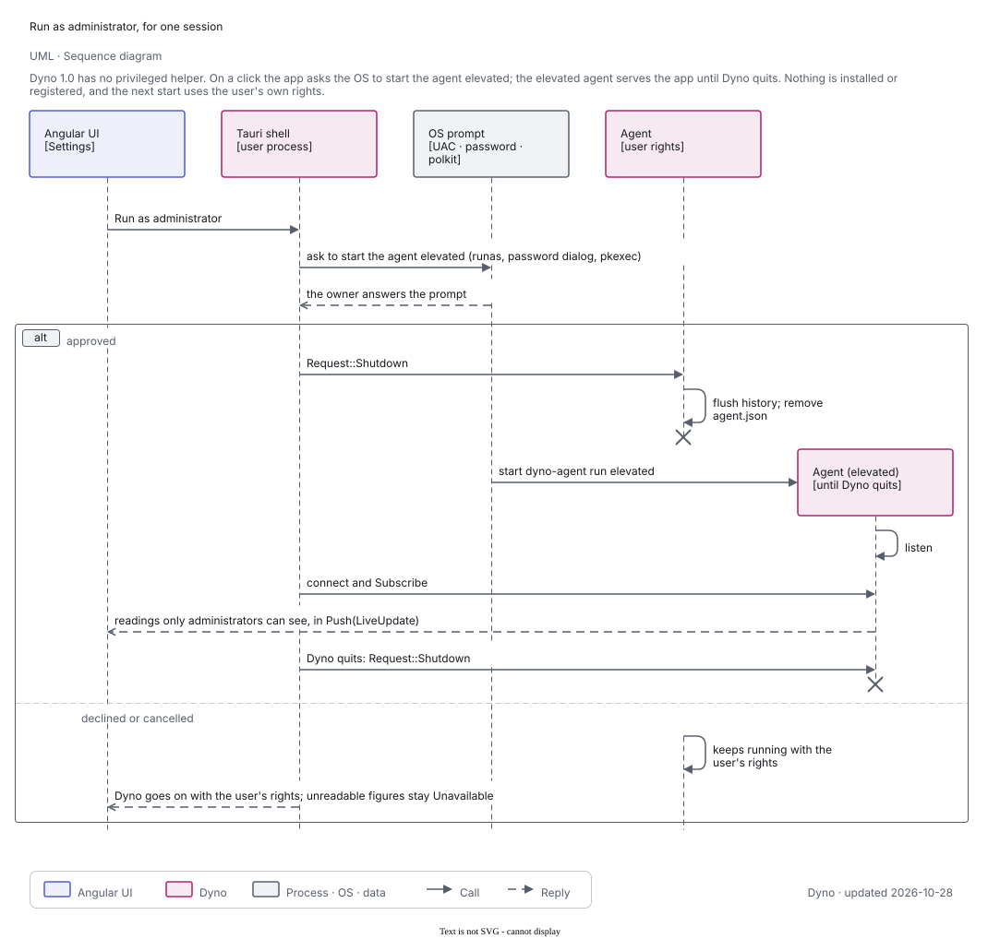

# Dyno design

The design diagrams, one page. The sources are generated from [`docs/diagrams/src`](diagrams/src) into draw.io files in
[`../diagrams/`](../diagrams) and exported to SVG there; they follow [`diagrams/STYLE.md`](../diagrams/STYLE.md). Dashed boxes and ellipses are
planned (not built). The text companion is [architecture.md](architecture.md).

## Overview

Dyno is a per-user **agent** that measures the machine and keeps its history, an **app** (Tauri shell plus Angular UI)
that shows it, a pure Rust **core** that holds every decision, and OS **adapters** behind the core's ports. Dyno 1.0 has no privileged helper: everything runs with the user's own rights. Dyno only watches: it changes nothing on the machine
([ADR 0021](adr/0021-monitoring-only.md)).

The README's hero, social card and feature panels are drawn illustrations for now: the screenshots still show features
ADR 0021 removed. They are retaken after Dyno moves onto the shared shell ([releasing.md](releasing.md#before-tagging)).

## C4 model

### Level 1 — system context

The PC owner uses Dyno; Dyno reads the operating system through ports and checks Dyno's own release host for opt-in
updates. Debrief (open a time window) and Pitwall (explain on click) are planned integrations and never get data unless the user
clicks; Dyno also checks that backup tools ran (built, read-only).

### Level 2 — containers

The app (Angular UI in a Tauri shell) and the agent run as the user; every arrow between Dyno processes is the one
`dyno-ipc` crate. The agent is the single writer of the data folder. Plugins run out of process. There is no helper in 1.0.

### Level 3 — core components

Pure modules over values; time is a parameter. `dyno-platform` implements the ports.

### Level 3 — agent components

A sampling thread feeding history, alarms and the flight recorder, an ipc server with a thread per connection, request
handlers and the SQLite store with its rollups.

### Level 3 — agent support modules

The CLI, the service registration, the shared state, the plugin host and the benchmark runner that starts `dyno-bench`.

## Deployment

Per OS: the app bundle, the OS's way of starting the agent at login (launchd through `SMAppService`, a systemd user
unit, a per-user `Run` entry on Windows), the agent process and the data folder. Nothing runs as a system service.

## Use cases

What the owner runs or sets up. Benchmarks start only on a click; Explain this in Pitwall is planned for after 1.0 (dashed). Dyno
only watches (ADR 0021): none of these changes the machine. The disk map is in scope for 1.0.

## Domain model

The core's main types. `Reading<T>` makes a missing sensor explicit; `ProcessRef` (pid plus start time) names a process
so a reused pid is never mistaken for it. The findings are what Dyno tells the owner.

## Flows

### Live update push

The app subscribes once; the sampler measures at adaptive intervals; the agent pushes each `LiveUpdate` to every
subscriber at its detail level, dropping frames for a slow subscriber.

### Run as administrator

Dyno 1.0 has no helper. On a click the app asks the OS (UAC, the password dialog or `pkexec`) to start the agent elevated; the
old agent exits, the elevated one serves the app until Dyno quits, and nothing is installed or registered.

### Agent restart after an update

A newer app asks the older agent to exit; the service manager starts the new one. On Windows no manager restarts the agent; the app does.

### History rollup

Raw points every 5 s; closed buckets roll up to minute, 15-minute and hour rows with min, average and max; a range
query uses the finest tier that covers it.

## States

### Window lifecycle

Closing the window destroys it; the tray and the agent stay; opening builds a fresh window; with no tray, closing quits.

### Service registration

Not installed, or installed with two flags: running and pointing at this executable. `ensure` repairs a stale
registration and never installs one unasked.
