# Dyno design

The design diagrams, one page. The sources are generated from [`docs/diagrams/src`](diagrams/src) into draw.io files in
[`../diagrams/`](../diagrams) and exported to SVG there; they follow [`diagrams/STYLE.md`](../diagrams/STYLE.md). Dashed boxes and ellipses are
planned (not built). The text companion is [architecture.md](architecture.md).

## Overview

Dyno is a per-user **agent** that measures the machine and keeps its history, an **app** (Tauri shell plus Angular UI)
that shows it, a pure Rust **core** that holds every decision, and OS **adapters** behind the core's ports. Everything runs with the user's own rights; an optional administrator helper reads what needs administrator rights, sets Dyno's own scheduled wakes (macOS, Linux) and installs the pinned disk-health tool on request (Windows), with an audit log ([ADR 0027](adr/0027-helper-for-1-1-0.md)). Power actions run as the owner sets them up ([ADR 0032](adr/0032-power-keep-awake-wake-on-lan-idle-actions-energy.md)).

The README's hero, social card and feature panels are drawn illustrations for now: the screenshots still show features
ADR 0021 removed. They are retaken after Dyno moves onto the shared shell ([releasing.md](releasing.md#before-tagging)).

## C4 model

### Level 1 — system context

The PC owner uses Dyno; Dyno reads the operating system through ports and checks Dyno's own release host for opt-in
updates. Debrief (open a time window) and Pitwall (explain on click) are planned integrations and never get data unless the user clicks; any local MCP client can read Dyno once AI access is on, and Dyno wakes saved computers on the LAN when asked.

### Level 2 — containers

The app (Angular UI in a Tauri shell) and the agent run as the user; Dyno's processes talk over `paddock-ipc`, and the agent asks the optional administrator helper, a system service. The Tauri app also serves MCP to local AI clients while it is open. The agent is the single writer of the data folder. Plugins run out of process.

### Level 3 — core components

Pure modules over values; time is a parameter. `dyno-platform` implements the ports.

### Level 3 — agent components

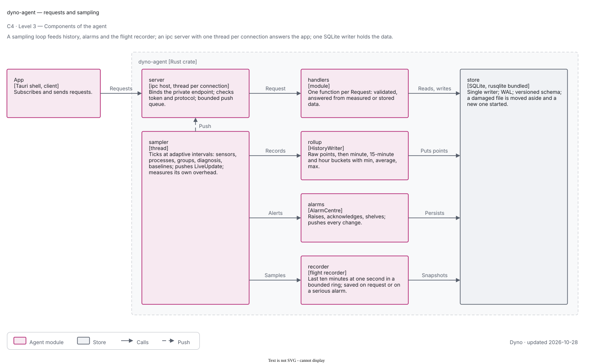

A sampling thread feeding history, alarms and the flight recorder, an ipc server with a thread per connection, request
handlers and the SQLite store with its rollups.

### Level 3 — agent support modules

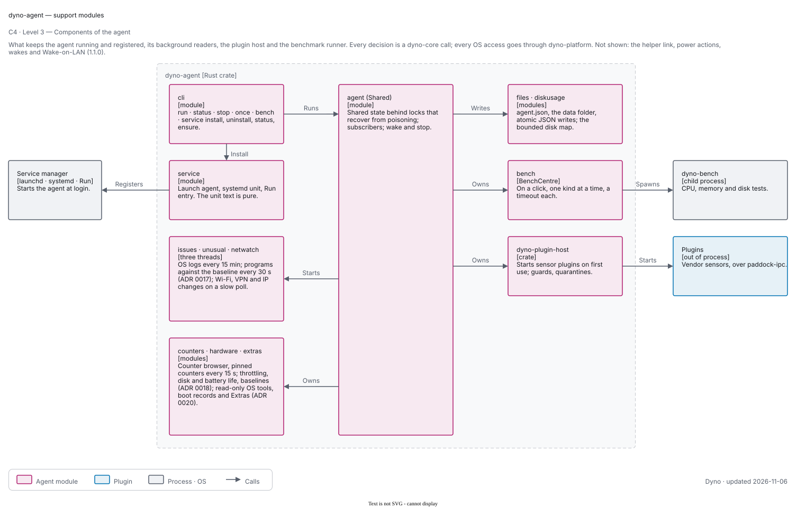

The CLI, the service registration, the shared state, the plugin host and the benchmark runner that starts `dyno-bench`.

## Deployment

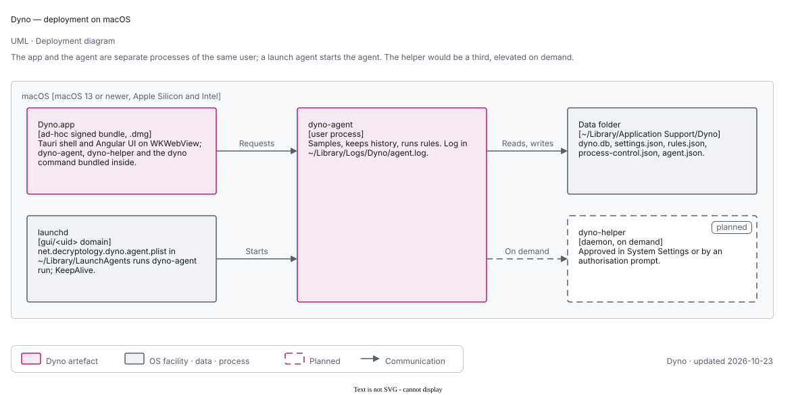

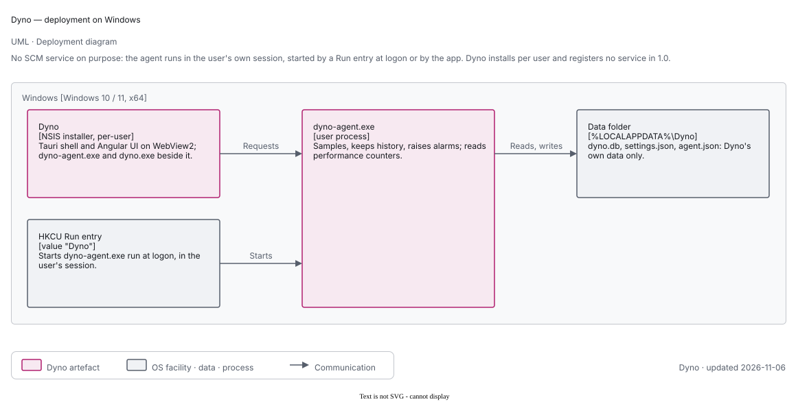

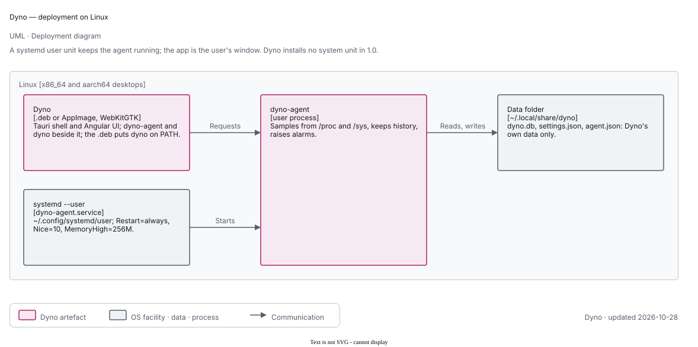

Per OS: the app bundle, the OS's way of starting the agent at login (launchd through `SMAppService`, a systemd user
unit, a per-user `Run` entry on Windows), the agent process and the data folder. Nothing runs as a system service.

## Use cases

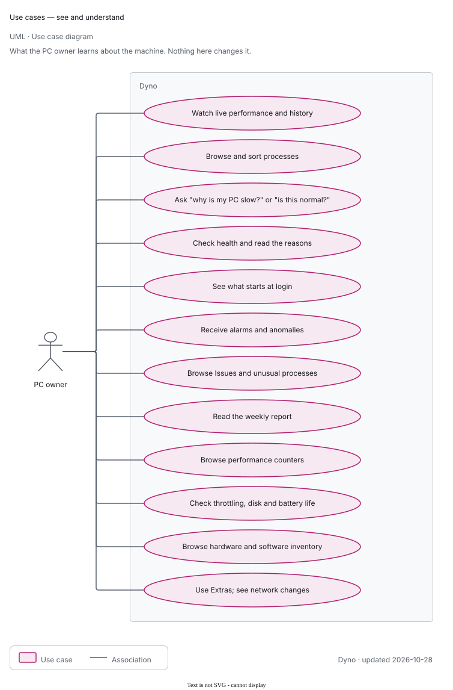

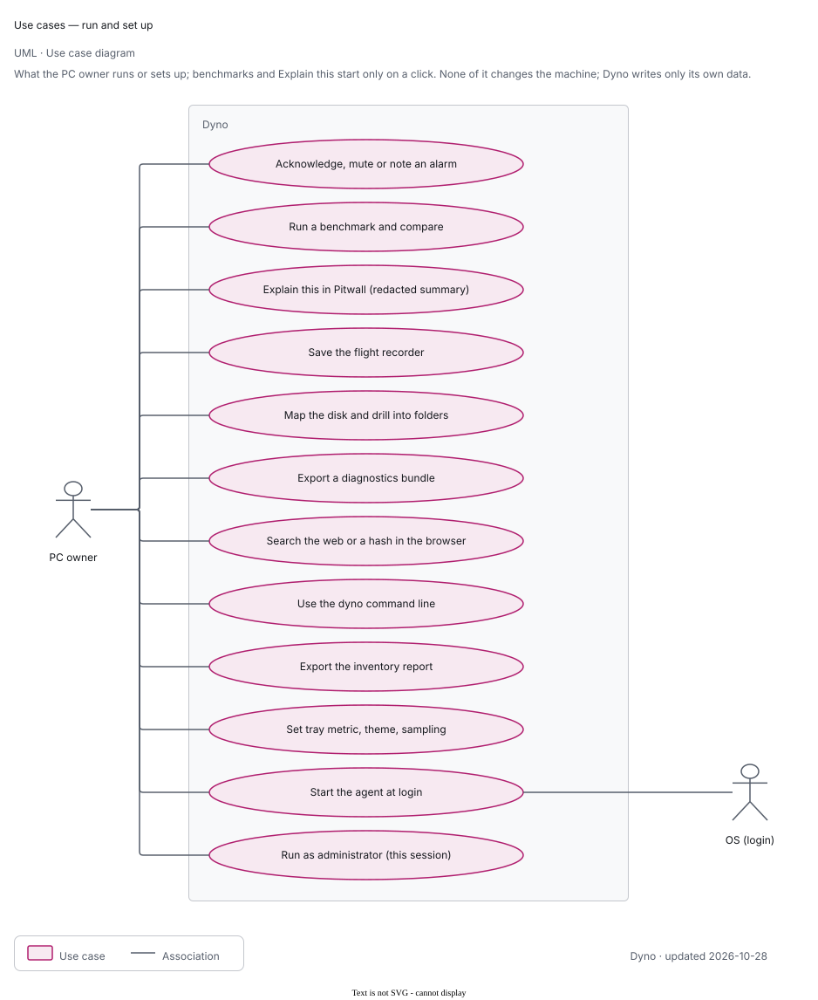

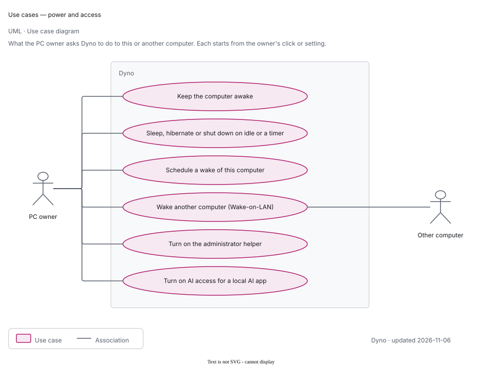

What the owner runs or sets up. Benchmarks start only on a click; Explain this in Pitwall is still planned (dashed). Keep awake, Wake-on-LAN, scheduled wakes and sleep, hibernate (Windows and Linux) or shut-down run as the owner set them up (ADR 0032); they and AI access are in the power and access diagram. The disk map is in scope for 1.0.

## Domain model

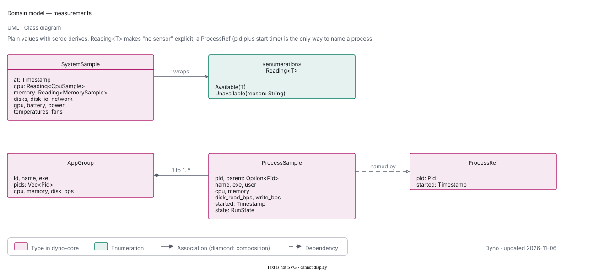

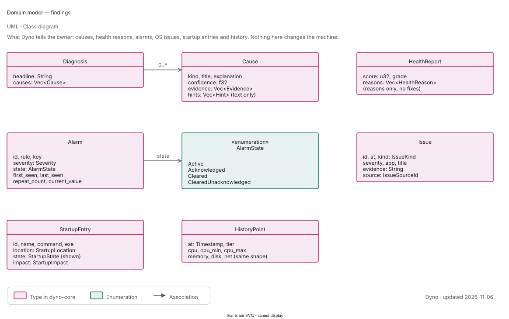

The core's main types. `Reading<T>` makes a missing sensor explicit; `ProcessRef` (pid plus start time) names a process
so a reused pid is never mistaken for it. The findings are what Dyno tells the owner.

## Flows

### Live update push

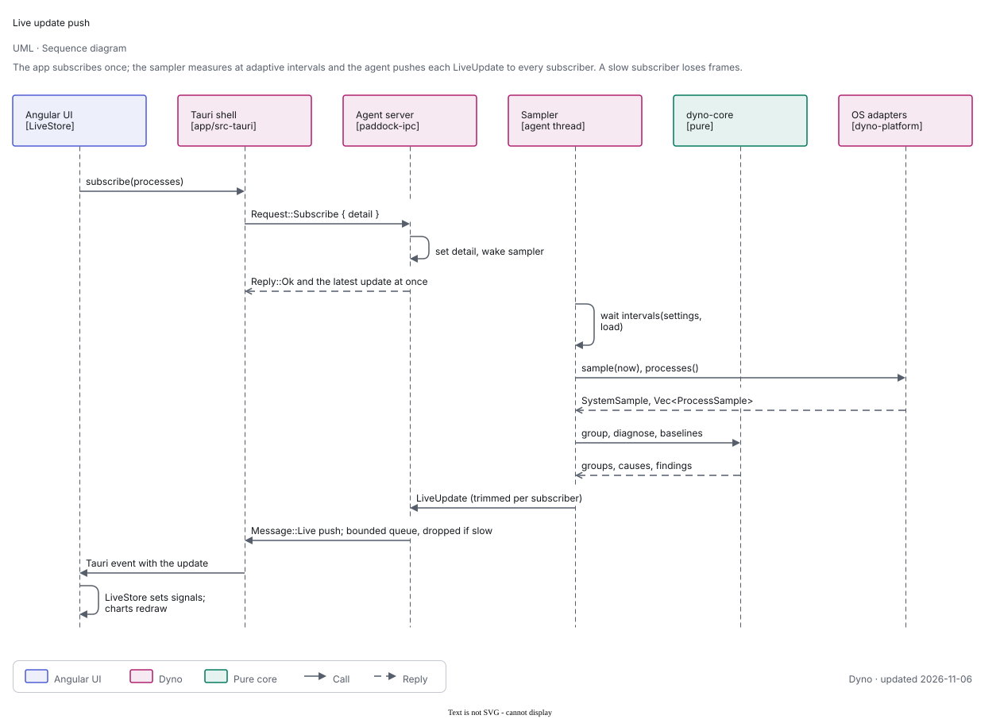

The app subscribes once; the sampler measures at adaptive intervals; the agent pushes each `LiveUpdate` to every
subscriber at its detail level, dropping frames for a slow subscriber.

### Agent restart after an update

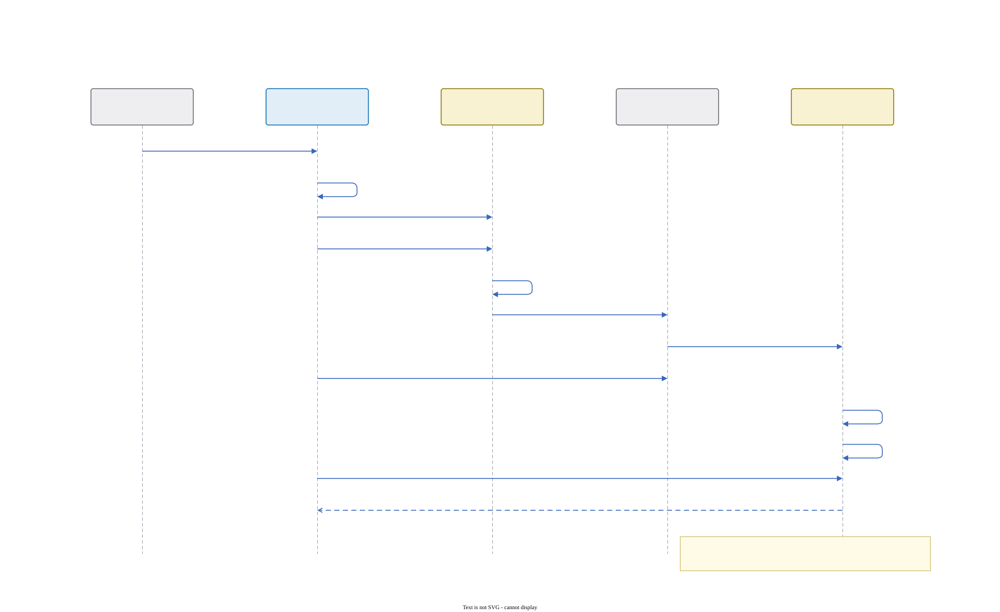

A newer app asks the older agent to exit; the service manager starts the new one. On Windows no manager restarts the agent; the app does.

### History rollup

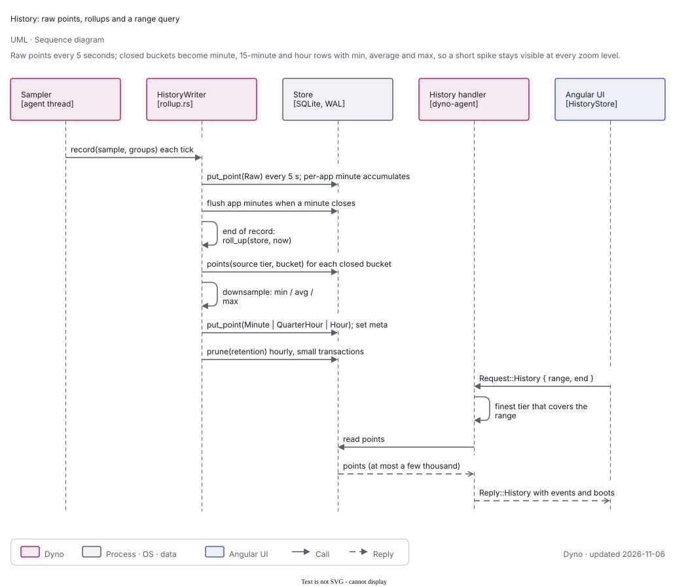

Raw points every 5 s; closed buckets roll up to minute, 15-minute and hour rows with min, average and max; a range
query uses the finest tier that covers it.

## States

### Window lifecycle

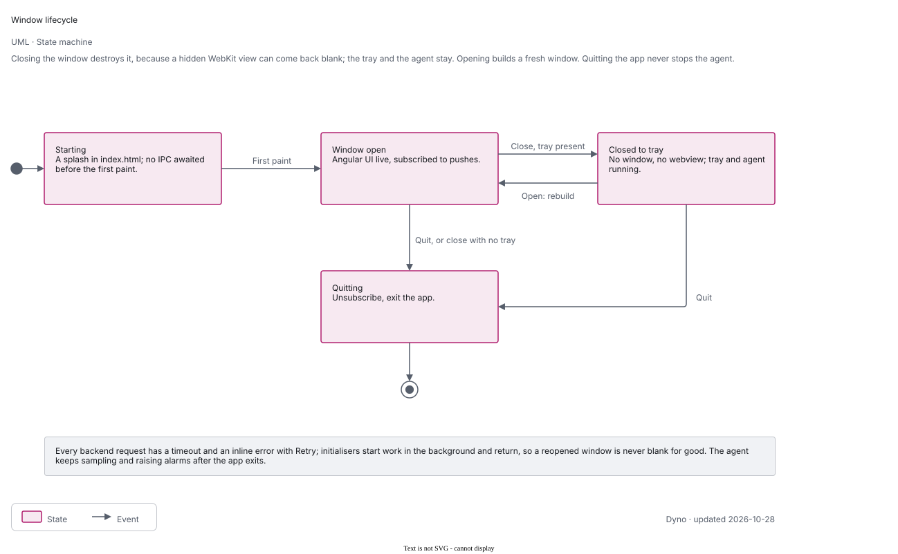

Closing the window destroys it; the tray and the agent stay; opening builds a fresh window; with no tray, closing quits.

### Service registration

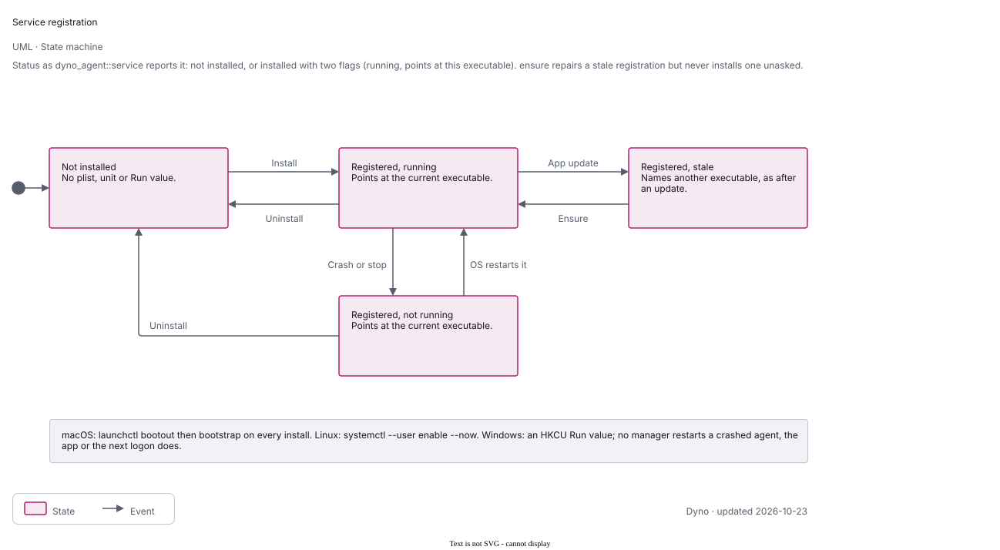

The record `service-<label>.json` holds one state (ADR 0056): Idle, Attempting (version, attempts, and a phase: Removing
old, Registering, Awaiting answer, Register failed) or Removing (uninstall). The phase is written before each OS step, so
a crash leaves what is safe next: after a crash in Removing old, still there means replace, gone means just register; in
Registering, absent means just register, there means wait.

- Idle goes to Removing old on a new version (macOS; elsewhere only when the definition differs) or on Repair, and to
  Registering on a first install or the switch turned on (nothing is removed).
- Registering goes to Awaiting answer when the OS accepted it, and to Register failed on `Other` or `NotAsWritten`; Register
  failed retries while attempts are under 3. Declined, cancelled, needs approval or elevation and unavailable return to the
  state before.
- Awaiting answer goes back to Removing old with no answer while attempts are under 3, and to Held at 3, as does
  Register failed. A hold has these ways out: "Answers" (back to Idle), a new version, Repair or Install; the last two run
  past 3 attempts, and a failed Repair returns to Held. The job of an old build never settles during Removing old.
- Uninstall or the switch turned off, from any state, writes Removing and then returns to Idle.

Every entry point (start, install, repair, resume, uninstall) goes through one transition function; a start never installs
one unasked. Windows Dyno has no agent service.
