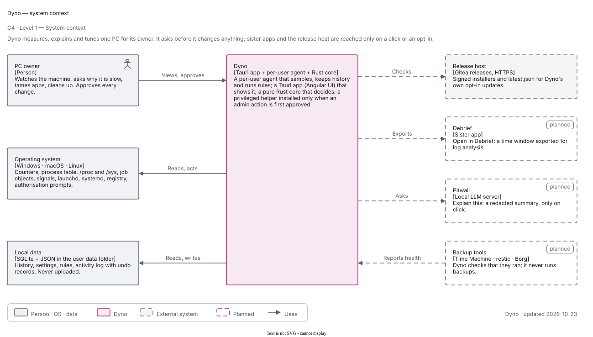
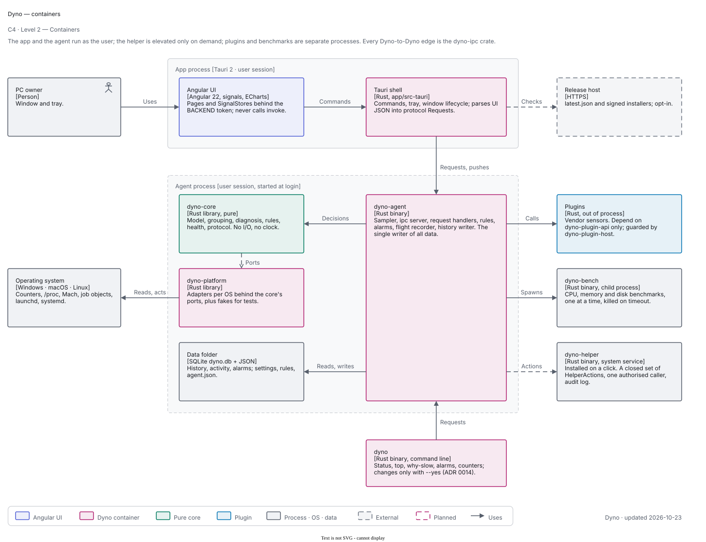
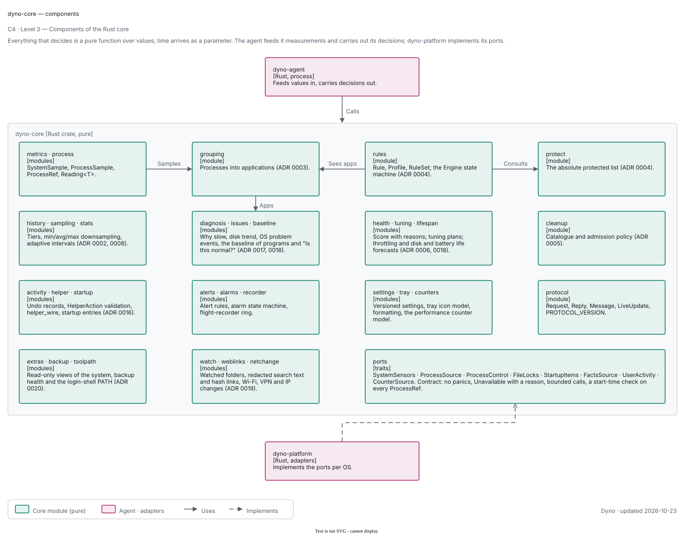
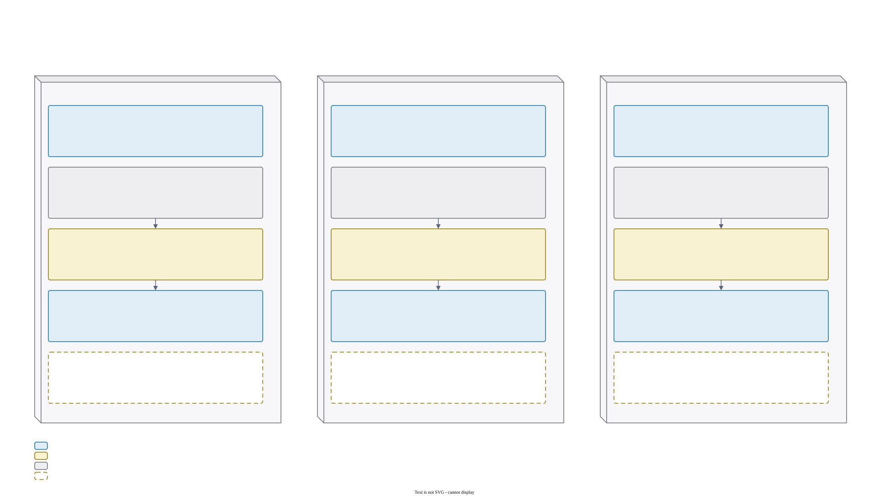
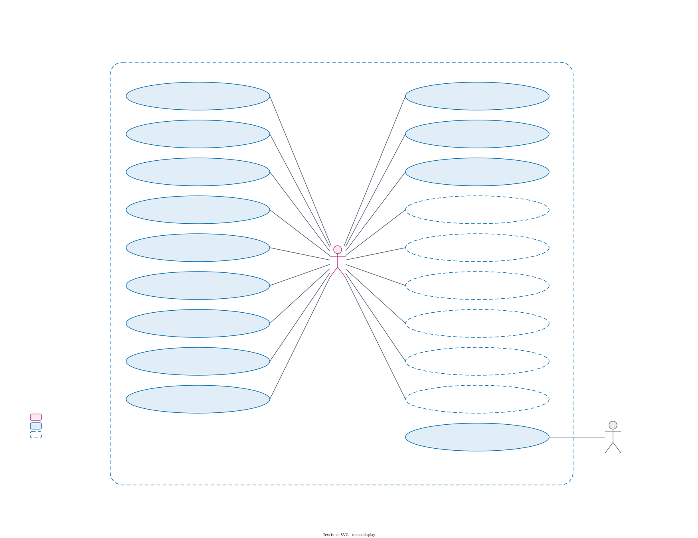
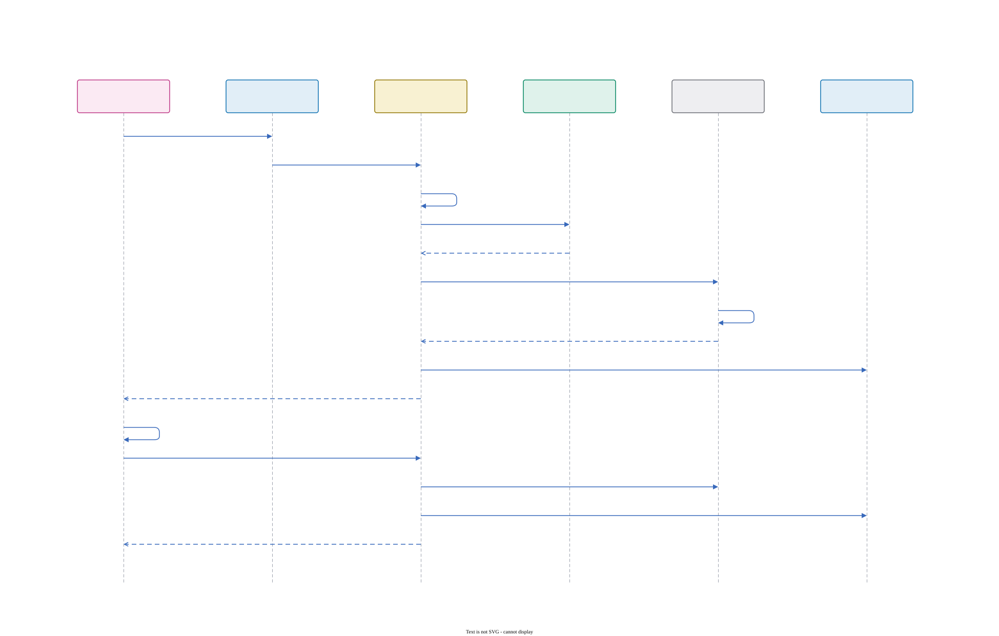
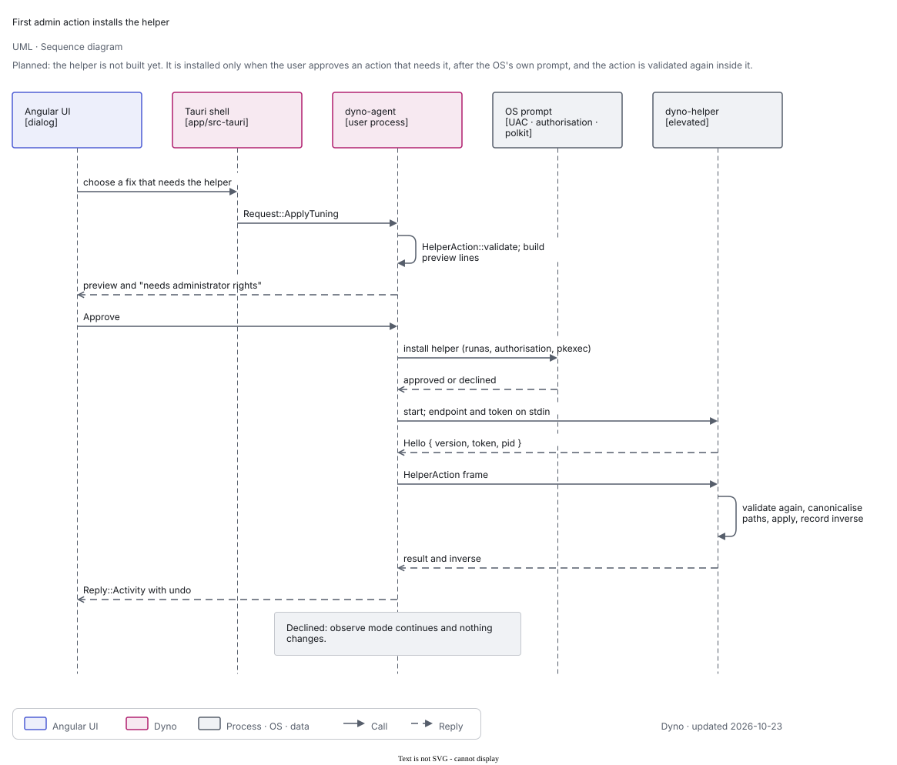
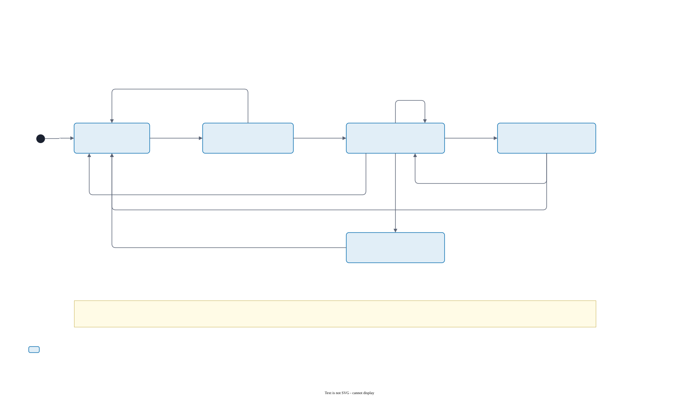

# Dyno design

The design diagrams, one page. The sources are draw.io files in [`../diagrams/`](../diagrams); the SVGs here are exported
by `scripts/export-diagrams.sh` and follow [`diagrams/STYLE.md`](../diagrams/STYLE.md). Dashed boxes and ellipses are
planned (not built). The text companion is [architecture.md](architecture.md).

## Overview

Dyno is a per-user **agent** that measures the machine and keeps its history, an **app** (Tauri shell plus Angular UI)
that shows it, a pure Rust **core** that holds every decision, OS **adapters** behind the core's ports, and (planned) a
privileged **helper** installed on the first admin action. The user changes nothing by accident: rules ship disabled,
and every action is logged with an undo (ADR 0006).

## C4 model

### Level 1 — system context

The PC owner uses Dyno; Dyno reads the operating system through ports and checks Dyno's own release host for opt-in
updates. Debrief (open a time window), Pitwall (explain on click) and backup tools (health checks) are planned
integrations and never get data unless the user clicks.

### Level 2 — containers

The app (Angular UI in a Tauri shell) and the agent run as the user; every arrow between Dyno processes is the one
`dyno-ipc` crate. The agent is the single writer of the data folder. Plugins run out of process; the helper is planned.

### Level 3 — core components

Pure modules over values; time is a parameter. `dyno-platform` implements the ports.

### Level 3 — agent components

A sampling thread, an ipc server with a thread per connection, request handlers, the SQLite store with its rollups, the
service registration and the CLI.

## Deployment

Per OS: the app bundle, the OS's way of starting the agent at login (launchd through `SMAppService`, a systemd user
unit, a per-user `Run` entry on Windows), the agent process, the data folder, and the planned helper started on demand.

## Use cases

Everything that changes the machine needs an enabled rule or an explicit click. Dashed use cases are planned.

## Domain model

The core's main types. `Reading<T>` makes a missing sensor explicit; `ProcessRef` (pid plus start time) is the only way to
name a process in an action; `ActivityEntry` carries an `UndoRecord`.

## Flows

### Live update push

The app subscribes once; the sampler measures at adaptive intervals; the agent pushes each `LiveUpdate` to every
subscriber at its detail level, dropping frames for a slow subscriber.

### Act on a process, then undo

Validate, check the protected list, apply to a `ProcessRef`, record the inverse; `Undo` applies it.

### First admin action installs the helper (planned)

Preview, approve, the OS's own prompt, install, a second validation inside the helper, the inverse recorded.

### Agent restart after an update

A newer app asks the older agent to exit; the service manager starts the new one; `release_all` first undoes what rules
applied. On Windows no manager restarts the agent; the app does.

### History rollup

Raw points every 5 s; closed buckets roll up to minute, 15-minute and hour rows with min, average and max; a range
query uses the finest tier that covers it.

## States

### Window lifecycle

Closing the window destroys it; the tray and the agent stay; opening builds a fresh window; with no tray, closing quits.

### Service registration

Not installed, or installed with two flags: running and pointing at this executable. `ensure` repairs a stale
registration and never installs one unasked.

### Rule engine per (rule, app)

Watching, Acting at step n, Releasing, Snoozed; steps add up and are undone in reverse order.
