# Features

What Dyno does, and honestly how far each feature is. Dyno 1.0.0 only watches: it never changes your machine, and the
features that did are dropped ([ADR 0021](adr/0021-monitoring-only.md), listed in the [roadmap](roadmap.md#dropped)).
**Built** means the code exists and is tested; **Engine only** means the agent and core implement it and the protocol
exposes it but the UI screen is still a placeholder; **Planned** means it is not in the code (see [roadmap.md](roadmap.md)
for the work package). Screenshots are in `docs/screenshots`; each is shown here as a light and dark pair that follows your colour scheme.

## Contents

- [Live monitoring](#live-monitoring)
- [History](#history)
- [Processes](#processes)
- [Why is it slow?](#why-is-it-slow)
- [Extras](#extras)
- [Backup health](#backup-health)
- [Health and startup](#health-and-startup)
- [Throttling, hardware life and what is normal](#throttling-hardware-life-and-what-is-normal)
- [Disk map](#disk-map)
- [Alerts and reports](#alerts-and-reports)
- [Tray, window and settings](#tray-window-and-settings)
- [Read-only by design](#read-only-by-design)
- [Extensibility](#extensibility)
- [Later](#later)
- [Platforms](#platforms)

## Live monitoring

<picture>
  <source media="(prefers-color-scheme: dark)" srcset="screenshots/dashboard-dark.png">
  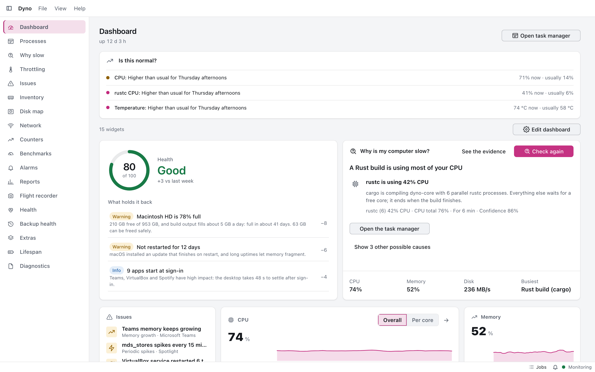
</picture>

<picture>
  <source media="(prefers-color-scheme: dark)" srcset="screenshots/cpu-detail-dark.png">
  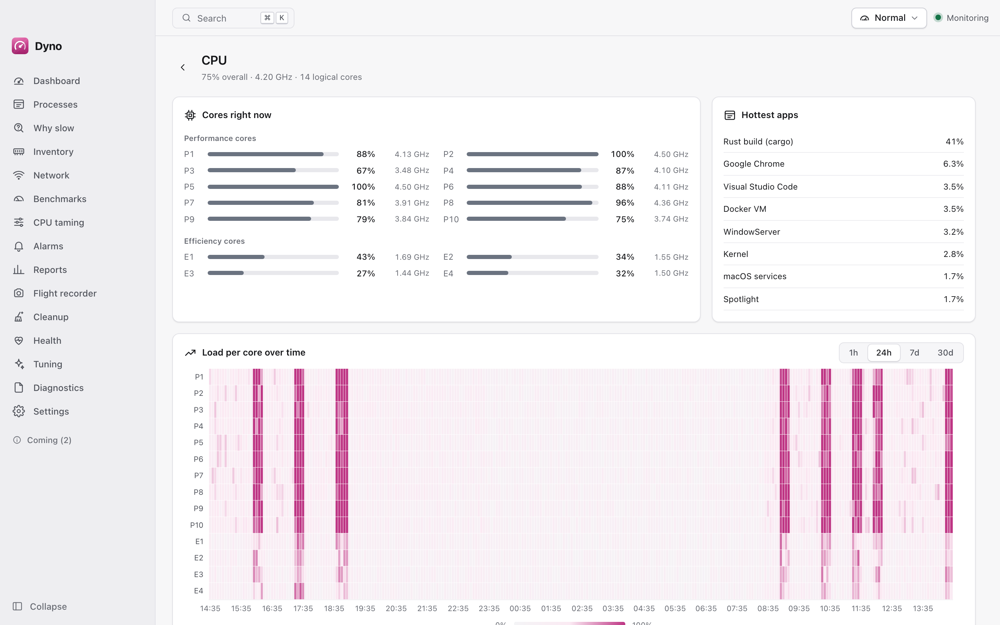
</picture>

<picture>
  <source media="(prefers-color-scheme: dark)" srcset="screenshots/widgets-edit-dark.png">
  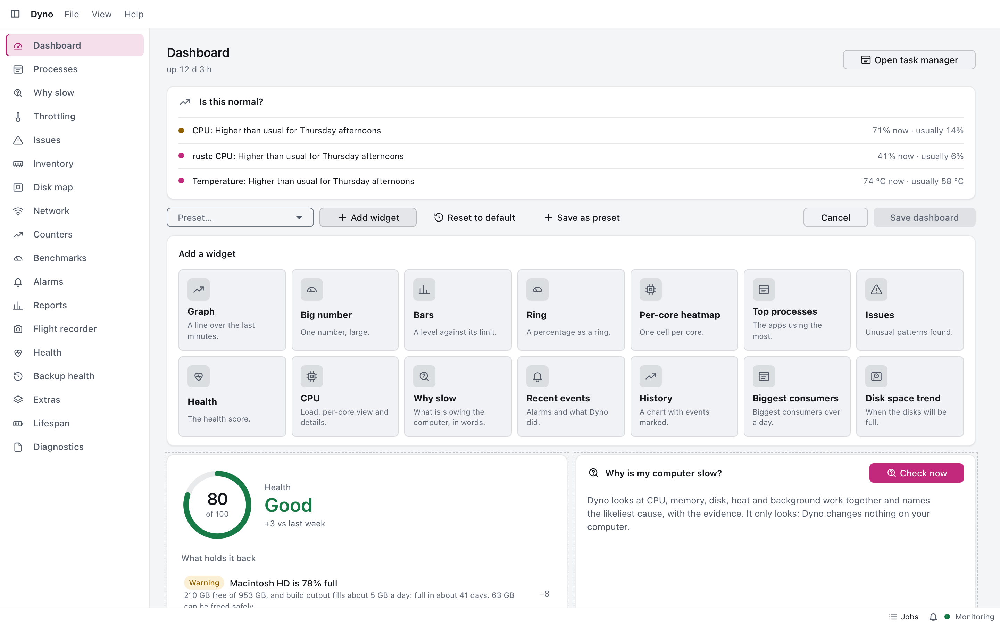
</picture>

<picture>
  <source media="(prefers-color-scheme: dark)" srcset="screenshots/recorder-dark.png">
  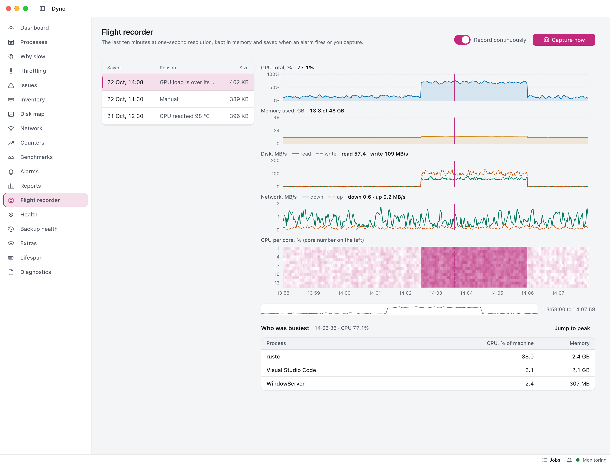
</picture>

**Built.** The agent samples CPU (total, per core), memory (used, commit, pressure), disks (free space, throughput),
network, and GPU, battery, temperatures and fans where the OS tells; every sensor that is missing shows *why* (a `Reading`
with a reason), never a zero. Intervals adapt: 1 s and 2 s by default while someone watches, 2 s and 10 s when nobody does,
doubled on battery, stretched when Dyno itself is over its CPU budget. The dashboard shows tiles with sparklines, the top
apps by CPU and memory, and "Dyno: x % CPU, y MB" (its own overhead, measured; [architecture](architecture.md#dynos-own-overhead)).

## History

**Built.** The agent keeps raw points for a day, then 1-minute, 15-minute and hourly rollups with min, average and max (so a
short spike stays visible at every zoom level), per-app minutes for "top consumers", disk space for the forecast, timeline
events and boot records, in SQLite ([ADR 0008](adr/0008-storage-sqlite-and-retention.md)). History keeps running with the
window closed. Retention is configurable. A damaged database is moved aside and recreated. The **crashes** series comes from the Issues log below.

## Issues

<picture>
  <source media="(prefers-color-scheme: dark)" srcset="screenshots/issues-dark.png">
  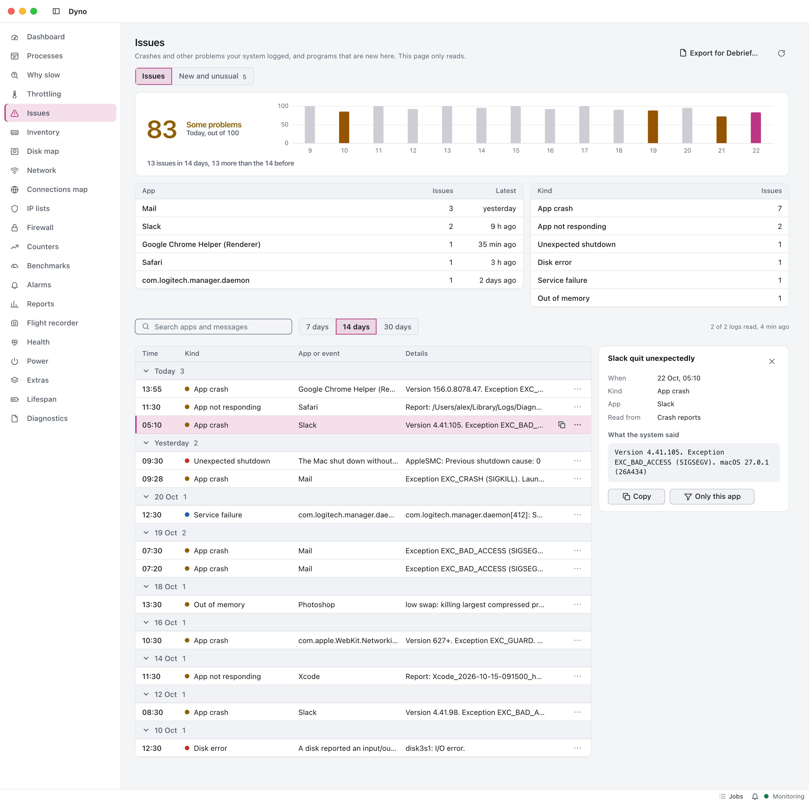
</picture>

**Built.** The agent reads what the OS itself recorded, read-only and with timeouts: macOS crash reports in
`~/Library/Logs/DiagnosticReports` and the unified log (`log show`), the Windows Event Log (Application, System, Windows
Update), the Linux journal and `coredumpctl`. Crashes, hangs, unexpected shutdowns, disk and memory errors, overheating, failing
services, running out of memory, update and driver failures are normalised, stored in SQLite and shown with a daily
**stability score** (0 to 100, a pure function of how often each kind happened), the apps and kinds with the most trouble, the
trend against the period before and each event's own text (plain text, never HTML). A log that cannot be read is listed as
"could not be read: reason", never an error, and no score is claimed when none can be read. **Export for Debrief** saves the
period as JSON lines. Serious issues raise alarms; a crash loop raises the crash-loop alert; the health reason "crashing apps"
and the weekly report count crashes. See [ADR 0017](adr/0017-issues-and-the-program-baseline.md).

## New and unusual programs

<picture>
  <source media="(prefers-color-scheme: dark)" srcset="screenshots/unusual-dark.png">
  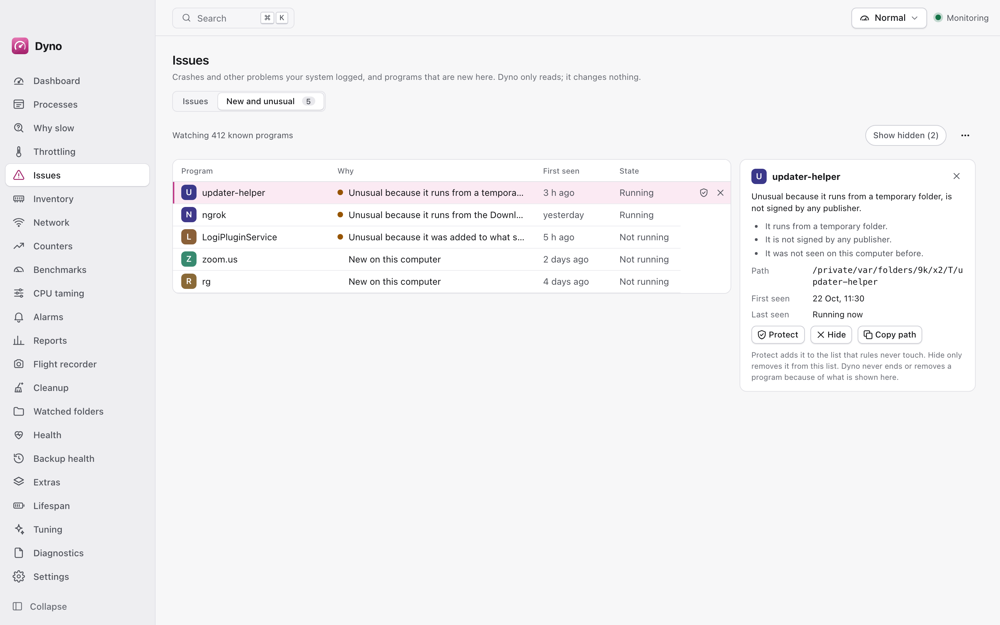
</picture>

**Built.** A transparency tool, not an antivirus. Dyno keeps a baseline of the programs seen on this PC, learning silently for a
configurable period (7 days by default) so a fresh install does not flag everything. After that it lists programs it has not
seen, and says **why** one may be worth a look ("unusual because it runs from a temporary folder, is not signed"): an unusual
place, a name one letter from a system program, an invalid or missing signature, many child programs or connections, a new
startup entry. Hide and Restore (Dyno's own list) are the only actions; nothing ends or removes a program.

## Processes

<picture>
  <source media="(prefers-color-scheme: dark)" srcset="screenshots/processes-dark.png">
  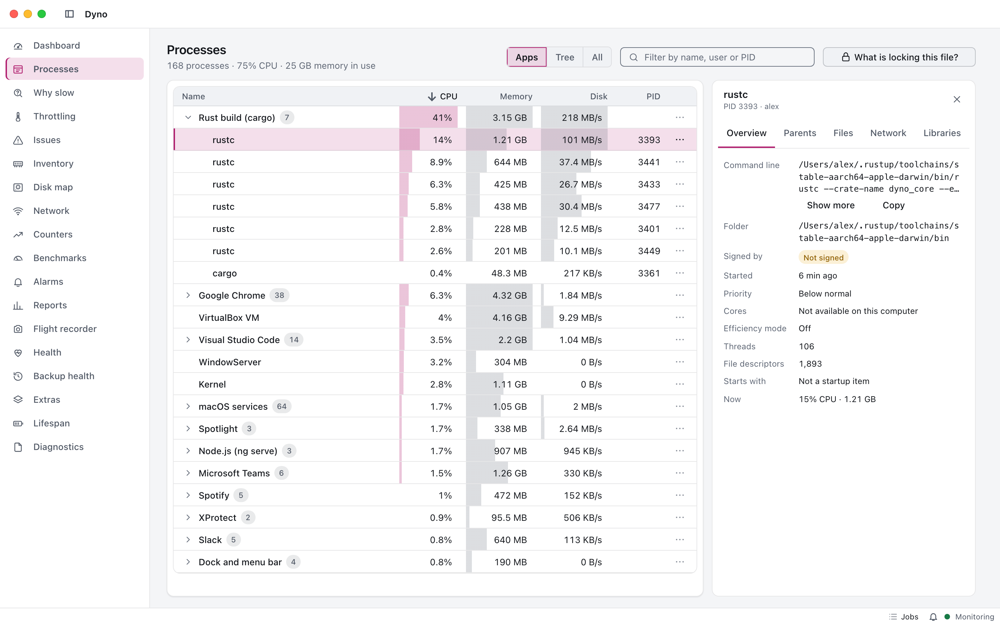
</picture>

<picture>
  <source media="(prefers-color-scheme: dark)" srcset="screenshots/network-connections-dark.png">
  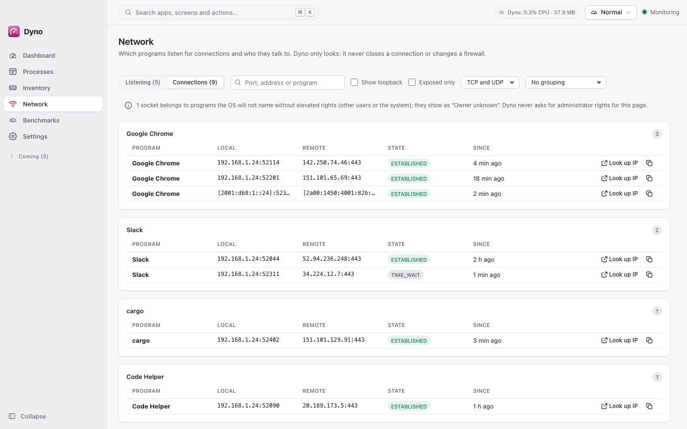
</picture>

**Built.** A tree grouped by application ([ADR 0003](adr/0003-process-grouping.md)); details per process (command line,
working directory, modules, connections, signer; on macOS and Linux today, Windows details are not wired yet); "what is locking
this file" (`lsof`, `/proc`; Windows not wired); open its folder. Your own and the system's processes are listed one by one; other accounts' processes are one **Other users** row, and details the OS withholds say *Unavailable* with the reason. Snapshots of the process list can be taken and compared. Protected processes no longer exist as a
concept: Dyno has no way to act on any process.

**Network traffic per program** (Network page, process details): macOS from `nettop`, Linux from the kernel's per-socket TCP byte
counters (no root; other users' programs are not attributed), Windows needs administrator rights for the OS's per-connection counters, so the page says so. Where it cannot be read the page shows the reason instead of zeros.

## Why is it slow?

<picture>
  <source media="(prefers-color-scheme: dark)" srcset="screenshots/why-slow-dark.png">
  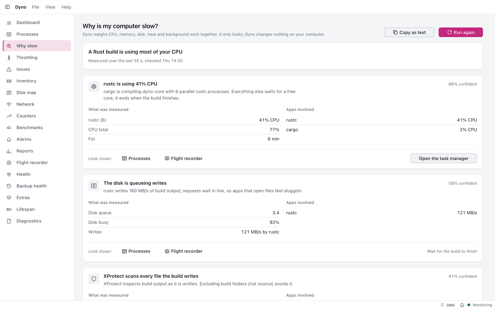
</picture>

**Built.** `WhySlow` returns a diagnosis: a headline and causes (kind, confidence, evidence, the busiest apps behind each cause,
how many seconds were measured, and suggestions in words); `Anomalies` lists unusual behaviour; disk-full
forecasts come from history. The dashboard card shows the answer on request ("Check now") and links to the **Why slow** page:
every cause with what was measured, the apps involved, links to Processes / Network / Flight recorder / Health, **Run again**,
**Copy as text**, and the earlier results of this session. Suggestions only point to a screen; nothing here changes a process. The history of results is kept in the app for the session (the engine
does not store diagnoses).

## Extras

<picture>
  <source media="(prefers-color-scheme: dark)" srcset="screenshots/extras-changes-dark.png">
  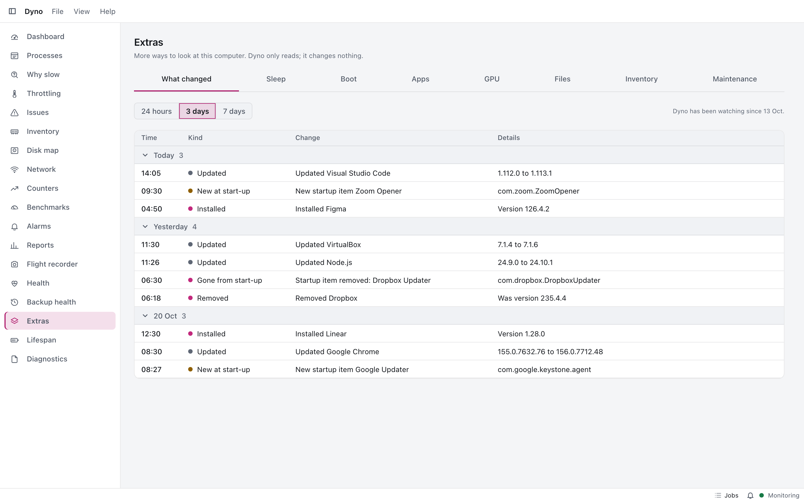
</picture>

<picture>
  <source media="(prefers-color-scheme: dark)" srcset="screenshots/extras-boot-dark.png">
  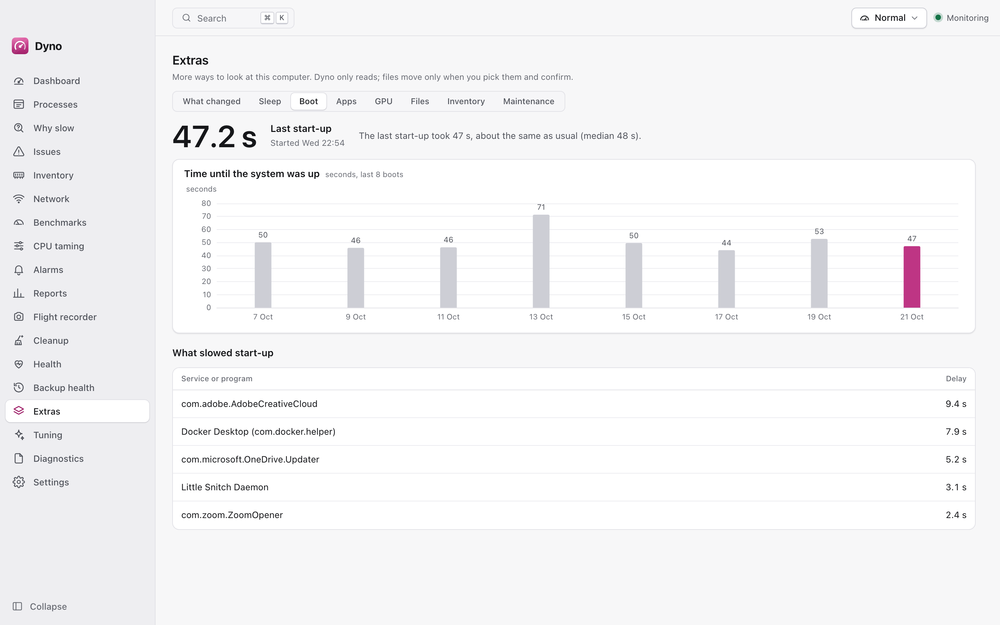
</picture>

<picture>
  <source media="(prefers-color-scheme: dark)" srcset="screenshots/extras-apps-dark.png">
  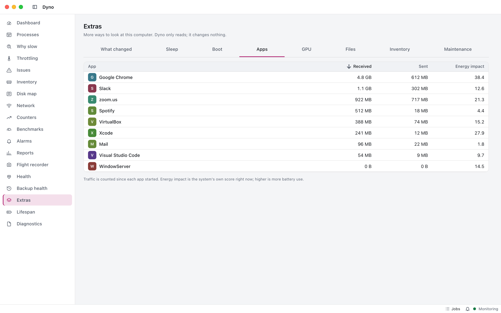
</picture>

<picture>
  <source media="(prefers-color-scheme: dark)" srcset="screenshots/extras-files-dark.png">
  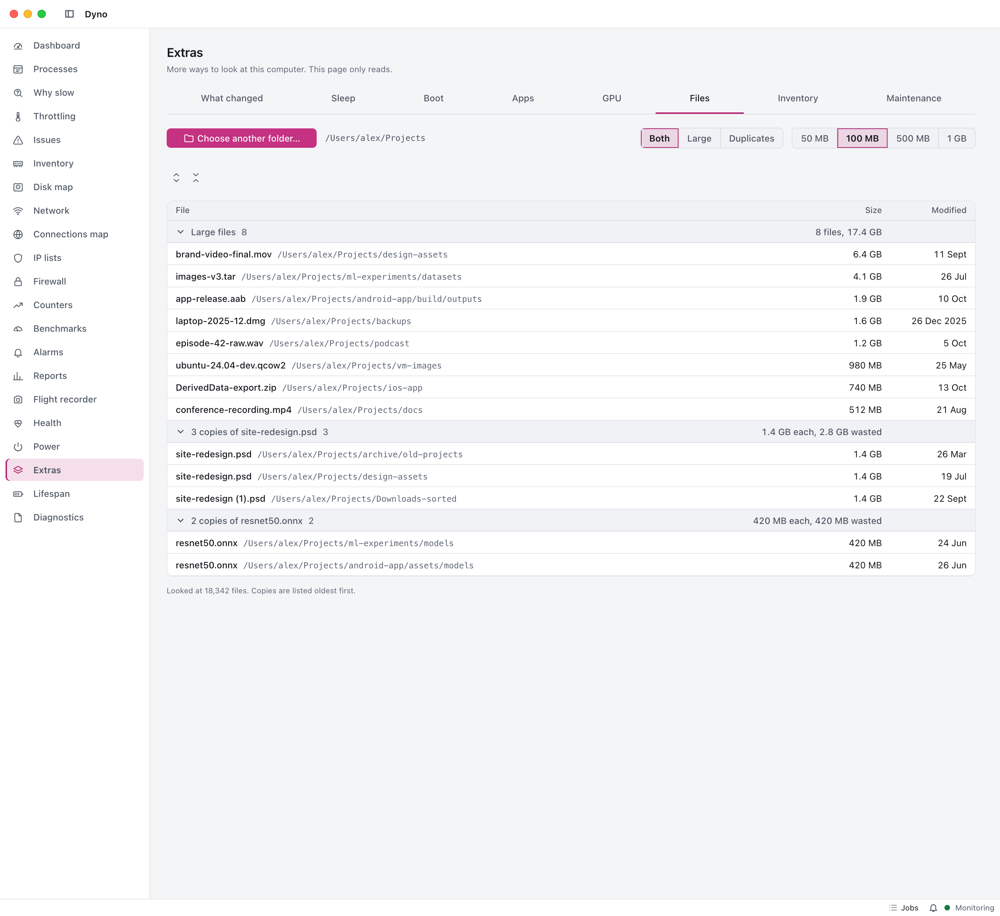
</picture>

<picture>
  <source media="(prefers-color-scheme: dark)" srcset="screenshots/inventory-dark.png">
  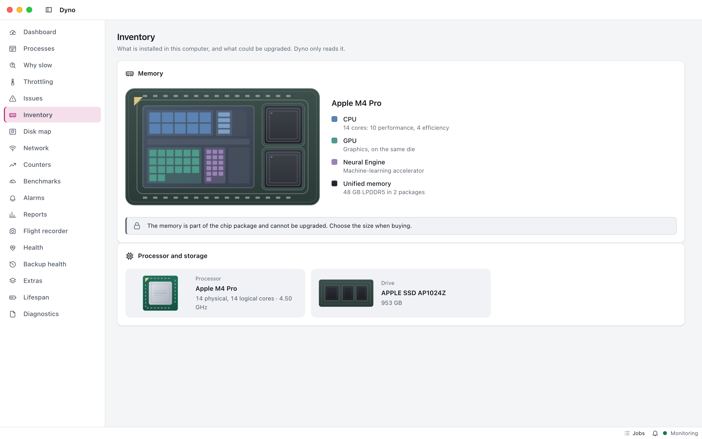
</picture>

**Built** (WP-13), all read-only, on the **Extras** page; every tool runs with a timeout and a missing or refused tool becomes a sentence
saying why, never an empty screen.

- **What changed**: installs, updates, removals, new startup items, setting changes in a window you pick. Dyno compares
  the software and startup lists every few hours and says since when it has been watching; the first look is a silent baseline.
- **Sleep**: what keeps the computer awake (`pmset -g assertions`, `powercfg /requests`, `systemd-inhibit --list`) and what woke it
  (`pmset -g log`, `powercfg /lastwake`). Windows lists blockers only to administrators and says so.
- **Boot**: how long each start-up took until the desktop settled (recorded by the agent from now on), a sentence comparing the last
  one with the usual, and on Linux and Windows what slowed it (`systemd-analyze blame`, Diagnostics-Performance events). macOS keeps
  no breakdown and says so.
- **Apps**: bytes received and sent per app (the OS's counters; macOS) and energy impact per app (macOS `top`); Windows and Linux say
  why there is no energy number.
- **GPU**: GPU use per process (macOS accelerator client time, Windows GPU Engine counters, NVIDIA `nvidia-smi pmon`); Linux with
  other graphics says it needs the vendor's tool.
- **Files**: large and duplicate files in a folder you choose. Duplicates are matched by SHA-256 after size and the first 64 KiB.
  View only: Dyno lists them and opens their location; it removes nothing.
- **Inventory**: the installed software next to the hardware; **Export report** saves Markdown or JSON where you choose.
- **Maintenance**: windows (days and times) when Dyno's heavier background work may run: reading the OS logs, backup checks and
  change recording. A click always runs.

## Backup health

<picture>
  <source media="(prefers-color-scheme: dark)" srcset="screenshots/backup-dark.png">
  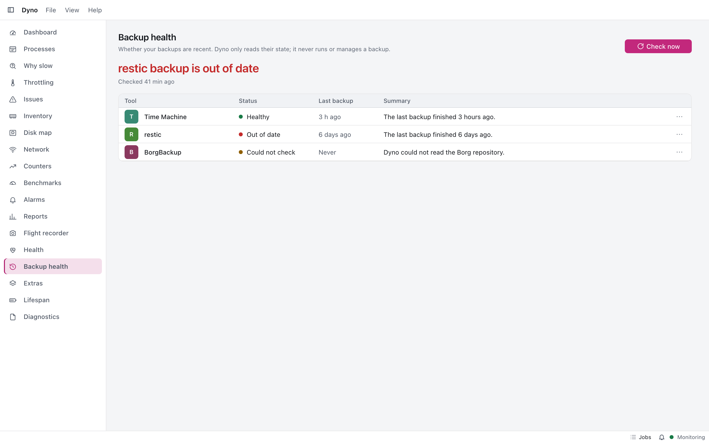
</picture>

**Built** (WP-14), on the **Backup health** page and in Settings. Dyno checks that backups ran, never runs or manages one: Time Machine
(`tmutil`), Windows Backup and File History (their event logs, `wbadmin`), restic and Borg (`snapshots` / `list`, with the repository
variables your login shell exports, never passwords); Duplicati is detected but cannot be read yet. Tools are found through your login
shell's `PATH` (so Homebrew installs work from a background service) and an optional folder per tool. A backup older than the limit
(48 hours by default) is one plain alarm per tool, cleared when a new backup appears. No tool found is a normal state.

## Health and startup

<picture>
  <source media="(prefers-color-scheme: dark)" srcset="screenshots/health-dark.png">
  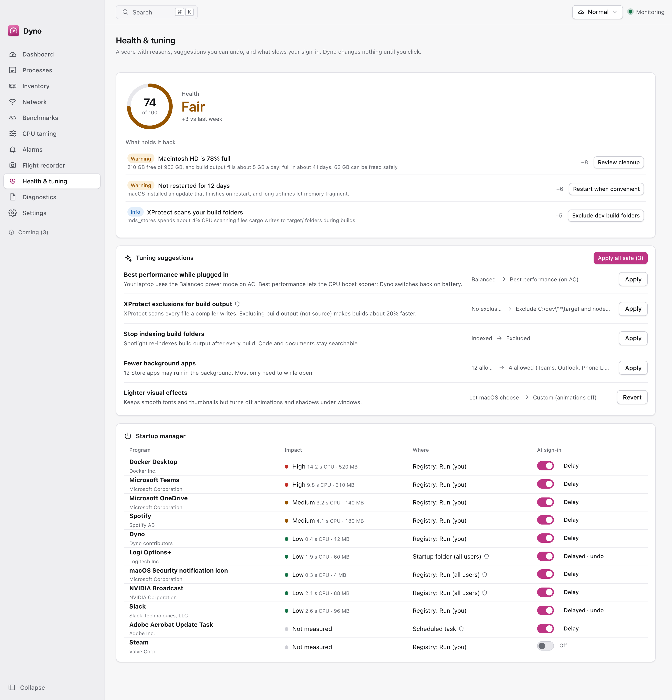
</picture>

**Built** (view only). `Health` returns a score and grade with reasons (no fix buttons). `StartupEntries` lists what starts at
login (Windows: not wired yet; macOS: launch agents and login items; Linux: autostart and user units), with a filter that hides
the operating system's entries and signed apps. Dyno does not enable or disable an entry.

## Throttling, hardware life and what is normal

<picture>
  <source media="(prefers-color-scheme: dark)" srcset="screenshots/throttling-dark.png">
  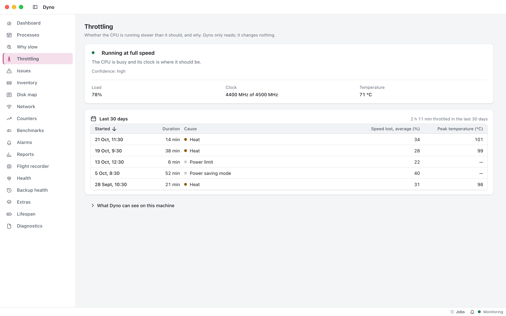
</picture>

<picture>
  <source media="(prefers-color-scheme: dark)" srcset="screenshots/forecasts-dark.png">
  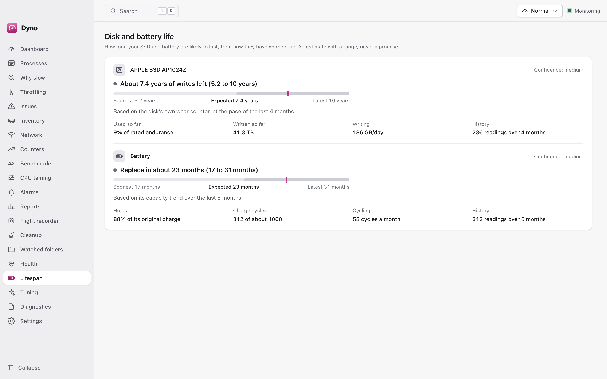
</picture>

<picture>
  <source media="(prefers-color-scheme: dark)" srcset="screenshots/benchmarks-dark.png">
  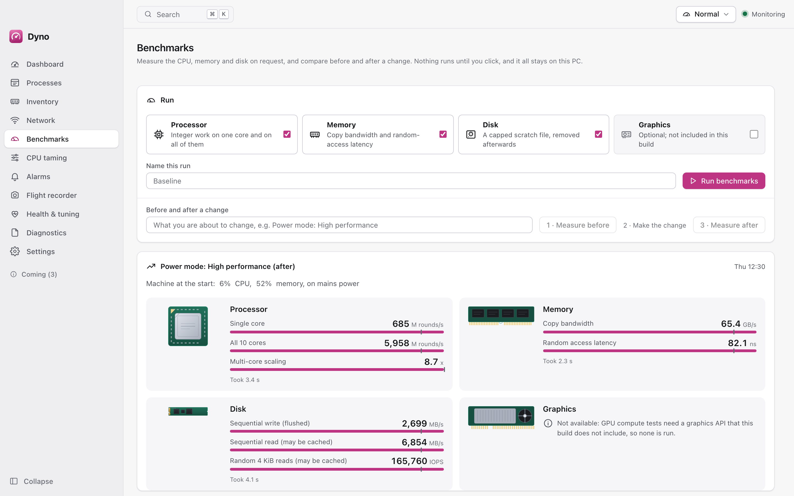
</picture>

**Built** ([WP-23](roadmap.md#wp-23-throttling-detector), [WP-24](roadmap.md#wp-24-disk-and-battery-life-forecasts),
[WP-25](roadmap.md#wp-25-is-this-normal-baselines), [ADR 0018](adr/0018-throttling-lifespan-and-baselines.md)). All three only
observe; nothing here changes a setting.

- **Throttling.** `Throttling` answers whether the CPU runs slower than it could while busy, and why: heat, a power limit, a
  battery-saving mode, or "unexplained" (with what could not be ruled out). It states how much speed is lost, how sure it is
  (low, medium, high) and the numbers behind it. A machine that does not report its clock or temperature gets "cannot tell" and a
  list of what it does and does not report. A lasting episode (busy and slow for 20 s) is stored with its cause, duration, share
  of speed lost and peak temperature; the **Throttling** page lists the last 30 days. The same detector names the cause in
  **Why slow**, and a lasting episode at medium confidence or better can raise an alarm.
- **Disk and battery life.** `Lifespan` forecasts "about 7 years of writes left (5 to 10 years)" for an SSD from its wear counter
  and bytes written, and "replace the battery in about 23 months (17 to 31 months)" from its capacity trend and charge cycles. Each
  forecast is a range with the readings it stands on and a confidence; with under two weeks (SSD) or four weeks (battery) of history
  it says so instead of guessing, and a part Dyno cannot read says why and what would help (installing smartmontools). A replaced disk or battery starts a new series. A part past its limit, or with under a year left at medium confidence,
  appears in Health, the weekly report and, if you allow it, as an alarm.
- **Is this normal?** Dyno learns, per metric (CPU, memory, disk writes, network, temperature, GPU) and per app (CPU, memory), what
  is usual for each weekday and hour, and says when the present is outside it in words ("higher than usual for Tuesday mornings",
  with the usual value and range). A new install learns silently for seven days (1 to 30 in Settings). The dashboard shows only what
  is unusual; alarms for values far above usual that last five minutes are off until you turn them on.
- **Where it reads from** (observe-only): macOS `pmset -g therm`, `ioreg` and, for SSD wear, `smartctl` when installed; Linux the
  kernel's thermal-throttle counters, cpufreq limits and `/sys/class/power_supply`, and `smartctl`; Windows `powercfg /batteryreport`
  and `smartctl`, with throttling inferred from the clock, the temperature and the power mode (Windows reports no reason). The
  Windows readers run only in CI and on Windows machines; macOS and Linux paths are tested here.

## Disk map

<picture>
  <source media="(prefers-color-scheme: dark)" srcset="screenshots/disk-map-dark.png">
  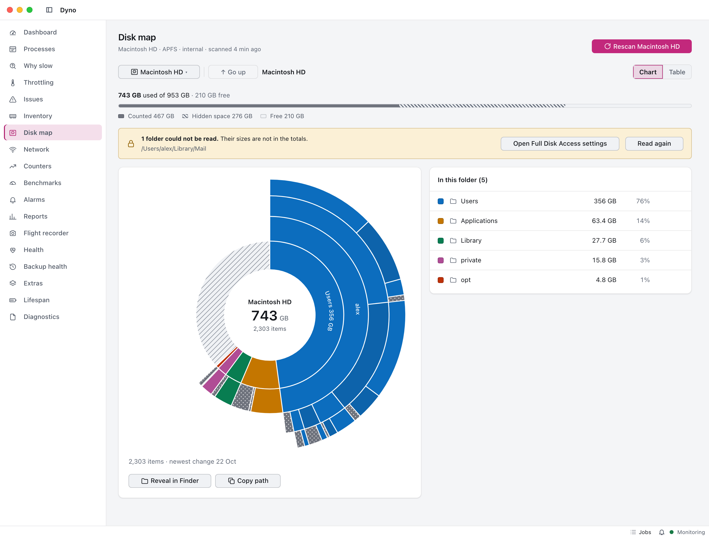
</picture>

<picture>
  <source media="(prefers-color-scheme: dark)" srcset="screenshots/disk-map-table-dark.png">
  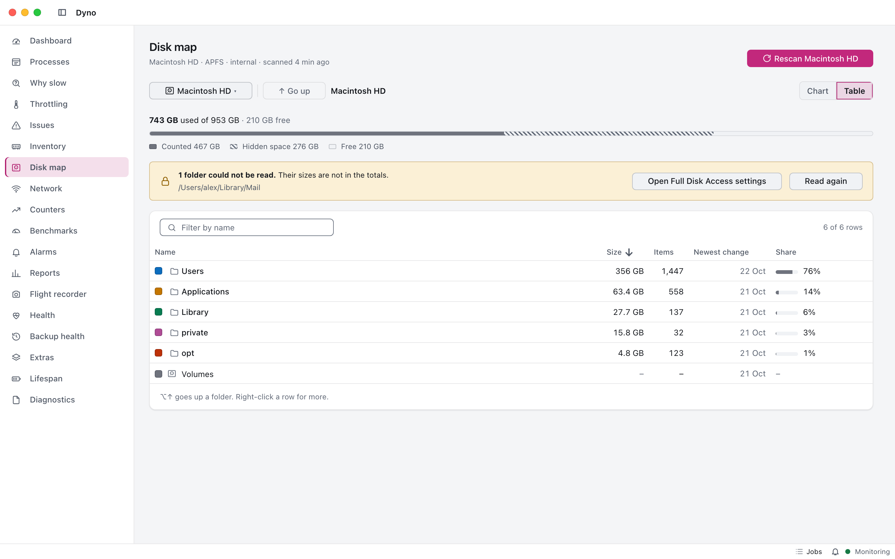
</picture>

**In progress for 1.0 (the engine is built; the screen is being built).** A clickable map of where the space went: a ring chart of a volume (internal, external or network) or a folder, where
each ring is one folder level. Click a segment to make that folder the centre, use the breadcrumb or the centre to go back,
hover for name, size and share. The scan is a live job with phases and Cancel, bounded in depth, entries and time. A table view
lists the same level with the keyboard. It is a map to look at: Dyno deletes, moves and renames nothing; the only actions are
Reveal in the file manager and Copy path.

**Planned for 1.1.** Tabs for the largest files, the oldest large files and duplicate hints, and the breakdown of hidden space
(purgeable space, snapshots, other volumes).

## Alerts and reports

<picture>
  <source media="(prefers-color-scheme: dark)" srcset="screenshots/alarms-dark.png">
  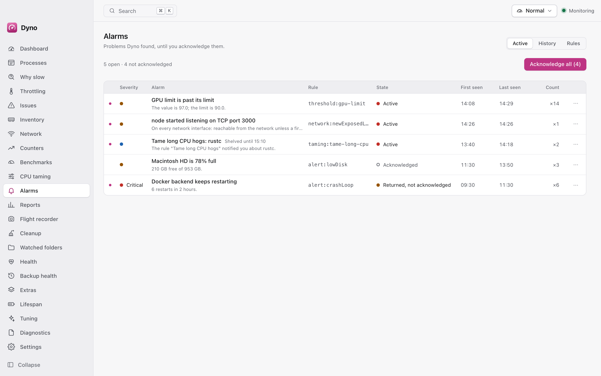
</picture>

<picture>
  <source media="(prefers-color-scheme: dark)" srcset="screenshots/alarms-history-dark.png">
  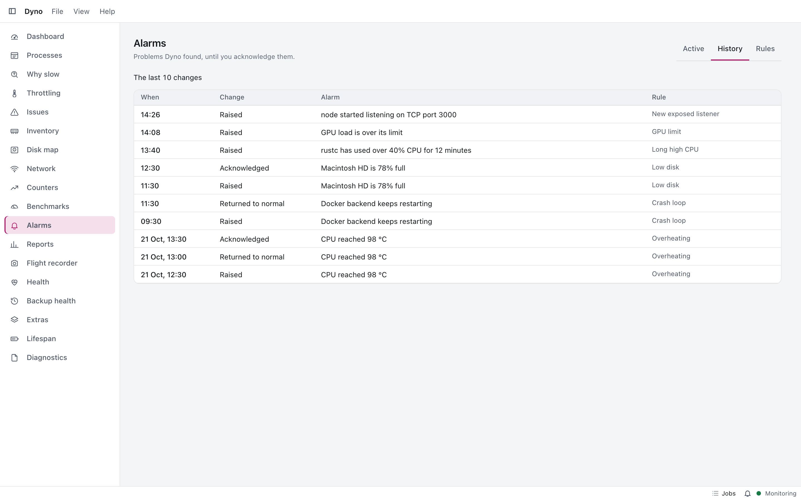
</picture>

<picture>
  <source media="(prefers-color-scheme: dark)" srcset="screenshots/alarms-rules-dark.png">
  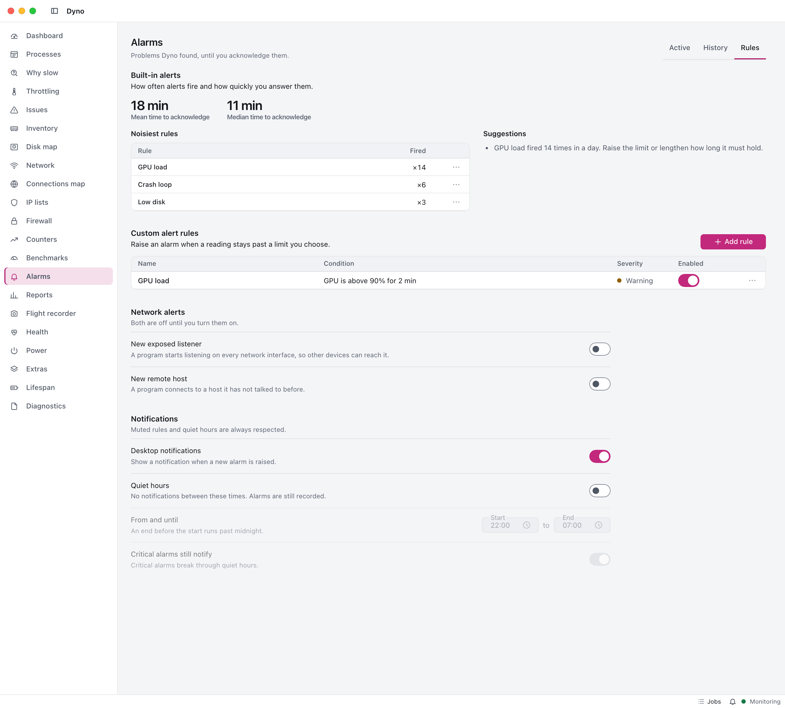
</picture>

<picture>
  <source media="(prefers-color-scheme: dark)" srcset="screenshots/reports-dark.png">
  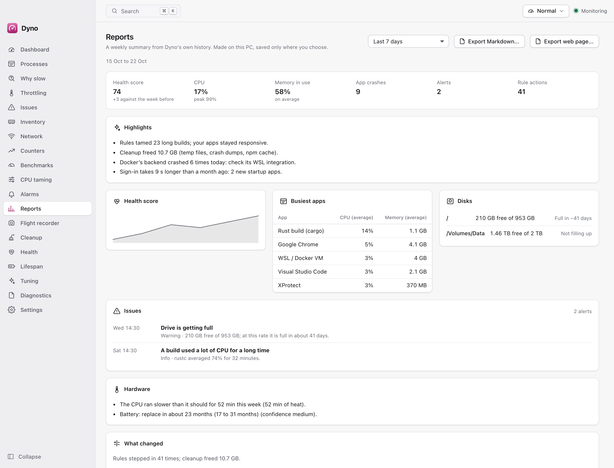
</picture>

**Built.** Alarms (low disk, overheating, crash loops, throttling, stale backups) notify and follow an ISA-18.2 style lifecycle
([ADR 0013](adr/0013-alarms-lifecycle.md)); acknowledging, muting and notes are Dyno's own data and change nothing else. `WeeklyReport { weeksAgo }` builds the report for any of the last 52 weeks from stored data, in the engine:
health score and its trend, CPU and memory, the busiest apps, free space and the disk-full forecast per disk, the week's alerts
as issues, and what changed (installs, updates and startup entries seen). A week with nothing in it is a valid
report ("Nothing to report"). The **Reports** page has a week selector and exports the week as Markdown or a web page
(`SaveReport`, through the OS save dialog; dates in the export are UTC). The health score is recorded hourly while the app asks
for it (the dashboard and Reports do), so a week with no visit has no trend. A weekly OS notification is not built.
[WP-08](roadmap.md#wp-08-alerts-and-the-weekly-report).

## Performance counters

<picture>
  <source media="(prefers-color-scheme: dark)" srcset="screenshots/counters-dark.png">
  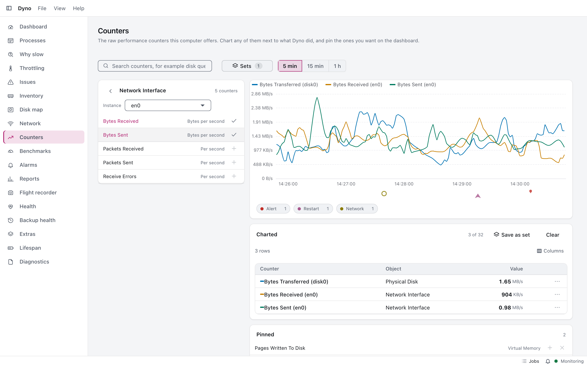
</picture>

**Built.** The **Counters** page browses the raw performance counters the OS offers, found by name: first the objects, then an
object's counters with its instances, or a search by words (every word must match; best match first). Any counter can be charted
next to Dyno's own events (alarms, issues) for 5 minutes, 15 minutes or an hour, up to 32 at once with two
units on the axes at most. A counter that has gone (a device unplugged, a program ended) is shown as unavailable with the reason,
never as zero. Counters can be pinned (kept in settings, so they survive a restart), saved as named sets, and added to the
dashboard as a graph widget. Counters are read only while the page or a dashboard widget needs them; the engine bounds objects,
counters, instances, history points and results, and every call into the OS has a deadline. Windows uses PDH, with the names in the
user's language; macOS reads `vm_stat`, `netstat -inb`, `iostat -Id` and `sysctl`; Linux reads `/proc` (memory, paging, network,
disks, load, context switches and pressure). Running totals are shown as the rate per second. Per-device IOKit statistics are not
read. [WP-12](roadmap.md#wp-12-performance-counters-browser).

## Command line

The `dyno` command speaks the agent's own local protocol (ADR 0014) and is read-only: `status`, `why-slow`, `top`, `alarms`,
`snapshot` and `counters`, as text or `--json`. It ships in the installers. A `dyno` built for another protocol version than
the running Dyno refuses with a message. [cli.md](cli.md). [WP-27](roadmap.md#wp-27-dyno-cli).

## Tray, window and settings

<picture>
  <source media="(prefers-color-scheme: dark)" srcset="screenshots/tray-dark.png">
  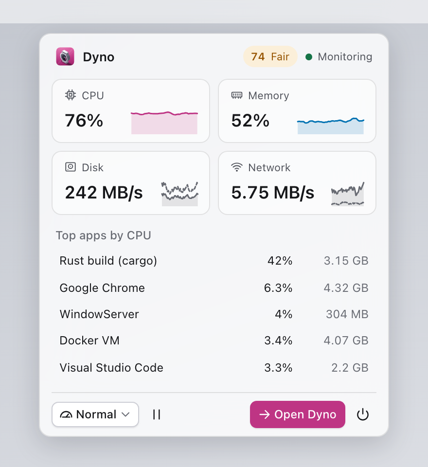
</picture>

<picture>
  <source media="(prefers-color-scheme: dark)" srcset="screenshots/settings-dark.png">
  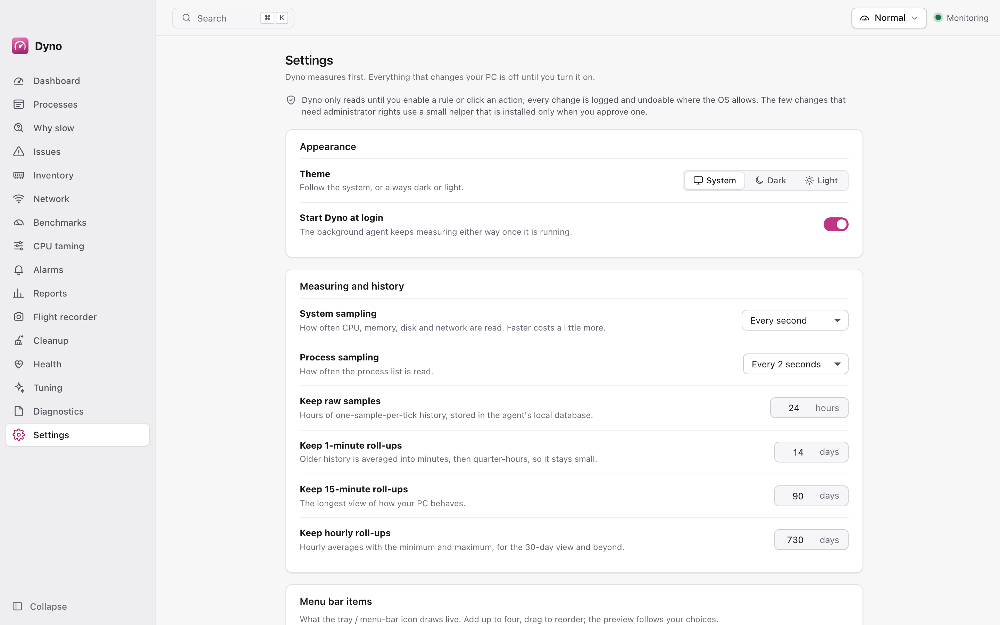
</picture>

<picture>
  <source media="(prefers-color-scheme: dark)" srcset="screenshots/settings-menu-bar-dark.png">
  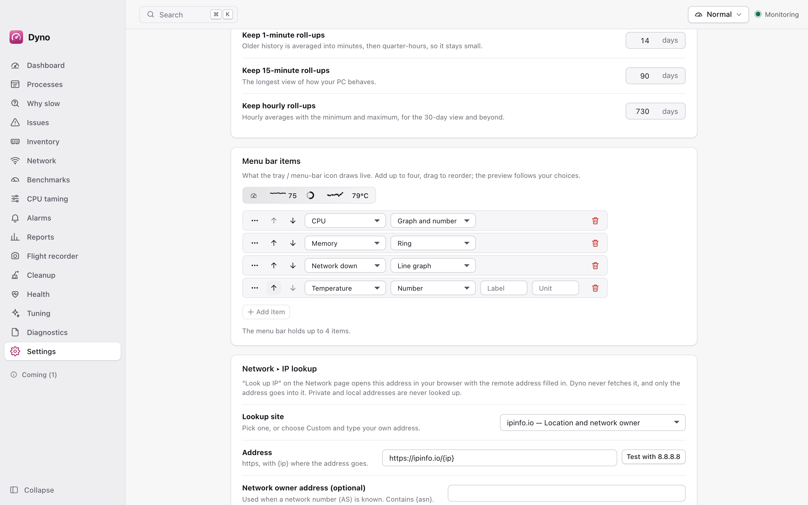
</picture>

<picture>
  <source media="(prefers-color-scheme: dark)" srcset="screenshots/command-palette-dark.png">
  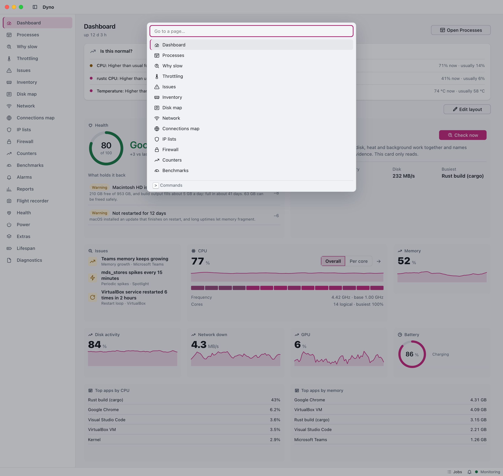
</picture>

<picture>
  <source media="(prefers-color-scheme: dark)" srcset="screenshots/jobs-dark.png">
  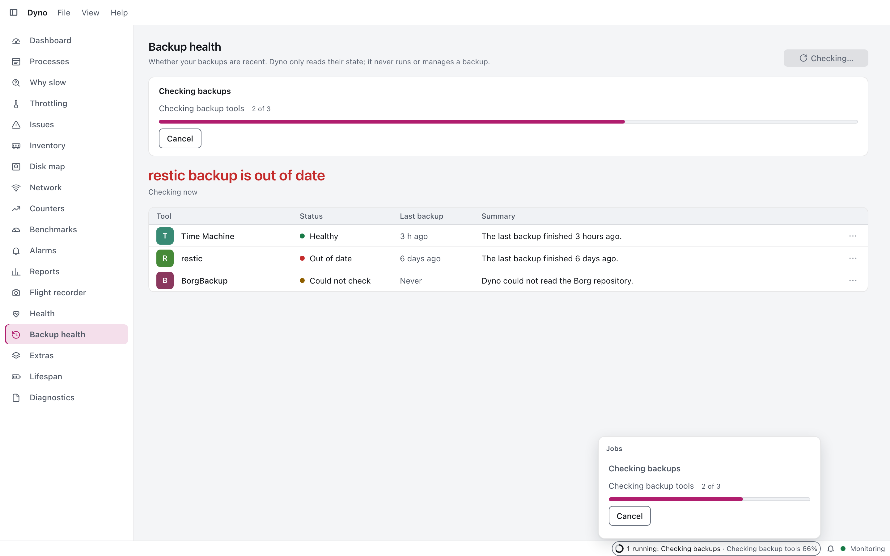
</picture>

**Built.** A tray icon with a live metric (CPU, memory, …, chosen in Settings; a template image on macOS) and a compact dropdown
window; closing the window destroys it and keeps the tray and the agent; Quit exits the app and leaves the agent measuring. Settings: tray metric and style, sampling intervals, history
retention, launch at login, alert settings; the theme, accent and density are the shell's Appearance page. Light and dark themes with a colour-vision-checked palette
([ADR 0011](adr/0011-design-system.md)); a desktop feel ([ADR 0009](adr/0009-native-feel.md)): no text selection on chrome,
Dyno's own Copy menu, no browser keys.

## Read-only by design

**Built.** Dyno does not end, suspend, cap, delete, move or tune anything ([ADR 0021](adr/0021-monitoring-only.md)). Dyno 1.0
has no privileged helper: the agent runs with your own rights, and a figure the OS withholds says *Unavailable* with the reason
(user guide, [Running with your own rights](user-guide.md#running-with-your-own-rights)). Elevation (a
read-only helper and starting as administrator at login) is planned for 1.1 (ADR 0022). Tests act only on processes and folders they create.

## Extensibility

**Partly built.** Out-of-process Rust plugins (`dyno-plugin-api`, `dyno-plugin-host`, an example plugin; guarded with timeouts,
a memory cap and quarantine) are built and listed in Settings; they are sensors only, and their contributions are minimally wired
([G5](roadmap.md#known-gaps-in-the-foundation)). Declarative TOML packs (read-only data) are planned for after 1.0
([WP-15](roadmap.md#wp-15-declarative-toml-packs)). See [plugins.md](plugins.md) and [ADR 0007](adr/0007-extensibility-three-tiers.md).

## Right-click search and hash search

<picture>
  <source media="(prefers-color-scheme: dark)" srcset="screenshots/web-search-dark.png">
  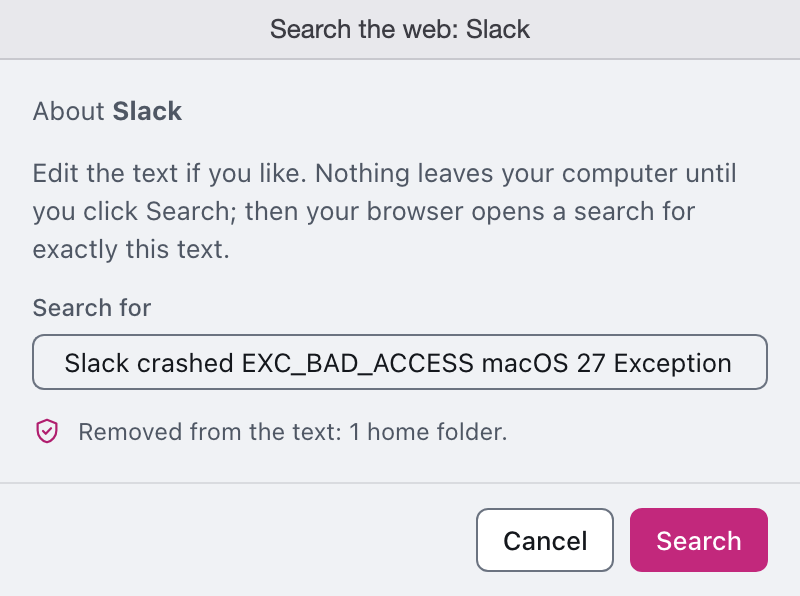
</picture>

<picture>
  <source media="(prefers-color-scheme: dark)" srcset="screenshots/hash-search-dark.png">
  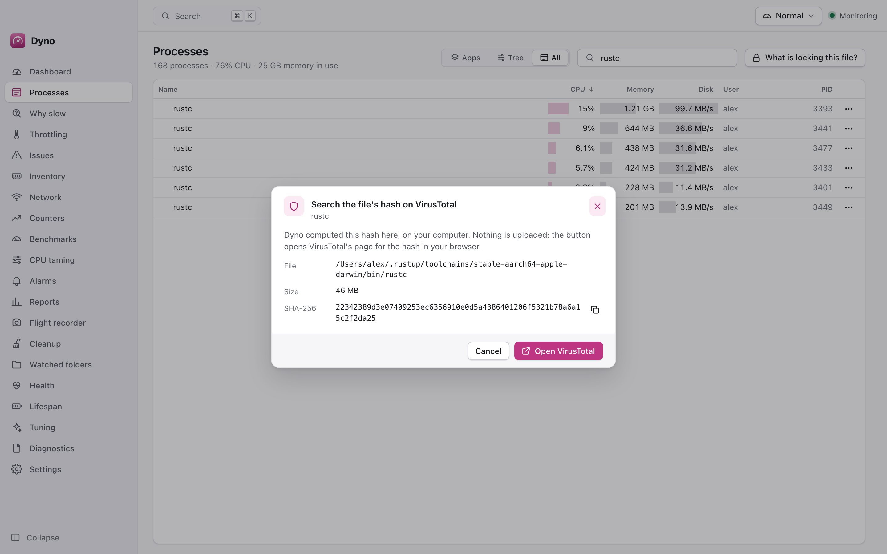
</picture>

- **Search the web** (Processes, Network, Issues, New and unusual menus): a dialog with the text, private details removed
  (home folders, user and computer names, IP and e-mail addresses, GUIDs, serial numbers) and what was removed. Edit it; nothing
  leaves the computer until Search, which opens your browser.
- **Search file hash on VirusTotal**: Dyno computes the SHA-256 on your computer, shows it, and on a click opens VirusTotal's page
  for that hash. Nothing is uploaded.
- **Startup filter** (Health): hide the operating system's entries and signed apps, with counts; remembered.
- **Network changes on the timeline**: Wi-Fi joins and leaves, VPN up and down, IPv4 address changes.
## Later

After 1.0 (all in [roadmap.md](roadmap.md)): declarative read-only packs (WP-15), an optional local web API (WP-16), "Explain
this" via Pitwall (WP-17), suite tie-ins (WP-30), session recording to CSV or Parquet (WP-31) and a multi-PC LAN view.

## Platforms

| | Windows 10 / 11 | macOS 13+ | Linux (systemd) |
| --- | --- | --- | --- |
| Sensors | CPU, memory, disk, network through performance counters | sysinfo plus memory pressure, GPU | sysinfo plus PSI, diskstats, hwmon, GPU |
| Details, locks, startup, facts | not wired yet | built | built |
| Agent at login | per-user Run entry | launch agent (`SMAppService`) | systemd user unit |
| Installer | NSIS | `.dmg` (ad-hoc signed) | `.deb`, AppImage |
