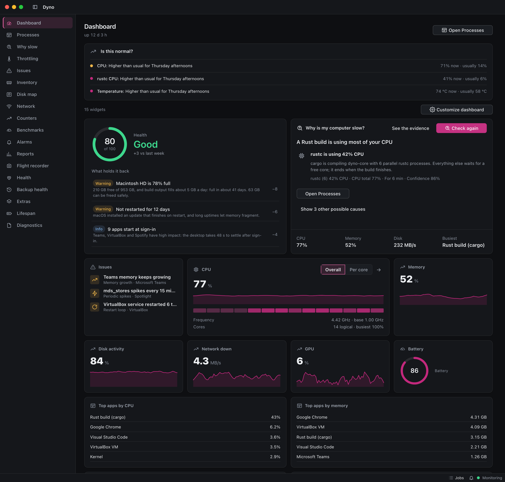
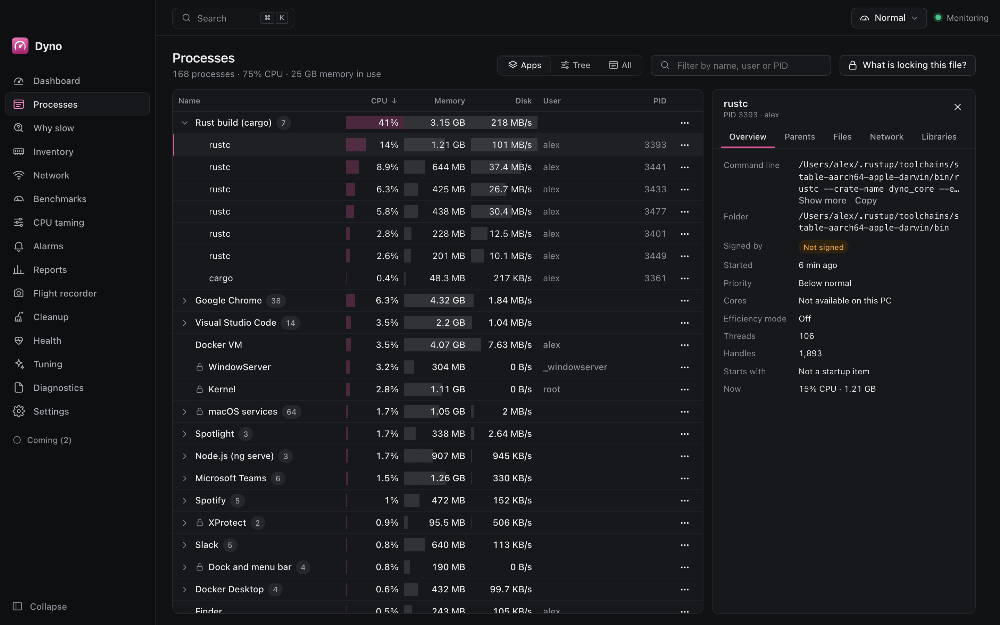
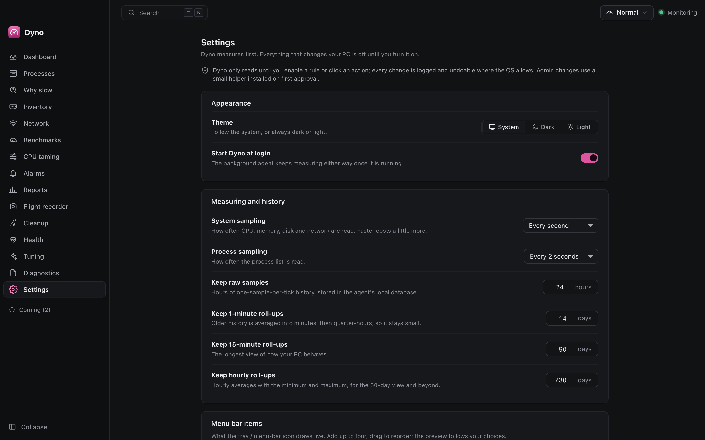

# Features

What Dyno does, and honestly how far each feature is. **Built** means the code exists and is tested; **Engine only** means
the agent and core implement it and the protocol exposes it but the UI screen is still a placeholder; **Planned** means it is
not in the code (see [roadmap.md](roadmap.md) for the work package). Screenshots are in `docs/screenshots` (dark and light).

## Contents

- [Live monitoring](#live-monitoring)
- [History](#history)
- [Processes](#processes)
- [Why is it slow?](#why-is-it-slow)
- [CPU taming and profiles](#cpu-taming-and-profiles)
- [Extras](#extras)
- [Backup health](#backup-health)
- [Health and startup](#health-and-startup)
- [Throttling, hardware life and what is normal](#throttling-hardware-life-and-what-is-normal)
- [Cleanup](#cleanup)
- [Tuning](#tuning)
- [Alerts and reports](#alerts-and-reports)
- [Tray, window and settings](#tray-window-and-settings)
- [Safety](#safety)
- [Extensibility](#extensibility)
- [Planned features](#planned-features)
- [Platforms](#platforms)

## Live monitoring

**Built.** The agent samples CPU (total, per core), memory (used, commit, pressure), disks (free space, throughput),
network, and GPU, battery, temperatures and fans where the OS tells; every sensor that is missing shows *why* (a `Reading`
with a reason), never a zero. Intervals adapt: 1 s and 2 s by default while someone watches, 2 s and 10 s when nobody does,
doubled on battery, stretched when Dyno itself is over its CPU budget. The dashboard shows tiles with sparklines, the top
apps by CPU and memory, and "Dyno: x % CPU, y MB" (its own overhead, measured; [architecture](architecture.md#dynos-own-overhead)).

## History

**Built.** The agent keeps raw points for a day, then 1-minute, 15-minute and hourly rollups with min, average and max (so a
short spike stays visible at every zoom level), per-app minutes for "top consumers", disk space for the forecast, timeline
events and boot records, in SQLite ([ADR 0008](adr/0008-storage-sqlite-and-retention.md)). History keeps running with the
window closed. Retention is configurable. A damaged database is moved aside and recreated. The **crashes** series comes from the Issues log below.

## Issues

**Built.** The agent reads what the OS itself recorded, read-only and with timeouts: macOS crash reports in
`~/Library/Logs/DiagnosticReports` and the unified log (`log show`), the Windows Event Log (Application, System, Windows
Update), the Linux journal and `coredumpctl`. Crashes, hangs, unexpected shutdowns, disk and memory errors, overheating, failing
services, running out of memory, update and driver failures are normalised, stored in SQLite and shown with a daily
**stability score** (0 to 100, a pure function of how often each kind happened), the apps and kinds with the most trouble, the
trend against the period before and each event's own text (plain text, never HTML). A log that cannot be read is listed as
"could not be read: reason", never an error, and no score is claimed when none can be read. **Export for Debrief** saves the
period as JSON lines. Serious issues raise alarms; a crash loop raises the crash-loop alert; the health reason "crashing apps"
and the weekly report count crashes. See [ADR 0017](adr/0017-issues-and-the-program-baseline.md).

## New and unusual programs

**Built.** A transparency tool, not an antivirus. Dyno keeps a baseline of the programs seen on this PC, learning silently for a
configurable period (7 days by default) so a fresh install does not flag everything. After that it lists programs it has not
seen, and says **why** one may be worth a look ("unusual because it runs from a temporary folder, is not signed"): an unusual
place, a name one letter from a system program, an invalid or missing signature, many child programs or connections, a new
startup entry. Protect (rules never touch it), Hide and Restore are the only actions; nothing ends or removes a program.

## Processes

**Built.** A tree grouped by application ([ADR 0003](adr/0003-process-grouping.md)); details per process (command line,
working directory, modules, connections, signer; on macOS and Linux today, Windows details are not wired yet); "what is locking
this file" (`lsof`, `/proc`; Windows not wired); end, suspend, resume, priority, affinity (not on macOS), efficiency mode and
CPU cap for a process or a whole app; open its folder. Every action is checked against the protected list, names the process by
id and start time, is logged in **Activity** and can be undone. Protected processes show a lock and the reason. Snapshots of the
process list can be taken and compared.

**Network traffic per program** (Network page, process details): macOS from `nettop`, Linux from the kernel's per-socket TCP byte
counters (no root; other users' programs are not attributed), Windows needs administrator rights for the OS counters, so the helper (when installed) reads them and
the page says to install it otherwise. Where it cannot be read the page shows the reason instead of zeros.

## Why is it slow?

**Built.** `WhySlow` returns a diagnosis: a headline and causes (kind, confidence, evidence, the busiest apps behind each cause,
how many seconds were measured, suggestions such as "lower priority of X"); `Anomalies` lists unusual behaviour; disk-full
forecasts come from history. The dashboard card shows the answer on request ("Check now") and links to the **Why slow** page:
every cause with what was measured, the apps involved, links to Processes / Network / Flight recorder / Health, **Run again**,
**Copy as text**, and the earlier results of this session. A fix that changes a process shows what it will do first and waits
for a second click; fixes that only open a screen navigate. The history of results is kept in the app for the session (the engine
does not store diagnoses).

## CPU taming and profiles

**Engine only.** Rules with a condition (an app's CPU above a threshold for a time, optional context such as user idle or on
battery) and an escalation ladder (lower priority, efficiency mode, a hard cap, notify) are evaluated by the pure `Engine` and
carried out per OS (Windows job objects; a 100 ms SIGSTOP/SIGCONT duty cycle on macOS and Linux; EcoQoS and background QoS;
`nice`), released when the app calms down, when the rule stops applying and when Dyno stops, also after a crash
([ADR 0004](adr/0004-cpu-taming-and-throttling-methods.md)). Profiles (Normal, Gaming, Meeting, On battery, Building code)
select the active rules. **Rules ship disabled.** A rule can be **temporary** (it ends at a time, releases everything it did and switches
itself off, with an Activity entry), never touches the app in front (and gives it back the moment you switch to it), restores
everything when the condition ends or Dyno exits, and **proves its effect**: about 20 s after each step Dyno measures the app's CPU
again and writes "used 78% CPU before and 31% after 21 s" to Activity and the in-effect list ([ADR 0020](adr/0020-extras-backup-checks-and-taming-proof.md)).
The protected list is absolute and rules never touch the foreground app.

## Extras

**Built** (WP-13), all read-only, on the **Extras** page; every tool runs with a timeout and a missing or refused tool becomes a sentence
saying why, never an empty screen.

- **What changed**: installs, updates, removals, new startup items, setting changes and cleanups in a window you pick. Dyno compares
  the software and startup lists every few hours and says since when it has been watching; the first look is a silent baseline.
- **Sleep**: what keeps the computer awake (`pmset -g assertions`, `powercfg /requests`, `systemd-inhibit --list`) and what woke it
  (`pmset -g log`, `powercfg /lastwake`). Windows lists blockers only to administrators and says so.
- **Boot**: how long each start-up took until the desktop settled (recorded by the agent from now on), a sentence comparing the last
  one with the usual, and on Linux and Windows what slowed it (`systemd-analyze blame`, Diagnostics-Performance events). macOS keeps
  no breakdown and says so.
- **Apps**: bytes received and sent per app (the OS's counters; macOS) and energy impact per app (macOS `top`); Windows and Linux say
  why there is no energy number.
- **GPU**: GPU use per process (macOS accelerator client time, Windows GPU Engine counters, NVIDIA `nvidia-smi pmon`); Linux with
  other graphics says it needs the vendor's tool.
- **Files**: large and duplicate files in a folder you choose. Duplicates are matched by SHA-256 after size and the first 64 KiB.
  Removal goes through the cleanup policy (re-checked, to the Trash or the 7-day quarantine, never every copy).
- **Inventory**: the installed software next to the hardware; **Export report** saves Markdown or JSON where you choose.
- **Maintenance**: windows (days and times) when Dyno's heavier background work may run: reading the OS logs, backup checks and
  change recording. A click always runs.

## Backup health

**Built** (WP-14), on the **Backup health** page and in Settings. Dyno checks that backups ran, never runs or manages one: Time Machine
(`tmutil`), Windows Backup and File History (their event logs, `wbadmin`), restic and Borg (`snapshots` / `list`, with the repository
variables your login shell exports, never passwords); Duplicati is detected but cannot be read yet. Tools are found through your login
shell's `PATH` (so Homebrew installs work from a background service) and an optional folder per tool. A backup older than the limit
(48 hours by default) is one plain alarm per tool, cleared when a new backup appears. No tool found is a normal state.

## Health and startup

**Engine only** (the dashboard shows the health score and fixes). `Health` returns a score and grade with reasons and fixes;
each fix explains and previews itself before anything changes. `StartupEntries` lists what starts at login (Windows: not
wired yet; macOS: launch agents and login items; Linux: autostart and user units); `SetStartupState` enables or disables an
entry that needs no administrator rights, undoable. The Health screen shows the score, its reasons and the startup manager.

## Tuning

**Built** (engine and screen). A catalogue of reversible suggestions that change something only on a click: power plan or mode
(Windows plan, Linux profile, macOS Low Power Mode), sleep timer on battery, hibernation, battery charge limit where Linux exposes
it, search indexing exclusions for developer folders, Defender exclusions for build folders, visual effects and background apps.
Each previews its exact change and its exact inverse; applying records an undoable activity entry and reads the setting back to
confirm it took effect; before a revert the setting is read again and a change made outside Dyno since is detected (Revert
anyway overwrites it on purpose). The changes are a closed set of typed actions behind a port with a fake for tests; nothing
runs text as a command. Changes that need administrator rights (Defender, hibernation, charge limit, macOS sleep and Low Power
Mode) go through the privileged helper ([WP-01](roadmap.md#wp-01-privileged-helper), [ADR 0016](adr/0016-privileged-helper-install-and-ipc.md)):
the first click explains the helper and the OS asks once to install it; each change is then previewed, validated again in the
helper, read back, logged by the helper and recorded with its undo. Where the helper cannot be installed (no polkit, no systemd)
the item says why.
Really applicable now: Windows power plan, sleep timer, visual effects, background apps and indexing; Linux power profile;
macOS indexing exclusions (Spotlight markers). Windows commands are unit-tested through a fake runner, not yet run on Windows.

## Throttling, hardware life and what is normal

**Built** ([WP-23](roadmap.md#wp-23-throttling-detector), [WP-24](roadmap.md#wp-24-disk-and-battery-life-forecasts),
[WP-25](roadmap.md#wp-25-is-this-normal-baselines), [ADR 0018](adr/0018-throttling-lifespan-and-baselines.md)). All three only
read; nothing here changes a setting.

- **Throttling.** `Throttling` answers whether the CPU runs slower than it could while busy, and why: heat, a power limit, a
  battery-saving mode, or "unexplained" (with what could not be ruled out). It states how much speed is lost, how sure it is
  (low, medium, high) and the numbers behind it. A machine that does not report its clock or temperature gets "cannot tell" and a
  list of what it does and does not report. A lasting episode (busy and slow for 20 s) is stored with its cause, duration, share
  of speed lost and peak temperature; the **Throttling** page lists the last 30 days. The same detector names the cause in
  **Why slow**, and a lasting episode at medium confidence or better can raise an alarm.
- **Disk and battery life.** `Lifespan` forecasts "about 7 years of writes left (5 to 10 years)" for an SSD from its wear counter
  and bytes written, and "replace the battery in about 23 months (17 to 31 months)" from its capacity trend and charge cycles. Each
  forecast is a range with the readings it stands on and a confidence; with under two weeks (SSD) or four weeks (battery) of history
  it says so instead of guessing, and a part Dyno cannot read says why and what would help (installing smartmontools, or the helper
  later). A replaced disk or battery starts a new series. A part past its limit, or with under a year left at medium confidence,
  appears in Health, the weekly report and, if you allow it, as an alarm.
- **Is this normal?** Dyno learns, per metric (CPU, memory, disk writes, network, temperature, GPU) and per app (CPU, memory), what
  is usual for each weekday and hour, and says when the present is outside it in words ("higher than usual for Tuesday mornings",
  with the usual value and range). A new install learns silently for seven days (1 to 30 in Settings). The dashboard shows only what
  is unusual; alarms for values far above usual that last five minutes are off until you turn them on.
- **Where it reads from** (observe-only): macOS `pmset -g therm`, `ioreg` and, for SSD wear, `smartctl` when installed; Linux the
  kernel's thermal-throttle counters, cpufreq limits and `/sys/class/power_supply`, and `smartctl`; Windows `powercfg /batteryreport`
  and `smartctl`, with throttling inferred from the clock, the temperature and the power mode (Windows reports no reason). The
  Windows readers run only in CI and on Windows machines; macOS and Linux paths are tested here.

## Cleanup

**Built, observe-only.** The Cleanup screen scans the categories you tick (scanning deletes nothing), lists every item with its path,
size and reason, and cleans only what you selected after you confirm in a dialog. A run accepts only a scan younger than an hour,
re-checks each item right before it moves (still there, not a link, no `..`, still inside its category's folders after resolving
the real path, not in a personal folder, unchanged since the scan), skips files in use and names the program holding them, and
moves items to a 7-day **quarantine** (restorable from the page or the activity log, then deleted for good by the agent) or to the
Recycle Bin / Trash. Categories come from TOML packs: the built-in pack is embedded; you may add packs to the data folder's
`packs/` folder (paths by template, `children` and `installers` selectors only; a bad pack is reported in the activity log and
ignored). Windows, macOS and Linux (XDG folders) have categories. The disk map is a separate engine (volumes, a cancellable scan as a job, one level at a time). Policy: [ADR 0005](adr/0005-cleanup-safety.md). Not built yet: scheduled cleanups, Docker image removal (the category says
to run `docker image prune`), a disk-map screen, Linux Trash is never emptied by Dyno. Work package:
[WP-04](roadmap.md#wp-04-cleanup-with-quarantine-and-undo).

## Tuning

**Built.** See the Tuning list above. Work packages [WP-01](roadmap.md#wp-01-privileged-helper), [WP-05](roadmap.md#wp-05-tuning-catalogue).

## Alerts and reports

**Reports built; alert history and notifications planned.** Alerts (low disk, overheating, crash loops, rule actions) are stored
and listed (`Alerts`). `WeeklyReport { weeksAgo }` builds the report for any of the last 52 weeks from stored data, in the engine:
health score and its trend, CPU and memory, the busiest apps, free space and the disk-full forecast per disk, the week's alerts
as issues, and what changed (cleanups, startup and tuning changes, your own process actions). A week with nothing in it is a valid
report ("Nothing to report"). The **Reports** page has a week selector and exports the week as Markdown or a web page
(`SaveReport`, through the OS save dialog; dates in the export are UTC). The health score is recorded hourly while the app asks
for it (the dashboard and Reports do), so a week with no visit has no trend. A weekly OS notification is not built.
[WP-08](roadmap.md#wp-08-alerts-and-the-weekly-report).

## Performance counters

**Built.** The **Counters** page browses the raw performance counters the OS offers, found by name: first the objects, then an
object's counters with its instances, or a search by words (every word must match; best match first). Any counter can be charted
next to Dyno's own events (rule actions, cleanups, tuning, alerts) for 5 minutes, 15 minutes or an hour, up to 32 at once with two
units on the axes at most. A counter that has gone (a device unplugged, a program ended) is shown as unavailable with the reason,
never as zero. Counters can be pinned (kept in settings, so they survive a restart), saved as named sets, and added to the
dashboard as a graph widget. Counters are read only while the page or a dashboard widget needs them; the engine bounds objects,
counters, instances, history points and results, and every call into the OS has a deadline. Windows uses PDH, with the names in the
user's language; macOS reads `vm_stat`, `netstat -inb`, `iostat -Id` and `sysctl`; Linux reads `/proc` (memory, paging, network,
disks, load, context switches and pressure). Running totals are shown as the rate per second. Per-device IOKit statistics are not
read. [WP-12](roadmap.md#wp-12-performance-counters-browser).

## Command line

The `dyno` command speaks the agent's own local protocol (ADR 0014). Read-only by default: `status`, `why-slow`, `top`, `alarms`,
`snapshot` and `counters`, as text or `--json`. `end`, `cap` and `undo` change something and do nothing without `--yes`; they go
through the same validation, protected list and activity log as a click, so a protected process is refused and a cap can be undone.
A `dyno` built for another protocol version than the running Dyno refuses with a message. [cli.md](cli.md).
[WP-27](roadmap.md#wp-27-dyno-cli).

## Tray, window and settings

**Built.** A tray icon with a live metric (CPU, memory, …, chosen in Settings; a template image on macOS) and a compact dropdown
window; closing the window destroys it and keeps the tray and the agent; Quit exits the app and leaves the agent measuring. A
command palette (Ctrl or Cmd + K). Settings: theme (system, dark, light), tray metric and style, sampling intervals, history
retention, launch at login, alert settings. Light and dark themes with a colour-vision-checked palette
([ADR 0011](adr/0011-design-system.md)); a desktop feel ([ADR 0009](adr/0009-native-feel.md)): no text selection on chrome,
Dyno's own Copy menu, no browser keys.

## Safety

**Built.** Observe-only by default; rules disabled; the protected list (critical OS processes, antivirus, audio engine, Dyno,
your entries) cannot be overridden; actions name a `ProcessRef`; every action is logged and undoable; the agent never runs
elevated; tests act only on processes and folders they create. The privileged helper for system changes is installed only on a click and serves one user and one program
([ADR 0006](adr/0006-privileged-helper-and-observe-only.md), [ADR 0016](adr/0016-privileged-helper-install-and-ipc.md)).

## Extensibility

**Partly built.** Out-of-process Rust plugins (`dyno-plugin-api`, `dyno-plugin-host`, an example plugin; guarded with timeouts,
a memory cap and quarantine) are built and listed in Settings; their contributions are minimally wired ([G5](roadmap.md#known-gaps-in-the-foundation)).
Declarative TOML packs are planned ([WP-15](roadmap.md#wp-15-declarative-toml-packs)). See [plugins.md](plugins.md) and
[ADR 0007](adr/0007-extensibility-three-tiers.md).

## Right-click search, hash search and watched folders

- **Search the web** (Processes, Network, Issues, New and unusual menus): a dialog with the text, private details removed
  (home folders, user and computer names, IP and e-mail addresses, GUIDs, serial numbers) and what was removed. Edit it; nothing
  leaves the computer until Search, which opens your browser.
- **Search file hash on VirusTotal**: Dyno computes the SHA-256 on your computer, shows it, and on a click opens VirusTotal's page
  for that hash. Nothing is uploaded.
- **Startup filter** (Health): hide the operating system's entries and signed apps, with counts; remembered.
- **Network changes on the timeline**: Wi-Fi joins and leaves, VPN up and down, IPv4 address changes.
- **Watched folders**: pick a folder and how long files may stay (10 minutes to 10 days); older files move to the 7-day
  quarantine and can be put back from Activity. A folder is off until you have seen the preview.

## Planned features

All in [roadmap.md](roadmap.md): Issues with statistics, new and unusual processes, right-click search, watched folders with
keep-for times, benchmarks on click, the tuning catalogue, extras (what changed, why won't it
All in [roadmap.md](roadmap.md): right-click search, watched folders with
keep-for times, a performance-counter browser, declarative packs, a local web API, "Explain this" via Pitwall, a multi-PC LAN view
later.

## Platforms

| | Windows 10 / 11 | macOS 13+ | Linux (systemd) |
| --- | --- | --- | --- |
| Sensors | CPU, memory, disk, network through performance counters | sysinfo plus memory pressure, GPU | sysinfo plus PSI, diskstats, hwmon, GPU |
| Process control | priority, affinity, EcoQoS, suspend, job-object CPU caps | signals, background policy, duty-cycle caps | signals, nice (per thread), affinity, duty-cycle caps |
| Details, locks, startup, facts | not wired yet | built | built |
| Agent at login | per-user Run entry | launch agent (`SMAppService`) | systemd user unit |
| Installer | NSIS | `.dmg` (ad-hoc signed) | `.deb`, AppImage |
