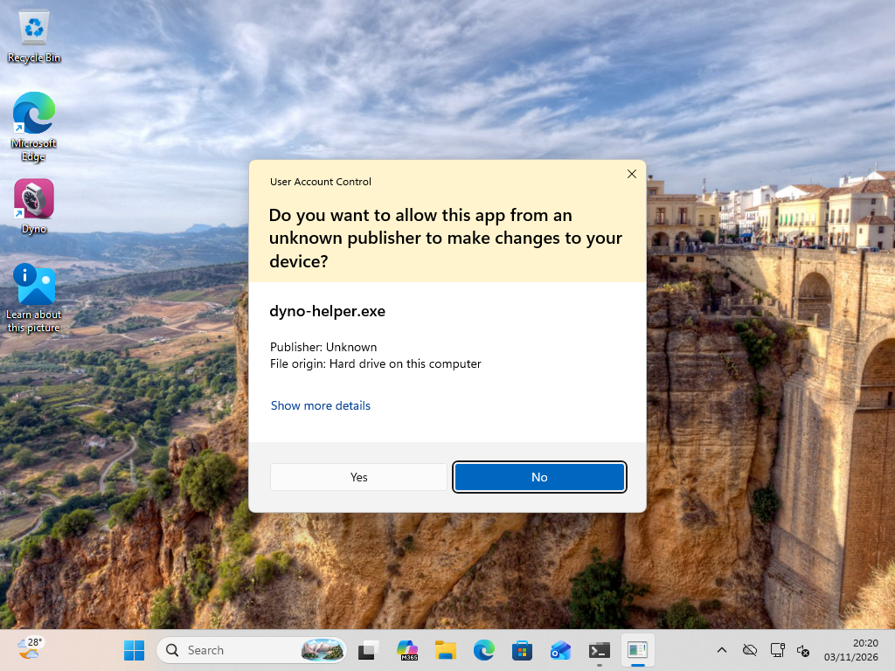
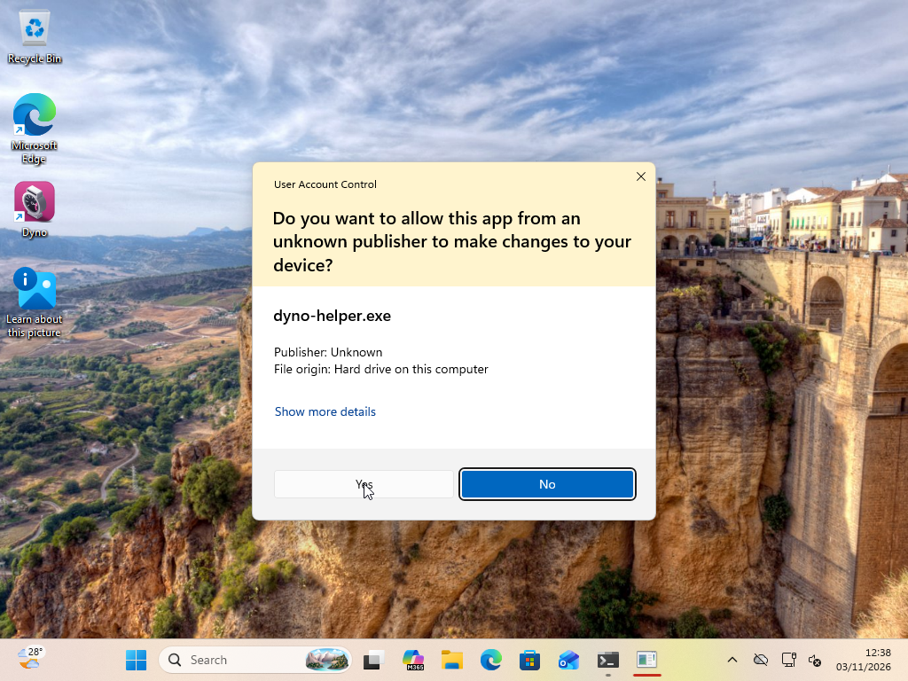
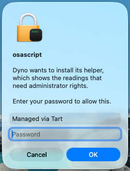
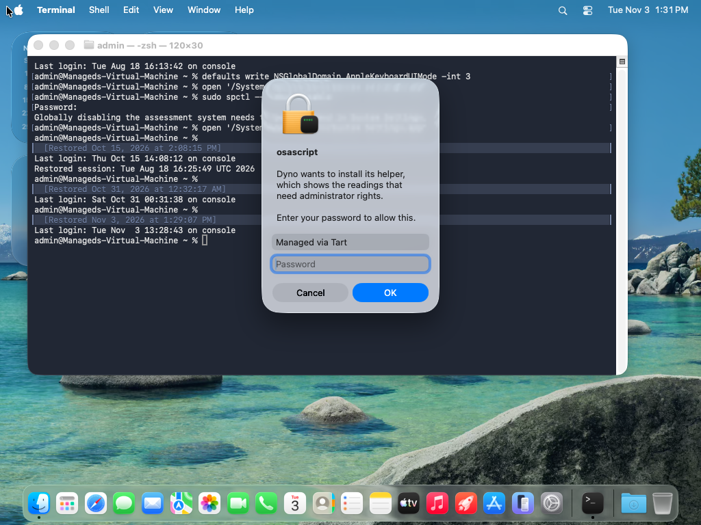
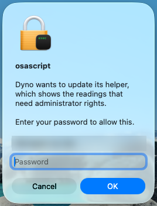

# The privileged helper: verification on real systems (Dyno ADR 0027)

What was run against the real operating system, as opposed to the fakes in `cargo test`. Local virtual machines only (ER-14, never CI,
never a developer's machine). Each run records the OS build, whether the system's prompt was seen, the states the agent showed, and
the helper's log lines. The harness is `crates/dyno-agent/tests/helper_vm.rs` (`PADDOCK_VM=1`, `--ignored`, `HELPER_ACTION=turnOn|repair|update|turnOff`):
it builds the agent's `HelperCentre` for the machine, prints the state, runs the action as the agent's job (printing each phase) and prints the state again.

## Windows 11 (2026-11-03): done

- **Machine.** `paddock-win11-test` (VMware Fusion, Windows 11 Pro Arm64, `DisplayVersion` 26H2, build 10.0.26300, stable channel: no
  `BranchName`, no `EnablePreviewBuilds`), started from the snapshot `gui-session-tools`, reverted to it afterwards, no snapshot taken.
  Binaries cross-built with `cargo xwin` (x86-64, run under emulation).
- **Who.** `paddock-test` made a member of Administrators for this run (an Admin Approval Mode token, as a real user who is an administrator has),
  signed in to the console (session 1); `PromptOnSecureDesktop=0` so the prompt can be photographed. The agent side ran as a scheduled task in
  that session (`/it`). The prompt was answered by a click through the VM's VNC (the VM's own input device: a synthetic click from inside the
  session is blocked by UIPI).
- **Prompt seen.** Yes, the real UAC prompt, the same words each time because it is for the same program (`dyno-helper.exe`, "Publisher:
  Unknown": Dyno's Windows helper is unsigned and stays so, so the card tells the user to expect this):
  -  *Turn on: the elevated `install --for <SID>`.*
  -  *Turn off: the bundled copy's elevated `uninstall`
    (Windows cannot delete a running program, so Turn off prompts too).*

| Step | Result |
| --- | --- |
| Nothing installed | state `Off` ("Administrator readings are not turned on ..."), no endpoint |
| Turn on (UAC, Yes) | phases `check`, `prompt`, `start`, `verify`; ends `Ready` (version 1.0.0 with a minimum lowered to 1.0.0 for this run, see finding 1) |
| Service | `DynoHelper`, `LocalSystem`, delayed automatic start, `sc qprivs`: `SeChangeNotifyPrivilege` only; the running process's token (read with `GetTokenInformation`): exactly `SeChangeNotifyPrivilege` (enabled by default) |
| Files | `C:\Program Files\Dyno Helper\dyno-helper.exe` (owner Administrators; SYSTEM and Administrators full, Users read and execute); `C:\ProgramData\Dyno\Helper\config.json` (schema 2, owner SID of the account that turned it on), `helper.log`, `audit.jsonl` |
| Pipe `\\.\pipe\net.decryptology.dyno.helper` | owner `S-1-5-18`; SDDL `O:SYG:SYD:P(A;;FA;;;SY)(A;;FA;;;BA)(A;;0x12019b;;;IU)(D;;FA;;;NU)`; the same for an administrator and for `paddock-test` over SSH (a network logon cannot connect: `NU` is denied) |
| Squatted pipe | service stopped, `paddock-test` creates the pipe name first (its own owner). The agent's state is `Missing`: "Something other than Dyno's helper answered on its endpoint, so Dyno did not trust it (... owner S-1-5-21-...-1001, expected S-1-5-18)". The agent sent nothing to it |
| Repair (UAC, Yes) | `check`, `prompt`, `prompt`, `prompt`, `start`, `verify`; `Ready` again |
| Turn off | on Windows through the prompt (see finding 2): the bundled copy removes the service, the installed program and its folder; state `Off` |
| Log lines | `Helper: protected-location check what=the program protected=true`, same for the data folder and configuration, `Helper: serving endpoint=... owner=sid:... version=...`, one `Helper: a connection was accepted account=sid ... admin=true` per call, `a caller could not be identified and was refused` for a client that connects and sends nothing, `install: EnsureFolder, ApplyAcl, CopyProgram (sha256), VerifyProgram, Register, Confirm` with durations; `uninstall: StopExisting, RemoveProgram, RemoveFolder, ConfirmGone` |

### Findings from this run (and what was done)

1. **A development build is older than `MIN_HELPER_VERSION`.** The workspace version is 1.0.0 and the minimum is 1.1.0, so a freshly installed
   helper answers and is `Outdated`; the turn-on job waited its whole minute for a state it could never reach. Fixed: the job now stops at once
   when the helper answers but is `Outdated`, and says so ("The helper started but this Dyno cannot use it. ..."). The `Ready` rows above were
   taken with the minimum lowered to 1.0.0 in a local build; it is 1.1.0 in the commit.
2. **A running Windows program cannot delete itself.** The helper's own `Uninstall` request stopped and unregistered the service but left
   `dyno-helper.exe` in Program Files, and the prompted `uninstall` run from the installed copy failed with `RemoveProgram ... Access is denied`.
   Fixed in the agent: on Windows the elevated `uninstall` runs the bundled copy, which removes the installed one completely, and Turn off on
   Windows goes straight to the prompt. (`uninstall_self_in_place` leaves the program behind on Windows; that is the service crate's to decide.)
3. **One removal failed once** with `RemoveProgram ... left in place while it runs` right after a turn on: `StopExisting` returned before the
   helper process had ended. Fixed: the stop now waits for the process by identity (pid and start time) before anything is removed, with a clear
   bounded error (test).
4. **The data folder stayed** after removal. Fixed (see finding 9).
5. **One connection per call** wrote one `a connection was accepted` line per request, hundreds during a status poll. Fixed: the agent keeps one
   connection between calls (a stale one is replaced once), and the state is logged at info only when it changes.

Update runs the same code as Repair (install again over the running helper) and was not run separately.

## macOS 26.6.2 (build 25G83, 2026-11-03): done

- **Machine.** A private clone of the Tart image `vmgui-base-tahoe-4aaa751f` (Apple silicon, the console user `admin` signed in), started with
  `--vnc-experimental`; the clone is deleted. Binaries built natively on the host (`aarch64-apple-darwin`) and shared read-only. The agent side
  ran in the user's session (`launchctl asuser`); the password was typed into the real dialog through the VM's VNC.
- **Prompt seen.** Yes, the real `osascript` password window, one per action with its own text (the first shots had a Terminal behind them and
  the same text for Turn on and Repair; they were taken again on a clean desktop, cropped to the dialog):
   *Turn on: "Dyno wants to install its helper ...".*
   *Repair: "Dyno wants to repair its helper ...".*
   *Update: "Dyno wants to update its helper ...".*

| Step | Result |
| --- | --- |
| Nothing installed | `Off` (see finding 6: it said "Not trusted" before the fix) |
| Turn on (password) | phases `check`, `prompt`, `start`, `verify`; `Ready`, readings listed for macOS |
| The daemon | `launchctl print system/net.decryptology.dyno.helper`: running, run by `root`, program `/Library/PrivilegedHelperTools/net.decryptology.dyno.helper` (root:wheel 0755), plist `/Library/LaunchDaemons/...plist` (root:wheel 0644, `RunAtLoad`, `KeepAlive` on failure) |
| The endpoint | `/var/run/dyno-helper` is `root:daemon 0755` (no group or world write), `helper.sock` is `srw-rw-rw-` (any local account may connect; what it sees is decided by its identity); the data folder is not readable by the standard user; `config.json` names uid 501 as owner |
| Squatting | the standard user cannot create a folder under `/var/run` (`Permission denied`); with the folder made the standard user's own (as root, in the VM only), the state is `Foreign` ("Not trusted") and nothing is sent; given back to root it is `Ready` |
| Repair (password) | `check`, `prompt` x3, `start`, `verify`; `Ready` |
| Turn off | no prompt on macOS (a program can remove itself while it runs): phases `check`, `remove`, `verify`; `Off`; the daemon, the program and (after finding 7) the plist are gone |
| Log lines | `Helper: protected-location check ... protected=true`, `Helper: serving endpoint=/var/run/dyno-helper/helper.sock owner=uid:501 version=...`, one `a connection was accepted account=uid 501 admin=true` for a whole poll (one kept connection) |

## Ubuntu 24.04 arm64 (Orb `paddock-gate-arm`, systemd, 2026-11-03): done except the polkit prompt

- **Machine.** The Orb machine, restored afterwards: `polkitd`, `pkexec`, `libpolkit-agent-1-0`, `libpolkit-gobject-1-0` installed for the test and
  removed again, the test account `dynotest` (member of `sudo`) removed, `/usr/bin/dyno-helper` and the unit removed, the build folder removed.
  Binaries built natively in the machine. The `.deb` is not built yet (WP-13), so the program was copied to `/usr/bin` and the packaged unit
  (`paddock-service`'s golden) to `/usr/lib/systemd/system`, as the package will.
- **The polkit prompt: not exercised.** The agent's `pkexec` runs with no terminal and there is no graphical authentication agent in the
  machine; a text agent (`pkttyagent`) could not be attached to the agent's `pkexec` (it tried its own and failed on `/dev/tty`: "You are not
  allowed to do this (Error creating textual authentication agent ...)", shown as the job's failure). The install itself was run as root
  (`dyno-helper install --for uid:1000`), which is what `pkexec` runs. A desktop test is still open.

| Step | Result |
| --- | --- |
| Package installed, service not enabled | `Off` after finding 8 (it said "Not running" before: the program's presence is not "turned on") |
| Install as root | `install: StopExisting, VerifyProgram, Register, Confirm (running)` |
| State as the standard user | `Ready`, the Linux readings listed |
| Service | `dyno-helper.service` active, `ps`: `root`; `/run/dyno-helper` `root:root 0755`, `helper.sock` `srw-rw-rw-`; `/var/lib/dyno-helper` `root 0700`, `config.json` owner uid 1000 |
| Unit hardening | the unit is the golden file (`ProtectSystem=strict`, `NoNewPrivileges=yes`, `PrivateTmp`, `CapabilityBoundingSet` of five, `SystemCallFilter=@system-service`, `IPAddressDeny=any`, `RestrictAddressFamilies=AF_UNIX AF_NETLINK`, `MemoryDenyWriteExecute`, `UMask=0077`, ...). `systemd-analyze security`: exposure 4.8 OK; the applied seccomp filter, the capability set, `IPAddressDeny` and `MemoryDenyWriteExecute` are in force. **`ProtectSystem`, `NoNewPrivileges`, `PrivateTmp` and `ProtectHome` read `no` in this machine** because it carries a global drop-in `/run/systemd/system/service.d/zzz-lxc-service.conf` that switches them off (an LXC-style container): they need a real VM to verify |
| Squatting | the standard user cannot create under `/run`; with `/run/dyno-helper` made the standard user's own (as root) the state is `Foreign`; given back it is `Ready` |
| Turn off | the helper removes itself on the authenticated request: the unit is stopped and `/run/dyno-helper` and `/var/lib/dyno-helper` are gone; the package's program stays (dpkg's) |

## The readers, on real systems (2026-11-04; WP-5, WP-6, WP-10)

Each OS ran the real helper and the agent's connection (`helper_vm`, test `the_helper_readers_on_this_machine`), which sends `Processes`,
`Counters`, `MemoryModules`, `SocketOwners`, `FileHolders` and `Extras` and prints counts and kinds only. The machines were as for the runs
above (Windows from `gui-session-tools`, reverted; Tart clone deleted; Orb restored: helper, unit and build folder removed).

| System | What came back |
| --- | --- |
| Windows 11 (as the owner, interactive session) | `Processes`: 138 items, owners Caller 38, Service 43, System 57, one page. `MemoryModules`: `Slots`, one module (VMware). `Extras`: wake requests 0 and backup versions 0, in detail (a standard owner is shown detail), no error. Thermal: the VM has no ACPI thermal zone class, so `Get-CimInstance` answers "Not supported"; it now reads "This computer does not report thermal zones". Fans and CPU energy: unavailable with the reason. The MSAcpi read on real hardware is **not** verified. |
| macOS 26.6.2 (Tart, Apple silicon VM) | `Processes`: 421 items (Caller 201, Service 65, System 155). `powermetrics --samplers cpu_power,smc` fails with "unrecognized sampler: smc" on Apple silicon; the reader now repeats with `cpu_power` alone and says fans are not offered. The VM has no `pmgr`, so `powermetrics` listed no CPU power: the parse of real `powermetrics` output on hardware is **not** verified. Thermal says macOS reports a pressure level, not temperatures. `MemoryModules`: `Unified`, 8 GB (the first call of `system_profiler` once took over 8 s and fell back to the total with that reason). |
| Ubuntu 24.04 arm64 (Orb) | `Processes`: 171 items (Caller 138, Service 10, System 23). `SocketOwners`: 137 sockets. `FileHolders` for a file the test held open: exactly the test process, owner Caller. Thermal and fans: empty lists (no sensors in the machine); CPU energy: "does not publish CPU energy counters"; memory: the slot table is not published in a virtual machine. RAPL energy and fans on real hardware are **not** verified. |

**Findings.** (1) On Linux an account below `UID_MIN` (Orb's user is 501) was classed as a service account and so lost its own processes as "Caller": the helper now carries the id with a service owner and compares it with the caller first (regression test `a_caller_below_the_first_person_id_still_sees_its_own_processes_as_its_own`), and the first person id comes from `/etc/login.defs`. (2) The `smc` sampler failure above. (3) The Windows "Not supported" wording above.

## Findings of the macOS and Linux runs, and what was done

6. **A missing socket folder was "Not trusted".** Before anything is installed, `/var/run/dyno-helper` does not exist and `paddock-ipc`'s
   client check called that an untrusted endpoint (macOS and Linux both showed `Foreign`; after Turn off the job then waited for an `Off` that
   could not come). Fixed in `paddock-ipc` (a missing folder is "nothing listening"), with a test.
7. **Self-removal left the registration behind.** On macOS `launchctl bootout` of its own job ended the helper before it removed its plist.
   Fixed: a service removing itself unregisters first and stops last (test). The stale `helper.sock` (a killed service cannot unlink
   its socket) and the empty `/Library/Application Support/Dyno` folder were left on macOS: the removal now takes the socket (only a socket)
   and its empty folder, and the empty `Dyno` parent (never with something in it), each with a test.
8. **"Installed" on Linux was "the package's program exists".** Without the service enabled the card said "Not running" instead of "Off".
   Fixed: on Linux, installed means `systemctl is-enabled` succeeds.
9. The helper's data folder is now removed by the elevated `uninstall` and by the self-removal (only its own files and folders, a link is never
   followed); the data folder of the earlier Windows run was kept before this fix.

## Windows: what the card says, and what was not re-run

The Windows build of Dyno's helper is unsigned, and stays so (user decision, 2026-11-03), so the card says before Turn on that Windows will ask
whether to let an app from an unknown publisher (`dyno-helper.exe`) make changes to the device, that this is expected, and to choose Yes
(`prompt_text`, shown on every Windows card state that can turn the helper on; no password line on Windows). The fixes above (the stop race,
the data folder, the kept connection) were not run again in the Windows VM in this session; the macOS and Linux runs exercise the same code.

## Open items for the release VM matrix

1. **Linux: the polkit prompt.** Turn on, Repair and Update through `pkexec` with a real graphical authentication agent, in a desktop session
   (Ubuntu 24.04 Desktop VM, not the headless Orb machine): the dialog's text, the account that may authorise, the job's phases, and Cancel
   while the dialog is open.
2. **Linux: the sandbox in a real VM.** `ProtectSystem=strict`, `ProtectHome=read-only`, `PrivateTmp` and `NoNewPrivileges` read `no` in the Orb
   machine (its LXC-style drop-in); check `systemctl show` and `/proc/<pid>/status` (`NoNewPrivs: 1`) on a machine without that drop-in.
3. **Windows: re-run after the fixes** (the stop race, the data folder, the kept connection, the Not trusted card) from a clean snapshot.
4. **macOS 15 and 27**: the same run; how the plist daemon shows in Login Items on each.
5. **A second, standard account** on each system: it sees the total only (the table is tested; the account is not).

## Settings card, every state (mock backend, independent review)

`docs/screenshots/helper/card-<state>-<light|dark>.png` for `off`, `silent` (not running), `foreign` (needs repair), `outdated`, `ready` and
`notIncluded`, and `card-turning-on-*` mid-job: generated by `e2e/screenshots-helper.spec.ts` (`SCREENSHOTS=1 HELPER_SHOTS_DIR=...`).
