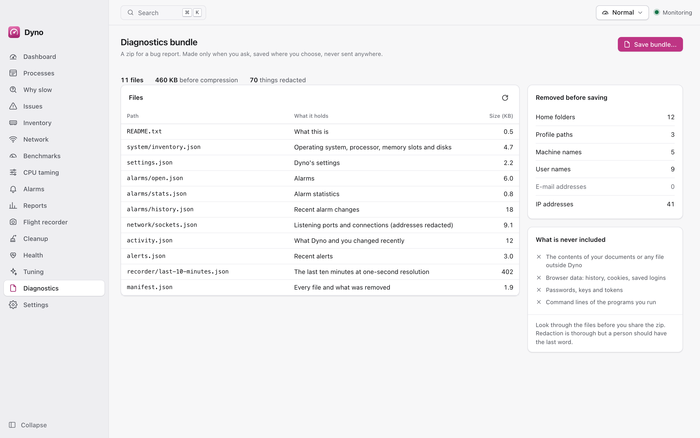

# User guide

Dyno measures your PC and explains why it is slow. It only watches: it never changes your machine, ends a program,
deletes a file or alters a setting ([ADR 0021](adr/0021-monitoring-only.md)). This guide covers what works today; screens
marked *placeholder* are described in [features.md](features.md) and [roadmap.md](roadmap.md).

## Glossary

| Term | Meaning |
| --- | --- |
| Agent | `dyno-agent`, the background program that measures and keeps your history, also when the window is closed |
| App | The Dyno window and tray icon |
| Application (group) | All processes of one program (Chrome and its 40 helpers) shown as one |
| Read-only | What Dyno is: it measures, explains and notifies; it writes only its own data (history, settings, alarm notes) |

## Install

Per OS in the [README](../README.md#quick-start); macOS in [macos.md](macos.md), Linux in [linux.md](linux.md). After
installing, open Dyno. The window starts with a short splash and then the dashboard. If no agent is running, the app starts
one; to keep measuring after you log in, turn on **Settings > Launch at login** (this registers the agent with the OS:
`SMAppService` on macOS, a systemd user unit on Linux, a per-user Run entry on Windows).

## First run

1. Open **Dashboard**. Tiles show CPU, memory, disk, network and, where your machine has them, GPU, battery, temperatures and
   fans. A tile that cannot be read says why (for example "no battery") instead of showing zero.
2. Press **Check now** to get the diagnosis: the likeliest cause of slowness, with evidence and suggestions in words.
3. Look at **Processes** to see which applications use the most.
4. In **Settings**, choose what the tray icon shows and how long history is kept.

## Everyday use

- **Dashboard.** Live tiles with sparklines, the history chart (hover for min, average and max; short spikes stay visible),
  the top applications, the health score and "Dyno: x % CPU, y MB" at the bottom, which is what Dyno itself costs.
- **Processes.** Applications are grouped; expand one to see its processes. Select a row for details (command line, working
  directory, modules, connections, signer), what is locking a file, and **Open location**. Take a snapshot and compare it with a
  later one. Dyno cannot end, suspend or change a process; use your system's own task manager for that.
- **Tray.** The icon shows the metric you chose; its dropdown is a compact dashboard. Closing the window keeps Dyno in the
  tray and the agent measuring; **Quit** closes the app (the agent keeps measuring until you stop it).
- **Why slow** explains the likeliest cause of a slow PC: what was measured, which apps are behind it, where to look closer.
  **Run again** checks anew; **Copy as text** puts the result on the clipboard.
- **Reports** shows a summary of the week (pick the week at the top): health score and trend, the busiest apps, disk space and
  how soon a disk fills, what needed attention and what changed. **Export** saves it as Markdown or a web page wherever you
  choose; nothing is sent anywhere. A week without history says "Nothing to report".
- **Throttling** says whether the processor is running slower than it could while it is busy, and why (heat, a power limit,
  battery saver, or unknown), how much speed it costs and how sure Dyno is. Below it are the episodes of the last 30 days and a list of
  what your machine does and does not report; when it reports too little, the page says "cannot tell" rather than guess.
- **Lifespan** shows how long your SSD and battery should last as a range ("about 23 months, 17 to 31"), what the estimate stands on
  and how sure it is. A new install needs a couple of weeks of readings first. If Dyno cannot read your SSD's wear it says what to
  install (smartmontools). A replaced disk or battery starts a new forecast.
- **Is this normal?** appears on the dashboard once Dyno has learned your usual week (7 days by default). It lists only what is out
  of the ordinary right now, in words ("CPU: higher than usual for Tuesday mornings, 71% against about 14%"). Change the learning
  period or switch alarms on in **Settings, Hardware and baselines**.

## Disk map and saved maps

**Disk map** shows where the space on a volume or a folder went, one folder level at a time (ring chart or table). Pick a
volume or choose a folder and the scan runs as a job with progress and Cancel.

A finished scan is **kept** on this computer, in the system cache folder (outside backups; it never leaves the computer), so
after a restart, an update or a login the page opens on the last map at once. The line under the title says how old it is and
that it is saved ("scanned 3 days ago (saved)"), and for a whole volume how the used space changed since: "Net change in used
space since: +12.4 GB". It is a **net** figure: files deleted and files written add up, so equal amounts show as no change.
Folders show their age only.

- **Rescan** reads everything again. The map you were looking at **stays on screen** and stays usable while the new pass runs;
  a strip above it shows the progress, with **Show progress** to watch the growing tree instead and **Cancel rescan**. When the
  pass is done the page swaps to the new map. If you cancel, or the rescan fails, the earlier map is still there.
- Dyno never rescans by itself unless you ask: in **Settings > Saved disk maps**, "Refresh when opened" can refresh a map older
  than a day or a week, at the first time you open the page (never in the background).
- **Forget this map** (on the page) and **Forget saved maps** (in Settings) delete them; switching **Keep disk maps** off
  forgets them all. They share a limit (1,024 MB by default, 64 to 8,192 MB), at most 16 maps, one per volume or folder; the
  least recently shown go first. A map too big for the limit says "Too big to keep; raise the limit in Settings".
- If a different disk is mounted under the same name, its old map is not shown.
- The list of performance counters and the list of installed software are kept the same way: they show at once as "Last
  known list", with their age, while Dyno reads them again; **Refresh** loads the new one.

## Issues and new programs

Open **Issues** to see what your system itself recorded going wrong: crashes, apps that stopped responding, unexpected
shutdowns, disk and memory errors, failing services. The big number is today's stability score out of 100; the bars are the days
before. Click an app or kind to filter, click a row for the system's own words, and use **Export for Debrief...** to save the
period as a file you can open in Debrief. If a log could not be read, the page says which one and why.

**New and unusual** lists programs Dyno has not seen on this PC. For the first week (Settings, New programs) it only learns.
Each program says why it is listed; a program that runs from a temporary folder or is not signed is "unusual because it...",
which is a reason to look, not a verdict. **Hide** removes it from the list,
and **Forget** in the menu starts learning again. Dyno never ends or removes a program because of this list.

## Searching and hashes

Right-click a process, a connection, an issue or a program and choose **Search the web…**: the text is shown with private details
removed; edit it, then **Search** opens your browser. **Search file hash on VirusTotal…** shows the file's SHA-256 (computed on your
computer) and opens VirusTotal's page for it; the file is never uploaded.

## Extras and backup health

**Extras** (one page, eight tabs) answers small questions without changing anything: *What changed* before things got slow, *Sleep*
(why the computer will not sleep and what woke it), *Boot* (how long start-up took and what slowed it), *Apps* (network and energy
per app), *GPU*, *Files* (large and duplicate files in a folder you choose), *Inventory* (installed software, with an export) and
*Maintenance* (when Dyno's heavier background work may run). If your system does not tell Dyno something, the tab says what and
why. In *Files*, Dyno lists duplicates and where they are; it removes nothing.

**Backup health** shows whether your backups ran: Time Machine, Windows Backup, File History, restic and Borg. It never starts or
changes a backup. A backup older than the limit you set (Settings, Backup health; 48 hours by default) raises an alarm. For restic
and Borg export their repository variables in your shell profile, or give Dyno the tool's folder in Settings. "No backup tool found"
is a normal answer.

## Settings

| Setting | Meaning |
| --- | --- |
| Theme | System, dark or light |
| Launch at login | Start the app in the tray and register the agent with the OS |
| Tray metric and style | What the tray icon shows |
| Sampling | System and process intervals (Dyno slows itself down when nobody is watching or on battery) |
| History retention | How long raw points and each rollup tier are kept |
| Alarms | Which conditions raise an alarm, quiet hours |
| Hardware and baselines | Whether and how long Dyno learns what is normal, and which hardware findings (throttling, disk and battery life, far-above-usual values) may raise an alarm |

Settings are versioned and saved with a backup; a damaged file falls back to the backup and then to the defaults.

## Command line

`dyno-agent` ships with the app (next to it, or in `Dyno.app/Contents/MacOS` on macOS):

```sh
dyno-agent status                      # is an agent running? prints pid, version, protocol
dyno-agent stop                        # ask the running agent to exit
dyno-agent once                        # one measurement as JSON; changes nothing
dyno-agent bench 25 processes          # Dyno's own CPU and memory for 25 s: none | summary | processes
dyno-agent service install|uninstall|status|ensure   # register it to start at login
dyno-agent run                         # run in the foreground (what the service starts)
```

`dyno` reads Dyno's status from a terminal or a script (full reference: [cli.md](cli.md)):

```sh
dyno status --json                 # how the PC is doing, as JSON
dyno top --by memory -n 5          # the busiest apps
dyno why-slow                      # the diagnosis in words
dyno counters search disk queue    # find a performance counter
```

## Counters

Open **Counters** in the sidebar. Search for a counter by words, or open an object and pick an instance, then choose **+** to chart
it. The chart marks Dyno's alarms and issues so you can see whether a spike followed one. Pin a counter to
keep it listed (Dyno then reads it every 15 seconds in the background, so its line already has history when you open the page), save the charted ones as a **set**, or use the row's **...** menu to add one to the dashboard. A counter that has
disappeared shows *Unavailable* with the reason. Rates (per second) need two readings, so a new line starts a moment later.

## Files and logs

- Data folder: `%LOCALAPPDATA%\Dyno`, `~/Library/Application Support/Dyno` or `~/.local/share/dyno`: `dyno.db` (history),
  `settings.json`, `agent.json`, `logs/`.
- Logs: the app's `logs/app.log` (small, rotating); the agent writes to its standard error, which the service keeps:
  `~/Library/Logs/Dyno/agent.log` on macOS, `journalctl --user -u dyno-agent` on Linux. Logs never contain file contents or
  command lines.
- Deleting `dyno.db` is safe: history starts again.

## Running with your own rights

Dyno 1.0 has no privileged helper. The app and the agent run with your own rights, register no system service, and never need
administrator rights to run. Installing needs none either, except that on Linux the `.deb` is a system package, so `apt` asks for
root (the AppImage needs none). What the OS shows only to administrators, or only to the account that owns a
process, is never guessed and never shown as zero: the figure says *Unavailable* with a plain reason (for example "Windows
shows this only to administrators").

Processes are grouped three ways. Yours and the system's are listed one by one. Other people's accounts form one **Other
users** row with whatever totals the OS allows. On Linux, a system that hides other accounts' processes (`hidepid`) says so
in one line above the list.

Dyno 1.0 runs only with your own rights, so there is nothing to approve and nothing to install. Elevation (a read-only helper
that gives the readings Dyno cannot get today, and starting as administrator at login) is planned for Dyno 1.1.

## Troubleshooting

<picture>
  <source media="(prefers-color-scheme: dark)" srcset="screenshots/diagnostics-dark.png">
  
</picture>

| Symptom | What to do |
| --- | --- |
| The window shows an error with **Retry** | The agent did not answer in 15 s. Retry; if it persists run `dyno-agent status`, then `dyno-agent run` in a terminal to see why |
| No history after a reboot | The agent was not registered to start at login: turn on Launch at login |
| A tile or column says "Unavailable" | Read the reason: the OS or hardware does not provide it (no battery, no sensor), or shows it only to administrators or to the owner of a process. |
| macOS: the agent does not start after an update | Dyno registers it again by itself; or `dyno-agent service ensure`; see macos.md |
| Linux: no tray icon | Install a status-notifier host (GNOME: the AppIndicator extension) |
| Windows: details, locks and startup are empty | Those adapters are not built yet (roadmap G8) |
