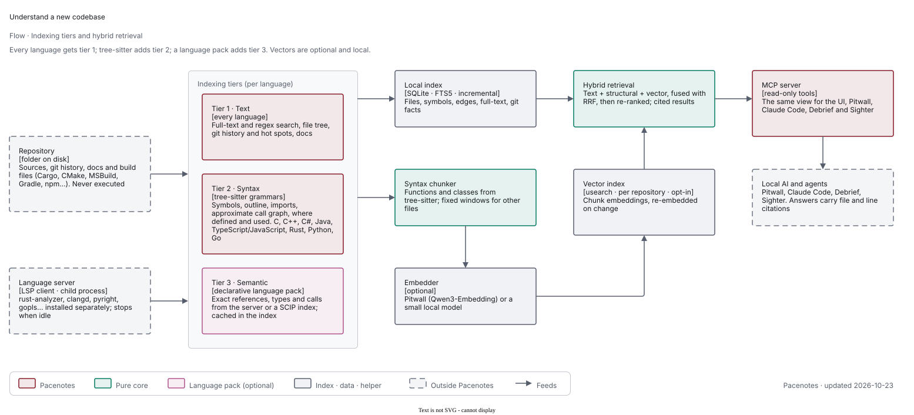
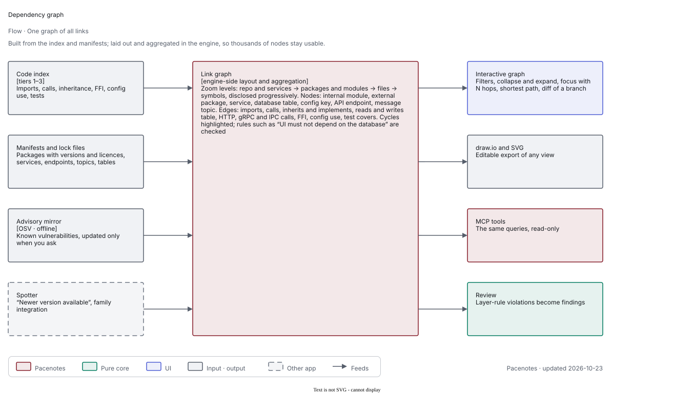
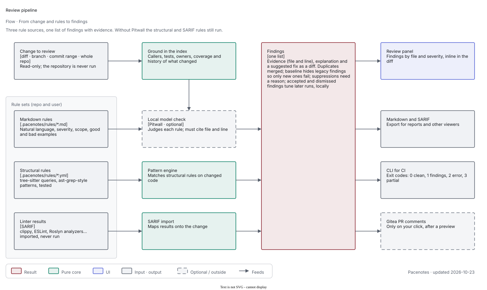

# Pacenotes

**Understand any new codebase, in any language: navigate, review, diagram and trace it, and serve it to local AI over MCP.**

Pacenotes reads a repository without running its code, builds a local index you can search and ask questions of, and gives
your local AI the same view over MCP. Everything runs on your machine.

> **Status: in design; implementation starts after Debrief's release.** There is no product code in this repository.
> The design is in [docs/proposal.md](docs/proposal.md) and open questions are pending.

## What it will do

## Understand a new codebase, in any language

Every language gets something useful, and better tooling for a language only adds precision:

1. **Text** (every language): full-text and regex search, file tree, git history and hot spots, docs.
2. **Syntax** (tree-sitter grammars): symbols, outline, imports, approximate call graph, where defined and used, structure diagrams.
3. **Semantic** (the language's own language server, or SCIP indexers, when the toolchain is present): exact references, types and calls. Pacenotes is a
   language-server client; a **language pack** (mostly a small TOML file) says how to find or install the server and what to ask it. Built-in packs for
   v1: C, C++, C#, Java, TypeScript/JavaScript, Rust, Python and Go. Servers are separate tools, never bundled, and start only after you trust the repository.

Open a folder and Pacenotes builds a local incremental index, detects languages and build systems (Cargo, CMake, MSBuild, Gradle, npm…), and shows an
**orientation**: entry points, modules and dependencies, external libraries, hot spots, tests and an editable draw.io architecture diagram. You then ask
questions answered by the local model in Pitwall, grounded in the index with file and line citations, follow a guided reading order and call traces, and
give Claude Code, Debrief and Sighter the same view over MCP. Limits are stated plainly: dynamic languages get "likely" call edges, macro-heavy C/C++ needs
the real build configuration, and answer quality depends on retrieval and the local model's size.

## Semantic search, locally

A per-repository, opt-in **vector index** over syntax-aware chunks is combined with text and structural search (hybrid retrieval, re-ranked), updated
incrementally as files change, with size limits. Embeddings come from Pitwall when it is present (Qwen3-Embedding), otherwise from a small local model you
download on a click, otherwise search is text and structural only. SQLite stays the source of truth (index, metadata, FTS5); the vectors sit in an embedded index beside it that is rebuilt from SQLite when missing or stale
(no vector database server), kept small in RAM because Pitwall shares the machine (disk-backed index, quantised vectors, a "Low memory" preset). Hits can be re-ranked and answered with citations through Pitwall. Nothing leaves the machine. (Debrief deliberately does not use vector search.)

## Views

Each view links back to code and is also a read-only MCP tool: architecture map, module and package dependencies with cycles, call graph and call-path
trace, sequence diagram from a trace, symbol outline and API surface, entry-point inventory (routes, commands, UI events, jobs, handlers), data flow for a
field, change impact, hot spots, ownership and knowledge map, test map with a coverage overlay, complexity and size metrics, duplicates and dead-code
candidates, TODO/FIXME inventory, dependency and licence inventory (SBOM), configuration and environment-variable inventory, domain glossary, and a guided
reading tour.

### One graph of all links

An interactive dependency graph with zoom levels (services, packages and modules, files, symbols), node kinds (module, external package with version and
licence, service, database table, config key, API endpoint, message topic) and edge kinds (imports, calls, inherits, reads/writes table, service calls, FFI,
config use, test covers). Filter, collapse, focus on a node with N hops, find the shortest path, see cycles, check layer rules ("UI must not depend on the
database") and see what links a branch adds or removes; export to draw.io or SVG. Known vulnerabilities come from a local, offline-mirrored advisory
database, refreshed only when you ask; layout and aggregation run in the engine so thousands of nodes stay usable.

## Code review with your own rules

Review a diff, branch, commit range or a whole repository. Rules come from three places: **Markdown rules** you write in plain language (checked by the
local model, which must cite file and line), **structural pattern rules** (tree-sitter queries, ast-grep style), and **linter results** imported as SARIF
(clippy, ESLint, Roslyn analyzers…). Rule sets live in the repository (`.pacenotes/rules/`) and per user, with severity, scope globs, good and bad examples
and tests. Findings carry evidence, an explanation and a suggested fix as a diff; suppressions need a reason; a baseline lets legacy code pass so only new
findings fail. Output goes to the review panel, Markdown or SARIF, CI exit codes, and, only when you click, Gitea PR comments. Without Pitwall, structural
and SARIF rules still work.

## More

Pacenotes is a small core (code index, headless service, MCP server, UI shell) with its functions as plugins:

- **Understand.** Symbols, references, call graphs, a token-budgeted repo map, search, stack-trace and log-site resolution, ownership and hotspots.
- **Review.** Rule packs and Markdown rules, an optional local-AI pass, suppressions, baselines and SARIF output.
- **Diagrams.** C4, module, class, call-graph and sequence diagrams as draw.io files that keep your hand edits when regenerated.
- **Requirements.** Import requirements from Word, Excel, CSV and Markdown (later PowerPoint, PDF, ReqIF), link them to code and tests, and see what
  is untraced, uncovered or suspect.
- **Tests & coverage.** Coverage import, patch coverage, test inventory and the untested hotspots that matter.
- **Debrief bridge.** Debrief asks "does this log line, exception or config key exist in the code?" and gets a verdict with evidence, owners and recent commits.
- **Language packs.** Grammars and query packs for tier 2, and declarative language-server packs for tier 3, signed and tested.
- **MCP.** Pacenotes is an MCP server (read-only code-index tools, local only) and can be an MCP host for deterministic flows, such as handing a drafted
  test plan to Sighter.

Proposed, to be confirmed: an upgrade-impact planner, API change detection between revisions, a test-gap finder, "explain this diff", documentation views
with stale-doc detection, onboarding notes pinned to code, and history views.

It never executes repository code (the one opt-in exception is a language server you choose to run for a repository you trust: off by default, per repository, through "Trust this repository", revocable, and never inferred), is read-only towards your
repositories, redacts secrets from what it returns, and sends nothing off the machine.

## What uses Pitwall and what doesn't

Pacenotes analyses the code itself; [Pitwall](https://dev.decryptology.net/decryp7/pitwall), the family's local LLM
server, explains what Pacenotes found and answers questions about it. Graphs and paths are facts from the index, never
guesses, and the model only explains facts Pacenotes has already found, with citations.

| Without a model (always available) | With Pitwall (optional) |
| --- | --- |
| Index, symbols, references, call graphs, the dependency graph with every link | Answers in plain language ("where is login handled?"), citing files and lines |
| Architecture maps and diagrams, sequence diagrams from traces, change impact | Explanations and summaries: modules, files, "explain this diff", the reading tour's narrative |
| Metrics, hot spots, ownership, coverage, duplicates, TODOs, SBOM and licences | Plain-English names for groups in generated diagrams |
| Structural review rules, SARIF linter results, architecture rules | Review rules written in Markdown |
| Text and structural search | Search by meaning (embeddings) and reranking |

Without Pitwall you keep every graph, view, metric and structural review; only the natural-language features are off.
Pitwall loads a model only when you ask something in words, so analysing a repository needs no model memory.

## How it fits the family

Pacenotes is the seventh app of the Paddock family. [Pitwall](https://dev.decryptology.net/decryp7/pitwall) is the
local model server Pacenotes uses for the features above and for embeddings (and is optional: every other function
works without it); MCP hosts such as Claude Code, Debrief or Sighter's agent query Pacenotes' read-only MCP tools,
[Debrief](https://dev.decryptology.net/decryp7/debrief) checks stack traces and log lines against the code,
[Sighter](https://dev.decryptology.net/decryp7/sighter) runs the UI tests whose plans Pacenotes can draft from
requirements, and [Pitcrew](https://dev.decryptology.net/decryp7/pitcrew) runs the headless service in CI. See the
[family overview](https://dev.decryptology.net/decryp7/paddock/src/branch/main/docs/ecosystem.md).

## Documentation

- [Design proposal](docs/proposal.md) (status: proposal, open questions pending)
- [Architecture direction](docs/architecture-direction.md)
- Diagrams: [docs/diagrams](docs/diagrams) (draw.io sources and exported SVG; regenerate with `node docs/diagrams/src/generate.mjs` and `scripts/export-diagrams.sh`)
- [Lessons from the suite](docs/suite-lessons.md)
- [Engineering rules](AGENTS.md)

## Licence

Dual-licensed under [MIT](LICENSE-MIT) or [Apache-2.0](LICENSE-APACHE), at your option.
