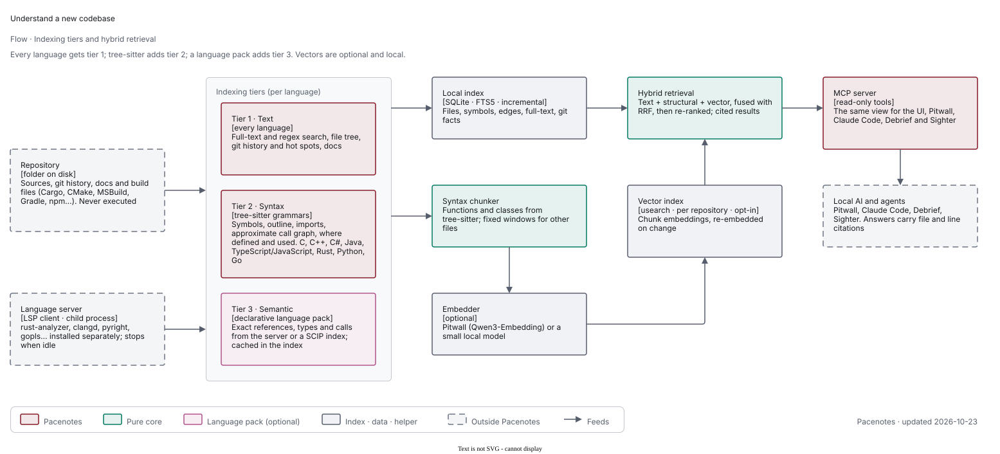
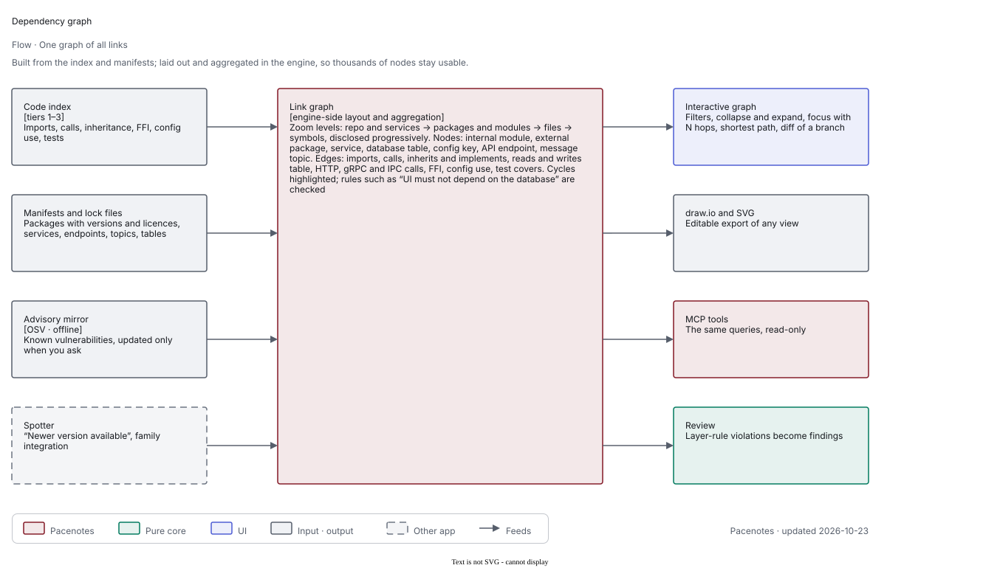
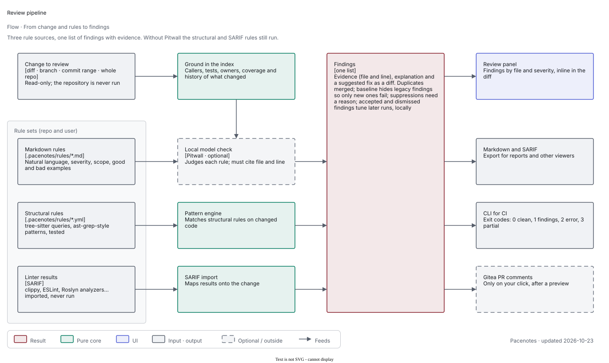

# Architecture direction

Decided 2026-10-23. The detailed catalogue and research are in [proposal.md](proposal.md) (revision 2, open questions
pending); this page is the short version of how Pacenotes is put together.

## Core and plugins

Pacenotes is its own app, not part of Debrief, for everything that is about code. It is a small **core** plus
**plugins**.

**Core** (built in, always present):

- **Code index**: tree-sitter parsing in isolated worker processes, an incremental SQLite store, git history through a
  `History` port, a secret denylist and a workspace allow-list; a **vector index** for semantic search behind a `VectorIndex` port (opt-in per
  repository, see below); and an **LSP client** that runs a language's server headless for tier 3 (see below).
- **Headless service and CLI**: the same engine without the UI, for CI and scripts.
- **MCP server**: stdio and loopback HTTP with per-client keys, grants, budgets and a call log. Tools are contributed by
  plugins; the core owns transport, auth and limits.
- **UI shell**: Tauri 2 and Angular. The core renders **declarative views** that plugins describe; plugins never ship
  web code.
- **Plugin host**: the guarded, quarantining, signature-checking host described below.

**Plugins** are out-of-process Rust programs on Debrief's ADR 0017 model: they depend on the plugin API crate only, talk
over one versioned postcard IPC on a private local stream, run under timeouts and memory caps, are quarantined after
repeated faults, and are signed.

## The plugins

| Plugin | Adds | MCP tools (examples) |
|---|---|---|
| Understand | Symbols, references, call graph, outline, repo map, search, stack-trace and log-site resolution, ownership and hotspots | `repo_map`, `file_outline`, `read_symbol`, `find_symbol`, `references`, `call_graph`, `search`, `explain_stack_trace`, `hotspots`, `owners` |
| Review | Rule packs (own rules, no GPL rule sets), optional LLM pass, suppressions, SARIF, Markdown-rules handling | `review_diff`, `review_status`, `review_findings`, `review_rules`, `explain_rule` |
| Diagrams | C4, module, class, call-graph and sequence diagrams as canonical, round-trip-safe draw.io files that keep hand edits | `generate_diagram`, `diagram_for_symbol`, `diagram_status` |
| Requirements | Importers (xlsx, docx, csv, md; later pptx, pdf, ReqIF), links with a suspect model, traceability reports | `list_requirements`, `trace_requirement`, `requirements_for_symbol`, `coverage_report`, `check_requirement` |
| Tests & coverage | Coverage import, patch coverage, test inventory, untested hotspots, test drafts | `coverage_for`, `patch_coverage`, `untested_hotspots`, `tests_for_requirement`, `draft_unit_test`, `draft_ui_test_plan` |
| Debrief bridge | Lets Debrief ask whether a log line, exception or config key matches the code | `check_log_site`, `check_exception`, `find_config_usage`, `find_throw_sites` |
| Language packs | Grammars and query packs per language (tier 2) and **declarative language-server packs** (tier 3, LSP client); optional code plugins for framework-aware edges | none of its own |

Tools that write (diagram files, review comments, accepted test drafts, imports, suppressions) are UI/CLI only and never
exposed over MCP.

## Understand any codebase: tiers (decided 2026-10-23)

The main use case is "understand a new codebase, in any language", with three tiers per language: **1 text** (every language: search, file tree, git history and
hot spots, docs), **2 syntax** (tree-sitter: symbols, outline, imports, approximate call graph, structure diagrams) and **3 semantic** (the language's own
language server, run by Pacenotes as an LSP client, or SCIP indexers). Tier 3 comes from **language packs**: mostly declarative TOML (server command,
detection or a pinned SHA-256-checked download on click, workspace and build-config discovery, LSP features used, optional SCIP command), with out-of-process
Rust code plugins only for custom indexers, framework-aware edges (routes, DI, ORM mappings) and extra review rules. Built-in packs for v1: C, C++, C#, Java,
TypeScript/JavaScript, Rust, Python and Go. Servers are separately installed tools and never bundled; they start only after "trust this repository" (they may run
build logic), are supervised (timeouts, limits, backoff, quarantine, idle stop) and their answers are cached in the index. Details: proposal section 20.

## Semantic search

A local vector index (per repository, opt-in) over syntax-aware chunks, fused with text and structural search (RRF) and re-ranked. Embeddings are Model2Vec static vectors plus BM25 on the CPU
(default, incremental, no Pitwall needed); Qwen through Pitwall re-ranks a query's top ~50 hits and, as an opt-in per-repository
"Deep index with Qwen" job, can embed everything (ADR 0001, amended 2026-10-28). Shared parts planned as the family crate `paddock-embed`. Store recommendation to confirm:
`usearch` behind the `VectorIndex` port with chunks and FTS5 in SQLite; LanceDB is the fallback. Proposal section 21.

## Views, dependency graph and review

A catalogue of views (architecture map, entry points, change impact, hot spots, inventories, guided reading and more; proposal section 22) and one interactive
**dependency graph** with zoom levels, filters, paths, cycles, layer rules and diff mode, laid out in the engine (section 23). **Review** takes rules from
three sources: user-defined Markdown rules checked by the local model, structural pattern rules, and linter results imported as SARIF, with baselines,
suppressions with reasons and CI exit codes (section 24).

## MCP

Pacenotes is an **MCP server** (read-only code-index tools, local only) and can be an **MCP host** for deterministic flows such as handing a drafted plan to
Sighter: only granted servers, non-read-only calls on a click. Models still reach tools through Pitwall.

## Phasing

1. **v1**: core, Understand, Review, Debrief bridge and the core language packs.
2. **Then Diagrams.**
3. **Then Requirements.**
4. **Then Tests & coverage.**

Implementation starts after Debrief's release. There is no cut-down public release inside these phases.

## Boundaries and shared parts

- **Sighter** owns UI test execution. Pacenotes owns requirements and traceability and can draft a test plan for Sighter;
  it never runs UI tests.
- **Shared Paddock crates**: the plugin host, plugin API and IPC (extracted from Debrief into Paddock), the Pitwall
  client, and `@decryp7/paddock-ui`. Pacenotes copies no code from Debrief's crates.
- **Never executes repository code**; read-only towards repositories. One opt-in exception: a language server started for a trusted repository (tier 3, below).
- **Vector search is Pacenotes-only.** Pacenotes has a local vector index; Debrief deliberately does not.

## Pitwall is optional

Every function works without Pitwall. Where a function needs a model (the LLM review pass, draft tests, semantic
requirement links), it shows a "needs local AI" state with a next step to set up Pitwall, and deterministic results are
still returned.
