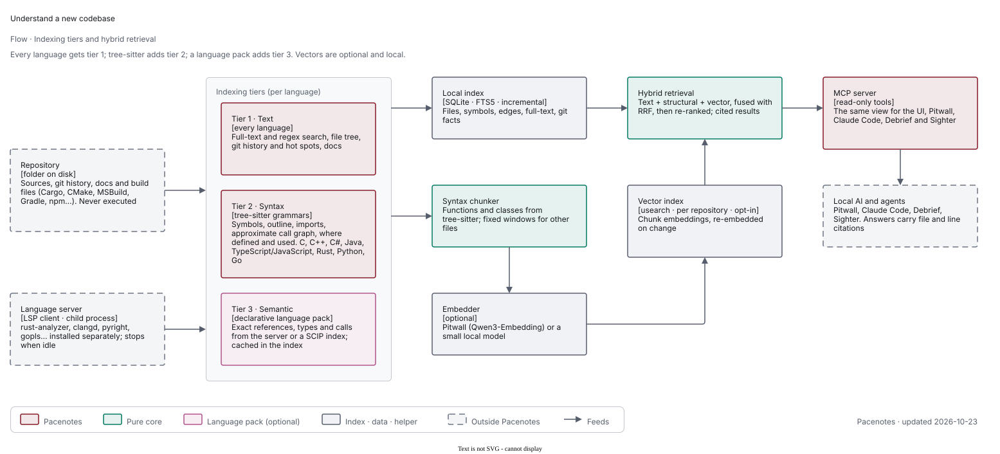
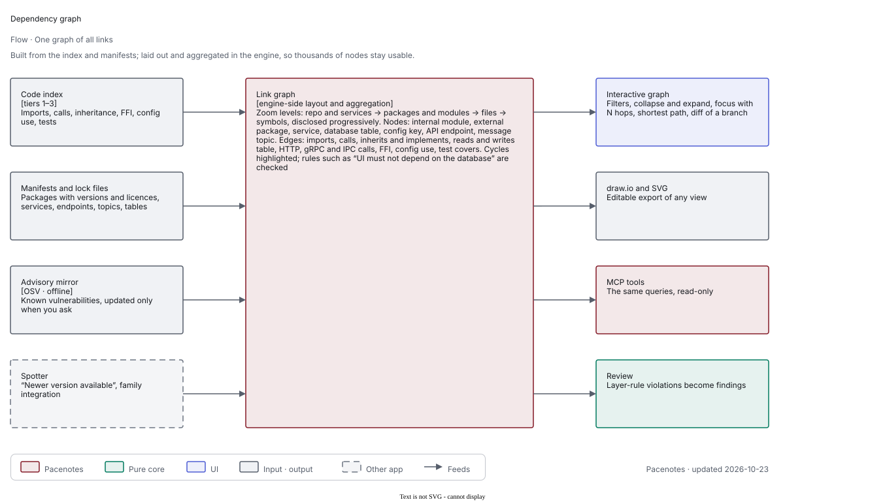
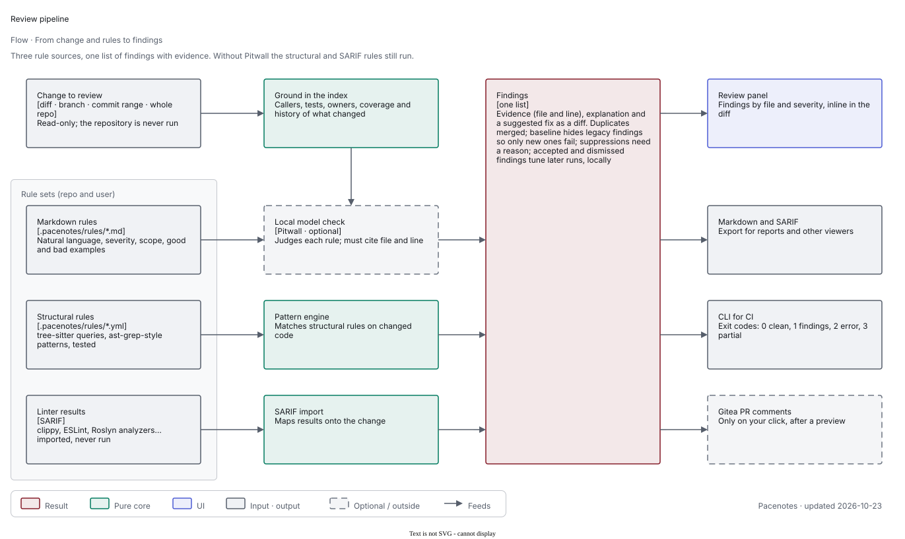

Status: proposal, open questions pending. Direction decided 2026-10-23: Pacenotes is its own app (not inside Debrief) for everything code-related; its functions (Understand, Review, Diagrams, Requirements, Tests & coverage, Debrief bridge, language packs) are plugins on a core of code index, headless service, MCP server and UI shell. Sighter owns UI test execution; Pacenotes owns requirements and traceability.

# Proposal: a local codebase tool, rev 2 (working name "Pacenotes")

Status: revision 2 of the proposal for the user, 2026-10-23. Nothing is built or queued. Revision 1 is kept as `proposal-codebase-tool-rev1.md`.
Research by web search, GitHub/crates.io/PyPI/npm metadata and raw LICENSE files on 2026-10-23. Items marked (unverified) were not confirmed
from a primary source. Licence statements are engineering reading, not legal advice.

What changed since rev 1: the user's objectives are now (1) understand a codebase, (2) code review, (3) generate draw.io diagrams, (4) MCP for
Pitwall, (5) let Debrief query and check code; plus requirements traceability (Word/Excel/PPT/ReqIF), tests and coverage (with Sighter for UI
tests), language packs, and round-trip-safe hand-editable diagrams. The product is no longer "a code search MCP server"; it is a **read-only
code intelligence workbench**. Sections 1-3 reframe; 4-5 are the survey and the licence findings; 6 is the full catalogue; 7-13 the designs; 14-15
architecture and integrations; 16-19 safety, risks, questions and size. **Update 2026-10-23** (sections 20-26): the main use case (understand any
new codebase, tiers), a vector index for semantic search (Pacenotes only), views, the dependency graph, the expanded Review rule sources and further
proposals; where these change earlier text (sections 3, 6.2, 11, 18, 19) it is edited in place.

## 1. Product pitch and the one hard rule

Pacenotes indexes code on your machine into a symbol, reference, call, import, history, test, coverage and requirement graph, and then:
**explains** it (repo map, tours, architecture summary, hotspots), **answers** exact questions (who calls this, what reads this key), **reviews**
changes (deterministic rule packs plus a Pitwall LLM pass, grounded in the index), **draws** it (draw.io diagrams in the Paddock style that you can
edit by hand and that survive regeneration), **checks** Debrief's logs and traces against the code at the right revision, **traces** requirements
to code and tests, **measures** test coverage by importing reports, and **drafts** tests. It is a Tauri 2 + Angular desktop app with a Rust
engine, and at the same time a **read-only MCP server** for Pitwall.

**Hard rule (kept from rev 1, now covers every new feature): Pacenotes never executes repository code.** No build, no tests, no coverage runs, no
language servers unless the user trusts the repository (tier 3, section 20.4), no rule that runs a script from the repo, no proc macros. Anything that needs execution (running a generated test,
producing a coverage report, building a SCIP index) is done by the user or by **Pitcrew on the user's runner**, and the results come back as
**imported files** (coverage, JUnit/TRX, SCIP). Pacenotes writes only: its own index/app data, files the user explicitly exports, diagram files in
`docs/diagrams` after a previewed diff, and (optionally, with consent) Gitea review comments through the user's token.

## 2. Name (re-evaluated for the broader scope)

Collision checks 2026-10-23: GitHub repository-name search, crates.io, npm registry, plus web search. Not a legal/trademark search.

| Candidate | Meaning | Fit for understand + review + diagrams + MCP + check + requirements | Collision evidence | Verdict |
|---|---|---|---|---|
| **Pacenotes** | Co-driver reads the road ahead from notes recorded on the recce | Good: notes about the terrain (understand, diagrams, tours), read aloud to the driver/model (MCP), "caution" calls (review), "does the road match the notes?" (check). Weakest for requirements | crates.io and npm free. 30 GitHub repos by name, best 3 stars (a TypeScript one, rally tools). Consumer rally apps ("Pacenote", "Pacenotes Pro", RallyEasy). `Ashon/pacenote` is a macOS app ("Pace") that sandboxes Claude Code/Codex sign-in: a different product, same developer-tool space, low risk | **Recommended** |
| **Roadbook** | The rally navigation document handed to crews: route, notes, distances, diagrams | Very good for the document side (diagrams, requirements, coverage reports, tours, architecture docs), less for "review" | crates.io free, npm free. 454 repos by name, top ones are travel-itinerary scripts (30 stars), no developer tool | **Runner-up** (replaces Gridwalk) |
| Gridwalk | Walk the starting grid, inspect every car | Fine for "walk the repo", weak for review/diagrams/MCP | crates/npm free; 95 repos, a creative-coding `gridwalk` org (26 stars). Meaning is thin | Dropped to third |
| Parc Ferme | Cars frozen and inspected after the race: a read-only snapshot at a revision | Good for "check at version X" and review, poor for understand/diagrams | 18 repos, nothing notable; crates/npm free (as `parcferme`). Accent, two words, awkward in CLI/crate names | Not recommended |
| Recce | Reconnaissance drive that produces the pacenotes | Excellent meaning ("understand before you race") | **Collision**: DataRecce/recce, 480 stars, TypeScript/Python, a dbt data-validation tool for PR review (same "review" space); a `recce` crate and npm package exist; also a Rust web-recon crate | Avoid |
| Scrutineer | Inspector who checks cars against the rules | Perfect for review/requirements | **Collision**: alpha-omega-security/scrutineer (256 stars, Go, local security-scan tool with agent backends), npm package exists | Avoid |
| Stewards | Officials who judge incidents | Review only | Generic; 781 repos by name, many unrelated; nothing that owns it | Weak identity |
| Codriver | Co-driver in your tool chain | Good for MCP/assistant framing | 96 repos; `ViktorTrn/codriver-mcp` (16 stars) and `RickyDane/CoDriver` (152 stars); sounds like Copilot | Avoid |
| Homologate | Certify a car against regulations | Excellent for requirements, narrow otherwise | Free on crates/npm, 3 repos; clumsy word | Only as the name of the requirements module |

Also considered and rejected: Telltale (a `telltale` crate and npm package exist), Marshal (crate and npm exist, generic), Chicane, Slipstream
(generic, rev 1). **Recommendation: Pacenotes** (crates `pacenotes-*`, CLI `pacenotes`, MCP server `pacenotes`); sub-modules keep plain names
(Review, Diagrams, Check, Requirements, Coverage). **Runner-up: Roadbook.** Do a trademark search before the name is public. Avoid Paddock, Pitwall,
Pitcrew, Spotter, Debrief, Dyno, Sighter.

## 3. What works for LLM grounding (research summary, from rev 1)

- Agentic lexical search beats a one-shot vector index for coding agents (secondhand reports on Claude Code; Cursor still embeds). Decision of
  2026-10-23: Pacenotes **does** add a local vector index, but as one leg of **hybrid** retrieval next to exact text and structural search, never
  instead of them (section 21). Debrief keeps its no-vector-search decision. Traceability (section 11) keeps candidates + judge; the vector index may
  later supply one more candidate source (question 22).
- Repo map = tree-sitter definitions + reference graph + ranking cut to a token budget (Aider, default 1k tokens): ideal for small local models.
- Symbol-level tools (find definition, references) save most tokens (Serena). Serena's licence, checked in this run: **SolidLSP MIT, the Serena
  application GPL-3.0-or-later** (rev 1 said MIT; corrected). Reference design only; it is Python.
- Precise graphs exist as formats: SCIP (Apache-2.0), Kythe (heavy). GitHub stack-graphs was archived 2025-09-09: do not depend on it.
- Git history is cheap, high-value context. Greptile (cloud) sells a code graph for review; Sourcegraph MCP is Enterprise only; Bloop archived Jan 2025.
- Community MCP code servers exist (filesystem, git, tree-sitter, language-server wrappers); none is a native, desktop-managed, budget-aware,
  history-aware, review/diagram/requirements-capable server.
- LLM traceability research: recall of roughly 60-80% with lower precision, authors say not sufficient without human oversight; small LLMs work well
  as a **filter over candidate pairs** (keeps recall, shrinks the space). This directly shapes section 11: candidates from lexical/structural
  evidence, LLM as judge, human confirms.

MCP state (verified 2026-10-23, from rev 1): spec revision 2026-07-28 is **stateless** (no initialize handshake; `server/discover`; per-request
`_meta`), Streamable HTTP + stdio, Roots/Sampling/Logging deprecated. Rust SDK `rmcp` (Apache-2.0; open: does 3.x implement the stateless
revision). Consequence: every tool takes explicit `workspace` and `rev`, no connection state.

## 4. Survey

### 4.1 Code review tools (what to take, what to avoid)

| Tool | Licence / model (checked) | Takeaway for Pacenotes |
|---|---|---|
| CodeRabbit | Commercial SaaS; self-hosted only Enterprise (docs: 500+ seats; an AWS Marketplace listing shows $15,000/month) | Walkthrough summary, per-file comments, chat on a PR, learnings from feedback. Not usable locally |
| Qodo PR-Agent | Was AGPL-3.0 after the Apache-2.0 launch; Qodo announced the return to Apache-2.0 and community stewardship at `The-PR-Agent/pr-agent` (GitHub API now reports MIT for that repo; secondary listings disagree). **AGPL flag: do not copy code from the AGPL-era history.** Qodo Cover is AGPL-3.0 | Commands (`/review`, `/describe`, `/improve`), token-budgeted PR compression, JSON-schema'd findings. Ideas only; we write our own |
| Sourcery | `sourcery-ai/sourcery` repo MIT (the product is a commercial service) | Refactoring-suggestion style, rules as code |
| Graphite reviewer, GitHub Copilot review | Commercial SaaS (unverified detail) | Stack/PR summaries, suggestion blocks one click to apply. Cloud: out |
| SonarQube / SonarLint (SonarQube for IDE) | Community Build and IDE: LGPL-3.0, but since Dec 2024 the **bundled analyzers are under the Sonar Source Available License v1.0** (bars building similar products, bars using AI to interact beyond what is included) | **Do not embed or copy Sonar rules/analyzers.** Take the taxonomy (bug, vulnerability, smell, hotspot), quality gate on new code, "clean as you code" |
| Semgrep | Engine **LGPL-2.1**; **rules (`semgrep-rules`) under Semgrep Rules License v1.0: internal business use only, no redistribution or competing service**; third-party registry rules inherit their own licences (Trail of Bits: AGPL-3.0) | Do not ship or copy Semgrep rules. Pattern-with-metavariables rule syntax is a good model. The engine is OCaml: not bundled |
| **ast-grep** | MIT; Rust, tree-sitter based | Closest to our design: structural patterns with metavariables and YAML rules. Use as **design and possibly as a library** (ast-grep-core is a Rust crate; check its tree-sitter version pinning) |
| reviewdog | MIT (Go) | Converts any linter output to review comments via a common diff-position format (rdjson); informs our import of external linters |
| Danger (danger-js) | MIT | "Rules over a PR" as code; informs the cross-check rules (changelog updated? tests touched?) but we do it as TOML |
| clippy / eslint | MIT/Apache-2.0 / MIT | Run by the user's CI (Pitcrew), **not by us** (they compile/execute plugins and build scripts). We import their SARIF/JSON output |
| Qodana | Community edition free but limited; Ultimate/Ultimate Plus paid per active contributor (90 days), annual licence | JetBrains inspections as SARIF; import only |
| CodeScene | Commercial | Behavioural analysis: hotspots (change frequency x low Code Health), change coupling, knowledge silos / bus factor, Code Health trend on PRs. Worth copying as features (section 6) |

### 4.2 Diagram and layout tools

| Tool | Licence (checked) | Note / verdict |
|---|---|---|
| **draw.io** (`jgraph/drawio`) | Apache-2.0 (the desktop wrapper `drawio-desktop` is GPL-3.0: we only **launch** it, never link it) | Our target format. Plain `<mxGraphModel>` accepted; `<mxfile>` wrapper; diagram body may be raw-deflate+Base64 compressed (draw.io's default) or uncompressed; draw.io docs recommend generating uncompressed |
| Structurizr (CLI/DSL) | `structurizr/cli` Apache-2.0 (Java); layout stored in a separate JSON and merged into the re-parsed model by matching element ids; ids come from creation order, so reordering loses layout | The closest published precedent for "regenerate without losing hand layout". We use content-derived stable ids instead of order-derived |
| PlantUML | GitHub reports **LGPL-3.0** (multi-licence offered; the user's note said GPL). Java, needs Graphviz for most layouts; draw.io is removing PlantUML support (end 2025 online, 2028 Confluence/Jira) | Unusable for us regardless: JVM + Graphviz runtime, no hand-editable round trip |
| Mermaid | MIT (JS) | Not our format (no stable layout; imports into draw.io lose it, unverified); useful only as a text export for READMEs |
| Graphviz | EPL-2.0 (repo LICENSE on GitLab; older releases CPL) | Native binary; permissive enough to spawn, but a runtime dependency we do not need and its edge routing does not follow the Paddock rules. Not bundled |
| **ELK / elkjs** | **EPL-2.0** (elkjs LICENSE.md; ELK Maven POMs also offer EPL-2.0 OR GPL-3.0-or-later) | Weak, file-level copyleft: using it unmodified is allowed with notices and source availability for the EPL files, modifications to those files stay EPL. Usable in principle, but it is a JS/Java artefact: running it needs a JS engine inside the Rust engine. Not recommended for the core; acceptable only as an optional UI-side helper |
| dagre | MIT (`dagrejs/dagre`, JS) | The algorithm (Sugiyama layered) is well known and simple. Rust ports exist: `dagre` 0.1.1 (Apache-2.0, 7.8k downloads, immature), `dugong`, `dagre-rs` (licences not checked) |
| Rust layered layouts | `rust-sugiyama` 0.4.0 **MIT** (52k downloads); `layout-rs` 0.1.3 **MIT** (827k downloads, parses DOT and renders SVG); `bra0-layout` 0.2.2 MIT OR Apache-2.0 (163 downloads) | Candidates for call/dependency graphs |
| pyreverse (pylint), code2flow, dependency-cruiser, Doxygen graphs | pylint GPL-2.0 (unverified), code2flow MIT (unverified), dependency-cruiser MIT (unverified); **Doxygen GPL-2.0** | Feature models only: UML class/package diagrams from code, call graphs by name, dependency rules/validation, include/call/caller graphs. Doxygen's use of Graphviz/dot is the precedent for large-graph pruning (node limits, depth) |

**Layout recommendation.** Most Paddock diagrams are small and structured, so do **not** adopt a general engine first. (1) C4, deployment, class, state:
**template layouts** in Rust: role-based rows/columns on the 8 px grid, deterministic, the way the Paddock templates are built. (2) Call graphs, module
and dependency graphs: a small **Sugiyama layered layout** (rank by longest path, crossing reduction by barycentre, coordinate assignment, then
snap to the grid) implemented in `pacenotes-diagram` using `rust-sugiyama` (MIT) as a starting point or a clean-room port of the dagre algorithm
(MIT) if its output does not meet the style (verify when prototyping). (3) **Edge routing is ours**: orthogonal with pinned ports per STYLE.md, which
no off-the-shelf engine gives. ELK stays the escape hatch if a benchmark shows our layered layout inadequate; its EPL-2.0 would then need an ADR.
The layout engine places only new cells or everything on request (section 9.3).

### 4.3 Understand-tools and wiki generators (features worth taking)

| Product | Features to take | Notes |
|---|---|---|
| Sourcegraph | Code search (regex/structural), code navigation, batch changes, code insights | Cody Free/Pro ended July 2025; MCP is Enterprise |
| Greptile | Code graph for review, learns from comments | Cloud |
| SciTools Understand | Butterfly graph (callers/callees), call/inheritance/include trees, metrics, "butterfly compare" (added/removed/modified between versions), coverage-coloured graphs | Commercial; our call graph + diagram diff mirror these |
| Doxygen | Source browsing, caller/callee, include and inheritance graphs | GPL-2.0, feature model only |
| Structurizr | C4 model as code, views, themes | Section 4.2 |
| Swimm | Docs coupled to code: live snippets, auto-sync, CI check fails when code change may stale docs | Direct model for "stale diagram/doc" checks and tours |
| DeepWiki / Devin Wiki; DeepWiki-Open (AsyncFuncAI), OpenDeepWiki | Generated wiki per repo with architecture diagrams (Mermaid) and chat | Self-hosted clones use embeddings/RAG; ours is index-first, local, MIT-compatible |
| Mintlify / Docusaurus autogen | Docs site generation | Out of scope (we export Markdown, not host sites) |
| JetBrains Qodana, Code With Me insights | Inspections as quality gate; baseline; ownership/insights | Qodana is import-only; no live collaboration |
| Aider repo map | Ranked outline within token budget | v1 |
| Serena | Symbol tools over LSP | Our index replaces LSP by default |
| CodeScene | Hotspots, change coupling, knowledge loss, Code Health | v1 hotspots, Later coupling/knowledge |

### 4.4 Requirements and traceability tools

| Tool | Licence | Takeaway |
|---|---|---|
| Jama Connect, Polarion, codebeamer, IBM DOORS | Commercial | Items, links, suspect links (flagged when an upstream item changes), coverage/impact analysis, baselines, ReqIF exchange |
| **Doorstop** | **LGPL-3.0** (PyPI classifiers) | Requirements as YAML in git; links with a content hash so changes show as "suspect". Idea reused: store a hash of the linked requirement text in each confirmed link to detect drift |
| **StrictDoc** | **Apache-2.0** (repo LICENSE) | Requirements + source-code traceability (forward and reverse), exports HTML, RST, ReqIF, PDF, Excel. Closest open model; pattern for in-code references |
| OpenFastTrack | licence not confirmed in this run (GitHub API gave none; I recall GPL-3.0, unverified) | Tagging requirements in code and docs, "covered/uncovered" reports. Idea only |
| sphinx-needs | MIT (GitHub API) | Typed needs with links, filters, traceability tables in docs |
| ReqIF | OMG standard (ReqIF 1.2, 2016), XML; Python `reqif` library exists; a `.reqifz` zip variant; the standard leaves open how to distinguish requirements from headings, so mapping packs are needed | Parse with quick-xml; export later |
| LLM traceability research | TraceLLM (recall ~60-70%), KIT RAG work, small-LLM candidate filtering (arXiv 2602.01253 and others) | Human in the loop, candidates then judge |

### 4.5 Test and coverage tools

| Tool | Licence | Takeaway |
|---|---|---|
| Codecov, Coveralls | SaaS (the Codecov uploader is Apache-2.0) | Patch coverage on PRs, trends, flags per component; we offer local equivalents |
| SonarQube coverage | Import of JaCoCo/Cobertura/LCOV/OpenCover into "coverage on new code" | Quality gate on new code concept |
| JaCoCo | EPL-2.0 (from memory; LICENSE not retrievable) | Produces XML we import; never run by us |
| coverlet / OpenCover / ReportGenerator | coverlet MIT (checked); OpenCover MIT-compatible text (checked); ReportGenerator Apache-2.0 (unverified) | Cobertura/OpenCover XML imports |
| cargo-llvm-cov | Apache-2.0 OR MIT (crates.io) | Emits LCOV / llvm-cov JSON that we import |
| istanbul/nyc, c8 | istanbul BSD-3 (unverified); c8 **ISC** (npm) | istanbul JSON, LCOV |
| gcovr | BSD-3 (unverified) | Cobertura/LCOV/JSON for C/C++ |
| Diffblue Cover | Commercial (unverified) | Java unit test generation by RL; reference only |
| Qodo Cover / Cover-Agent | **AGPL-3.0** (repo LICENSE) | Loop: generate, run, keep only tests that build, pass and raise coverage. **Do not copy**; we reimplement the loop with the execution delegated to the user's CI |
| EvoSuite, Pynguin | LGPL-3.0 each (unverified; I recall) | Search-based generation; not usable (JVM / Python), ideas only |
| Meta TestGen-LLM (FSE 2024) | Paper | Filters: builds, passes repeatedly (flake check), raises coverage; 75% built, 57% passed reliably, 25% raised coverage; 73% of recommendations accepted by engineers |

### 4.6 Language pack ecosystems

- **Zed**: language extensions are Git repos with `extension.toml`; grammars declared as `[grammars.<name>]` with repository and `rev` (a commit SHA);
  each language has a folder with `config.toml` plus query files (`highlights.scm`, ...); grammars are compiled to **WebAssembly** (wasm32-wasip2,
  wasi-sdk); extension logic is also Wasm via WIT. Closest precedent to our packs.
- **Helix**: `languages.toml` with `[[language]]` and `[[grammar]]` entries; queries in `runtime/queries/<lang>/`; the first matching query wins
  (Neovim: last wins). Helix is MPL-2.0.
- **nvim-treesitter** (Apache-2.0): a parser registry plus per-language `highlights/locals/injections/folds` queries; no wasm by default. Neovim can
  load wasm parsers when built with the tree-sitter wasm feature (from a Neovim PR; secondary).
- **GitHub code navigation**: per-language `tags.scm` queries (`@definition.*`, `@reference.*`) in each grammar repo: the standard we reuse (also what
  Aider's repo map uses).
- **difftastic** (MIT): compiles a fixed set of tree-sitter grammars in; shows the trade-off of built-in only.
- **tree-sitter Rust crate** (MIT): a `wasm` feature using wasmtime (`WasmStore`, `load_language(name, bytes)`, `Parser::set_wasm_store`).
  `wasmtime` is Apache-2.0 WITH LLVM-exception (crates.io), a large dependency; compile-time cost is real.

## 5. Licence findings in one place

Unusable, or usable only as ideas:

| Item | Finding | Consequence |
|---|---|---|
| Semgrep rules | Semgrep Rules License v1.0: internal business use, no redistribution or competing service (engine is LGPL-2.1 and OCaml) | Never copy or bundle Semgrep rules; we write our own packs |
| SonarQube analyzers | Sonar Source Available License v1.0 (restricts similar products and AI interaction); the Community Build/IDE shell is LGPL-3.0 | Do not embed or copy |
| Qodo PR-Agent | AGPL-3.0 era; now announced back to Apache-2.0 under `The-PR-Agent` (GitHub reports MIT; unclear) | Ideas only; do not take AGPL-era code |
| Qodo Cover / Cover-Agent | AGPL-3.0 | Ideas only |
| Serena application | GPL-3.0-or-later (SolidLSP MIT) | Reference design only (it is Python anyway) |
| universal-ctags | GPL-2.0 (rev 1) | Unusable; tree-sitter tags replace it |
| Doxygen | GPL-2.0 | Do not bundle; feature model |
| PlantUML | LGPL-3.0 per GitHub (the user's note said GPL); Java + Graphviz | Unusable for other reasons (runtime, no round trip) |
| Doorstop | LGPL-3.0, Python | Idea only |
| drawio-desktop | GPL-3.0 | Launch as an external program only; never link or bundle |
| ELK / elkjs | EPL-2.0 (weak copyleft) | Usable with obligations, but a JS/Java runtime; not recommended for core |
| Graphviz | EPL-2.0 | Possible to spawn; not needed |
| CodeRabbit, Graphite, Copilot review, CodeScene, Swimm, Understand | Commercial | Features only |

Usable: tree-sitter and most grammars (MIT; checked: C#, Java, Rust, Python, TypeScript, Go, C, C++, JSON, Kotlin (fwcd), TOML, YAML, XML, SQL
(DerekStride), Markdown), ast-grep (MIT), reviewdog (MIT), Danger (MIT), calamine (MIT), quick-xml (MIT), docx-rs (MIT), lopdf (MIT), pdf-extract
(MIT), pdf_oxide (MIT OR Apache-2.0), zip (MIT), csv (Unlicense/MIT), roxmltree (MIT OR Apache-2.0), cargo-llvm-cov (Apache-2.0 OR MIT, an
external tool we do not run), the `lcov` crate (MIT/Apache-2.0), wasmtime (Apache-2.0 WITH LLVM-exception), rmcp (Apache-2.0), gix, SCIP, StrictDoc
(Apache-2.0, reference), sphinx-needs (MIT, reference). `cargo deny` must still check each transitive grammar crate; per-grammar licence is
checked at pack-add time (packs declare it, section 7).

## 6. Feature catalogue

"Seen in" lists the closest products the feature comes from. v1 means the planned first release; Later means designed but after v1.
The v1 set is large and is staged in milestones (section 19).

### 6.1 Understand

| Feature | v1 / Later | Seen in |
|---|---|---|
| Workspaces (multi-root projects), ignore rules, secret denylist | v1 | Sourcegraph, Cursor |
| Tree-sitter symbol table; confidence-labelled reference table; import graph; call graph | v1 | Understand, Aider, GitHub tags |
| Manifest-driven package graph (Cargo, npm, pyproject, pom/gradle, csproj, go.mod) | v1 | Structurizr (inputs), Understand |
| Repo map with token budget and seed (file/symbol/stack trace) | v1 | Aider |
| Architecture summary (generated from manifests + dependency graph + README/ADRs; LLM caption optional) | v1 | DeepWiki, Swimm |
| Glossary (domain terms from identifiers, docs and log text, with where used) | Later | DeepWiki |
| Onboarding tours: ordered, code-anchored steps ("start here: entry points, then ..."), generated from the repo map and edited by hand, stored as Markdown in the repo, anchors re-resolved after changes | Later (v1.1) | Swimm |
| Entry points and public API surface list (main, handlers, routes, exported items) | v1 | Understand |
| Ownership: blame-based top authors per file/symbol, CODEOWNERS, bus factor | v1 (blame, CODEOWNERS), Later (bus factor) | CodeScene, GitHub |
| Churn and hotspots: change frequency x complexity (cyclomatic from tree-sitter) | v1 | CodeScene |
| Complexity and size metrics per function/file (cyclomatic, nesting, length, params) | v1 | Understand, Sonar |
| Change coupling (files that change together), knowledge-loss map | Later | CodeScene |
| Dead-code candidates, API diff between tags, layer-violation rules | Later | dependency-cruiser, Understand |
| Cross-repo links (OpenAPI/proto), DB schema to usage | Later | Sourcegraph |
| Optional SCIP import for exact references | Later (v1.1) | Sourcegraph/SCIP |
| **Tier model** (text / syntax / semantic per language) and orientation page for a new codebase (section 20) | v1 (tiers 1-2; LSP client with the 8 built-in language packs, opt-in per repository), v1.1 (more packs, SCIP import) | Sourcegraph, Understand |
| Language packs: declarative TOML for language servers (detect/install on click, build-config discovery, LSP features, optional SCIP command) and out-of-process code plugins for framework edges, indexers, review rules (section 20.4) | v1 (8 packs: C, C++, C#, Java, TypeScript/JavaScript, Rust, Python, Go), Later (more, community) | Serena (SolidLSP), Sourcegraph |
| Server diagnostics as review findings | v1.1 | Qodana |
| Views catalogue (architecture map, entry points, change impact, inventories, tours...) (section 22) | v1 / Later per view | Understand, CodeScene, Swimm |
| Dependency analyzer: one graph, zoom levels, paths, cycles, layer rules, diff mode, offline advisory data (section 23) | v1 (graph, cycles, rules, diff), v1.1 (advisories, Spotter versions) | Understand, Structurizr, dependency-cruiser |

### 6.2 Ask & navigate

| Feature | v1 / Later | Seen in |
|---|---|---|
| Live regex/text search (ripgrep libs) and identifier/symbol search (FTS5, fuzzy) | v1 | Sourcegraph, ripgrep |
| Go to definition, references, call hierarchy, outline, dependency view, all with confidence badges | v1 | IDEs, Understand |
| Structural search (ast-grep style patterns with metavariables) | v1 (as rule-pack engine), UI box Later | ast-grep, Sourcegraph |
| Stack-trace explainer (Java, .NET, Python, Rust, Node, C++) | v1 | Debrief, Sentry |
| Ask box via Pitwall with visible tool calls and citations | v1 (needs Pitwall) | Cursor, DeepWiki chat |
| Open in editor by file:line; code viewer read-only | v1 | all |
| Semantic (concept) search: local vector index fused with text and structural search, re-ranked, per-repository opt-in (section 21) | v1 (M2b) | Cursor, Sourcegraph |

### 6.3 Review

| Feature | v1 / Later | Seen in |
|---|---|---|
| Review a working-tree diff, branch, commit range or Gitea PR (read-only) | v1 | CodeRabbit, PR-Agent |
| Deterministic rule packs (TOML, ast-grep-style) with severities | v1 | ast-grep, Semgrep (syntax only), Danger |
| **Markdown review rules**: `AGENTS.md` (root + nested, nearest applies), optional `REVIEW.md` / `review/*.md`, user-level rules; per-path `applies_to`, severity hints, addressable rule ids; findings quote the rule | v1 | AGENTS.md, Copilot `*.instructions.md`, Cursor `.mdc`, CodeRabbit `path_instructions` |
| Offer to convert a Markdown rule into a deterministic check (proposed ast-grep/regex pattern, tested on the repo, user accepts); converted rules run without Pitwall | v1 | none (unique) |
| Rule hygiene report (conflicting, vague, never-triggered rules; suggestions mined from dismissed findings) | v1 | CodeRabbit learnings (partly) |
| Starter `REVIEW.md` template and language/framework rule packs (Rust, Angular, C#, Java...) as editable Markdown | v1 | Cursor rule libraries, Copilot instruction collections |
| Grounding from the index: callers of changed functions, tests touching them, owners, related history, linked requirements | v1 | Greptile |
| LLM pass via Pitwall with token budget, severity taxonomy, per-hunk context | v1 | CodeRabbit, PR-Agent |
| Review panel, finding detail with evidence, status workflow | v1 | CodeRabbit |
| "Not an issue" feedback that writes suppressions (per rule, path, symbol, with expiry) | v1 | CodeRabbit learnings, Sonar |
| Markdown and SARIF export; CI mode via Pitcrew with exit codes | v1 | Qodana, reviewdog |
| Import external linter results (clippy, eslint, Sonar/Qodana SARIF) and merge them into one list, deduplicated | v1 (SARIF, rdjson), Later (more) | reviewdog |
| Review a whole repository (index-based, budgeted, paged), not only a diff | v1 | SonarQube, Qodana |
| Rule sets in the repo (`.pacenotes/rules/*.md\|*.yml`) and per user; scope globs, severity, good/bad examples; **tests for rules** (`pacenotes rules test`) | v1 | Semgrep, ast-grep, CodeRabbit |
| Findings with evidence, explanation and a suggested fix as a diff (never applied) | v1 | CodeRabbit, PR-Agent |
| Suppressions with a required reason; **baseline for legacy code** so only new findings fail | v1 | SonarQube, Qodana |
| Learn from accepted/dismissed findings, local only (few-shot examples, hygiene report) | v1.1 | CodeRabbit learnings |
| Architecture/layer-rule violations from the dependency graph as findings (section 23) | v1 | dependency-cruiser, ArchUnit |
| Post comments/summary to a Gitea PR with the user's token and explicit consent per post | Later (v1.1) | reviewdog, CodeRabbit |
| Diagram-stale and requirement-touched checks in a review | v1 | Swimm, Jama suspect links |
| Test-gap check on changed lines (patch coverage, from imported coverage) | v1 | Codecov |
| Quality gate on new code (rules: no new High findings, patch coverage >= N) | Later (v1.1) | SonarQube |
| Reviewer assignment from ownership | Later | GitHub |

### 6.4 Diagrams

| Feature | v1 / Later | Seen in |
|---|---|---|
| Paddock-style draw.io output (C4 context/containers/components, module and dependency graphs, class, call graph for a symbol) | v1 | Structurizr, Doxygen graphs |
| Sequence diagram from a call path or stack trace | v1 | Understand, IDE tools |
| State diagrams from detectable enums + transitions | Later (v1.1) | pyreverse (class only) |
| Deployment diagrams from manifests (Dockerfile, compose, k8s, tauri conf) | Later (v1.1) | Structurizr |
| Round-trip-safe regeneration (stable ids, pinned layout, manual additions kept, "removed in code" marks, diff preview) | v1 | Structurizr layout merge |
| Size limits (1600x1200; sequence 8 participants, 25 messages), automatic splitting with shared legend, "updated <date>" footer | v1 | Paddock STYLE.md |
| Diagram diff between two commits (added/removed/changed elements, shown as overlay in the preview) | v1 | Understand butterfly compare |
| SVG/PNG export, in-app preview from our own geometry, "Open in draw.io" | v1 | draw.io |
| Pitwall caption (alt text and one-line summary) per diagram | Later (v1.1) | DeepWiki |
| `docs/diagrams` kept current as a review check ("diagram stale") | v1 | Swimm |
| Text export (Mermaid) for READMEs | Later | Mermaid |

### 6.5 Check (Debrief)

| Feature | v1 / Later | Seen in |
|---|---|---|
| Stack trace to code at the right revision (version mapping rules) | v1 | Sentry source context |
| Log message to emitting code (template match, values) | v1 | Debrief templates |
| Config key to usages, defaults, aliases | v1 | grep tools |
| Bulk enrichment of exception groups with throw sites (no LLM) | v1 | Sentry |
| **Check**: does this log line / behaviour match the code at that version (template changed, path gone, exception cannot be thrown there) | v1 | none (unique) |
| Suspected-cause suggestions grounded in code + logs + recent commits (via Pitwall) | v1 | Sentry Autofix (cloud) |
| "Seen in production logs, never covered by tests" (log/throw sites hit in Debrief but uncovered) | v1 (needs coverage import) | none (unique) |
| Deep link both ways: Debrief to Pacenotes (`pacenotes://`) and back | v1 | Pitcrew/Dyno "Open in Debrief" |

### 6.6 Requirements and traceability

| Feature | v1 / Later | Seen in |
|---|---|---|
| Source importers: .xlsx, .docx, .csv, .md | v1 | StrictDoc, Jama import |
| .pptx, .pdf (text layer), ReqIF/.reqifz | Later (v1.1) | DOORS/Polarion, StrictDoc ReqIF |
| Declarative mapping packs (Excel columns, Word headings/numbering/styles, PPT slide/shape rules) | v1 | Jama, sphinx-needs |
| Pitwall-assisted extraction for unstructured documents, every item shown with source location, user-reviewed, low confidence flagged | v1.1 | LLM RE research |
| Traceability matrix requirement -> symbols/files -> tests -> commits/PRs | v1 | Polarion, StrictDoc |
| Links from explicit tags (`REQ-123` in comments, test names, commits, PR text; configurable) | v1 | StrictDoc, OpenFastTrack |
| Pitwall-assisted semantic candidates (lexical + structural candidates, LLM judge, user confirms) | v1.1 | TraceLLM |
| Coverage reports (no implementation, no tests), orphans, suspect-link drift (hash of requirement text stored in each link) | v1 | Doorstop, Polarion |
| Conflicts / duplicates between requirements (LLM-assisted, flagged not decided) | Later | research |
| Impact view: edit a requirement, see affected code and tests | v1 | Jama |
| Matrix export to .xlsx/.csv, round-trip into the user's own sheet columns | v1 (csv), v1.1 (xlsx write-back) | Jama, Polarion |
| Markdown/HTML report (reuse of the Debrief report engine) | v1.1 | StrictDoc |
| Review integration: a PR touching linked code flags its requirements | v1 | Polarion |

### 6.7 Tests and coverage

| Feature | v1 / Later | Seen in |
|---|---|---|
| Coverage import: LCOV, Cobertura XML, JaCoCo XML, OpenCover/coverlet, llvm-cov JSON, istanbul JSON, gcov | v1 (LCOV, Cobertura, JaCoCo, llvm-cov JSON, istanbul), Later (OpenCover, gcov) | Codecov, Sonar |
| Coverage per file, symbol, requirement, PR diff (patch coverage); trend over commits | v1 | Codecov |
| Risk hotspots = churn x complexity x low coverage | v1 | CodeScene |
| Untested error paths (throw sites and log sites uncovered) | v1 | none (unique with Debrief) |
| Test inventory via language-pack conventions (attributes/decorators/names) | v1 | IDE test explorers |
| Test results import (JUnit XML, TRX) and flaky-test detection from history/Pitcrew | v1.1 | Gradle Enterprise, Buildkite |
| Requirement -> tests matrix; requirements without tests; acceptance criteria not covered; tests without requirement | v1 | Polarion |
| Trigger a coverage run through Pitcrew (never inside Pacenotes) | v1.1 | Codecov (CI) |
| Draft unit tests via Pitwall as a diff, validated by the user's CI and reported back by import | v1.1 | TestGen-LLM, Cover-Agent |
| Draft UI test plans for Sighter (`.sighterplan`) and Sighter results back as evidence | Later (after Sighter exists) | Sighter |
| Draft regression test from a production exception | v1.1 | Debrief-driven |
| Mutation-testing report import | Later | cargo-mutants, Stryker |

### 6.8 MCP and Pitwall

| Feature | v1 / Later | Seen in |
|---|---|---|
| Stdio MCP server (`pacenotes serve --stdio`) and loopback Streamable HTTP with bearer token | v1 | MCP spec |
| Tools listed in section 13; resources and prompts | v1 | Serena, Sourcegraph MCP |
| New read-only tools for orientation, semantic search, views and the dependency graph (sections 20-23); `orient` toolset | v1 | Serena, Sourcegraph MCP |
| Pacenotes as MCP **host** for deterministic flows (for example handing a drafted plan to Sighter), only to granted servers, non-read-only calls on a click (section 22.1) | v1.1 | MCP spec |
| Per-client grants (workspaces, tools), budgets, call log | v1 | Pitwall grants |
| Managed loop in Pitwall, toolsets, presets | v1 (Pitwall side) | Pitwall roadmap |
| Subscriptions and tasks extension for long jobs | Later | MCP 2026-07-28 |

### 6.9 Integrations

| Integration | v1 / Later |
|---|---|
| Pitwall (MCP client, LLM, tool router) | v1 |
| Debrief (flows in section 10; deep links) | v1 |
| Gitea: read PRs/diffs via API with a token in the OS credential store; post comments with consent | v1 read, v1.1 post |
| Pitcrew: CI mode runner (`pacenotes review --ci`), trigger coverage runs, collect artifacts (coverage, JUnit, SARIF) | v1.1 |
| Sighter: `.sighterplan` hand-off | Later |
| Spotter: "watch this dependency for new releases" from the manifest graph (one-way deep link) | Later |
| Dyno: none (no useful link found) | n/a |
| Editors: VS Code/JetBrains/`$EDITOR` open at file:line; draw.io desktop for diagrams | v1 |

### 6.10 Admin and safety

| Feature | v1 / Later |
|---|---|
| Path allow-list, canonicalisation, symlink-escape refusal | v1 |
| Secret denylist + redaction of returned snippets; requirement documents treated as confidential (strictly local) | v1 |
| Per-client grants; budgets on every call; call log without contents | v1 |
| Parser/wasm sandbox with time and memory limits, crash containment | v1 |
| Prompt-injection hygiene (tool output labelled untrusted) | v1 |
| Index health: unparsed files with reasons, language coverage, rebuild | v1 |
| Settings export/import, pack manager, ignore editor, **"Low memory" preset** (section 21.4) | v1 |
| Autosave of review state/suppressions/links; versioned persistent state, corrupt files moved aside | v1 |

## 7. Language packs

Decision: **core languages compiled in; every other language is a declarative language pack (data, not code).** Plugins are not used for grammars.
(Update 2026-10-23: **tier 3 language packs** for language servers and the optional code plugins for framework edges are described in section 20.4.)

### 7.1 Core (compiled in, v1)

C#, Java, TypeScript/JavaScript (incl. TSX/JSX), Python, Rust, Go, C/C++, Kotlin; config/data: JSON, YAML, TOML, XML (incl. csproj/pom/appsettings),
INI, SQL; Markdown. All the checked grammars are MIT. **Order of work (quality first, rev 1 advice): C#, Java, then TypeScript, Python, Rust, C/C++, Go,
Kotlin** (Debrief's users' logs come from C#/Java/C++). If time is tight, ship C#, Java, TS, Python, Rust and Go as "complete", C/C++ and Kotlin as
"beta" (outline and search, resolver limited), and say so in the UI. First packs (v1.1): PHP, Ruby, Swift, Dart, Scala, Lua, Shell, PowerShell,
Dockerfile/HCL, Protobuf/OpenAPI, Gradle/MSBuild props.

### 7.2 What a pack is

A folder (or zip) with:

- `pack.toml`: id, name, version, pack-format version, licence of grammar and queries (required, shown at install), grammar source (repository + commit,
  like Zed's `rev`), file extensions/filenames/shebangs, comment syntax, string/escape rules, test conventions (file globs, attribute/decorator/name
  patterns), requirement-tag pattern, **log-call patterns for Debrief** (e.g. `logger.Error(` with the format-string argument position, or a
  query capture), **config-key access patterns** (`getenv`, `config.get("a.b")`, serde field names), manifest hints, and the declared capabilities
  (`symbols`, `refs`, `calls`, `throws`, `logs`, `config`, `tests`).
- `grammar.wasm`: the tree-sitter grammar compiled to WebAssembly, loaded via the tree-sitter crate's `wasm` feature and wasmtime. Wasm gives a
  sandbox without native code: no host access, memory/instruction limits and a wall-clock timeout (epoch interruption) contained per file. (Core
  grammars are compiled in natively for speed; the same queries run for both.)
- `queries/`: `tags.scm` (definitions and references, GitHub-style `@definition.*` / `@reference.*`), `locals.scm` (scopes), plus ours: `calls.scm`,
  `imports.scm`, `throws.scm`, `logs.scm`, `config.scm`, `tests.scm`. Core languages use the same files embedded.
- `tests/`: sample sources with expected output (`expected.json`: symbols, refs, calls, log sites, test cases). `pacenotes pack test <dir>` runs them,
  so authors validate without the app. This is the **pack test kit**.

### 7.3 Distribution, trust and signing

- Installed from a folder or zip; a registry is not needed in v1. A pack has a semver, a pack-format version, and a content hash listing.
- **Signing:** reuse Debrief's `.debriefplugin` scheme if it already provides detached signatures with a trust store (the user decides; I did not
  inspect that code). Because packs contain no native code and run in the Wasm sandbox, **unsigned packs are allowed with a visible "unsigned"
  warning**; signatures matter more for later third-party sharing. Built-in packs are signed with the app's key.
- Packs cannot read files, spawn processes or see the network: queries are pure data, Wasm has no imports. A hostile grammar can only waste time or
  memory, which the limits handle (robustness test: infinite-loop grammar, huge-output scanner).
- Grammar quality varies. The pack manifest records the grammar commit and the test-kit result; the index shows "pack quality: tested N samples".

### 7.4 Precision upgrades per language (optional)

SCIP import (static files from the user's own indexing run) upgrades references to "exact" for covered files; an opt-in language server (off by
default, never started on untrusted repos without a clear warning; rust-analyzer and others run build scripts) can resolve single references. Neither
is part of a pack; the pack only says which SCIP indexer name applies.

### 7.5 Risks specific to packs

Grammar maintenance (grammars lag language versions), query drift between grammar versions (pin the commit; the test kit catches it), Wasm toolchain for
authors (wasi-sdk / tree-sitter CLI `build --wasm`), compile time of wasmtime in CI, and per-language resolver effort that queries alone cannot give
(name resolution across imports stays Rust code per language family; packs get only the generic scope+import resolver).

## 8. Code review design

Modes: working-tree diff, branch vs base, commit range, Gitea PR (fetch diff and metadata through the API; the repository is cloned/read by the
user's git, we never execute hooks or fetch automatically). Read-only by default.

1. **Collect**: parse the diff into hunks; map hunks to changed/added/removed symbols using the index at both revisions; classify each change
   (signature change, body only, new file, test only, config).
2. **Ground**: for each changed symbol: callers (with confidence), tests touching it, owners (blame), related history (commits touching the symbol),
   coverage of the changed lines, linked requirements, diagrams that include it. Cap by budget; keep the evidence with each finding.
3. **Deterministic checks** (rule packs): ast-grep-style rules in TOML, with metavariables and `not`/`inside` relations, a message, severity, fix
   hint, and optional `applies_to` scopes. Packs are the family pattern (profile-like, mergeable, test kit with good/bad examples). Examples from
   Debrief's AGENTS.md as a shipped pack `agents-md-rust-ts`:
   - `no-unwrap-on-user-data`: `$X.unwrap()` / `.expect(..)` outside `#[cfg(test)]`, with an allow-list of paths (High);
   - `tauri-command-must-be-async`: `#[tauri::command] fn` without `async` (High);
   - `no-innerhtml-with-log-text`: `[innerHTML]` binding in Angular templates (High);
   - `no-github-server-url-for-public-urls`: `github.server_url` in workflow files used to build public links (Medium);
   - `no-invoke-in-components`: `invoke(` imported in Angular component files (Medium);
   - `panic-free-parsers`: indexing/`unwrap` inside parser modules (Medium);
   - `no-conventional-commit`: commit subject check (Low, commit-range mode).
   Rules can also be written as Markdown and converted (section 8.1).
   The rule engine is Pacenotes' own Rust code over tree-sitter (we may use `ast-grep-core` as a library if its licence and tree-sitter version fit
   after a spike); it never runs scripts from the repo. Semgrep/Sonar rules are not imported (licences, section 5).
4. **LLM pass via Pitwall**: per changed hunk group, prompt with diff + grounding excerpts + the deterministic findings so far (to avoid repeating
   them) and the rule "cite evidence or say nothing"; JSON-schema output (finding, severity, category, file:line, evidence refs, suggested change,
   confidence). Token budget per review (default 12k tool/context tokens, configurable) and per hunk group; hunks are prioritised by risk (changed
   public API, low coverage, hotspots, no tests). Overflow is reported ("12 files not reviewed by the LLM; budget"), never silent. Findings without
   a resolvable citation are dropped or shown as "unverified". Small local models: first pass summarises, second pass judges candidates, a
   Fuchß-style filter approach (small models filter, deterministic evidence decides).
5. **Severity taxonomy**: `blocker` (will break or is a security/data-loss defect), `high`, `medium`, `low`, `info`; categories: correctness,
   security, robustness, performance, maintainability, testing, docs/diagram stale, requirement impact, style. Rule packs set the severity; the LLM
   suggests, the user's config caps what the LLM may emit (default: never `blocker`).
6. **Feedback**: "Not an issue" asks for a scope (this line / this rule in this file / this rule in this path / this rule everywhere) and optional
   expiry, and writes a suppression to `.pacenotes/suppressions.toml` (committable) plus a local note; LLM findings similar to a suppressed one
   (same rule or same fingerprint: file path + normalised snippet hash) are dropped; "Useful" raises the weight of a category in the prompt. No
   training of models.
7. **Outputs**: review panel (grouped by file/severity, diff-inline, evidence popovers, open in editor); Markdown report; **SARIF 2.1.0** (for
   Gitea/other viewers and Qodana-style tooling); optional Gitea comment payloads that are only sent after a preview with explicit consent per
   review; CI mode `pacenotes review --base X --head Y --fail-on high --format sarif|md` with exit codes (0 clean, 1 findings at/above threshold, 2
   error, 3 budget exhausted/partial), run by Pitcrew on the user's runner against a checkout the runner already has.
8. **Review of the review**: every finding stores rule id/model/prompt version, evidence and index revision, so results are reproducible and
   comparable between runs; the LLM pass is cached per hunk fingerprint.
9. **Hard rule**: no repository code is executed; external linters' output is imported, not run.

### 8.1 Markdown review rules (first-class)

Teams already write review expectations as prose in `AGENTS.md`-style files. Pacenotes makes that Markdown the primary way to say "what to look for".

**Conventions surveyed** (what to align with):

| Convention | How it scopes rules | Takeaway |
|---|---|---|
| AGENTS.md (agents.md, cross-vendor) | Plain Markdown, no required fields; the AGENTS.md closest to the edited file takes effect, nested files for monorepos; tools differ: Codex concatenates root-to-leaf with later winning, Claude Code concatenates `CLAUDE.md` files, Copilot CLI defines no precedence | We read AGENTS.md as-is; nearest wins by default, with a setting "layered" (concatenate, nearest last) for people who write them that way |
| CLAUDE.md | Same idea, concatenated | Optional read-only source |
| `.github/copilot-instructions.md` and `.github/instructions/*.instructions.md` | Repo-wide file plus path-scoped files with `applyTo` globs; `excludeAgent: "code-review"` hides a file from review; a third-party guide says review reads only the first 4,000 characters (unverified, not in GitHub docs) | Frontmatter-with-globs is the de facto pattern; the per-file budget is a reminder to keep rules short and to budget tokens |
| Cursor `.cursor/rules/*.mdc` | Frontmatter `description`, `globs`, `alwaysApply`; activation modes always / auto-attached by glob / agent-requested / manual; malformed frontmatter fails silently (community reports) | Our frontmatter validator must fail loudly with the line |
| CodeRabbit `reviews.path_instructions` in `.coderabbit.yaml` | List of `path` glob (minimatch) + `instructions` text; only shapes guidance, does not disable other checks; org-level overrides win | Path glob + instruction text is the unit; org/user-level layering needs a clear precedence |
| Qodo / PR-Agent `extra_instructions` (`[pr_reviewer]`; newer docs `[review_agent]` guidelines) | Free text in TOML; advice: be specific, concise, bullet points | Keep rules short; per-tool sections are not needed |
| Continue rules (`.continue/rules`) | Markdown with frontmatter (name, globs, alwaysApply) (from memory; not verified in this run) | Same shape as Cursor |

**Sources, in precedence order (highest first):** (1) user-level rules in the app (personal, never committed, can disable repo rules per rule id);
(2) review-only files: `REVIEW.md` at the repo root and `review/*.md` (or `.pacenotes/review/*.md`); (3) `AGENTS.md`, root plus nested (the nearest to
the changed file applies; "layered" mode available); (4) optional read-only vendor files (`CLAUDE.md`, `.github/copilot-instructions.md`,
`.github/instructions/*.instructions.md`, `.cursor/rules/*.mdc`), off by default, one toggle per source. A rule on a more specific path or from a
higher source overrides a conflicting rule with the same id; unresolved contradictions go to the hygiene report instead of being guessed.

**Syntax (all optional, plain Markdown stays valid):**

- Frontmatter per file: `applies_to: ["app/src/**/*.ts"]`, `exclude: [...]`, `severity: should` (default), `languages: [...]`, `enabled: true`.
  Without frontmatter, a file applies to its directory subtree (the AGENTS.md rule). A heading may carry its own scope: `## Angular templates {applies_to="app/src/**/*.html"}`.
- Each **bullet or heading line under a "review" heading** becomes a rule. The whole of AGENTS.md is parsed, but only sections matching a
  configurable heading filter (default: headings containing review, security, robustness, style, testing, "never", "must") are treated as review
  rules; the user can include/exclude sections in the Rules view (a rule list is shown with source lines; nothing is silently included).
- Severity hints at the start of a bullet: `[must]` (maps to high), `[should]` (medium), `[nit]` (low), `[info]`; imperative words ("Never", "Always",
  "must") imply `[must]` when no tag is present (shown as inferred, editable).
- Rule ids: explicit `{#no-unwrap-user-data}` suffix or `(R-012)` tag, otherwise derived: `<file-slug>/<heading-slug>/<n>` plus a short content hash;
  when the text of a bullet changes slightly the id stays (the previous id is matched by similarity), so suppressions and statistics survive edits.
  Every finding cites the rule id, quotes the rule text, and links to `file:line`.

**Two kinds of checks, with no pretending:**

1. **Mechanical rules** are those where a pattern can say yes or no (no `unwrap()` on user data, `[innerHTML]`, every `#[tauri::command]` is
   `async`, no `github.server_url` for public URLs). For each rule Pacenotes **offers a conversion**: the LLM (Pitwall) or a built-in recipe library
   proposes an ast-grep/regex pattern with good and bad examples; Pacenotes runs it on the repo at the current revision (count of matches, a sample,
   false-positive guess), the user edits and accepts; the result is written as a deterministic rule in the rule pack and linked back to the Markdown
   rule id (`converted`). Converted rules run **without Pitwall**, in CI mode too, and are the same engine as section 8 item 3. The Markdown stays the
   source of intent; if the Markdown bullet changes, the converted rule is flagged "source changed, re-check".
2. **Judgement rules** ("functions should do one thing", "prefer composition") are checked by the LLM pass through Pitwall: each applicable rule is
   injected for the hunks whose paths match, the model must answer per finding with the rule id, quoted text and code evidence. **Without Pitwall only
   converted rules run, and the UI and the report say so** ("14 of 31 rules were not checked: need Pitwall").

**Rule hygiene report** (a view, and a CI-optional output): rules that conflict (same scope, opposite advice; flagged by pattern checks and an LLM
pass), vague rules (no verb/object, no scope, unobservable terms), duplicates, rules never triggered over the last N reviews/commits (candidate for
removal or evidence the code complies), noisy rules (high dismissal rate), rules with no mechanical form that could have one, rules whose referenced
paths or names no longer exist, and **suggestions mined from feedback**: "you dismissed `unwrap` findings in `tests/` five times: add `exclude` to
this rule or a suppression?" and "three accepted review comments mention X with no rule: add one?" (suggestions are drafts; the user edits the Markdown;
Pacenotes never edits the rule files on its own, it shows a diff and writes only after the user accepts).

**Templates:** a starter `REVIEW.md` (sections: Correctness, Security, Robustness, Testing, Docs and diagrams, Style, Out of scope; each with example
bullets, severity tags and a comment explaining the syntax), plus language/framework packs as editable Markdown that the user copies into the repo
(Rust, Angular, C#, Java, Python, TypeScript, SQL, Tauri; the Debrief AGENTS.md rules are the Rust/Angular/Tauri seed). Packs are plain Markdown with
frontmatter, so they work in other tools too.

**Parsing and safety:** the Markdown is parsed in the parser worker (pulldown-cmark or tree-sitter-markdown, line numbers kept), size-capped, front matter
validated with errors that name the line; rule text is **untrusted data** when injected into prompts (a rule file in a PR could try to
instruct the model; review rules are read from the **base** revision by default, and a changed rules file in the PR is itself flagged
"rules changed in this PR" and applied only after the user opts in); rule text never executes anything. MCP: `review_rules` and `explain_rule`
(section 13).

## 9. Diagram generation (draw.io, hand-editable, regenerable)

### 9.1 Format

Plain, **uncompressed** `.drawio` (`<mxfile><diagram><mxGraphModel>...`), written with the Paddock styles (`light-dark()` colours, kit styles from
`paddock.xml`) so they open and edit in draw.io desktop, the web app and the VS Code extension. draw.io's default save compresses the diagram body
(raw deflate + Base64), so the **reader must accept both**, and the writer always produces uncompressed. If the user saves in draw.io and the file
becomes compressed, Pacenotes still reads it and rewrites it uncompressed at the next regeneration (the "Compressed" file option can be turned off in
draw.io; the exact menu location is unverified). SVG and PNG exports sit alongside (`svg/`, `png/`), produced by our own renderer for the preview
and by `scripts/export-diagrams.sh` (draw.io CLI, external, with timeout) when the user wants the official export.

### 9.2 Round-trip safety (the key requirement)

Every generated cell carries:

- a stable id `pn:<kind>:<hash>` where `<hash>` derives from the code element's identity, not its order: symbol qualified name + kind + language (or
  manifest package id, or crate/package path), so renames produce a new id only when the qualified name changes, and reordering never matters
  (contrast Structurizr's order-derived ids that lose layout);
- a marker `pnGen=1` in its `style` (draw.io keeps unknown style keys) and custom attributes through an `<object>` wrapper: `pn_key` (element
  identity string), `pn_rev` (revision generated from), `pn_hash` (hash of generated label/content), `pn_geo` (generated geometry `x,y,w,h`).

Rules on regeneration (three-way, using the file's own attributes as the base, so no sidecar file is needed):

| Situation | Behaviour |
|---|---|
| Cell without the marker or without the `pn:` id (manual additions; also **duplicates** the user made of a generated cell, which keep the style but get a new id) | Never touched, never removed |
| Generated cell, geometry equals `pn_geo` | Eligible for re-layout; moved only if the user chose "re-layout" |
| Generated cell moved/resized by the user (geometry differs from `pn_geo`) | **Pinned**: position and size kept; style tweaks (colours, fonts) kept; text edits to the label kept and flagged "label edited" |
| Code element still exists, content changed | Label/members updated unless the label was edited (then shown as a conflict in the preview) |
| Code element gone | Cell marked "removed in code" (greyed via style, small note), **kept until the user confirms removal** in the preview |
| New code element | Added; placed near related cells (neighbours by edge, else by group) in free grid slots without moving existing cells; edges routed by the orthogonal router around pinned cells |
| Edge between generated cells | Regenerated routing unless the user edited waypoints (pinned like geometry) |

**Diff preview before applying**: a list and an overlay of added / changed / removed / pinned / conflicting items, with accept per item; nothing is
written until the user accepts; the previous file is kept in the app data folder for undo. The **stale-diagram check** compares the code against the
generated part only (cells with the marker): a diagram is stale when `pn_hash`/identity sets differ from the current model; manual cells are ignored.

Git-friendliness (merge conflicts in XML are the main risk): the writer emits a **canonical form**: uncompressed, one `mxCell`/`object` per line,
attributes in fixed order, cells sorted by id (generated first by kind then id, manual cells in their original order after them), numbers rounded to
the 8 px grid, no volatile fields (no timestamps inside cells; the "updated <date>" footer is one text cell). draw.io rewrites the file on save in its
own order and formatting (unverified in detail), so regeneration normalises the whole file once; a recommended `.gitattributes` entry
(`*.drawio merge=union` is NOT recommended; a normal text merge plus the canonical form is) and a `pacenotes diagram merge-driver` (optional, Later)
that merges cell-wise by id is the clean fix.

No existing tool was found that does incremental regeneration of a hand-edited **draw.io** diagram; the nearest published precedent is Structurizr's
layout-merge (match elements between old and new workspace and keep positions). Ours extends that to manual cells, pinning, removal confirmation
and a preview. This is a design bet; prototype early with real draw.io round trips (open, move, add, save in desktop and web) as acceptance tests.

### 9.3 Layout

The layout engine places only new cells, or everything when the user asks for "re-layout" (which resets pins after a confirmation). Engine choice
in section 4.2: templates for C4/deployment/class/state, Sugiyama layered (rust-sugiyama MIT or our port) for call/dependency graphs, our
orthogonal router for edges. ELK only as an ADR-gated fallback (EPL-2.0).

### 9.4 Diagram kinds (from the index)

- **C4 context/containers/components**: from workspace + crate/package structure + manifests (Cargo workspace members, package.json workspaces,
  csproj references, compose services, tauri config). Context level needs a small hand-written `pacenotes.diagram.toml` (actors, external systems);
  otherwise the generator only claims what it can see and says so in the legend ("inferred").
- **Module and dependency graphs**: import graph at package/module level; cycles highlighted; capped (section 9.5).
- **Class diagrams**: types, members, inheritance/implements, composition from field types (confidence-labelled); one diagram per module.
- **Call graph for a symbol**: callers/callees to depth N with confidence styling (dashed = name-only).
- **Sequence from a call path**: from a stack trace (Debrief) or a chosen entry symbol; participants = types/modules; messages in call order;
  async boundaries flagged; at most 8 participants and 25 messages, else split.
- **State diagrams**: enums used in `match`/`switch` with assignments to a field (state machines detectable by pattern); Later because detection is
  heuristic.
- **Deployment**: manifests (Dockerfile, compose, k8s, tauri `bundle`) per OS.

### 9.5 Keeping diagrams honest

Canvas at most 1600 x 1200 (sequence 1600 x 1800), at most 12 edges (STYLE.md), so large graphs are **split** (by package boundary/community) into
linked diagrams with a shared legend and an index page; aggregation nodes ("+37 more") with the count; confidence shown (inferred vs declared);
"updated YYYY-MM-DD" footer plus `pn_rev` visible in the footer as short hash; a **diagram diff between two commits** (generate both models, diff by
stable id, render added/removed/changed as an overlay like Understand's butterfly compare); a Pitwall-assisted **caption** (alt text and one line)
stored in the file as a note cell marked generated, never replacing human text; "diagram stale" as a review check for diagrams under
`docs/diagrams` with generated cells.

### 9.6 Workflow

"Open in draw.io" launches the installed desktop app (else the system default for `.drawio`); the user edits and saves to the same file under
`docs/diagrams`; Pacenotes watches the file and shows "edited outside, N manual cells"; optional "commit" button runs the user's own git with a
prepared message (never automatic, never push).

### 9.7 Emitter: reuse the Paddock tools or port to Rust?

Paddock's `tools/*.mjs` (lib, uml, themes, overview, apply-accent, build-kit) and `scripts/export-diagrams.sh` exist and define the look. They are
Node scripts; the app may not ship other runtimes (AGENTS.md "Languages"). Options:

1. Call the Node tools from Rust: needs Node on the user's machine; breaks the "nothing else to install" rule; headless MCP use would depend on it. No.
2. **Port to Rust (recommended)**: `pacenotes-diagram` implements the model -> mxGraph XML emitter, the theme tokens (read from a shared
   `themes.json` generated from `tools/themes.mjs` so the colours have one source) and the UML/C4 shape helpers; **the Paddock `.mjs` tools become the
   conformance oracle**: golden tests generate a fixture model with both and compare the XML after canonicalisation (this presumes the `.mjs` APIs
   are scriptable; I have read STYLE.md and the directory listing only, not the tool sources: confirm before committing).
3. Keep `export-diagrams.sh` as the external exporter (draw.io CLI) and `apply-accent.mjs` as an author-time tool.

Per-app accent: Pacenotes needs its own entry in `themes.mjs` (three role colours); pick during the design pass. A Paddock change request: expose
`themes.json` as a build artefact of the kit.

## 10. Check: Debrief queries and verifies code

Debrief stores per-profile `codeWorkspace` and a **rev rule** (log-reported app version/build id -> git tag/commit; open question 9). Debrief ->
Pitwall (managed loop, preset `debrief-code`) -> Pacenotes; Pure Rust parts need no LLM.

1. Stack trace -> code at the right revision (`explain_stack_trace(rev)`): frames to symbols, throw site, callers, recent commits (rev 1).
2. Log message -> emitting code (`find_log_site`): Debrief passes its template; result has logger, function, value sources, history ("added in v2.3").
3. Config key -> usage (`find_config_usage`).
4. Bulk enrichment of top exception groups and patterns (no LLM, cached per rev).
5. **Check** (`check_log_site`, `check_behavior`): given a log line (or template) and a revision, returns a verdict with evidence:
   - `match`: emitted at `path:line`, template identical;
   - `template_changed`: the nearest site's template differs at this rev (shows both texts and the commit that changed it);
   - `site_missing`: no site at this rev matches; the closest candidates and the commit that removed it;
   - `path_unreachable`: the site exists but no call path from any entry point (name-level; labelled with confidence);
   - `exception_not_throwable_here`: the exception type has no throw site in the stack's functions or their callees at this rev, with the throw sites
     that do exist and the handler/catch chain; uncertainty labelled for dynamic dispatch/reflection;
   - `ambiguous`: several candidates, with the discriminator needed (levels, values).
   The verdict is computed in Rust; the LLM only narrates.
6. **Suspected-cause suggestions**: Pitwall agent loop with grounded inputs (trace, surrounding log lines redacted by Debrief rules, the code, `blame`,
   changes since the previous good version, coverage of the site); the answer must cite `path:line` and say what evidence is missing; offered as
   hypotheses, never as facts.
7. "Seen in production, never covered": for log and throw sites with Debrief occurrence counts, join with imported coverage: list uncovered ones
   ordered by frequency/severity; offers a regression-test draft (section 12).
8. Deep links: Debrief opens `pacenotes://open?workspace=..&rev=..&path=..&line=..` or `pacenotes://check?...`; Pacenotes opens Debrief with
   a template query ("Open matching lines in Debrief"). Degrades with a message naming what to start when Pitwall/Pacenotes are absent.

## 11. Requirements and traceability

**Plugins here are built-in requirement-source importers behind a trait (`RequirementSource`) plus declarative TOML mapping packs, not code
plugins.** A proprietary-format code plugin only if the user needs one later (YAGNI; consistent with the suite decisions).

### 11.1 Ingest (parsers)

| Format | Parser | Licence | Notes |
|---|---|---|---|
| .xlsx | `calamine` 0.37 (read-only; sheets, ranges, merged cells) | MIT | Writing the matrix back (round-trip into the user's columns) needs a writer: patch the OOXML with `quick-xml` + `zip` for cell values (keeps formatting) rather than a full writer; Later |
| .docx | `zip` + `quick-xml` over OOXML (`word/document.xml`, `styles.xml`, `numbering.xml`, comments); `docx-rs` 0.4.22 (MIT) is mainly a writer/reader of its own model | MIT | Recommend quick-xml directly: styles, numbering levels and tables are what mapping rules need, and we control limits |
| .pptx | `zip` + `quick-xml` (`ppt/slides/slideN.xml`, notes, tables) | MIT | Later |
| .pdf | `pdf-extract` 0.12 (MIT, built on `lopdf` 0.46 MIT) or `pdf_oxide` 0.3 (MIT OR Apache-2.0) | MIT | Text layer only, layout loss; no OCR; Later; extraction is always reviewed |
| .md | existing Markdown tree-sitter or pulldown-cmark | MIT | headings/lists/tables |
| .csv | `csv` crate | Unlicense/MIT | |
| ReqIF / .reqifz | `quick-xml` + `zip`; SPEC-OBJECTS, SPEC-TYPES, SPEC-RELATIONS, hierarchy | MIT | OMG ReqIF 1.2; mapping needed to tell requirements from headings; Later (v1.1) |

All parsers run in the parser worker process (untrusted documents), with limits on archive expansion (zip bomb), XML entity expansion (no DTD),
file size and sheet size; failures mark the document "unparsed" with a reason.

### 11.2 Extract (mapping packs)

TOML mapping pack per document type: Excel: sheet, header row, columns for ID, title, text, priority, parent, status, acceptance criteria,
custom columns, ID pattern; Word: heading levels/styles/numbering patterns that start a requirement, paragraphs belonging to it, "shall" statements
(optional), tables with ID columns; PPT: slide title/shape-name/table rules; Markdown: heading/list/table rules; ReqIF: attribute-definition names.
A mapping has a live preview (parse, show items and unmatched rows) and a validator. Output item: `{id, title, text, priority?, parent?,
acceptance[], source:{doc, location (sheet!cell / paragraph path / slide+shape / page), hash}, confidence}`.

**Pitwall-assisted extraction** for unstructured documents: the LLM proposes item boundaries and fields; every item is shown **with its source
location and highlighted text**, the user accepts/edits/rejects (no silent guessing), low-confidence items (LLM unsure, no ID, ambiguous
boundaries) are flagged and sorted first; accepted items are stored with `origin=llm-reviewed`. Strictly local: Pitwall is local-only; documents
never leave the machine.

### 11.3 Cross-check

- **Link candidates** from (a) explicit tags: configurable patterns (`REQ-\d+`, `[A-Z]+-\d+`, `@req(..)`) in code comments, test names/attributes,
  commit messages and PR text (Gitea API); (b) structural/lexical candidates from the index: identifiers and strings matching requirement terms,
  files touched by commits that mention the ID, tests in the same module; (c) **Pitwall judge** (no vector DB in v1; see question 22 and section 21): for each requirement with weak or no
  links, pass the requirement plus a small set of candidate symbols (retrieved by FTS5 identifier search and call-graph neighbourhood) and ask for
  a verdict with a quoted reason. Research reports modest recall for LLM-only traceability, so candidates are shown as **suggested, with evidence,
  never auto-confirmed**; confirmed links are stored (and may live in a committable `requirements/links.toml`).
- Each confirmed link stores the **hash of the requirement text and of the linked code range** at confirmation. Changes later produce **suspect
  links**: requirement changed after the code (drift), or code changed and the requirement may no longer hold (the LLM can assess "still holds?"
  with a diff; the human decides).
- **Reports**: coverage (requirements without implementation / without tests, acceptance criteria without a test), orphans (code or tests with no
  requirement, filtered to public API and non-trivial tests to avoid noise), drift (suspect links), conflicts/duplicates between requirements
  (LLM-assisted pairs within a topic, flagged), and an **impact view**: choose a requirement (or a pending edit) and see linked symbols, callers
  of those, tests, owners and open reviews.
- **Review integration**: a PR review lists requirements whose linked code changed and whether their tests changed or still pass/cover.

### 11.4 Outputs

Matrix view in the UI (requirement rows x columns: implementing symbols, tests, commits/PRs, coverage %, status); CSV export (v1) and Excel export
with round trip into the user's sheet columns where possible (v1.1: write only the columns the user designates, preserving formatting via OOXML
patching, never overwriting the source without a backup copy); Markdown/HTML report through Debrief's report engine if it can be reused (check:
if it is tied to log data, build a thin `report` layer shared via Paddock); MCP tools in section 13.

### 11.5 Confidentiality

Requirement documents are confidential: strictly local; stored in the workspace's Pacenotes data folder (encrypted at rest only if the OS provides
it; not our concern), excluded from logs and crash reports; Pitwall requests carrying requirement text are never cached by the response cache (ADR
0019 rule for tool-bearing requests; confirm for plain completions) and the call log has names and sizes only. Export is explicit.

## 12. Tests and coverage

### 12.1 Coverage by import (never run)

Importers behind a `CoverageSource` trait: LCOV (the `lcov` crate, MIT/Apache-2.0, or a small parser), Cobertura XML, JaCoCo XML, llvm-cov JSON
(`cargo llvm-cov --json`), istanbul JSON; v1.1: OpenCover/coverlet, gcov. Each import records the **commit and tool** (reports without a rev are
matched by the user choosing the rev or from CI metadata) and maps file paths to the index (path normalisation rules for CI checkouts).
Views: coverage per file, per symbol (lines of the symbol range), per requirement (union of linked symbols), per PR diff (**patch coverage**:
covered/uncovered added lines), trend over commits (import history), **risk hotspots** = churn x complexity x (1 - coverage), and
**untested error paths**: throw sites and log sites with zero coverage, joined with Debrief occurrence counts (section 10). Staleness: a report older
than the files' hashes is marked stale per file, never trusted silently.
Optionally trigger a coverage run through **Pitcrew** (a workflow dispatch on the user's runner, user-configured command in the repo's CI, results
fetched as artifacts), never locally by Pacenotes.

### 12.2 Test-case coverage

Test inventory from language packs (`tests.scm`: `[Test]`/`[Fact]`, `#[test]`, `@Test`, `def test_*`, `describe/it`), including unit, integration and
UI/e2e (Playwright/WebdriverIO file conventions, Sighter plans later). Requirement -> tests matrix (from links in 11.3), requirements with no test,
acceptance criteria not mapped to a test (each criterion can be linked separately), tests with no requirement, and flaky tests from imported JUnit/TRX
results over time and Pitcrew job history (a test with mixed outcomes at the same commit).

### 12.3 Test generation (proposals, never auto-committed)

- **Unit tests via Pitwall**: for a symbol (or an uncovered hotspot): context = signature and body, callers (usage shape), existing tests in the same
  module (style, fixtures, naming), error paths from throw sites, language-pack test conventions. Output: a **draft test file shown as a diff**; the
  user accepts to write it into the working tree (or exports a patch). **Validation requires running it, which Pacenotes never does.** The loop:
  1. user accepts the draft and commits it on a branch, or Pitcrew runs it on the branch;
  2. the user's CI runs build + tests + coverage;
  3. Pacenotes imports the results and, following TestGen-LLM's filters (builds, passes repeatedly, raises coverage), marks each draft
     `kept / failed to build / flaky / no coverage gain`, shows failures with the compiler/test output and offers "repair draft" (Pitwall) for another
     round. Meta reports 75% built, 57% passed reliably, 25% raised coverage; expect a similar attrition with local models, so the UI frames drafts as
     "suggestions", shows the expected gain, and limits batch size.
- **UI tests via Sighter**: from requirements and acceptance criteria plus the index's UI knowledge (strings, routes, dialogs, component selectors,
  labels), draft **Sighter script skeletons** (Python/TS) using `locate`, `wait_for`, `assert_screen` with element names. Unknown elements become
  "record this screen in Sighter" tasks. Reverse: Sighter runs link back to requirements via ids in the plan (traceability evidence).
  **Hand-off contract (`.sighterplan`, JSON, versioned, proposed; Sighter's side not yet designed in detail)**:
  `{ "schema": 1, "id": "...", "title": "...", "requirements": ["REQ-12"], "app": {"name": "...", "revision": "<git rev>"},
  "screens": [{"name": "Login", "status": "known|to_record", "hint": "strings/route from code"}],
  "steps": [{"id": "s1", "action": "locate|click|type|wait_for|assert_screen", "target": {"name": "Sign in button", "hint": {"text": "Sign in"}},
  "text": null, "expect": {"screen": "Dashboard"}}], "provenance": {"generator": "pacenotes", "sources": ["src/login.ts:41"]} }`.
  Sighter imports it (opens the studio at the first `to_record` screen via `sighter://record?plan=..&screen=..`), runs it, and writes a result JSON
  (`planId`, per-step status, screenshots refs, requirement ids, revision) that Pacenotes imports as test evidence next to JUnit results.
  This depends on Sighter existing; **Later**.
- **Debrief-driven**: "this exception from production has no test; here is a draft regression test" (trace + throw site + minimal reproduction
  from log values, always flagged as a guess).
- Risks: LLM test quality (assertions that restate the code, brittle mocks, tests that pass vacuously); mitigations: rubric checks in Rust (has
  assertions, calls the target, not a copy of the body), coverage-gain gate, mutation-report import (Later) as the real quality signal, human review
  of every draft. Report/tool licences: all import formats are open; no AGPL generator code is reused (Cover-Agent is AGPL; we reimplement the idea).

## 13. MCP surface

Server `pacenotes`; stdio and loopback Streamable HTTP with bearer token. Every tool takes `workspace` and optional `rev` (git rev or
`WORKTREE`) and `budget_tokens`; results have `structuredContent` plus short text, deterministic order, `truncated`, `next_cursor`, and
`path:line` citations. All tools are `readOnlyHint`; the few that write to disk are **not exposed to MCP** (see "Not exposed").

Rev 1 tools (unchanged): `list_workspaces`, `repo_map`, `file_outline`, `read_symbol`, `read_range`, `find_symbol`, `references`, `call_graph`,
`dependencies`, `search`, `explain_stack_trace`, `find_log_site`, `find_config_usage`, `find_throw_sites`, `blame`, `history`, `diff_since`,
`index_status`.

New:

| Tool | Args | Returns |
|---|---|---|
| `review_diff` | `(workspace, base, head or range or pr_url, rules?: pack ids, llm?: bool, budget_tokens?)` | review id, findings (rule/LLM, severity, category, location, evidence, suggestion), skipped parts with reasons. Runs deterministic rules always; LLM pass only when `llm=true` and Pitwall available. Does not post anywhere |
| `review_status` | `(review_id)` | progress, counts by severity, budget used, partial flag |
| `review_findings` | `(review_id, min_severity?, path?, cursor?)` | paged findings |
| `review_rules` | `(workspace, path?: file to resolve rules for, include?: mechanical\|llm\|all, rev?)` | the rules that apply to a path (source file + line, id, severity hint, kind: converted/mechanical/llm, last triggered, hygiene flags), in precedence order |
| `explain_rule` | `(workspace, rule_id)` | rule text and source location, why it applies to which paths, its converted pattern if any, findings and dismissals history, conflicts with other rules |
| `generate_diagram` | `(workspace, kind: c4_context\|c4_containers\|c4_components\|modules\|dependencies\|class\|deployment\|state, scope?, rev?, format: summary\|drawio_xml)` | model summary + (optionally) canonical draw.io XML as text; does **not** write files |
| `diagram_for_symbol` | `(workspace, symbol, kind: call_graph\|sequence\|class, depth?, rev?)` | same, for one symbol or call path |
| `diagram_status` | `(workspace, path?)` | for each `docs/diagrams` file: stale or current, added/removed elements vs the code |
| `check_log_site` | `(workspace, message or template, rev?, level?)` | verdict (`match`, `template_changed`, `site_missing`, `path_unreachable`, `ambiguous`) with evidence |
| `check_exception` | `(workspace, exception_type, stack?: string, rev?)` | whether it can be thrown from those frames, throw/handler chain, confidence |
| `list_requirements` | `(workspace, query?, status?, link_state?: linked\|unlinked\|suspect)` | items with id, title, source location, link counts |
| `trace_requirement` | `(workspace, requirement_id)` | linked symbols, tests, commits/PRs, coverage, suspect flags with evidence |
| `requirements_for_symbol` | `(workspace, symbol or path:line)` | requirements linked (confirmed and suggested, marked) |
| `coverage_report` | `(workspace, scope: requirements\|files\|symbols, rev?)` | uncovered requirements (no code, no tests), orphans, drift |
| `check_requirement` | `(workspace, requirement_id, rev?)` | LLM-free evidence bundle (linked code excerpts, tests, last changes) for the caller to judge; with `judge=true` Pitwall assesses "implemented? / still holds?" |
| `coverage_for` | `(workspace, target: path\|symbol\|requirement, rev?)` | line/branch coverage from the latest import, staleness |
| `patch_coverage` | `(workspace, base, head)` | uncovered added lines, % |
| `untested_hotspots` | `(workspace, limit?, include_log_sites?: bool)` | ranked churn x complexity x low coverage, throw/log sites uncovered |
| `tests_for_requirement` | `(workspace, requirement_id)` | tests linked, acceptance criteria without tests |
| `draft_unit_test` | `(workspace, symbol, style_from?: path)` | context bundle (signature, callers, test style, error paths) and, with Pitwall, a draft as unified diff text; never written |
| `draft_ui_test_plan` | `(workspace, requirement_ids[])` | a `.sighterplan` JSON (not written) |
| `hotspots` | `(workspace, since?, limit?)` | churn x complexity ranking |
| `owners` | `(workspace, path or symbol)` | blame-based owners, CODEOWNERS |
| `architecture_summary` | `(workspace, level?)` | text summary from manifests + dependency graph (+ ADR index) |

**Not exposed over MCP** (UI/CLI only, behind user clicks): writing diagram files, posting review comments, accepting drafted tests, importing
documents, writing suppressions. Resources add `pacenotes://{workspace}/requirements`, `.../coverage`, `.../diagrams/{name}`, `.../review/{id}`;
prompts add `review_change`, `check_log_line`, `trace_requirement`, `draft_test`. Naming stays short; ~40 tools is a lot for small models, so
Pitwall toolsets expose subsets (`code`, `review`, `diagrams`, `requirements`, `tests`), and one-shot tools (`repo_map`, `explain_stack_trace`,
`check_log_site`, `review_diff`) do the heavy lifting.

## 14. Architecture

Crates (pure core, thin edges, ports and adapters; names are placeholders for the final product name):

- `pacenotes-core`: pure types (SymbolId, Confidence, Location, Rev), query semantics, ranking, repo-map budgeting, stack-trace parsers, template
  matchers, resolver heuristics, budget accounting, **severity/finding types**, **requirement/link/coverage domain types** (no I/O).
- `pacenotes-parse`: tree-sitter (native core grammars; wasm packs through the `wasm` feature + wasmtime), query packs, **parser worker binary**
  (process isolation, time/memory limits, postcard IPC); document parsers for xlsx/docx/pptx/pdf/ReqIF also run here.
- `pacenotes-packs`: pack format, loader, validator, test kit runner, signature check.
- `pacenotes-index`: SQLite store (WAL, schema versions), incremental indexer, watcher, ignore, secret denylist.
- `pacenotes-git`: gix wrapper behind `History` (blame, log, diff, read-at-rev).
- `pacenotes-search`: live text search + FTS5 identifiers.
- `pacenotes-rules`: rule-pack engine (ast-grep-style matching over tree-sitter), suppressions, SARIF writer.
- `pacenotes-review`: review orchestration (collect, ground, deterministic, LLM through a `Llm` port, budgets, outputs); `Llm` port implemented by a
  Pitwall HTTP client in the app, by a fake in tests.
- `pacenotes-diagram`: model -> layout (templates, layered, router) -> canonical draw.io XML; reader for compressed/uncompressed; round-trip merge;
  diagram diff; SVG preview renderer; tests with golden files and the Paddock oracle.
- `pacenotes-req`: `RequirementSource` importers (behind ports), mapping packs, link store, traceability reports, matrix export (csv/xlsx patch).
- `pacenotes-cover`: `CoverageSource` importers, coverage model, patch coverage, hotspots, test inventory, results import (JUnit/TRX).
- `pacenotes-check`: log-site/exception/config checks and verdicts (pure, over core + index ports).
- `pacenotes-mcp`: MCP server, tool schemas, grants, budgets, call log (depends on ports only).
- `pacenotes-scip` (optional), `pacenotes-lsp` (optional, Later), `pacenotes-gitea` (REST client for PRs/comments; a port `Forge` so other forges can be
  added), `pacenotes-cli`, `app/src-tauri`, `app/src`.
- Shared Paddock crates and `@decryp7/paddock-ui`. Debrief report engine: check reuse; else a small shared `paddock-report` crate.

Store: SQLite only (as rev 1) with new tables: `findings`, `suppressions`, `reviews`, `requirements`, `req_docs`, `req_links`
(requirement, target kind, target id, state: suggested/confirmed/rejected/suspect, evidence json, req_hash, code_hash), `coverage_runs`,
`coverage_lines` (run, file, line ranges compressed), `tests` (inventory), `test_results`, `diagram_files`. Persistent user decisions
(links, suppressions, packs config) are also written to committable TOML where sensible, so they survive an index rebuild and live in git.

Process model: the app hosts the engine; the MCP server runs in the app process group or as `pacenotes serve --stdio` sharing the SQLite file (WAL,
single writer lock); parser workers and document parsers are child processes; draw.io and the editor are external programs launched on click (with
validated paths). No repository code is executed anywhere; the only subprocesses are our own workers, git (via gix, in-process), the optional draw.io
CLI export (with timeout) and the user's editor.

## 15. Pitwall integration (unchanged principles, new toolsets)

Roles unchanged: Pitwall is the MCP client and router; models never talk to MCP; Debrief talks only to Pitwall. Toolsets: `code`, `review`,
`diagrams`, `requirements`, `tests`; managed loop for Debrief and for the review's LLM pass (which may be driven by Pacenotes itself calling
Pitwall's chat endpoint with a fixed prompt rather than an open loop: fewer failure modes for small models). Grants per app, workspace and toolset;
budgets (iterations, tool calls, tool-result tokens); only read-only tools auto-run; tool results labelled untrusted; tool-bearing requests not
cached. Local-only: requirement documents and code never leave the machine. This tool is the first real consumer of Pitwall's MCP-client work
(suggest the ADR "MCP client and tool router"); Pitwall also needs a structured-output (JSON schema) path for reviews and extraction.

## 16. Safety and privacy (additions to rev 1)

- Never execute repo code (hard rule); generated tests, coverage and SCIP indexes are produced elsewhere and imported.
- Writes are explicit and previewed: diagram files (diff preview), accepted test drafts, suppressions, link stores, exported matrices; Gitea posting
  needs the user's token (OS credential store), a preview and consent per post; tokens never logged; rate limits and timeouts on the Forge client.
- Document parsers hardened (zip-bomb limits, no XML DTD/external entities, size caps), run in the worker.
- Wasm packs sandboxed with epoch timeouts and memory caps; pack licences shown at install.
- Prompt injection: code, comments, requirement text and PR descriptions are untrusted data in every prompt; LLM findings need citations; the
  review cannot call write tools.
- Requirement documents and coverage data stay local; logs contain no contents.
- Every robustness behaviour has a trigger test: corrupt docx/xlsx/zip bomb, hostile grammar, infinite-loop query, huge diff, malformed SARIF/LCOV,
  draw.io file edited and compressed by the user, duplicate cell ids, clipboard-duplicated generated cells, Gitea 401/429/timeout, symlink escape,
  poisoned locks, worker crash, prompt-injection fixtures in code and requirement text.

## 17. Risks

- **Approximate references** (rev 1): confidence labels everywhere; SCIP upgrade; honest "unresolved". Checks (section 10) inherit this: verdicts
  carry confidence, and `exception_not_throwable_here` must never claim certainty under dynamic dispatch/reflection.
- **Scope**: the catalogue is now several products. Mitigation: milestones (section 19), shared infrastructure (index, evidence, previewed writes),
  and a strict v1 cut. Scope creep towards an IDE/CI system is refused: no editing, no running.
- **Round-trip diagram edits**: draw.io rewrites files; ids may change on paste; users edit labels; merge conflicts in XML. Mitigations in 9.2
  (stable content-derived ids, marker + id-prefix pair, `pn_geo` base, canonical one-cell-per-line writer, preview, confirmation before removal); the
  largest remaining risk is draw.io behaviours we have not observed (needs an early prototype with real round trips on desktop, web and VS Code).
- **Layout quality** vs the strict Paddock rules (orthogonal pinned ports, at most one crossing): template layouts cover most kinds; call graphs may
  need manual fixing; the 12-edge split rule makes big graphs several diagrams.
- **LLM quality locally**: review noise, wrong traceability judgements, weak tests, small models mis-calling tools. Mitigations: deterministic first,
  evidence-required findings, candidate-then-judge, human confirmation of links and drafts, budgets, caps, feedback suppressions.
- **Document formats**: real-world Word/Excel requirement documents are messy (merged cells, tracked changes, numbering by style, tables inside
  tables, images), PDF text extraction loses structure, PowerPoint has no semantics; ReqIF dialects vary by tool. Mitigation: mapping packs with live
  preview, nothing auto-accepted, v1 limited to xlsx/docx/csv/md.
- **Confidentiality of requirement documents**: strictly local, no cloud, no telemetry, not cached, not logged; Pitwall local-only rule holds.
- **Tests and coverage**: coverage tools differ in semantics (line vs statement vs branch; path normalisation; reports from other commits); stale or
  mismatched reports mislead. Mitigation: record rev/tool, staleness marks, path-mapping UI, never blend runs silently. Drafted tests may be vacuous
  (rubric + coverage-gain gate + user review).
- **Grammar quality and query maintenance** for packs and 8 core languages; wasm toolchain friction for authors; wasmtime build size/time.
- **Licence drift**: Semgrep/Sonar/Qodo terms changed within the last two years; keep a licence table in the repo and run `cargo deny` for every
  grammar/crate; re-check on adding dependencies.
- **MCP spec churn** (rev 1): rmcp 3.x stateless support unverified; thin protocol layer behind a trait.
- **Name**: only a web-search sanity check; trademark search pending.
- **Language servers on big repositories** (added 2026-10-23): memory use of a server can reach several GB and first indexing can take many minutes (rust-analyzer,
  clangd, jdtls, Roslyn all load the whole project). Mitigation: scopes ("only these folders"), limits and idle shutdown (section 20.4), results cached in
  the index, throttled and resumable initial indexing with progress, tier 2 shown meanwhile; some packs will be unusable on the largest monorepos.
- **Server licences and distribution**: jdtls is EPL-2.0 and Microsoft's distributed Roslyn server binary terms are unconfirmed; servers are never bundled
  and are shown with their licence in the pack manager. A server update can change behaviour: packs pin a tested version range.
- **Memory** (added 2026-10-23, user priority): the vector index, the embedding model, language servers and Pitwall's chat model compete for RAM on one machine; language servers are the largest. Mitigated by the RAM budget in section 21.4 (disk-backed index, quantised or reduced vectors with rescoring, idle-only batch indexing, one capped server at a time, results cached) and the "Low memory" preset.
- **Vector index** (added 2026-10-23): embedding CPU time and index size on large repositories, quality on code-specific queries with small models, a
  model change forcing a full re-embed; mitigated by per-repository opt-in, caps, incremental hashes, a benchmark before choosing the small model, and
  hybrid retrieval that never depends on vectors alone.
- Index size/time, symbol history across renames approximate (rev 1).

## 18. Open questions for the user

1. **Name**: Pacenotes (recommended) or Roadbook (runner-up)? Trademark search before public.
2. Is the broadened scope right for one app, or should requirements/traceability and tests/coverage ship as a second step (v1.1) behind the same
   engine? (I recommend staged milestones, one product.)
3. Languages and order: C#, Java, TS, Python, Rust, C/C++, Go, Kotlin, with C/C++ and Kotlin allowed to ship as "beta"?
4. SCIP import in v1 or v1.1 (suggest v1.1)?
5. Standalone app (recommended) or panes inside Pitwall/Debrief?
6. Hard rule "never execute anything" confirmed, including no language servers by default and no coverage/test runs (everything via Pitcrew and imports)?
7. Managed agent loop in Pitwall (recommended) vs Debrief orchestrating?
8. ~~Embeddings stay out of roadmap?~~ **Decided 2026-10-23: Pacenotes uses a vector index** (section 21); the remaining question is whether it also feeds traceability candidates (question 22).
9. Priority relative to the queue: needs Pitwall's MCP client and structured output; start after Pitwall? And relation to Sighter timing (UI test drafts wait for it).
10. Version mapping for `rev` in Debrief: does the log carry app version/build id so profile rules can pick the revision?
11. Which requirement documents do you actually have (Word headings? Excel columns? PPT slides? DOORS/Polarion ReqIF exports?) and may I get **anonymised
    same-shape samples** (never real ones, per the confidentiality rule) to design the first mapping packs?
12. Gitea comment posting: acceptable in v1.1 with per-review consent, or never?
13. Diagrams: is it acceptable that Pacenotes rewrites `.drawio` files into a canonical one-cell-per-line uncompressed form (so git diffs work), and should
    Pacenotes get its own accent entry in the Paddock `themes.mjs`? May I request `themes.json` as a Paddock build artefact?
14. Rust port of the diagram emitter with the Paddock `.mjs` tools as conformance tests (recommended) vs requiring Node?
15. Pack signing: reuse Debrief's `.debriefplugin` signing scheme, and allow unsigned wasm packs with a warning?
16. Report engine: can Debrief's report engine be shared via Paddock, or should Pacenotes have its own small one?
17. Code review rules: should the AGENTS.md rule pack (no unwrap on user data, async Tauri commands, no innerHTML, no `github.server_url`) ship as a
    built-in example pack, and for which repos?
18. Test generation: acceptable as suggestions only, with validation exclusively through the user's CI/Pitcrew?
19. `.sighterplan` contract: does it match what Sighter will offer (`locate`, `wait_for`, `assert_screen`) and who owns the schema (Sighter)?
20. Markdown review rules: file names and locations. `AGENTS.md` (root + nested) is read as-is; do we add `REVIEW.md` (repo root) and `review/*.md` for review-only rules, and **standardise `REVIEW.md` across the Paddock family repos** (with a shared starter in `paddock/docs`)? Should user-level rules live in the app only, or also in a `~/.config` Markdown file?
21. Should the review also honour other vendors' files (`CLAUDE.md`, `.github/copilot-instructions.md`, `.cursor/rules/*.mdc`) as read-only rule sources when present (default off, one toggle per source)?

Added 2026-10-23 (sections 20-26):

22. ~~Vector store~~ **Decided 2026-10-23: SQLite is the source of truth, the ANN index is derived data behind a `VectorIndex` port; the engine is chosen by the
    spike among hannoy (preferred, low RAM), libSQL, usearch and sqlite-vec, LanceDB as fallback (sections 21.3-21.4).** Still open: should the vector index later also supply candidates for requirement traceability, or stay code-search only?
23. ~~Tier 3 and the hard rule~~ **Decided 2026-10-23: tier 3 language servers that may run build scripts (rust-analyzer build.rs and proc macros, MSBuild, Gradle) are opt-in per repository through an explicit "Trust this repository" (off by default). Untrusted repositories use a pre-built SCIP index or tiers 1-2.** Trust is local, stored per repository on this machine, never inferred (not from git remotes, owners, file contents or a shared config) and never synced or shipped in a project file; it can be revoked at any time (section 20.4).
24. ~~Embeddings source~~ **Decided 2026-10-23 (amended 2026-10-28: Model2Vec + BM25 is the default, Qwen re-ranks and is an opt-in deep index; ADR 0001): Pitwall's Qwen3-Embedding (llama.cpp `/v1/embeddings`), else a small code-embedding model downloaded on the user's
    click, else text and structure only (section 21.2).** Still open: which small model after a benchmark (`CodeRankEmbed` or `jina-embeddings-v2-base-code`),
    the per-repository cap defaults (500k chunks / 2 GB), and whether semantic search is off by default.
25. **MCP host**: should Pacenotes also be an MCP client for deterministic flows (Sighter run after a drafted plan), with every non-read-only call behind a click?
26. **Dependency graph**: which node and edge kinds are in v1 (internal modules, packages, files, symbols, imports, calls first; services, tables,
    topics, endpoints as recognisers grow)? Which advisory source for the offline mirror (OSV), and is a user-triggered refresh enough?
27. **Spotter integration**: is "newer version available" as a read-only call to Spotter right, and what does Spotter expose for it?
28. **Further proposals** (section 25): which of upgrade-impact planner, API change detection, test-gap finder, explain-this-diff, documentation views,
    onboarding notes and history views do you want, and in which version?
29. **Views cut**: is the v1 / Later split in section 22 right (v1 has 14 of the 18 views)?
31. **Language packs in v1**: **decided 2026-10-23** (user, final): C, C++, C#, Java, TypeScript and JavaScript, Rust, Python and Go; others Later or community packs. Still to
    confirm: csharp-ls as the C# default (Roslyn LSP once its binary terms are confirmed), no server ever bundled (Java's EPL-2.0 jdtls, unconfirmed Roslyn terms),
    a pinned SHA-256-checked download on click (or only detection of what is installed), which generator provides `compile_commands.json` for MSBuild/vcxproj,
    pyright or basedpyright as the Python default, and the framework plugins marked v1 (ASP.NET, Spring, Express, Django/FastAPI/Flask, Go net/http and gin routes) or Later.
30. **Rule files**: confirm `.pacenotes/rules/*.md|*.yml` and `.pacenotes/architecture.toml` in the repo and a user-level folder; are Markdown rules (model-checked) allowed
    in CI only when a Pitwall is reachable, or must CI run only deterministic rules?

## 19. Size and phasing

Rev 1 estimate was about 35-45k LOC Rust (about 70k with tests) and about 12-18k LOC Angular for the code intelligence core alone. Additions:

| Area | Rust (code) | Notes |
|---|---|---|
| Review (rules engine, orchestration, SARIF, Gitea client, Markdown rules parser/conversion/hygiene) | 7-10k | rule packs + test kit; Markdown rules add about 1.5-2k |
| Diagrams (emitter, layout, router, round trip, diff, SVG preview) | 8-10k | the hardest to get right visually |
| Requirements (importers, mapping, links, reports, matrix export) | 6-8k | xlsx/docx/csv/md in v1; pptx/pdf/ReqIF v1.1 |
| Coverage and tests (importers, model, hotspots, inventory, results) | 4-5k | |
| Language packs (wasm loader, validator, test kit) | 3-4k | |
| Check (verdicts) | 2k | |
| MCP additions | +2k | |
| Vector index and embeddings (chunker, `Embedder`/`VectorIndex` ports, hybrid fusion and re-rank, embed worker, incremental update) | 3-4k | section 21 |
| Tiers and orientation (language/build-system detection, orientation page, reading order) | 3-4k | section 20 |
| LSP client and language packs (LSP client, pack loader/validator, supervision, caching, SCIP import, 8 built-in packs with interpreter and build-config discovery) | 4-6k | section 20.4; packs are TOML plus small tests |
| Views (entry-point recognisers, inventories, impact, duplicates, metrics, test map) | 6-8k | section 22; recognisers are data packs |
| Dependency graph (model, aggregation, layout service, rules, diff, advisory mirror reader) | 4-6k | section 23 |
| Review additions (repo-level rule files, rule tests, baseline, whole-repo mode) | 2-3k | section 24 |
| Further proposals, if all accepted | 5-7k | section 25 |

Total v1 as catalogued before 2026-10-23: roughly **70-85k LOC Rust code, about 130-150k with tests**, Angular about 25-30k LOC with tests (review panel, diagram
preview/diff, requirements matrix and mapping editor, coverage views, pack manager), about 12 ADRs (add: rule packs, diagram round-trip, canonical
draw.io form, requirement links/suspect model, coverage import, wasm packs, no-execution contract, Forge port).

**Keep v1 realistic: milestones inside one product** (no cut-down public release, as per your standing preference; internal milestones only):

- M1 (about 3 weeks): core + index + 3 languages (C#, Java, TS) + search/outline/repo map over MCP stdio with Pitwall, git layer.
- M2 (about 3 weeks): references/call graph/stack-trace/log-site/config/throw sites; Debrief flows and the check verdicts; ownership, hotspots.
- M3 (about 3 weeks): diagrams (C4 from manifests, module, class, call graph, sequence) with the round-trip prototype first; remaining core languages.
- M4 (about 3 weeks): review (rule engine, agents-md pack, LLM pass, suppressions, SARIF, CI mode); coverage import and patch coverage; test inventory.
- M5 (about 3 weeks): requirements (xlsx/docx/csv/md, mappings, tags, matrix, reports, impact, review integration); language packs; UI polish;
  hardening, screenshots, docs.
- M2b (about 3-4 weeks, after M2): tier model and orientation page, the LSP client and the first language packs (Rust, C/C++, C#, TypeScript, Python; Java and Go follow in M3), vector index and hybrid retrieval (after the store spike, now a few days with four candidates; section 21.3), the views marked v1 and the
  dependency graph (core), with the matching MCP tools; Angular adds the graph view (progressive, engine-laid-out), the orientation page and the
  ask box. Review additions land in M4 with the rest of Review.
- v1.1 items (Pitwall extraction/semantic links, pptx/pdf/ReqIF, xlsx write-back, Gitea posting, test drafts, JUnit results, Pitcrew triggers,
  state/deployment diagrams, SCIP) follow without being on the critical path.

**Update 2026-10-23:** the additions above (tiers, vector index, views, dependency graph, review sources) add about **+28-39k LOC Rust code** (about +50-70k with
tests; plus 5-7k with the optional proposals in section 25), so v1 is roughly **100-125k LOC Rust code, about 185-225k with tests**, Angular about 35-45k LOC with tests,
about 16 ADRs (add: tiers and tier 3 trust, vector store and embedder, hybrid retrieval, dependency graph model, rule files), and **about 22-26 weeks elapsed**.
The earlier figure was roughly **15-18 weeks elapsed** with parallel agents at the current pace (rev 1 said 8-10 weeks for the smaller scope), plus about 2 weeks of
Pitwall-side work (MCP client, toolsets, managed loop, grants, structured output). The two biggest uncertainty drivers are diagram round-trip
fidelity and per-language reference quality.

## 20. Understand a new codebase (the main use case)

Decided 2026-10-23: the main use case is **"understand any new codebase, in any language"**. Everything else (review, diagrams, requirements, tests)
builds on the same index. The design principle is graceful tiers: every language gets something useful, and better tooling for a language only
adds precision, never changes how the product is used.



### 20.1 The tier model

| Tier | Source of facts | Works for | What you get |
|---|---|---|---|
| 1. Text | files, ripgrep-style search, FTS5, git | **every** language and file type | Full-text and regex search, file tree, git history and hot spots, docs and READMEs, build-file detection |
| 2. Syntax | tree-sitter grammars (compiled in, or signed language packs) | languages with a grammar (the v1 languages and many more as packs) | Symbols, outline, imports, approximate call graph (confidence-labelled), where defined and where used, structure diagrams, syntax-aware chunks for semantic search |
| 3. Semantic | the language's own language server (rust-analyzer, clangd, Roslyn, pyright, gopls, jdtls…) **or SCIP indexers**, when the toolchain is present | languages that have such a server or indexer | Exact references and types, resolved calls, cross-file renames, macro and generics awareness. Added by a **language pack** that runs the server as an LSP client (section 20.4) |

A repository is indexed per language and per file: a Rust crate with a Python script folder has tier 3 for Rust and tier 2 for Python, and
every view shows the tier and a confidence label for what it displays. Tier 3 is never required: if it is missing or fails, the tier 2 answer is
shown with its label, and the UI says what installing the toolchain would add.

**Tier 3 and the hard rule** (detail in 20.4). Language servers can run build scripts and procedural macros, which is executing repository code. So tier 3 is
**opt-in per repository** ("trust this repository"), runs out of process under the plugin host's timeouts and memory caps, never starts without
the user's click (CLI: an explicit flag), and has a safe alternative that needs no trust: **import a SCIP index** produced elsewhere (for example
by Pitcrew on the user's runner). This is the one deliberate, opt-in exception to the no-execution rule and is a decision (2026-10-23, question 23).

**UI for trust (decided 2026-10-23).** (1) *Trust prompt*: the first time tier 3 would start for a repository, a dialog names the repository path, the
server and what it may run (build scripts, proc macros, MSBuild targets, Gradle tasks), and offers **Trust this repository**, **Use SCIP / tiers 1-2 only**
(default button) and Cancel; it never appears twice in a session for the same answer. (2) *Per-repository setting*: the repository's settings show
Trust (Off by default) with the date it was granted. (3) *Revoke*: one click stops the running server (kill-tree) and removes the trust record; the CLI has
`pacenotes trust <path>` and `pacenotes untrust <path>` with an explicit flag, never an implicit grant. Trust is keyed by the canonical path, so a moved or
re-cloned repository is untrusted again.

### 20.2 The walkthrough

1. **Open a folder.** Pacenotes builds a local, incremental index (tier 1 immediately, tier 2 in the background, in worker processes) and
   detects languages and build systems: Cargo, CMake and `compile_commands.json`, MSBuild/.sln, Gradle/Maven, npm/pnpm, pyproject, go.mod and
   others. Detection only reads manifests; nothing is built.
2. **Orientation.** One page, generated from the index: entry points, modules and their dependencies, external libraries, git hot spots, where
   the tests are, configuration keys and environment variables, and a **generated, editable draw.io architecture diagram** (round-trip safe,
   section 9). Each line links to code.
3. **Questions.** The local model in Pitwall answers questions ("where is authentication decided?", "what happens when a job fails?") **grounded
   in the index**: hybrid retrieval (section 21) finds candidates, the tools read symbols and ranges, and every claim carries a `path:line`
   citation. Answers without a resolvable citation are marked unverified.
4. **Guided reading.** A suggested reading order (entry points first, then the most depended-on modules, then the hot spots), with call-graph
   traces ("follow this request from the route to the database") and, where useful, a sequence diagram generated from the trace.
5. **The same view over MCP.** Claude Code, Debrief, Sighter and Pitwall's agents get the same orientation, search and trace as read-only tools
   (section 13), so an agent starts from the map instead of grepping blindly.

### 20.3 Limits (stated in the UI as well)

- **Dynamic languages** (Python, JavaScript, Ruby…) get "likely" call edges at tier 2; the confidence label says so, and tier 3 (pyright, tsserver)
  improves it.
- **Macro-heavy C/C++ and generated code** need the real build configuration (`compile_commands.json`, include paths, generated sources) to be
  understood; without it tier 2 is approximate and the index flags the affected files.
- **Large monorepos** are indexed once and then incrementally (watcher plus git change detection); the first index is the slow step, so it
  reports progress, can be paused, and honours scopes ("index only these folders").
- **Niche languages** get tiers 1 and 2 (a grammar pack) and often only tier 1.
- **Answer quality depends on retrieval and on the local model's size.** Small models need smaller, better-ranked context; the product shows the
  evidence it used so a wrong answer can be spotted, and never states more certainty than the index has.

### 20.4 Tier 3 as language packs: Pacenotes is an LSP client

Tier 3 is delivered by **language packs**. Pacenotes is a **Language Server Protocol client**: it starts the language's own server **headless as a child
process**, asks it questions, and **caches the answers in the index**, so browsing, search and MCP queries never need the server to be running.

**A language pack is mostly declarative** (one TOML file, in the style of the family's former declarative packs, here for language servers):

```toml
[pack]
id = "rust"
languages = ["rust"]
globs = ["**/*.rs"]

[server]
command = "rust-analyzer"            # args = [...], env = {...}
detect = ["path:rust-analyzer", "rustup:component=rust-analyzer"]   # installed server found on PATH or in the toolchain
install = { offer = "rustup component add rust-analyzer" }          # or a pinned download, shown and run only on the user's click
# download = { url = "...", sha256 = "..." }                       # pinned, SHA-256-checked, never automatic
init_options = { cargo = { buildScripts = { enable = false } } }    # least-execution defaults, see the trust note below

[workspace]
discover = ["Cargo.toml"]            # build-config discovery: Cargo.toml, compile_commands.json, *.sln/*.csproj, pyproject.toml, go.mod, build.gradle, tsconfig.json

[features]                           # the LSP requests Pacenotes uses
use = ["definition", "references", "callHierarchy", "typeHierarchy", "documentSymbol", "workspaceSymbol", "semanticTokens", "diagnostics"]

[scip]                               # optional: whole-repo batch indexing instead of live queries
command = "rust-analyzer scip ."
```

Fields: language id and file globs; server command and arguments; **how to detect an installed server** (on `PATH`, in a toolchain such as a rustup
component or a dotnet tool) or a **pinned, SHA-256-checked download offered on the user's click**; initialisation options; **workspace and build-config
discovery**; the **LSP features used**; and an **optional SCIP indexer command** for batch indexing. Packs are validated when loaded (unknown keys, a
command that is not an absolute path or a bare name, a download without a hash are rejected with a message that says what to fix) and are signed like
other packs (section 7.3).

**Code plugins only where declarative is not enough.** Out-of-process Rust plugins on the Paddock plugin platform (ADR 0001 there; the model of Debrief's
ADR 0017: they depend on the plugin API crate only, talk over the one IPC, run under timeouts and caps, are quarantined after repeated faults) cover
what a server cannot give: **custom indexers**, **framework-aware edges** for the dependency graph (HTTP routes, DI containers, ORM table
mappings, message topics: section 23), and **extra review rules** (section 24). A pack can ship a code plugin next to its TOML.

**Decision (user, 2026-10-23, final): the built-in v1 language packs are C, C++, C#, Java, TypeScript (and JavaScript, which the same server covers), Rust, Python
and Go** (eight packs on seven servers). Every other language is a Later or community pack and still gets tiers 1 and 2. Servers per language (licences checked
2026-10-23 from repository LICENSE files and metadata; items marked (unverified) were not confirmed from a primary source in this run). **None is bundled in
the installer**: each is installed by the user or the toolchain, or downloaded (pinned, hash-checked) on a click, and runs as a separate program, which also settles any
copyleft question (we neither link nor modify them):

| Language | Server (chosen) | Licence | Notes |
|---|---|---|---|
| Rust | rust-analyzer | Apache-2.0 (GitHub metadata; also described as MIT/Apache, unverified) | from rustup (`rustup component add rust-analyzer`); build scripts and proc-macro expansion are switchable and **off by default**; discovery from `Cargo.toml` |
| C and C++ (two packs, one server) | clangd | Apache-2.0 (repository `clangd/clangd`; the LLVM exception wording is unverified) | **needs `compile_commands.json`**; without it the pack says so and tier 2 stays. The pack discovers or offers to obtain it: **CMake** (`CMAKE_EXPORT_COMPILE_COMMANDS=ON`, Makefile and Ninja generators), **Make** (Bear or compiledb, run by the user or Pitcrew), **MSBuild/vcxproj** through a generator tool (several community generators exist; which one is unverified, to pick in the spike). Generating it runs the build system's configure step, so it is a trust case |
| C# | **csharp-ls** by default; the Roslyn language server (`roslyn-language-server`) as an alternative | csharp-ls MIT (verified); Roslyn repository MIT, but the terms of Microsoft's *distributed* server binary were **not confirmed** (secondary sources only), which is why csharp-ls is the default until they are; the proprietary **C# Dev Kit is never used or required** | both are .NET tools that need the **.NET SDK, not Visual Studio** (unverified in this run; to confirm on a machine without Visual Studio); `.sln`/`.csproj` discovery; MSBuild project loading runs build logic, so this is a trust case |
| TypeScript and JavaScript | typescript-language-server over TypeScript's tsserver | TypeScript Apache-2.0 (verified); typescript-language-server Apache-2.0 with some MIT parts copied from vscode (file header, exact terms unverified) | needs Node and the project's TypeScript; `tsconfig.json`/`jsconfig.json` discovery. TypeScript's own `tsserver` speaks its own protocol, not LSP, so the wrapper is needed; a native LSP server from the TypeScript team may replace it (unverified, to check in the spike) |
| Python | pyright by default; basedpyright (a fork with extra checks) as an option | MIT both (verified from the repositories' LICENSE files); Microsoft's Pylance is proprietary and **not used** | needs Node for pyright (the `pyright` PyPI wrapper installs it) or the basedpyright wheel (unverified); **interpreter discovery** for imports and stubs: `VIRTUAL_ENV`/`.venv`/`venv`, `pyproject.toml` and its tool sections, **uv** (`uv.lock`, `.venv`), **poetry** (`poetry env info`-style discovery without installing), **conda** (`CONDA_PREFIX`, named environments), pipenv and pyenv shims; the user can pin an interpreter per repository. Reading an environment's `site-packages` is read-only; the chosen interpreter is only inspected, not run, unless the user trusts the repository |
| Go | gopls | BSD-3-Clause style (`golang/tools` LICENSE, verified) | needs the Go toolchain; `go.mod`/`go.work` discovery; module download is the toolchain's job, so missing modules are reported with a next step instead of fetched; build tags and `GOFLAGS` are read from the project settings |
| Java | Eclipse JDT Language Server (jdtls) | **EPL-2.0** (weak copyleft, verified from the LICENSE header) | the one non-permissive server: run strictly as a **separately installed tool, never bundled or linked**, shown with its licence in the pack manager; needs a JDK; **Maven and Gradle projects are imported by the server** (it runs the build tool's model resolution, so a trust case; first import is slow and needs the dependency cache) |

**Later / community packs:** Kotlin, PHP, Ruby, Swift, Dart, Scala and others; the pack format is public so they can be written without changing Pacenotes.

**Framework-aware code plugins worth doing first** (proposals, for the user to confirm; they feed the dependency graph, entry-point inventory and
review rules, and each is a small out-of-process Rust plugin plus recognisers):

| Plugin | Adds | Proposed |
|---|---|---|
| ASP.NET Core | routes (controllers, minimal APIs), DI registrations and resolutions, config binding | v1 for routes and DI, Later for the rest |
| Spring (Boot) | `@RequestMapping` routes, bean wiring (`@Autowired`, `@Bean`), `@Value`/properties use, scheduled jobs | v1 for routes and beans |
| EF Core / Hibernate-JPA | entity to table mappings, reads/writes of tables and columns for the graph | Later (v1.1) |
| Express / NestJS | routes and handlers, Nest modules and providers (DI) | v1 for Express routes, Later for Nest DI |
| Django / FastAPI / Flask | routes and views, Django models and ORM table mappings, FastAPI dependency injection | v1 for routes, Later for ORM mappings |
| Go `net/http`, gin, chi | routes and handlers, middleware chains | v1 for `net/http` and gin routes |
| Rust web and CLI (axum/actix routes, clap commands, tauri commands) | entry points | Later |
| C/C++ build graph | targets and include dependencies from CMake/compile commands | v1 (feeds the module graph) |

SCIP indexers for the batch path (`scip-java`, `scip-typescript`, `scip-clang`: Apache-2.0 per repository LICENSE; `scip-python`'s licence unverified) are
named in the packs' `[scip]` section and are normally run by Pitcrew or the user, with the result imported.

**Trust and the hard rule.** A server may execute repository code (build scripts, proc macros, MSBuild targets, Gradle). So a pack's server starts only
after **"trust this repository"** (per repository, remembered, revocable), with the pack's least-execution `init_options`, and the UI states what the
server may run. Without trust, tier 2 plus any imported SCIP index still work. Pacenotes' own code still never runs repository code; the server does,
under the user's explicit consent (decision 2026-10-23, question 23; trust is local and never inferred).

**Robustness (each has a test that triggers the failure).** Per-request and startup **timeouts**; **memory and CPU limits** on the child (job objects
on Windows, rlimits/cgroups elsewhere, best effort); **restart with exponential backoff**, then **quarantine** of a server that keeps crashing, with the
failure attributed to the pack and tier 2 shown meanwhile; a malformed or oversized reply is an error, never a panic; servers are **stopped when idle**
and started on demand; answers are **cached by index revision** so a stopped or quarantined server never blocks browsing; initial indexing is
throttled, resumable and shows progress. **Server diagnostics can feed Review** as findings labelled with the server and the diagnostic code
(section 24), alongside SARIF imports.

## 21. Semantic code search (vector index)

Decided 2026-10-23: **Pacenotes uses a vector index for semantic code search**. This **replaces** the earlier "no vector search" rule for
Pacenotes only (rev 2 sections 3, 6.2 and the open question 8 are updated). **Debrief deliberately does not use vector search** (user decision) and
is unaffected; the two apps share no index.

### 21.1 Design

- **Hybrid retrieval.** A query runs three searches: text (ripgrep and FTS5 over identifiers and comments), structural (symbols, tree-sitter
  queries) and vector (nearest chunks by embedding). The ranked lists are fused with reciprocal rank fusion (RRF), then a **re-ranking** step
  orders the top candidates (a small reranker such as Qwen3-Reranker or a chat LLM through Pitwall on the top 20-50 hits, otherwise a deterministic score: exact identifier hits, symbol kind,
  path proximity, recency, hot-spot weight). Every result carries `path:line`, its tier and which searches found it. Semantic search never
  replaces exact search: it widens recall for concept queries ("where do we retry network calls?").
- **Chunking along syntax.** Chunks are the functions, methods, classes and top-level items that tree-sitter finds (tier 2), with a header of
  file path, enclosing type and signature, plus docs and comments; oversized items are split at statement boundaries, and files without a grammar
  fall back to overlapping line windows. Generated, vendored and secret-denylisted files are skipped.
- **Incremental re-embedding.** Each chunk has a content hash. On change (watcher or git), only chunks whose hash changed are re-embedded and
  deleted chunks are removed; a model or chunker version change triggers a full, resumable re-embed in the background with progress.
- **Per-repository on/off.** Off by default until the user enables it for a repository (it costs CPU and disk); a repository can also be
  excluded by path globs. Off means text and structural search only, never an error.
- **Everything local.** Chunks, vectors and the model stay on the machine; nothing is sent anywhere. The index lives with the app data, is
  derived data (safe to delete and rebuild), and contains no more than the source it indexes, so it is covered by the same secret denylist and
  redaction as the rest of the index.
- **Index size and limits.** A default per-repository cap (for example 500k chunks and 2 GB, configurable) with a clear message and an
  "index these folders only" next step when exceeded. Vectors are stored at reduced precision (float16 or int8) and, with Qwen3-Embedding's
  flexible output dimension, optionally truncated (for example 1024 to 512). Rough size: 1M lines of code is about 40-60k chunks, so about 80-120 MB
  of float16 vectors at 1024 dimensions plus graph overhead (estimate, to be measured). Embedding throughput on CPU is the main time cost and is
  unmeasured (open question 24).

### 21.2 Where the embeddings come from (decided, user, 2026-10-23)

> **Amended 2026-10-28 (ADR 0001):** the order below is superseded. Default indexing is Model2Vec + BM25 on the CPU (no Pitwall, no GPU); Qwen through Pitwall only re-ranks a query's top ~50 hits and runs as the opt-in per-repository "Deep index with Qwen" job (confirmed, with a time and size estimate; family rule 46). Item (b) below, per-chunk one-line summaries, is dropped: summaries are generated on click. Shared parts planned in the family crate `paddock-embed`.

An `Embedder` port with three implementations, chosen in this order:

1. **Pitwall** (optional, preferred when present): its llama.cpp `/v1/embeddings` endpoint with **Qwen3-Embedding** (Apache-2.0, 0.6B for modest
   machines, larger sizes for better recall). Pitwall already manages local model files and hardware, so Pacenotes does not duplicate that.
2. **A small code-embedding model downloaded on the user's click**, so semantic search works without Pitwall: an embedding worker process (a plugin on
   the usual isolation model) running it through `candle` or ONNX Runtime (`ort`); candidates are `CodeRankEmbed` (MIT) and
   `jina-embeddings-v2-base-code` (Apache-2.0), benchmarked on real repositories before choosing. **It is not bundled in the installer** (size,
   licence notices): downloaded once, with a hash check, and cached.
3. **No embeddings** (text + structure only): always available and the default state.

**Chat LLMs are not used to make embeddings**: retrieval quality is worse than a purpose-trained embedding model and they are far too slow and heavy
for hundreds of thousands of chunks. They are used for three other jobs, all optional and all through Pitwall: (a) **reranking** the top 20-50 hits
(a chat LLM as judge, or a small dedicated reranker, below); (b) ~~one-line summaries of important chunks~~ (dropped 2026-10-28: summaries on click only); (c) the **cited answer** built from the retrieved chunks.

Reranker model: Qwen3-Reranker (Apache-2.0) exists in sizes 0.6B/4B/8B and **is servable by llama.cpp**: `llama-server` documents a `/v1/rerank`
endpoint that needs a reranker model and `--reranking` (or `--embedding --pooling rank`). Caveat: many community GGUF conversions of Qwen3-Reranker
give near-zero scores because they lack the reranker-specific tensors (llama.cpp issue #16407); only conversions made with the current official
`convert_hf_to_gguf.py` work, e.g. the community repository `Voodisss/Qwen3-Reranker-0.6B-GGUF-llama_cpp`. No official `Qwen/Qwen3-Reranker-*-GGUF`
page was reachable in this check (unverified whether one exists). Pitwall must pin a verified conversion; the spike checks scores end to end.

The vectors record the model id and dimension; vectors from different models are never mixed, and changing the embedder rebuilds the index. This
keeps "Pitwall is optional" true for every function.

### 21.3 Storage (decided, user, 2026-10-23) and vector index shortlist (spike pending)

**Decided.** SQLite is the **source of truth**: chunks, index, metadata and FTS5. Embeddings live in an **embedded ANN index beside it behind a
`VectorIndex` port**. The vector index is **derived data**: it is rebuilt from SQLite when missing, corrupt or stale (staleness is detected per
chunk by chunk id + text hash). **Hybrid search** = FTS5 + vector, fused with reciprocal rank fusion; filters (path, language, tier) and enrichment
(symbol, signature, tier, hot-spot weight) come from SQLite. **No vector database server and no second primary database.**

**Primary criterion: low RAM** (user priority, 2026-10-23: Pitwall runs on the same machine). Then: embedded in a Rust app, permissive licence, maintained, low memory or on disk, incremental insert and delete, a few
hundred thousand chunks, builds on Windows, macOS and Linux. Checked 2026-10-23 (items marked (unverified) are not confirmed from source):

| Candidate | Licence | Maintenance (checked 2026-10-23) | Fit |
|---|---|---|---|
| 1. **hannoy** (Meilisearch's pure-Rust HNSW on LMDB; successor to `arroy`). **Preferred (low RAM)** | MIT (crate and repository) | active: `hannoy` 0.3.0 (2026-10-22), 626k downloads. The version is 0.3.0, not 0.1.x; the repository shows 190 commits, 87 stars | Disk-backed on LMDB (datasets larger than RAM, so low RAM), dynamic insert and delete without a full rebuild, quantized metrics (kind of quantisation unverified), pure Rust, no C++ toolchain. Adds LMDB as a second on-disk store (derived data only); young project, "production-ready" is the project's own claim; the repository is not Meilisearch's own (owner `nnethercott`) |
| 2. **libSQL native vectors** (Turso's SQLite fork) | MIT | "actively maintained, but new features are being developed in Turso" (the from-scratch Rust database, in beta, recommended for new projects); `libsql` crate 0.10.0 (2026-10-13) | `F32_BLOB(n)` columns (also f16/f8/1-bit) and a DiskANN index (`libsql_vector_idx`, `vector_top_k`) inside the database: one file, transactional consistency, no sync problem. But it **replaces stock SQLite with a fork**, whose feature work has moved elsewhere. Based on SQLite 3.43 (shell banner); **FTS5 support not confirmed from the docs read (unverified)**; the vector index needs a rowid or single-column primary key |
| 3. **usearch** (`usearch` crate, HNSW) | Apache-2.0 | very active: 2.26.5 (2026-10-18), 1.5M downloads | Vector index only, no payloads; C++ core with Rust bindings, very fast; save/load and a memory-mapped `view` that serves the index from disk without loading it (confirmed in the README; whether a viewed index accepts inserts and deletes is not documented, so **unverified**, and until the spike shows otherwise updates need the index loaded in RAM, which is why it ranks third); f16 and i8 (cosine-like metrics) and b1 (binary metrics) quantisation, but quantised vectors cannot be read back, so originals must be kept elsewhere (the README). Needs a C++ compiler at build time (the app's own code stays Rust) |
| **sqlite-vec** (extension, crate `sqlite-vec`) | MIT/Apache-2.0 | pre-v1: `0.1.10-alpha.4` (2026-05-18), last push five months before this check; upstream warns of breaking changes | Prototype and small repositories only: same SQLite file, one transaction, hybrid by SQL, but brute-force scan (unverified), linear in chunk count |
| **LanceDB** (`lancedb` 0.40.0) | Apache-2.0 | very active; `lance` 13.0.0 (2026-10-07) | **All-in-one fallback**: columnar tables, ANN indexes, full-text and hybrid search (unverified). Heaviest dependency set (Arrow, DataFusion), long compile times, and a second storage engine, which the decision above rules out unless the spike fails |

Not shortlisted: Qdrant Edge (`qdrant-edge` 0.9.0, 2026-10-22; young and 0.x), a revisit later, not a rejection.

**Spike (planned, before M2b).** Same 500k-chunk corpus and the same 1024-dimension vectors for usearch, hannoy, libSQL and sqlite-vec (as the
brute-force baseline); measure build time, query latency (k=10 and k=50, filtered and unfiltered), **recall@10 against exact search**, RAM, disk, and
**incremental update and delete cost** (churn of 1%, 10%), plus Windows build and binary size, and for libSQL whether FTS5 is present. The order is
hannoy, libSQL, usearch (by RAM when updating) and the spike confirms or reverses it; the `VectorIndex` port keeps the choice reversible. Fusion (RRF) and re-ranking are our own pure
functions, tested in the core.


### 21.4 RAM budget (user priority: save RAM, Pitwall shares the machine)

Vector memory for 500k chunks (arithmetic; real index overhead, graph links and page cache are measured in the spike):

| Setting | Per vector | 500k chunks |
|---|---|---|
| float32, 1024 dimensions | 4 KB | about 2 GB |
| int8, 1024 dimensions | 1 KB | about 0.5 GB |
| int8, 512 dimensions | 512 B | about 256 MB |
| int8, 256 dimensions | 256 B | about 128 MB |
| binary (1 bit), 1024 dimensions | 128 B | about 64 MB |
| binary, 256 dimensions | 32 B | about 16 MB, plus rescoring |

Qwen3-Embedding supports user-defined output dimensions from 32 to 1024 (Matryoshka-style; model card, verified), so 256 and 512 are legitimate settings.
Binary or heavily reduced vectors are used for the first pass and the **top hits are rescored** against higher-precision vectors read from disk (SQLite
or a side file), so RAM holds only the small vectors. **Default: the smallest setting whose recall@10 stays within a few percent of float32**; the
spike measures recall@10 per setting (including rescoring cost) on the real corpus. A disk-backed index (hannoy on LMDB, libSQL DiskANN) lets the
operating system page vectors in and out instead of holding the whole index resident.

**Pitwall side.** The embedding model is small (Qwen3-Embedding 0.6B is about 0.6 GB at Q8 (estimate)). Qwen indexing is **only the opt-in deep index** (a visible, cancellable job, amended 2026-10-28); the default indexer does not use Pitwall. Pitwall's idle release unloads the model afterwards. The chat model is loaded only to answer or
re-rank, never for indexing.

**Language servers are usually the largest consumers** (rust-analyzer, jdtls and clangd on big repositories can take several GB each): a per-server memory cap
(the server is restarted or stopped above it, with a message), **one server at a time by default**, stopped when idle, and results cached in the index so
browsing does not need a running server.

**Targets (proposals to confirm, to be measured):** with one language server running and semantic search on, about **2 GB total on a 16 GB machine
("Low memory" preset)** and up to about **6-8 GB on a 64 GB machine** (several servers allowed, larger caches, higher-precision vectors); without servers
and semantic search, a few hundred MB.

**"Low memory" preset** (settings, default on machines with 16 GB or less): int8 or binary reduced-dimension vectors with rescoring, one language
server at a time with a memory cap, servers stopped after a short idle time, indexing only when Pitwall is idle, smaller caches and page budget, and the
per-repository chunk cap lowered. Each knob is also set individually.

## 22. Views (what to look at while analysing code)

Every view is computed from the index (never by running the code), shows its tier and confidence labels, links each element back to code (open at
`file:line`), and is available over MCP as a read-only tool (section 13). Diagram views export as editable draw.io files (section 9); tables export as
CSV or Markdown. "Needs" is the lowest tier that gives a useful result; a higher tier makes it exact.

| View | Purpose | Needs | v1 / Later |
|---|---|---|---|
| Architecture map | Auto C4-style containers and components from manifests, folders and the import graph, as an editable draw.io diagram | tier 2 | v1 (diagram kinds in section 9) |
| Module and package dependency graph | Layers, fan-in/fan-out, **dependency cycles** highlighted | tier 2 (manifests: tier 1) | v1 |
| Call graph and call-path trace | Who calls what; "follow this path from A to B" with confidence per edge | tier 2 approximate, tier 3 exact | v1 |
| Sequence diagram from a trace | The traced path as a UML sequence, editable | tier 2/3 | v1.1 (after Diagrams) |
| Symbol outline and API surface | Per-file outline; public API of a module or package; what is exported | tier 2 | v1 |
| Entry-point inventory | HTTP routes, CLI commands, UI events, scheduled jobs, message handlers (framework recognisers shipped as packs) | tier 2, framework patterns | v1 (common frameworks), more as packs |
| Data flow for a value or field | Where a field is written, read, passed, persisted ("who sets `status`?") | tier 3 where possible; tier 2 gives name-based "likely" flow | v1.1 |
| Change impact | "What does this change affect": callers, dependent modules, tests, configs, requirements, with the reason for each | tier 2 approximate, tier 3 exact | v1 |
| Hot spots | Git churn x complexity ranking | tier 1 + 2 | v1 |
| Ownership and knowledge map | Who knows which area from git history, CODEOWNERS, bus-factor warnings | tier 1 | v1 (owners), Later (bus factor) |
| Test map and coverage overlay | Which tests touch which code; imported lcov/Cobertura/JaCoCo overlay on files and symbols | tier 2 + imported coverage | v1 |
| Complexity and size metrics | Cyclomatic complexity, nesting, length, parameters per function and file | tier 2 | v1 |
| Duplicates and dead-code candidates | Near-duplicate blocks (token/AST based); unreferenced symbols, labelled "candidate" (reflection, dynamic dispatch and public API excluded or flagged) | duplicates tier 2; dead code tier 2 candidates, tier 3 stronger | v1.1 |
| TODO / FIXME / HACK inventory | All markers with age (blame), author, area | tier 1 | v1 |
| Dependency and licence inventory (SBOM) | External libraries from manifests and lock files with versions and licences; CycloneDX/SPDX export | tier 1 (manifests) | v1 (inventory), v1.1 (licence resolution, SBOM export) |
| Configuration and environment-variable inventory | Every config key, env var and feature flag read in code, where, defaults, where it is documented | tier 2 | v1 |
| Domain glossary | Terms from identifiers, docs and log text with where they are used | tier 2 (+ optional model captions) | Later |
| Guided reading tour | Ordered, code-anchored reading steps from entry points and dependencies; stored as Markdown | tier 2 | v1 (generated), v1.1 (editable tours, section 6.1) |

New MCP tools (read-only, same arguments as section 13: `workspace`, `rev`, `budget_tokens`; outputs deterministic with `path:line` citations):
`orient` (the orientation page), `index_tiers` (what tier each language has, and what would add more), `semantic_search` (hybrid retrieval;
`search` also takes `mode: text|structural|semantic|hybrid`), `reading_order`, `call_path`, `entry_points`, `impact_of_change`, `dependency_cycles`,
`config_inventory`, `dependency_inventory`, `marker_inventory`, `duplicates`, `dead_code_candidates`, `knowledge_map`, `test_map`, `glossary`. That
would be about 55 tools in total, which is too many for small models, so the Pitwall toolsets stay the unit of exposure: a new **`orient`** toolset
(`orient`, `repo_map`, `search`, `semantic_search`, `reading_order`, `entry_points`, `call_path`) is the default for "understand this codebase", and
the inventories sit in a `inventories` toolset.

### 22.1 MCP server and MCP host

- **Pacenotes is an MCP server.** The code-index tools above and in section 13, read-only (`readOnlyHint`), over stdio or loopback with
  per-client keys, grants, budgets and a call log, local only. Nothing that writes (diagram files, comments, suppressions, accepting drafts) is
  exposed, as in the rest of the family.
- **Pacenotes can also be an MCP host** (an MCP client of its own, for deterministic flows, not an open agent loop): for example to hand a
  `.sighterplan` it drafted to **Sighter** and read back results. As a host it connects only to servers the user added and granted, over
  loopback or stdio, calls only the tools on that grant, shows every call in the call log, and runs any tool that is **not** read-only
  (such as starting a Sighter run) only after a click. Models still reach tools through Pitwall; Pacenotes-as-host is not a second router. Decision
  to confirm (question 25).

## 23. Dependency analyzer: one graph that shows all links



One interactive graph for "what is linked to what", at every scale. It is a view over the index (section 22 has the simpler per-purpose views; this
is the general one behind several of them).

**Zoom levels** (progressive disclosure; each level aggregates the one below): repositories and services → packages and modules → files → symbols.
Zooming in expands a node; zooming out collapses it and sums its edges.

**Node kinds:** internal module, external package (with version and licence), service, database table, config key, API endpoint, message topic.
**Edge kinds:** imports, calls, inherits/implements, reads/writes table, HTTP/gRPC/IPC calls between services, FFI, config use, test-covers. Each edge
has a source (which tier or manifest produced it) and a confidence label; cross-service edges come from recognisers for OpenAPI/proto files, route
and client declarations, and queue/topic names, and are marked "likely" when only names match.

**What you can do:** filter by node and edge kind, language, path and tier; collapse and expand; **focus on a node with N hops**; **shortest path**
between two nodes (with the edges explained); **cycles highlighted** (strongly connected components, with the smallest cycle to cut); a **diff mode**
(links a branch or commit range adds and removes, so a reviewer sees new coupling at a glance); **export** the current view to draw.io (editable,
section 9) or SVG; and the same queries (`graph_focus`, `graph_path`, `graph_cycles`, `graph_diff`, `graph_rules`, `graph_export`) as **read-only MCP
tools**.

**Layer and architecture rules**, written in the repo (`.pacenotes/architecture.toml`): layers and allowed directions, forbidden edges ("UI must not
depend on the database"; "domain must not import adapters"), with globs and an allow-list for known exceptions. Violations are computed from the graph
and **fed to Review** as findings with the offending edge and a path as evidence (section 24), so CI can fail on new violations only (baseline).

**External packages.** Versions and licences come from manifests and lock files. **Known vulnerabilities come from a local, offline-mirrored advisory
database** (for example OSV, whose per-ecosystem data is published as downloadable dumps; licence terms per source to be checked before shipping, unverified
in this run). The mirror is refreshed **only on the user's action** (or an explicit scheduled setting), never by a live lookup while browsing the graph;
queries run against the local copy and show its age. "Newer version available" comes from **Spotter** (family integration: Pacenotes asks Spotter,
read-only, and shows the answer; without Spotter the column is empty with a next step). Package nodes show vulnerability and licence badges.

**Scale.** Thousands of nodes must stay interactive: layout and aggregation run **in the engine** (a worker process), not in the webview; the UI asks for
a viewport and a zoom level and gets a bounded, pre-laid-out subgraph (a few hundred nodes at most) plus counts of what is hidden; large views page
and cache by index revision. The UI only renders and animates what it is given.

## 24. Review: rule sources, rule sets and workflow

This expands section 8 (design) and the Review rows of section 6.3. A review checks a **diff, a branch, a commit range or a whole repository**
(whole-repo mode runs on the index, with a budget and paging).



### 24.1 Three rule sources

| Source | What it is | Needs Pitwall | Licence note (checked 2026-10-23) |
|---|---|---|---|
| (a) **Markdown rules** | User-defined natural-language rules ("handlers must validate the request body before using it"), checked by the local model in Pitwall, which **must cite the evidence** (file and line); a finding without a resolvable citation is dropped or shown as "unverified". Good and bad examples in the rule steer the model and test it | yes (the rule is skipped with a "needs local AI" note without it) | our own format |
| (b) **Structural pattern rules** | tree-sitter queries and ast-grep-style patterns with metavariables and relations, with fix hints; deterministic and fast | no | tree-sitter is MIT and ast-grep is MIT (verified on GitHub, `ast-grep-core` 0.51.0 on crates.io), so using it as a library is possible after the spike in section 8. **Semgrep's engine is LGPL-2.1, but its rule sets are under separate terms (the Semgrep Rules License v1.0 is not an open-source licence, other rule sources vary)**: we do not import Semgrep rules |
| (c) **Existing linters and analyzers via SARIF** | Results of clippy, ESLint, Roslyn analyzers, SpotBugs, CodeQL and others, imported as SARIF 2.1.0 (and rdjson) and merged with ours; Pacenotes never runs them (Pitcrew or the user's CI does) | no | SARIF is an OASIS standard; each tool keeps its own licence |

### 24.2 Rule sets, scope and tests

- **Where rules live.** In the repository, committable and reviewable: `.pacenotes/rules/*.md` and `.pacenotes/rules/*.yml` (the existing
  `AGENTS.md` / `REVIEW.md` Markdown sources of section 8.1 remain read as-is and are listed in the same rule view); and **per user** in the app's
  data folder (or an optional `~/.config/pacenotes/rules/`). Precedence: nearest rule file wins, repo before user, with a visible "why this rule
  applies" explanation. Rule packs (Rust, Angular, C#, Java…) are ordinary rule files.
- **A rule has**: an id, a title, **severity** (`blocker`…`info`, section 8), **scope globs** (`include`/`exclude`, languages), the check (Markdown
  text or a pattern), an optional **fix** hint, and **examples**: `good` and `bad` snippets.
- **Tests for rules.** A rule's examples are its tests: `pacenotes rules test` runs every structural rule against its good/bad snippets and
  fails if a bad one is missed or a good one is flagged; for Markdown rules the model-check examples are run on demand against Pitwall (never in
  offline CI) and recorded. Rule files are validated when loaded (unknown keys, bad globs, patterns that do not compile) with a message that says
  what to fix.
- **Rule hygiene** (conflicts, never-triggered, vague rules) and **conversion** of a Markdown rule to a structural one stay as in section 8.1.

### 24.3 Findings and workflow

- **Evidence and explanation.** A finding has the rule, severity, `file:line` evidence (with excerpts), an explanation of why it matters and a
  **suggested fix as a diff** (never applied by Pacenotes; the user copies or applies it).
- **Suppressions with a reason.** In code (an annotation comment) or in `.pacenotes/suppressions.toml`, scoped (line, file, path, rule) with an
  optional expiry; a reason is required.
- **Baseline for legacy code.** `pacenotes review --baseline` records current findings by fingerprint (rule, path, normalised snippet hash) so
  that later runs, and CI, **fail only on new findings**; the baseline file is committable and shrinks as legacy findings are fixed.
- **Learning, local only.** Accepted and dismissed findings adjust how Markdown rules are worded for the model (few-shot examples from the user's
  own decisions) and feed the rule hygiene report; nothing is uploaded and no model is trained (section 8, item 6).
- **Outputs.** The in-app review panel; Markdown and SARIF export; **CLI exit codes for CI** (0 clean, 1 findings at or above the threshold,
  2 error, 3 partial or budget exhausted); and an optional **"post comments to the Gitea PR"** that happens only on the user's click, after a
  preview, with the user's token.
- **Without Pitwall.** Structural and SARIF rules work fully; Markdown rules show "needs local AI" with a next step, and the review reports which
  rules were skipped, so a green result is never read as "all rules passed".


## 25. Further proposals (for the user to confirm)

These came out of the same discussion. They are **proposals**: each is a candidate for the catalogue and none is queued until confirmed (question 28).
All are read-only and local, and each also becomes an MCP tool where it makes sense.

| Proposal | What it does | Needs | v1 / Later (proposed) |
|---|---|---|---|
| Upgrade-impact planner | "What breaks if dependency X goes from version A to B": the call sites of the APIs that changed (from the two versions' public surfaces), tests touching them, and the licence and vulnerability delta; Spotter supplies new releases | tier 2 (tier 3 exact), package sources in a local cache | Later (v1.1) |
| API change detection between two revisions | Public API diff of a package or module, classified breaking / additive / internal, with a semver recommendation | tier 2 | v1.1 |
| Test-gap finder | Changed or risky code (hot spots, high complexity, many callers) without tests or coverage, ranked; builds on the test map and patch coverage | tier 2 + imported coverage | v1 (changed code), v1.1 (risk ranking) |
| "Explain this diff / PR" | A reviewer's summary: what changed, why it may matter (callers, config, schema), what to look at first; deterministic grounding, optional model wording | tier 2; Pitwall for prose | v1 (grounding), v1.1 (prose) |
| Debrief bridge, deepened | Stack trace or log line to code, **owners and recent commits** for the frames (extends section 10) | tier 1-2 | v1 |
| Documentation views | ADRs and docs linked to the code they describe (by path, symbol and link mentions); **stale-doc detection** when the code a doc names changed or vanished | tier 2 | v1.1 |
| Onboarding notes | Personal or shared **annotations pinned to code** (stored as Markdown in the repo for shared ones, in app data for personal), re-anchored after edits | tier 2 anchors | v1.1 |
| History views | How a file or symbol evolved (renames, moves, size over time), who knows it | tier 1-2 + git | v1 (file), v1.1 (symbol across renames) |

## 26. Sources (additions, 2026-10-23)

Vector stores and models
- LanceDB: https://github.com/lancedb/lancedb (Apache-2.0), https://crates.io/crates/lancedb , https://crates.io/crates/lance , Lance format: https://github.com/lance-format/lance
- sqlite-vec: https://github.com/asg017/sqlite-vec , https://crates.io/crates/sqlite-vec ; release state and the pre-v1 warning (secondary): https://depscope.dev/pkg/npm/sqlite-vec
- hannoy: https://github.com/nnethercott/hannoy , https://crates.io/crates/hannoy (MIT, 0.3.0 checked 2026-10-23)
- libSQL: https://github.com/tursodatabase/libsql (MIT; maintenance note), https://crates.io/crates/libsql , vector search docs: https://docs.turso.tech/features/ai-and-embeddings
- llama.cpp server (rerank and embeddings endpoints): https://github.com/ggml-org/llama.cpp/blob/master/tools/server/README.md ; Qwen3-Reranker GGUF conversion that works with llama.cpp: https://huggingface.co/Voodisss/Qwen3-Reranker-0.6B-GGUF-llama_cpp (Apache-2.0; issue #16407 on broken conversions)
- Qdrant Edge: https://qdrant.tech/documentation/edge/ , https://crates.io/crates/qdrant-edge , https://github.com/qdrant/qdrant ; launch (secondary): https://www.blocksandfiles.com/ai-ml/2025/07/29/qdrant-launches-lightweight-vector-database-for-edge-devices/1615914
- usearch: https://github.com/unum-cloud/usearch , https://crates.io/crates/usearch
- Models: https://huggingface.co/Qwen/Qwen3-Embedding-0.6B (Apache-2.0), https://huggingface.co/nomic-ai/CodeRankEmbed (MIT), https://huggingface.co/jinaai/jina-embeddings-v2-base-code (Apache-2.0); runtimes: https://crates.io/crates/candle-core (MIT or Apache-2.0), https://crates.io/crates/ort (MIT or Apache-2.0)
- Rule engines: https://github.com/ast-grep/ast-grep (MIT), https://github.com/tree-sitter/tree-sitter (MIT), https://github.com/semgrep/semgrep (LGPL-2.1)
- OSV (offline advisory data and licence terms, to be verified per source): https://google.github.io/osv.dev/data/
- OASIS SARIF 2.1.0: https://docs.oasis-open.org/sarif/sarif/v2.1.0/sarif-v2.1.0.html

## 27. Sources (rev 2)

Code review and quality tools
- Qodo PR-Agent relicensing and community move: https://github.com/The-PR-Agent/pr-agent , https://futurumgroup.com/insights/qodo-hands-pr-agent-to-the-community-will-open-governance-accelerate-ai-code-review/
- Semgrep licensing (engine LGPL-2.1, Rules License v1.0): https://docs.semgrep.dev/licensing , https://semgrep.dev/blog/2024/important-updates-to-semgrep-oss , rules LICENSE: https://raw.githubusercontent.com/semgrep/semgrep-rules/develop/LICENSE
- SonarQube/SonarLint licences and Sonar Source Available License: https://community.sonarsource.com/t/a-new-sonar-license-for-sonarqube-analyzers/130731 , https://sonarsource.com/legal/archive/sonarqube-terms-and-conditions-2026-06/
- CodeRabbit self-hosted: https://docs.coderabbit.ai/self-hosted/overview.md , https://www.augmentcode.com/guides/coderabbit-pricing-costs-limits
- CodeScene: https://rubinlake.com/en/technology-radar/developer-ai-and-delivery/codescene , https://aicodereview.cc/tool/codescene
- Qodana editions: https://www.jetbrains.com/help/qodana/2026.2/pricing.html
- ast-grep (MIT), reviewdog (MIT), danger-js (MIT), sourcery (MIT): GitHub licence API, checked 2026-10-23.

Markdown review rules
- AGENTS.md convention and nesting (secondary sources; check agents.md itself): https://www.mintlify.com/agentsmd/agents.md/guides/monorepos , https://getunblocked.com/blog/claude-md-vs-agents-md-vs-cursor-rules/ , https://hidekazu-konishi.com/entry/agents_md_and_instruction_files_across_coding_agents.html , https://codex.danielvaughan.com/2026/03/26/agents-md-advanced-patterns/
- Copilot instructions: https://docs.github.com/en/copilot/how-tos/configure-custom-instructions-in-your-ide/add-repository-instructions-in-your-ide , https://github.blog/changelog/2025-11-12-copilot-code-review-and-coding-agent-now-support-agent-specific-instructions/ , 4,000-character claim (unverified): https://www.morphllm.com/copilot-code-review
- Cursor rules (community/third-party): https://forum.cursor.com/t/a-deep-dive-into-cursor-rules-0-45/60721 , https://www.morphllm.com/cursor-rules-best-practices
- CodeRabbit path instructions: https://docs.coderabbit.ai/configuration/path-instructions , https://docs.coderabbit.ai/knowledge-base/code-guidelines
- Qodo/PR-Agent extra instructions: https://docs.qodo.ai/code-review/get-started/use-qodo-in-prs/code-review/extra-instructions , https://qodo-merge-docs.qodo.ai/tools/review
- Continue rules: not verified in this run.

Diagrams
- draw.io diagram generation / format: https://www.drawio.com/docs/reference/diagram-generation/ , https://www2.drawio.com/doc/faq/ai-drawio-generation , https://www.drawio.com/doc/faq/export-to-xml
- draw.io removing PlantUML: https://www.drawio.com/blog/plantuml-to-mermaid
- Structurizr manual layout merge: https://docs.structurizr.com/ui/diagrams/manual-layout ; CLI Apache-2.0: https://github.com/structurizr/cli
- ELK/elkjs EPL-2.0: https://raw.githubusercontent.com/kieler/elkjs/master/LICENSE.md , https://projects.eclipse.org/node/8803 , https://projects.eclipse.org/projects/modeling.elk/releases/0.12.0/review
- Graphviz LICENSE (EPL-2.0): https://gitlab.com/graphviz/graphviz/-/raw/main/LICENSE
- PlantUML (LGPL-3.0): https://github.com/plantuml/plantuml ; Mermaid and dagre MIT: GitHub licence API
- Rust layout crates: https://crates.io/crates/rust-sugiyama , https://crates.io/crates/layout-rs , https://docs.rs/crate/bra0-layout/0.2.2 , https://docs.rs/crate/dagre/0.1.1
- Paddock diagram kit: /Volumes/d8sst7/dev.decryptology.net/paddock/diagrams (STYLE.md, paddock.xml, templates, tools)

Understand and docs
- DeepWiki and clones: https://medium.com/@jasonyang.algo/unlocking-codebases-with-ai-introducing-deepwiki-open-a61de3402cc4 , https://codersera.com/blog/deepwiki-complete-developer-guide-2026/
- Swimm: https://docs.swimm.io/new-to-swimm/benefits-of-code-coupled-documentation
- SciTools Understand graphs: https://scitools.com/graphs , https://blog.scitools.com/graphlist/
- Aider repo map: https://aider.chat/docs/repomap.html ; Serena licensing: https://raw.githubusercontent.com/oraios/serena/main/LICENSE

Requirements
- ReqIF: https://www.omg.org/spec/ReqIF , https://pypi.org/project/reqif , https://en.wikipedia.org/wiki/Requirements_Interchange_Format
- StrictDoc (Apache-2.0): https://github.com/strictdoc-project/strictdoc , https://strictdoc.readthedocs.io/en/latest/strictdoc_02_faq.html ; Doorstop (LGPL-3.0, PyPI): https://pypi.org/project/doorstop ; sphinx-needs (MIT): https://github.com/useblocks/sphinx-needs ; RTEMS tool evaluation: https://docs.rtems.org/docs/6.2/eng/req/tooling.html
- LLM traceability: https://arxiv.org/pdf/2602.01253 , https://fuchss.org/conferences/aire25/ , https://arxiv.org/pdf/2509.20149
- Parser crates licences: crates.io API (calamine 0.37 MIT, docx-rs 0.4.22 MIT, quick-xml 0.42 MIT, lopdf 0.46 MIT, pdf-extract 0.12.1 MIT, pdf_oxide 0.3 MIT OR Apache-2.0, zip 9 MIT, csv Unlicense/MIT)

Tests and coverage
- Meta TestGen-LLM: https://arxiv.org/abs/2402.09171v1 , https://2024.esec-fse.org/details/fse-2024-industry/18/Automated-Unit-Test-Improvement-using-Large-Language-Models-at-Meta
- Qodo Cover (AGPL-3.0): https://github.com/qodo-ai/qodo-cover ; coverlet MIT: https://github.com/coverlet-coverage/coverlet ; OpenCover: https://github.com/OpenCover/opencover ; codecov uploader Apache-2.0: https://github.com/codecov/uploader ; cargo-llvm-cov (crates.io, Apache-2.0 OR MIT); c8 (npm, ISC)

Language packs
- Zed extensions and languages: https://zed.dev/docs/extensions/developing-extensions.md , https://zed.dev/docs/extensions/languages , https://zed.dev/blog/zed-decoded-extensions
- Helix adding languages: https://docs.helix-editor.com/guides/adding_languages.html
- tree-sitter Rust crate and wasm feature: https://docs.rs/tree-sitter ; wasmtime (Apache-2.0 WITH LLVM-exception): crates.io
- Grammar licences: raw LICENSE files of tree-sitter-{c-sharp,java,rust,python,typescript,go,cpp,c,json}, fwcd/tree-sitter-kotlin, tree-sitter-grammars/{toml,yaml,xml,markdown}, DerekStride/tree-sitter-sql (all MIT, checked 2026-10-23)

Names
- GitHub repository-name search, crates.io and npm registry lookups for pacenotes, roadbook, gridwalk, recce, scrutineer, stewards, parcferme, codriver, homologate (2026-10-23); https://github.com/DataRecce/recce ; https://github.com/alpha-omega-security/scrutineer ; https://github.com/Ashon/pacenote

Carried over from rev 1
- MCP spec 2026-07-28: https://modelcontextprotocol.io/specification/latest/changelog ; rmcp: https://github.com/modelcontextprotocol/rust-sdk ; SCIP: https://github.com/sourcegraph/scip ; stack-graphs (archived): https://github.com/github/stack-graphs ; Cursor indexing: https://cursor.com/blog/secure-codebase-indexing ; Greptile: https://www.greptile.com/docs/how-greptile-works/graph-based-codebase-context ; Sourcegraph changes: https://sourcegraph.com/blog/changes-to-cody-free-pro-and-enterprise-starter-plans ; Pitwall docs: /Volumes/d8sst7/dev.decryptology.net/pitwall/docs/
