<div align="center">


# Pitcrew

**A runner manager for Gitea and Forgejo.** Pitcrew installs, runs, watches and updates the CI runners on your build
machines: Gitea's runner (`gitea-runner`, formerly `act_runner`) first, Forgejo's runner next, and later GitHub's
self-hosted runner, on **Windows, macOS and Linux**.

A pit crew keeps the car going without stopping the race: Pitcrew restarts a runner that crashed or stalled, and
updates it between jobs, so the builds keep running.

</div>


> **Status: v1.0.2.** Supervisor, watchdog, safe updates with roll-back, housekeeping, insights, disk guard, pause
> windows, notification channels, dashboard and tray on Windows, macOS and Linux. Installers are on the
> [releases page](https://dev.decryptology.net/decryp7/pitcrew/releases).
> See [Status](#status).

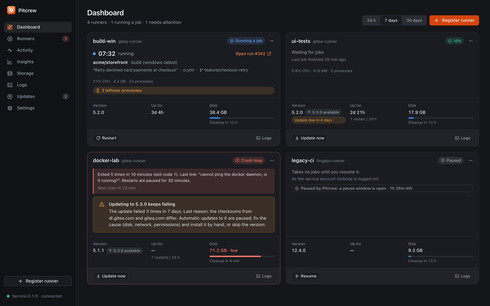

## At a glance


A privileged-when-needed **service** keeps the runners going whether or not the window is open; an unprivileged **app**
(window and tray) shows and controls them over one local IPC; a pure Rust **core** holds every rule (stall detection,
restart back-off, the update state machine, housekeeping plans). Details: [architecture](docs/architecture.md) and every
design diagram in [docs/design.md](docs/design.md).

## Why Pitcrew

Keeping a self-hosted runner healthy usually ends up as a pile of scripts: a scheduled task that starts it at log-on, a
supervisor loop that restarts it with back-off and rotates its log, a watchdog that restarts it when its polls keep timing
out, and a daily job that downloads a new binary and swaps it when no job runs. That works until it doesn't, and nobody
can see what it is doing. Pitcrew does the same work as a proper service, with a window and a tray icon that show what is
going on, and adds what the scripts lack:

- **Safe by design.** A running job is never killed; updates wait for an idle runner, are verified against two hosts and
  roll back automatically.
- **Visible.** A dashboard, per-runner pages, an activity timeline, logs, notifications and a tray icon that shows the
  worst state.
- **Several runners per machine,** each with its own folder, labels, policies and session.
- **Cross-platform.** Windows, macOS and Linux with the OS's own service manager and credential store.
- **Local only.** No telemetry; tokens live in the OS credential store; Pitcrew never handles passwords.

## Key features


Every feature, with screenshots, is in [docs/features.md](docs/features.md).

1. **Runs the runner as a service.** A small Rust service: a Windows service under the Service Control Manager, a per-user
   launch agent on macOS (`SMAppService`) or a systemd user service on Linux
   ([ADR 0003](docs/adr/0003-service-model.md), [0009](docs/adr/0009-linux-service-and-runner-environment.md)). On
   Windows each runner runs in the logged-on user's desktop session (default; desktop jobs such as WebView2 tests work) or
   in the service session. Installing the service is done from the app; elevation prompts are the OS's own.
2. **Supervisor and watchdog** ([ADR 0006](docs/adr/0006-supervision-and-housekeeping.md)). Per runner: process alive,
   registered, polling OK, job running (repository, job, run link, elapsed time). A runner whose polls keep timing out
   while no job runs is **stalled** and restarted. Restarts back off; repeated exits are a **crash loop**: restarts pause
   and you are notified. Pause, resume and drain (finish the current job, then stop) are one click.
3. **Safe updates with roll-back** ([ADR 0002](docs/adr/0002-runner-auto-update.md)). Checks the official runner releases
   on a schedule, downloads the binary for the platform, verifies its SHA-256 from two hosts, waits until the runner is
   idle, swaps the binary, restarts it, waits for the server to accept it and **rolls back** automatically if it does not.
   Per runner: automatic, ask first or manual; pin or skip a version; an update window.
4. **Housekeeping and disk safety.** Cleans each runner's work and cache folders on a schedule or on demand, and records
   what it freed. A **low-disk guard** drains runners before the disk is full and resumes them when space is back
   ([ADR 0013](docs/adr/0013-holds-low-disk-guard-and-pause-windows.md)); **pause windows** keep runners off at set times or
   while the machine is busy. **Storage** reports the container engine and the Actions cache, with preview-then-confirm
   pruning ([ADR 0016](docs/adr/0016-container-engine-hygiene-and-actions-cache.md)).
5. **Dashboard** ([ADR 0007](docs/adr/0007-runner-scoped-metrics.md)). Live runner cards, tiles for what the runners use
   (CPU and memory of each runner and everything it started, not the whole machine), history, jobs per day, an uptime
   timeline with restarts, stalls and updates marked, an events feed and quick actions. With a read-only Gitea token it
   also shows job outcomes and queue wait.
6. **Tray and notifications.** The tray icon shows the worst state of all runners. Closing the window keeps Pitcrew
   running; quitting the app never stops the runners. Optional **webhook, ntfy and email** channels with secrets in the OS
   credential store ([ADR 0017](docs/adr/0017-notification-channels.md)).
   **Insights**: slow and flaky jobs, queue time, success rates per repository and capacity advice
   ([ADR 0015](docs/adr/0015-workflow-insights-and-capacity-advice.md)); **update deadline** countdown and update-loop
   detection ([ADR 0014](docs/adr/0014-update-deadline-and-update-loops.md)); **open a job's log in Debrief**
   ([ADR 0018](docs/adr/0018-open-in-debrief.md)).
7. **Runner environment.** On macOS and Linux jobs get your login shell's `PATH`, and a runner can set its own variables
   (`[runners.env]`).
8. **Adopts existing runners.** A registered runner folder is used as it is; configuration is a versioned `pitcrew.toml`
   that tolerates damage.
9. **Updates itself** with the Tauri updater: minisign-signed releases, opt-in ([docs/releasing.md](docs/releasing.md)).
10. **Edits a runner's configuration** ([ADR 0011](docs/adr/0011-runner-config-editing.md)). A form and an Advanced YAML
    editor for the runner's `config.yaml`; comments and layout stay, a diff and a timestamped backup come before every
    save, and the runner restarts after its current job and is checked for the labels it declares.
11. **Tracks the processes a runner starts** ([ADR 0012](docs/adr/0012-process-tracking-and-leftover-cleanup.md)). A live
    list with the job of each process, leftovers of finished jobs, and automatic cleanup (on by default; only when the
    runner is idle, with per-process rules and keep times).

### Screenshots

Taken against the mock backend with invented data (1440 x 900 at 2x; `docs/screenshots/<theme>/`, every screen in both themes).

**Dark**

| | |
| --- | --- |
|  | 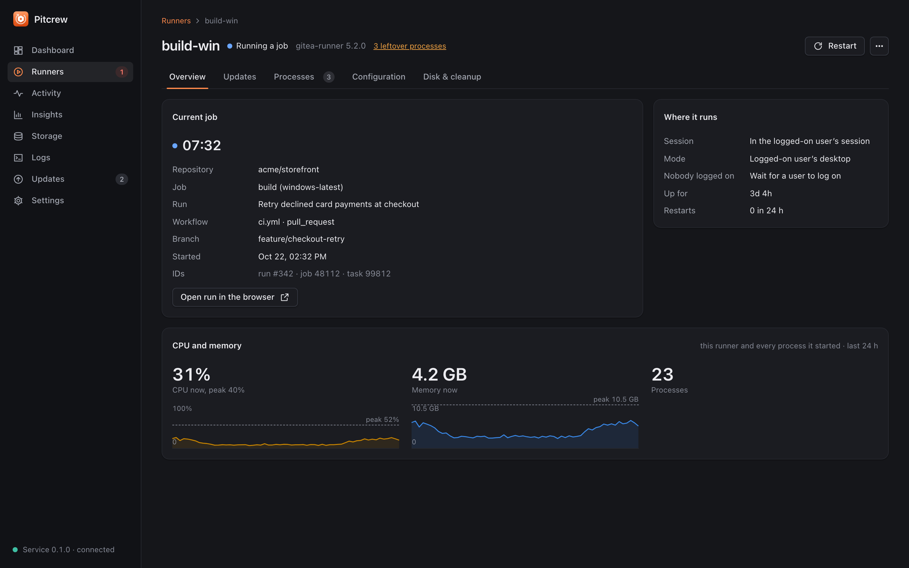 |
| 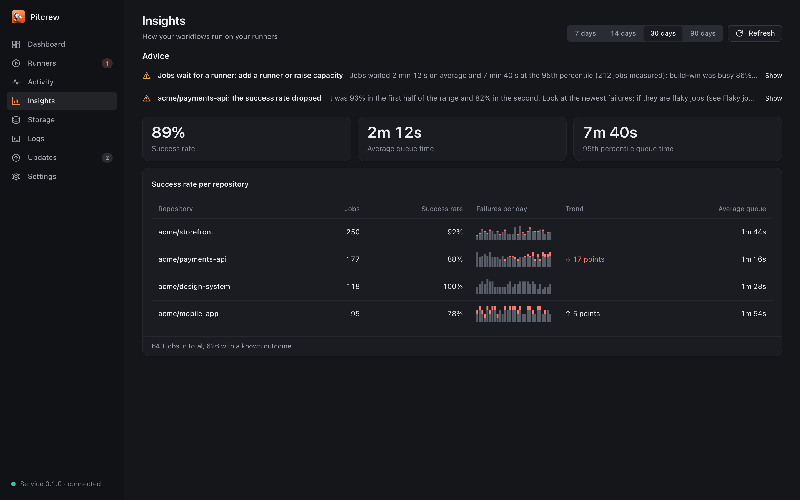 | 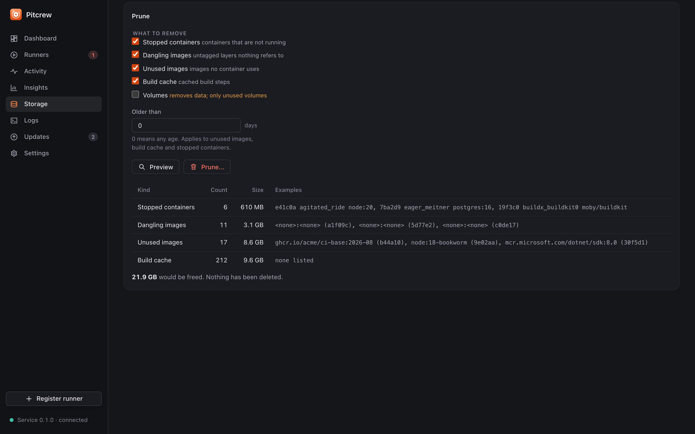 |
| 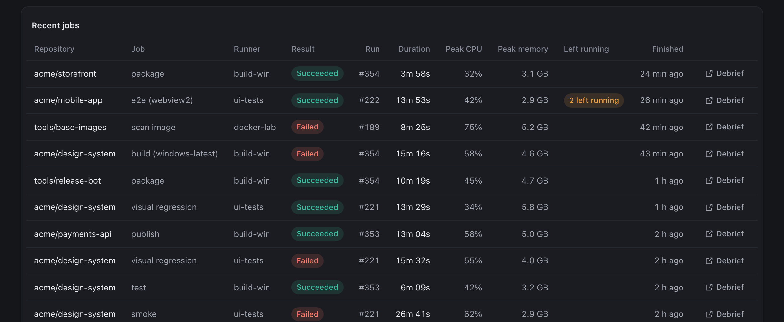 | 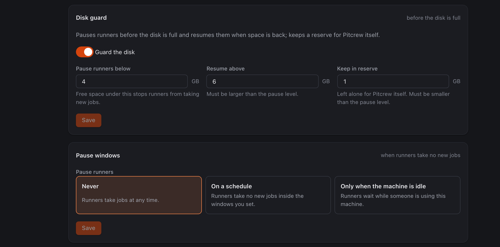 |
| 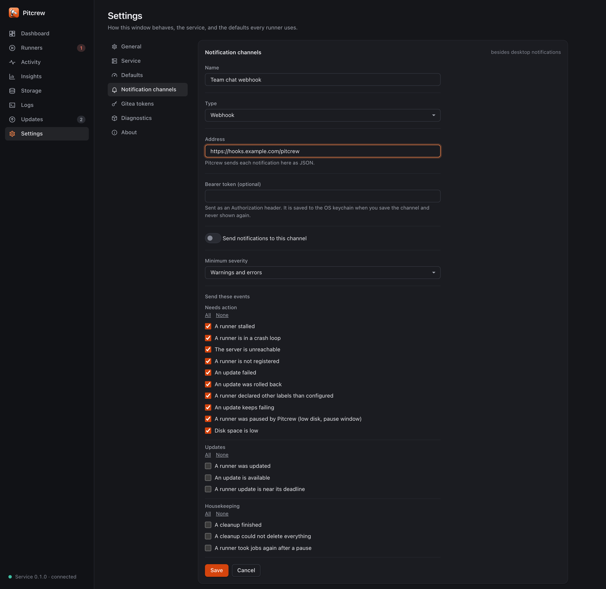 | 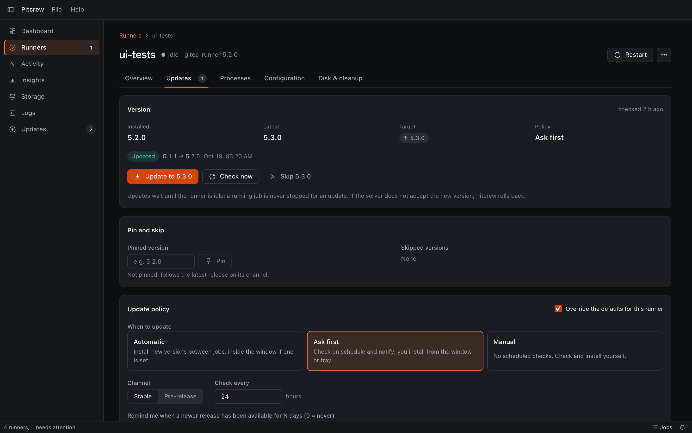 |

**Light**

| | |
| --- | --- |
| 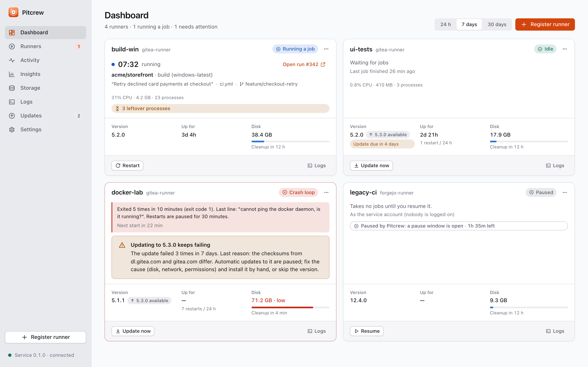 | 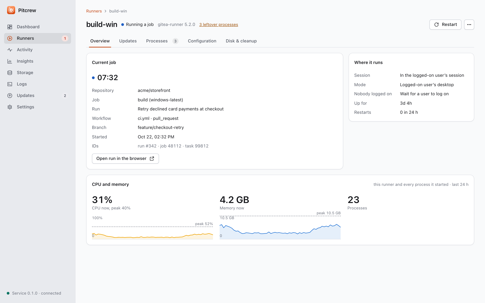 |
| 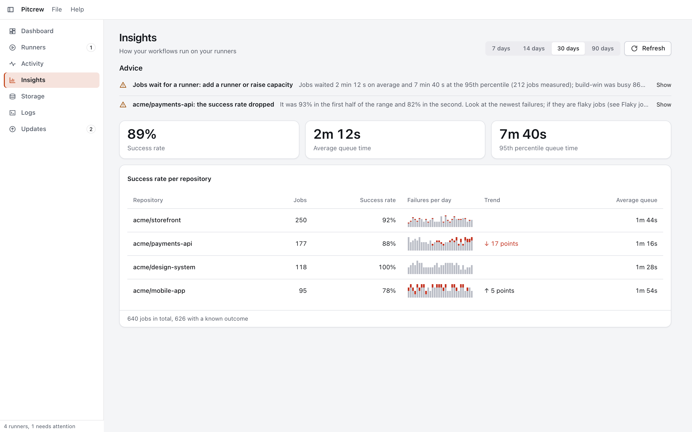 | 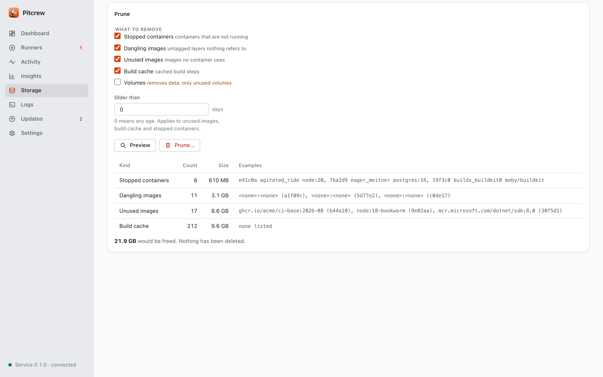 |
| 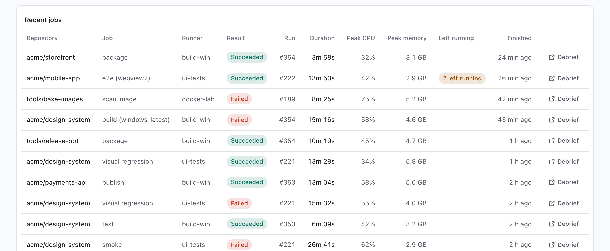 | 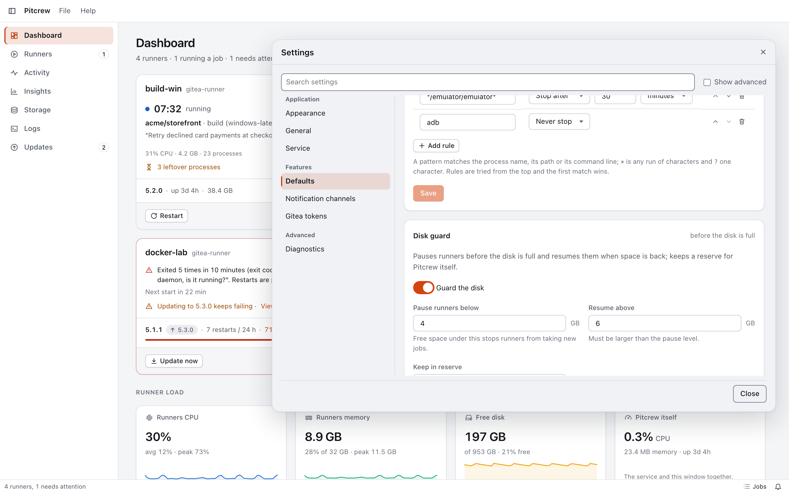 |
| 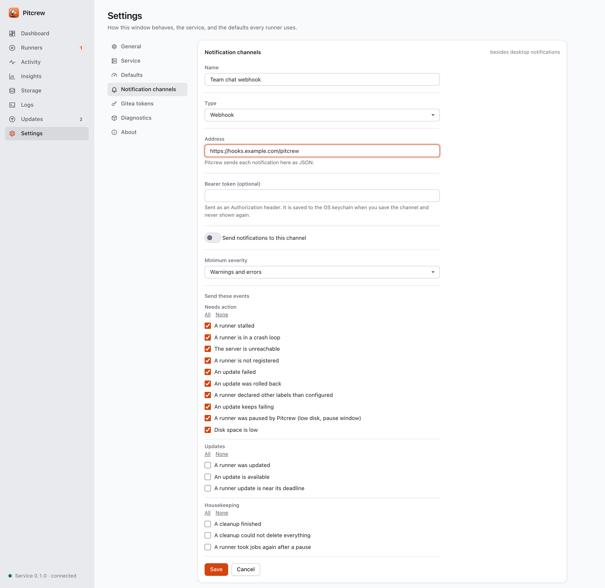 | 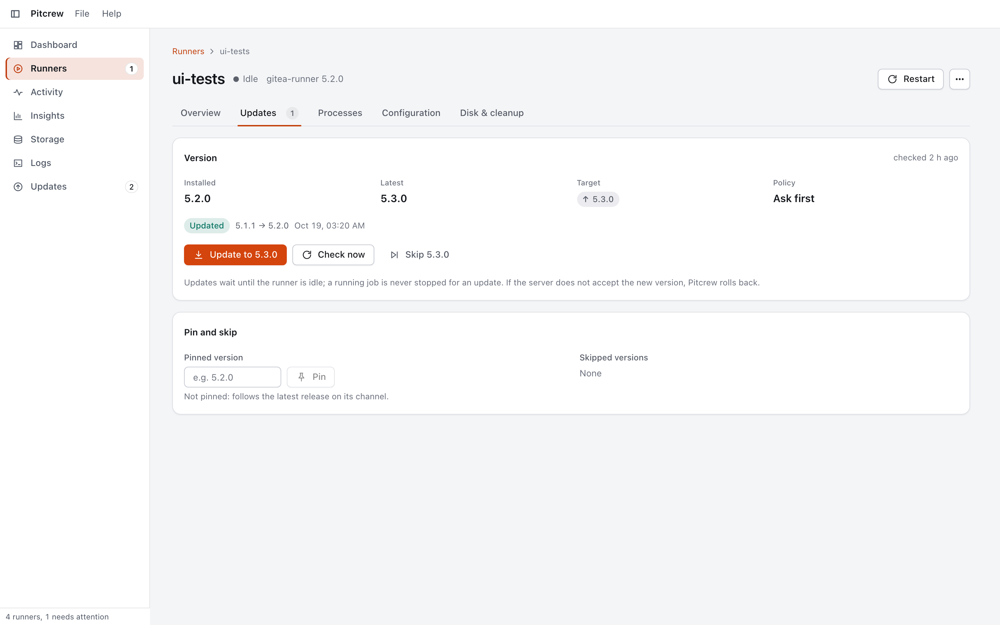 |

## Quick start

No release is published yet; build the installer yourself ([Building from source](#building-from-source)) or take the CI
artifacts of a `v*` tag or the nightly run. Then, in three steps:

1. **Install** and turn on the service (**Settings > Service**), per OS below.
2. **Register a runner:** **Register runner**, enter the server URL and a registration token (or adopt an existing runner
   folder). Pitcrew downloads, verifies, registers and starts it; the card turns **Idle**.
3. **Watch it:** the Dashboard, the tray and the notifications tell you about stalls, crash loops, updates and low disk.

The user guide has the details: [docs/user-guide.md](docs/user-guide.md).

### Windows

Run the NSIS installer (`Pitcrew_<version>_x64-setup.exe`). Then **Settings > Service > Install service**: Windows
asks for administrator permission (UAC) once to register the "Pitcrew" service (automatic, delayed start, recovery
actions). Add a runner with **Register runner**, or adopt an existing runner folder.

### macOS (13 or newer)

The build is **not notarised**; it is signed ad hoc (see [docs/macos.md](docs/macos.md)). Open the `.dmg`, drag Pitcrew
to Applications, and open it the first time with right-click > Open (or System Settings > Privacy & Security > Open
Anyway). Then **Settings > Service > Turn on**: Pitcrew registers its launch agent with `SMAppService`, and macOS asks you
to allow it under **System Settings > General > Login Items & Extensions**. No administrator rights are needed.

To adopt an existing registered runner folder (for example `~/gitea-runner`, with the binary next to `config.yaml`),
choose "An existing runner folder" in the Register wizard: the folder is used as it is and the token is not sent.
Stop whatever supervised that folder before (a launchd job: `launchctl bootout gui/$(id -u)/<label>`; a leftover
supervisor script: kill it). The full walk-through, permissions and a verification script are in
[docs/macos.md](docs/macos.md).

### Linux (systemd, x86-64 or ARM64)

Install the `.deb` (`sudo apt install ./Pitcrew_<version>_amd64.deb`) or run the AppImage, then **Settings > Service >
Turn on**: Pitcrew installs a systemd **user** service (`~/.config/systemd/user/pitcrew.service`), no root needed. To
keep the runners going when nobody is logged in, run `loginctl enable-linger $USER` once (your decision; Pitcrew never
runs it). Jobs get your login shell's `PATH` (so `node`, `cargo`... are found), and a runner can set its own variables in
`pitcrew.toml` (`[runners.env]`). The tray needs a status-notifier host (GNOME: the AppIndicator extension). Build,
verification script and details: [docs/linux.md](docs/linux.md).

## Status

| Area | State |
| --- | --- |
| Core | Built and unit-tested (rules, update state machine with roll-back, config migration, protocol). |
| Service | Supervisor, IPC, session launch, updates and cleanup built; end-to-end tests drive the real supervisor with a fake runner. Windows service, macOS launch agent and Linux systemd unit have their own CI coverage. |
| App | Dashboard, runners, activity, logs, updates (including Pitcrew's own check and install), settings and the register wizard against the real service. |
| macOS | Verified on a real Mac on 2026-10-22 (bundle, `SMAppService`, adopting a runner folder). Jobs get the login shell's `PATH`. |
| Linux | systemd user service, XDG paths, `.deb` and AppImage bundles. Rust tests, the service against a fake runner and the unit text run in a Linux container and on the `ubuntu-latest` CI jobs; the `systemctl` calls, the tray and the bundles are not yet verified on a real desktop. |
| Windows | Built and tested on the Windows CI runner; not yet verified end to end on a dedicated build machine. |
| Installers | CI builds a Windows NSIS installer, a macOS `.dmg` and a Linux `.deb` and AppImage on tags, nightly and manual runs. Not yet published. |

## Roadmap

Planned work is in [docs/roadmap.md](docs/roadmap.md): Forgejo's runner, GitHub's self-hosted runner, Developer ID signing
and notarisation, headless-host service modes, per-runner `env` on Windows.

## Documentation

| Document | What it covers |
| --- | --- |
| [docs/features.md](docs/features.md) | Every feature, with screenshots |
| [docs/user-guide.md](docs/user-guide.md) | Installing, registering runners, everyday use, configuration, troubleshooting |
| [docs/architecture.md](docs/architecture.md) | Overview, the core, service and app, state and files, security |
| [docs/design.md](docs/design.md) | All design diagrams on one page (C4, deployment, use cases, domain, flows, states) |
| [docs/diagrams/STYLE.md](docs/diagrams/STYLE.md) | The diagram style guide |
| [docs/macos.md](docs/macos.md) | Build, install, register and verify on macOS |
| [docs/linux.md](docs/linux.md) | Build, install, register and verify on Linux |
| [docs/development.md](docs/development.md) | Building, testing, CI/CD, project layout, where to add things |
| [docs/releasing.md](docs/releasing.md) | Releases and signed updates |
| [docs/testing-manual.md](docs/testing-manual.md) | Manual tests that need a real desktop and server |
| [docs/roadmap.md](docs/roadmap.md) | Planned work and engineering follow-ups |
| [docs/adr/](docs/adr/0001-architecture.md) | Architecture decision records 0001 to 0012 |

Decisions: [0001 architecture](docs/adr/0001-architecture.md), [0002 runner auto-update](docs/adr/0002-runner-auto-update.md),
[0003 service model](docs/adr/0003-service-model.md), [0004 IPC protocol and ACL](docs/adr/0004-ipc-protocol-and-acl.md),
[0005 credential storage](docs/adr/0005-credential-storage.md), [0006 supervision and housekeeping](docs/adr/0006-supervision-and-housekeeping.md),
[0007 runner-scoped metrics](docs/adr/0007-runner-scoped-metrics.md), [0008 native feel](docs/adr/0008-native-feel.md),
[0009 Linux service and runner environment](docs/adr/0009-linux-service-and-runner-environment.md),
[0010 design system](docs/adr/0010-design-system.md),
[0011 runner configuration editing](docs/adr/0011-runner-config-editing.md),
[0012 process tracking and leftover cleanup](docs/adr/0012-process-tracking-and-leftover-cleanup.md).

## Building from source

Prerequisites: Rust stable (1.88+), Node 24, and the [Tauri 2 prerequisites](https://v2.tauri.app/start/prerequisites/)
for your OS (WebView2 on Windows, Xcode command line tools on macOS; on Linux `libwebkit2gtk-4.1-dev` and friends).

```sh
cd app && npm ci && cd ..
cargo test --workspace                 # core, service and app tests
(cd app && npx ng test --watch=false)  # UI tests
(cd app && npm start)                  # UI in a browser, against the mock backend
(cd app && npx tauri dev)              # the desktop app
cargo run -p pitcrew-service -- check-config
```

On a Mac, `bash scripts/macos-bootstrap.sh` checks the prerequisites and builds the `.app` and `.dmg`
([docs/macos.md](docs/macos.md)); on Linux, `bash scripts/linux-bootstrap.sh` builds the `.deb` and the AppImage
([docs/linux.md](docs/linux.md)). More in [docs/development.md](docs/development.md).

## Contributing

Read [AGENTS.md](AGENTS.md) first: it sets the design principles, the security and robustness rules and the quality gates.
Build, test and CI details are in [docs/development.md](docs/development.md). Use
[Conventional Commits](https://www.conventionalcommits.org/); releases are `v*` tags following semver
([docs/releasing.md](docs/releasing.md)).

## Security and privacy

- The service never trusts the app and the app never trusts the webview: every IPC field is validated in Rust, the
  protocol is local only (named pipe with an ACL, or a 0600 Unix socket) and bounded.
- Pitcrew never handles passwords. Runner tokens and `.runner` files are never read, logged or stored; registration tokens
  pass straight to the runner's `register` command; secrets live only in the OS credential store.
- Nothing unverified is installed: HTTPS, a SHA-256 from two hosts that must agree, a version check and roll-back. Pitcrew's
  own updates are minisign-signed and opt-in.
- Tauri capabilities are least-privilege and the CSP has no `unsafe-eval` and no remote origins. No telemetry.
- Found a vulnerability? Please report it privately to the maintainers rather than in a public issue.

## Name and trademarks

"Gitea" and "Forgejo" are trademarks of their respective owners. Pitcrew is an independent project and not affiliated with
or endorsed by either; it manages their runners, which speak the same protocol.

## Licence

Pitcrew is licensed under either of [MIT](LICENSE-MIT) or [Apache-2.0](LICENSE-APACHE), at your option.
