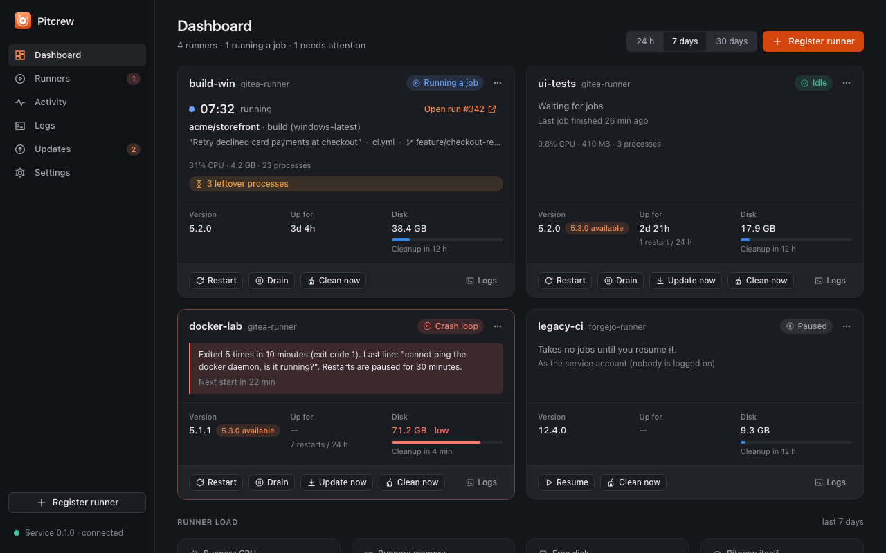
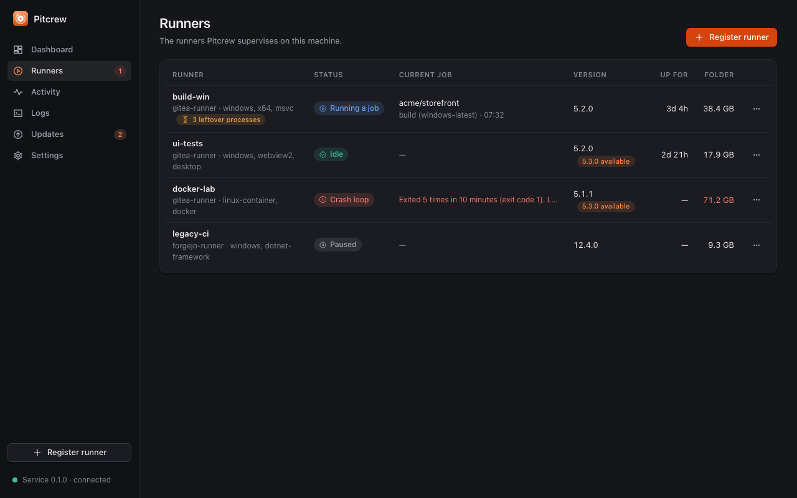
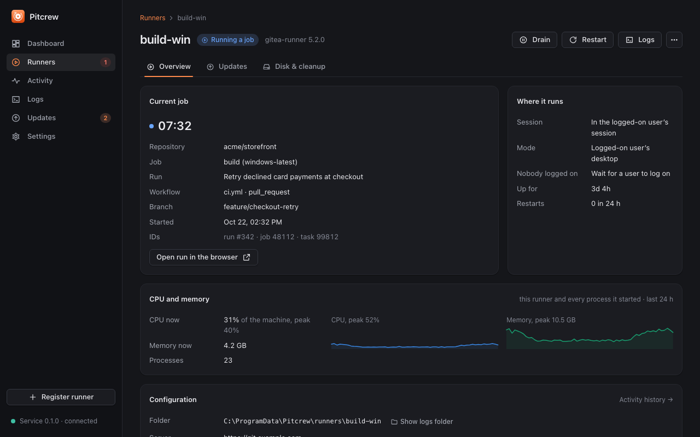
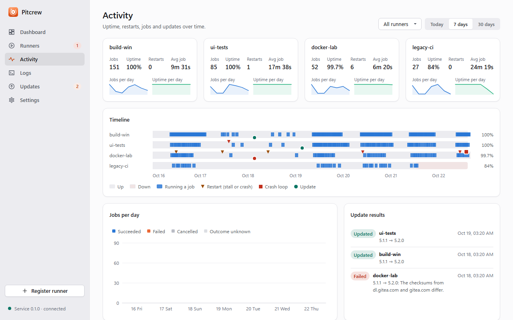
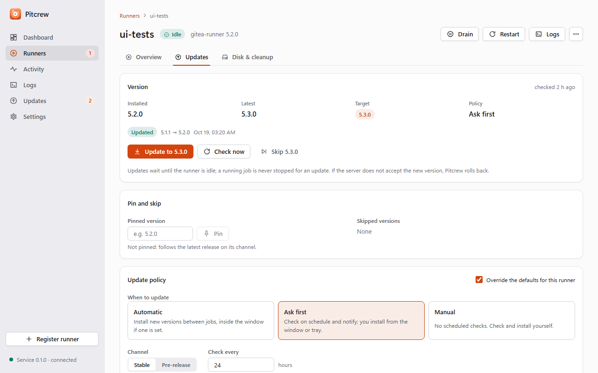
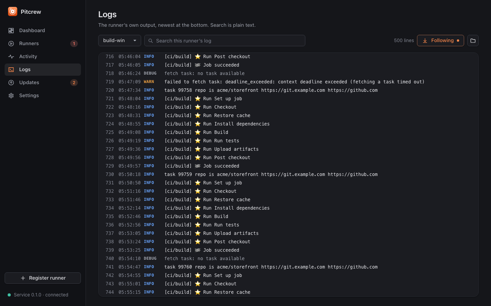
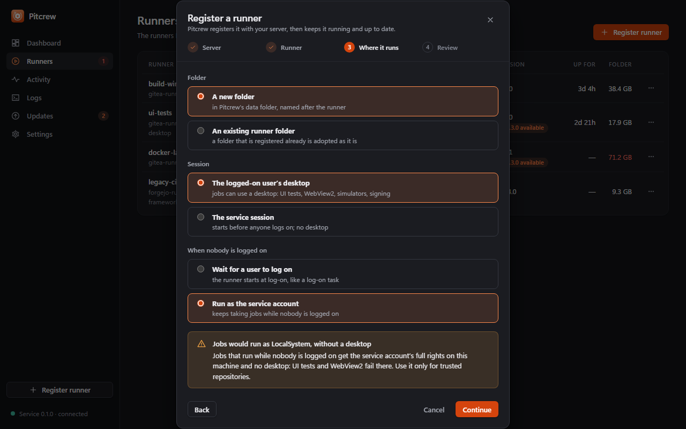
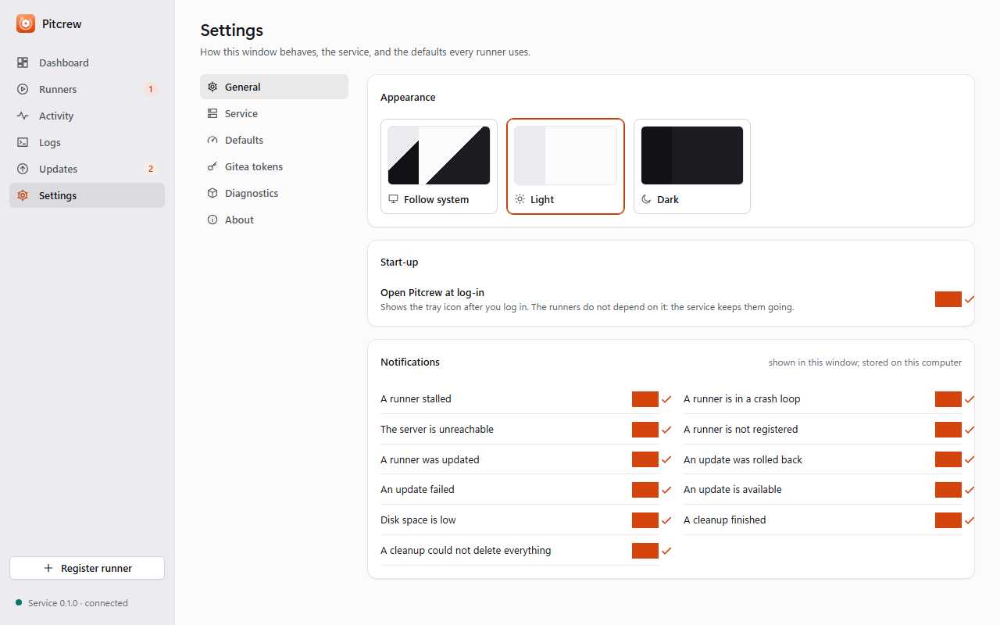
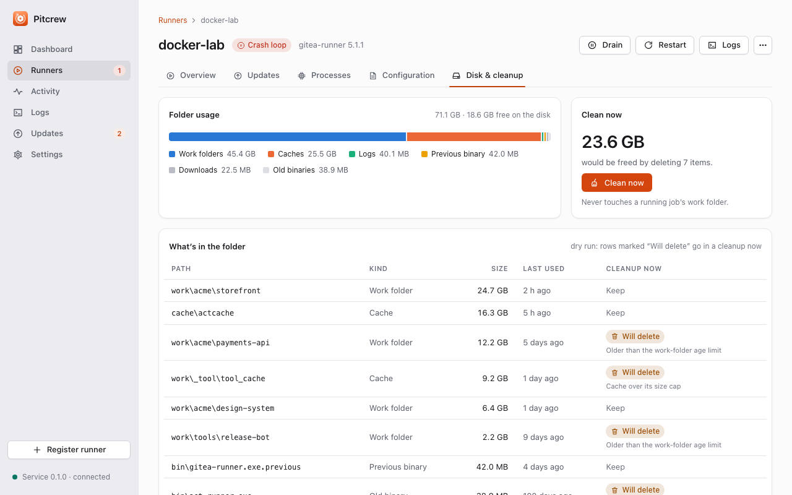

# Pitcrew

**A runner manager for Gitea and Forgejo.** Pitcrew installs, runs, watches and updates the CI runners on your build
machines — Gitea's runner (`gitea-runner`, formerly `act_runner`) first, Forgejo's runner next, and later GitHub's
self-hosted runner — on **Windows, macOS and Linux**.

A pit crew keeps the car going without stopping the race: Pitcrew restarts a runner that crashed or stalled, and
updates it between jobs, so the builds keep running.

> **Status: v0.1.0, unreleased.** The supervisor, watchdog, updates with roll-back, housekeeping, dashboard and tray
> are built and tested; the macOS path was verified on a real Mac on 2026-10-22. No release is published yet. See
> [Status](#status).



## Why

Keeping a self-hosted runner healthy usually ends up as a pile of scripts: a scheduled task that starts it at log-on,
a supervisor loop that restarts it with backoff and rotates its log, a watchdog that restarts it when its polls keep
timing out, and a daily job that downloads a new binary and swaps it when no job runs. That works until it doesn't,
and nobody can see what it is doing. Pitcrew does the same work as a proper service, with a window and a tray icon
that show what is going on, and adds what the scripts lack: roll-back of bad updates, crash-loop protection, several
runners per machine and macOS support.

## What it does

1. **Runs the runner as a service.** A small Rust service: a Windows service under the Service Control Manager, or a
   per-user launch agent on macOS registered with `SMAppService` ([ADR 0003](docs/adr/0003-service-model.md)). On
   Windows each runner runs either in the logged-on user's desktop session (default; jobs that need a desktop, such as
   WebView2 tests, work) or in the service session. Installing the service is done from the app; elevation prompts
   are the OS's own, and Pitcrew never handles passwords.
2. **Supervisor and watchdog** ([ADR 0006](docs/adr/0006-supervision-and-housekeeping.md)). Per runner: process
   alive, registered, polling OK, job running (with repository, job, run link and elapsed time). A runner whose
   polls keep timing out while no job runs is **stalled** and restarted. Restarts back off; repeated exits are a
   **crash loop**: restarts pause and you are notified. A running job is never killed. Pause, resume and drain
   (finish the current job, then stop) are one click.
3. **Safe updates with roll-back** ([ADR 0002](docs/adr/0002-runner-auto-update.md)). Checks the official runner
   releases on a schedule, downloads the binary for the platform, verifies its SHA-256 from two hosts, waits until the
   runner is idle, swaps the binary, restarts it and waits for the server to accept it, and **rolls back**
   automatically if it does not. Per runner: automatic, ask first or manual; pin or skip a version; an update window.
4. **Housekeeping.** Cleans each runner's work and cache folders on a schedule or on demand, warns when the disk is
   low, and records what it freed.
5. **Dashboard** ([ADR 0007](docs/adr/0007-runner-scoped-metrics.md)). Live runner cards, tiles for what the runners use
   (CPU and memory of each runner and every process it started, not the whole machine; free disk stays machine-wide;
   a muted line gives the machine's totals), CPU and memory history with the runners stacked on the rest of the
   machine, per-runner trends on the runner page, jobs per day, an uptime
   timeline with restarts, stalls and updates marked, an events feed and quick actions. With a read-only Gitea token
   (kept in the OS credential store) it also shows job outcomes. History is local and bounded.
6. **Tray and notifications.** The tray icon (Windows notification area, macOS menu bar) shows the worst state of all
   runners. Closing the window keeps Pitcrew running; quitting the app never stops the runners. Notifications for
   stalls, crash loops, updates, roll-backs and low disk are configurable.
7. **Several runners per machine**, each with its own folder, labels and session, in a versioned `pitcrew.toml` that
   tolerates damage (falls back to the last good copy, skips one bad entry). An existing registered runner folder is
   adopted as it is: no registration happens.
8. **Pitcrew updates itself** with the Tauri updater: minisign-signed releases, opt-in
   ([docs/releasing.md](docs/releasing.md)).

## Screenshots

Taken against the mock backend (`docs/screenshots`, dark and light for every screen).

| | |
| --- | --- |
|  |  |
|  |  |
|  |  |
|  |  |

## Install

No release is published yet; build the installer yourself ([Building](#building)) or take the CI artifacts of a `v*`
tag or the nightly run.

### Windows

Run the NSIS installer (`Pitcrew_<version>_x64-setup.exe`). Then **Settings > Service > Install service**: Windows
asks for administrator permission (UAC) once to register the "Pitcrew" service (automatic, delayed start, recovery
actions). Add a runner with **Register runner**, or adopt an existing runner folder.

### macOS (13 or newer)

The build is **not notarised**; it is signed ad hoc (see [docs/macos.md](docs/macos.md)). Open the `.dmg`, drag Pitcrew
to Applications, and open it the first time with right-click > Open (or System Settings > Privacy & Security > Open
Anyway). Then **Settings > Service > Turn on**: Pitcrew registers its launch agent with `SMAppService`, and macOS asks you
to allow it under **System Settings > General > Login Items & Extensions**. No administrator rights are needed.

To adopt an existing registered runner folder (for example `~/gitea-runner`, with the binary next to `config.yaml`),
choose "An existing runner folder" in the Register wizard: the folder is used as it is and the token is not sent.
Stop whatever supervised that folder before (a launchd job: `launchctl bootout gui/$(id -u)/<label>`; a leftover
supervisor script: kill it). The full walk-through, permissions and a verification script are in
[docs/macos.md](docs/macos.md).

### Linux (systemd, x86-64 or ARM64)

Install the `.deb` (`sudo apt install ./Pitcrew_<version>_amd64.deb`) or run the AppImage, then **Settings > Service >
Turn on**: Pitcrew installs a systemd **user** service (`~/.config/systemd/user/pitcrew.service`), no root needed. To
keep the runners going when nobody is logged in, run `loginctl enable-linger $USER` once (your decision; Pitcrew never
runs it). Jobs get your login shell's `PATH` (so `node`, `cargo`... are found), and a runner can set its own variables in
`pitcrew.toml` (`[runners.env]`). The tray needs a status-notifier host (GNOME: the AppIndicator extension). Build,
verification script and details: [docs/linux.md](docs/linux.md).

## Architecture

A pure core, a privileged service and an unprivileged app that talk over one local IPC.

| Part | Where | Role |
| --- | --- | --- |
| Core | `crates/pitcrew-core` | Pure rules, no I/O, time passed in: controller (start, stop, backoff, stalls, drain), jobs, update policy and state machine, housekeeping, history, metrics, notifications, config, protocol. |
| Service | `crates/pitcrew-service` | One supervisor thread, workers for slow work, launch adapters, the IPC server (named pipe with ACL / 0600 Unix socket), the SCM, launchd and systemd integration. |
| App | `app/src-tauri`, `app/src` | Tauri 2 shell (tray, window, commands, credentials, updater) and the Angular UI over a `BACKEND` token (Tauri or mock). |

Decisions: [0001 architecture](docs/adr/0001-architecture.md), [0002 runner auto-update](docs/adr/0002-runner-auto-update.md),
[0003 service model](docs/adr/0003-service-model.md), [0004 IPC protocol and ACL](docs/adr/0004-ipc-protocol-and-acl.md),
[0005 credential storage](docs/adr/0005-credential-storage.md), [0006 supervision and housekeeping](docs/adr/0006-supervision-and-housekeeping.md),
[0007 runner-scoped metrics](docs/adr/0007-runner-scoped-metrics.md), [0008 native feel](docs/adr/0008-native-feel.md),
[0009 Linux service and runner environment](docs/adr/0009-linux-service-and-runner-environment.md),
[0010 design system](docs/adr/0010-design-system.md).

## Status

| Area | State |
| --- | --- |
| Core | Built and unit-tested (rules, update state machine with roll-back, config migration, protocol). |
| Service | Supervisor, IPC, session launch, updates and cleanup built; end-to-end tests drive the real supervisor with a fake runner. Windows service and macOS launch agent have their own CI jobs. |
| App | Dashboard, runners, activity, logs, updates, settings and the register wizard against the real service. The Pitcrew self-update UI (check, download, restart) is not built yet: the updater plugin is wired and About reports whether the build can update. |
| macOS | Verified on a real Mac on 2026-10-22 (bundle, `SMAppService`, adopting a runner folder). Jobs get the login shell's `PATH` since the launchd start-up fix of the same day. |
| Linux | systemd user service, XDG paths, `.deb` and AppImage bundles, `scripts/linux-bootstrap.sh` / `linux-verify.sh`. Rust tests, the service against a fake runner and the unit text run in a Linux container and on the `ubuntu-latest` CI jobs; the `systemctl` calls, the tray and the bundles are not yet verified on a real desktop. |
| Windows | Built and tested on the Windows CI runner; not yet verified end to end on a dedicated build machine. |
| Installers | CI builds a Windows NSIS installer and a macOS `.dmg` on tags, nightly and manual runs. Not yet published. |

## Roadmap

1. Pitcrew self-update UI (check, download, restart) on top of the wired updater plugin.
2. Forgejo's runner (user-provided binary on Windows/macOS, OpenPGP-verified updates on Linux).
3. Developer ID signing and notarisation for the macOS build.
4. Later: GitHub's self-hosted runner, LaunchDaemon mode for headless Macs and a systemd system unit for headless Linux
   hosts, the per-runner `env` on Windows.

Dedicated build Macs: since the macOS service is a launch agent, enable automatic log-in for the CI user so the
runners start after a reboot.

## Building

Prerequisites: Rust stable (1.88+), Node 24, and the [Tauri 2 prerequisites](https://v2.tauri.app/start/prerequisites/)
for your OS (WebView2 on Windows, Xcode command line tools on macOS; on Linux `libwebkit2gtk-4.1-dev` and friends).

```sh
cd app && npm ci && cd ..
cargo test --workspace                 # core, service and app tests
(cd app && npx ng test --watch=false)  # UI tests
(cd app && npm start)                  # UI in a browser, against the mock backend
(cd app && npx tauri dev)              # the desktop app
cargo run -p pitcrew-service -- check-config
```

On a Mac, `bash scripts/macos-bootstrap.sh` checks the prerequisites and builds the `.app` and `.dmg`
([docs/macos.md](docs/macos.md)); on Linux, `bash scripts/linux-bootstrap.sh` builds the `.deb` and the AppImage
([docs/linux.md](docs/linux.md)).

More in [docs/development.md](docs/development.md); releasing and the update signing key in
[docs/releasing.md](docs/releasing.md); engineering rules in [AGENTS.md](AGENTS.md).

## Name and trademarks

"Gitea" and "Forgejo" are trademarks of their respective owners. Pitcrew is an independent project and not
affiliated with or endorsed by either; it manages their runners, which speak the same protocol.

## Licence

Pitcrew is licensed under either of [MIT](LICENSE-MIT) or [Apache-2.0](LICENSE-APACHE), at your option.
