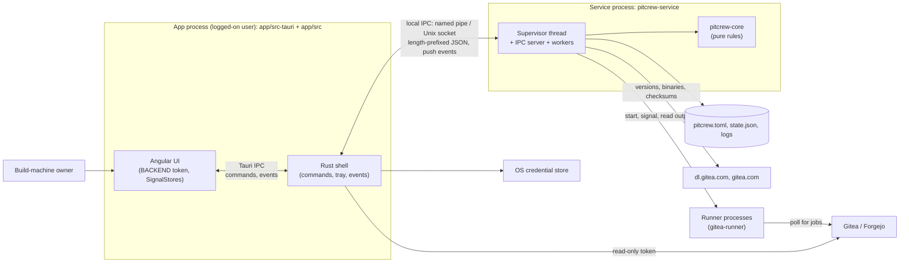
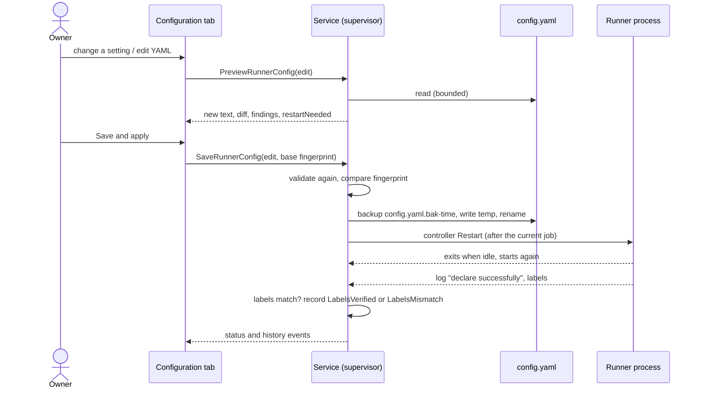
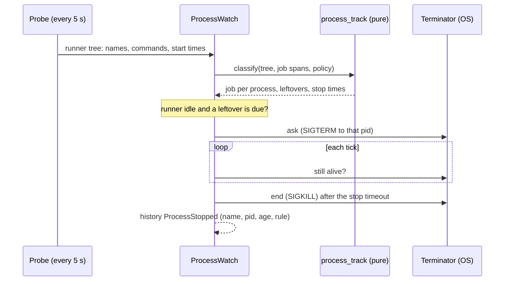

# Pitcrew architecture

This page ties together the design diagrams in [`docs/diagrams/`](diagrams/), all of them on one page in
[design.md](design.md). The decisions behind them are the [ADRs](adr/0001-architecture.md); planned work is in
[roadmap.md](roadmap.md). In short: a pure Rust core (`crates/pitcrew-core`) that holds every rule, a background
service (`crates/pitcrew-service`) that supervises the runners and carries out the core's decisions, a thin Tauri 2
shell (`app/src-tauri`) and an Angular UI (`app/src/app`) that only talk to the service through one local IPC.

The diagrams follow [diagrams/STYLE.md](diagrams/STYLE.md) (the suite spec in Paddock plus Pitcrew's colours): planned work
(not in the code yet) is drawn with a dashed outline and a "planned" tag.

## Overview

A runner manager exists so that CI builds keep running without a person watching: Pitcrew starts each runner, restarts
it when it exits or stalls, updates it between jobs and cleans its disk. It is split in three so that each part has one
reason to change ([ADR 0001](adr/0001-architecture.md)):

- **Core** (`crates/pitcrew-core`): the stall rule, restart back-off and crash-loop protection, the runner controller
  (one runner's life), job tracking, health status, update policy and the update state machine with roll-back,
  versions and checksums, release locations, housekeeping plans, history and metrics, notifications, configuration with
  migration, and the app ↔ service protocol with its framing. No I/O and no clock: time comes in as `Timestamp`
  values, files as strings or bytes, and decisions go out as typed values.
- **Service** (`crates/pitcrew-service`): one supervisor thread owns every runner, workers do the slow steps, an async
  IPC server answers the app. It runs as a Windows service (LocalSystem), as a per-user launch agent on macOS, and
  as a systemd user service on Linux ([ADR 0009](adr/0009-linux-service-and-runner-environment.md)).
- **App** (`app/src-tauri`, `app/src`): a tray icon and a window for the logged-on user. It holds no runner state of its
  own, so it can be closed, restarted or updated while the runners keep working.

## The pieces

### Core

The modules group into five areas (see the level 3 diagram, [core components](design.md#level-3--core-components)):

| Area | Modules | What they decide |
| --- | --- | --- |
| Supervision of one runner | `logline`, `jobs`, `session`, `watchdog`, `restart`, `controller`, `health` | What a log line means; whether a job runs; where a runner may start; whether it is stalled; how long to wait before a restart; what to do with each input; the one-word status. |
| Updates | `distribution`, `checksum`, `version`, `update::policy`, `update::machine` | Where each runner kind publishes releases; whether two checksum hosts agree; which version is newer; whether, when and to which version to update; the phases of an update and when to roll back. |
| Housekeeping and metrics | `housekeeping`, `usage`, `metrics` | What a cleanup deletes and in which order; which processes belong to a runner; the tiered CPU, memory and disk series. |
| Records and configuration | `config`, `history`, `state` | The versioned `pitcrew.toml` and how damage is tolerated; the bounded event history and its per-day summaries; the persisted service state. |
| Wire and helpers | `protocol`, `names`, `layout`, `logs`, `notify`, `redact`, `gitea_api`, `service_spec`, `service_paths`, `runner_env`, `self_update`, `time`, `platform` | The messages between app and service; validated names; the folder layout of a runner; bounded log search; what the user is told; secret masking; Gitea API URLs and parsing; the launch agent plist and the systemd unit; data folder and socket paths per OS; the login-shell `PATH` and the per-runner `[runners.env]` table; whether the service should restart because its program changed; timestamps. |

Rules that hold everywhere in the core:

- A running job is never interrupted. Stop, restart, drain, a stall restart, a move to another session and an update
  all wait until the job tracker says no job runs. The runner is asked to stop gracefully and is terminated only after
  the stop timeout, and only while no job runs.
- Untrusted input is parsed once at the edge into typed values (`RunnerName`, `RunnerVersion`, `Sha256Digest`,
  `Secret`) and the types are used afterwards.
- Everything is bounded: log lines, configuration size, checksum files, release bodies, label and runner counts,
  history length, search results.

### Service

The service is deliberately thin around the core (level 3, [service components](design.md#level-3--service-components)):

- **Supervisor** (`supervisor.rs`). One thread owns all runner state. Everything reaches it as a message on one channel:
  the app's requests (from the IPC server), the runners' output lines (from reader threads), the results of slow work
  (from worker threads) and log-on changes; a tick every second drives time. There are no locks, so one runner's failure
  can only be a state of that runner. Per runner it holds a `Controller`, a `JobTracker`, an `UpdateMachine`, the log
  file and tail, and housekeeping state.
- **Launcher and process control** (`launcher.rs`, `launch.rs`, `process.rs`). Start a runner where it should run (the
  logged-on user's session or the service's), with its output piped to the service; stop it gracefully (SIGTERM, or
  Ctrl+Break to its process group on Windows); kill the tree only after the timeout. Every external program runs
  without a console window and with a timeout.
- **Probe** (`probe.rs`). One `sysinfo` snapshot per tick: whether a runner has job processes, whether a runner binary
  already runs outside Pitcrew, the machine's CPU, memory and free disk, and the CPU and memory of each runner's process
  tree ([ADR 0007](adr/0007-runner-scoped-metrics.md)).
- **Work** (`work.rs`, `net.rs`, `cleanup.rs`). Release discovery, download (HTTPS only, size cap, SHA-256 computed
  while streaming), verification, the binary swap and its roll-back, asking a binary for its version, registration, and
  folder scans and deletions. Each runs on a worker thread and reports a result to the supervisor; none of them touches
  supervision state.
- **Log file** (`logfile.rs`). The service owns the runner's output pipes, so it writes the log itself, adds its own
  `supervisor:` lines and rotates the file between two lines.
- **Transport** (`ipc.rs`). A named pipe with an ACL on Windows, a 0600 Unix socket elsewhere; hello first; bounded
  frames; at most 32 connections; a subscription turns a connection into an event stream
  ([ADR 0004](adr/0004-ipc-protocol-and-acl.md)).
- **Login environment** (`login_env.rs`). launchd and the systemd user manager start the service with a minimal `PATH`, and runners inherit it. At each runner start the service asks the user's login shell (`$SHELL -l -i -c`, 5 s timeout, bounded, cached 60 s) for the `PATH` a terminal has, with a fallback, and merges the runner's `[runners.env]` table (validated in the core). macOS and Linux; Windows runners keep the service's or the user's environment ([ADR 0009](adr/0009-linux-service-and-runner-environment.md)).
- **Self-restart** (`host.rs`, core `self_update`). launchd and systemd keep an old service process alive after the app is updated, so the service fingerprints its own executable and exits cleanly when it changed and no job or update runs; the service manager (`KeepAlive`, `Restart=always`) starts the new program, which adopts the runners. The watch is off on Windows, where the app or installer restarts the service.
- **Store** (`store.rs`, `paths.rs`). Bounded reads; atomic writes that keep a `.bak`; the data folder per OS.
- **Platform adapters** (`platform/`). Windows: the Service Control Manager entry point, install and uninstall, and the
  session FFI (the one module of Win32 calls, every `unsafe` block justified). macOS: the launch agent. Linux: the systemd user unit
  (`~/.config/systemd/user/pitcrew.service`, written and enabled with `systemctl --user`, no root).

### App

- **Rust shell** (`app/src-tauri`). Tauri commands are thin edges: each parses the webview's arguments into typed values,
  then asks the service through the `ServiceClient` trait (never a pipe or socket directly) or does an app-side job
  (credential store, Gitea API with the read token, diagnostics bundle, service install, Pitcrew's own updater). One
  subscription thread (`events.rs`) forwards pushed events to the UI and the tray and shows native notifications; it
  reconnects with back-off. Capabilities are least-privilege: the webview gets events only, never the file system, the
  shell or the updater. Window lifecycle: closing the window destroys it (the webview's memory is freed); the tray's Open item and the macOS Dock icon recreate it; with no tray (Linux without a status-notifier host) closing the window quits the app. `pitcrew://navigate` events open a page such as `/logs/<runner>` from a tray action or a notification. The UI follows the native-feel policy of [ADR 0008](adr/0008-native-feel.md) and the design system of [ADR 0010](adr/0010-design-system.md); calls have timeouts with an inline Retry.
- **Angular UI** (`app/src/app`). Standalone components and signals; state in SignalStores (`StatusStore`, `DashboardStore`,
  `ActivityStore`, `LogsStore`, `SettingsStore`, `ServiceStore`); components never call `invoke` directly but use the
  backend injected by the `BACKEND` token (the Tauri backend, or the mock for browser development and tests). The
  routes are Dashboard, Runners, a runner's page, Activity, Logs, Updates and Settings; registering a runner is a
  wizard opened from several places.

## Decisions at a glance

| ADR | Decision |
| --- | --- |
| [0001](adr/0001-architecture.md) | A pure core, a privileged service and an unprivileged app that talk over one local IPC; files and state are versioned and tolerate damage. |
| [0002](adr/0002-runner-auto-update.md) | Safe updates: discovery, verification against two checksum hosts, drain, swap, confirm, automatic roll-back. |
| [0003](adr/0003-service-model.md) | A Windows service that can start runners in the user's session (LocalSystem); a per-user launch agent on macOS (no root). Linux later. |
| [0004](adr/0004-ipc-protocol-and-acl.md) | Framed JSON over a named pipe with an ACL or a 0600 socket; pushed status events instead of polling. |
| [0005](adr/0005-credential-storage.md) | Secrets only in the OS credential store, owned by the app; registration tokens pass through and are never stored by Pitcrew. |
| [0006](adr/0006-supervision-and-housekeeping.md) | One supervisor thread with pure controllers; jobs from log lines plus child processes; the stall rule; housekeeping; history and metrics. |
| [0007](adr/0007-runner-scoped-metrics.md) | The dashboard measures the runners and everything they started, not the whole machine; thread entries are left out of the process table. |
| [0008](adr/0008-native-feel.md) | The window behaves like a desktop application: opt-in selection, one context-menu policy, browser keys and drops blocked. |
| [0009](adr/0009-linux-service-and-runner-environment.md) | Linux: a systemd user service, XDG paths, the login shell's `PATH` for runners (macOS and Linux), `[runners.env]`. |
| [0010](adr/0010-design-system.md) | Tokens first, measured accessibility, shared partials and components, standard loading, empty and error states. |
| [0011](adr/0011-runner-config-editing.md) | Runner `config.yaml` editing: a form and a raw editor over one pipeline, a comment-preserving patcher, diff, timestamped backups, restart after the job, label verification. |
| [0012](adr/0012-process-tracking-and-leftover-cleanup.md) | A runner's process list with jobs, leftovers of finished jobs, and automatic cleanup (on by default, idle-only, per-process rules, graceful then forced). |

## Behaviour in text

### One runner's life

The `Controller` is a state machine ([runner lifecycle](design.md#runner-lifecycle)). It starts in WaitingToStart,
Stopped or Paused from the saved state, launches the process, and runs it. While it runs, the stall detector watches the
timed-out polls the log classifier finds. A request to stop, restart, drain or relocate is carried out at once if no job
runs, and otherwise stored as pending (the status then reads Draining) until the job tracker says the job ended. An
unexpected exit goes through the restart tracker: back-off from 10 s doubling to 5 min, reset after 10 minutes of
running; five exits in ten minutes are a crash loop, restarts pause for 30 minutes (or until a manual Start), and the
user is notified. A running update holds the controller so nothing restarts by itself.

### Jobs

Gitea's runner logs `task started` with the repository, job, run and task when it takes a job and nothing when it ends.
A job therefore counts as running while the runner has child processes (its console host does not count) and for 20
seconds after the last one, because host-mode steps start fresh shells and a gap between steps must not look like the
end of the job.

### Updates

An update is a pure state machine ([update machine](design.md#update-machine)) fed events by the supervisor; it returns
commands. Phases: Downloading, Verifying, Draining (the runner keeps working; after the drain timeout of 3 hours the
update is postponed), Stopping, Swapping (the installed binary becomes `<binary>.previous`, the download takes its place;
both are renames in one folder), Confirming (wait up to 5 minutes for the server to accept the runner), RollingBack.
Verification takes the checksum from both `dl.gitea.com` and the gitea.com release and requires them to agree, because
Gitea publishes no signatures for the runner. The sequence is in [safe update](design.md#safe-update-with-roll-back).

### Housekeeping and metrics

The core plans a cleanup from a scan (leftover downloads, old binary names, rotated logs beyond the keep count, aged work
folders, caches over their cap, and under disk pressure the oldest work first); the service deletes with long-path and
read-only handling and reports what it could not delete for the next run. It runs only while the runner has no job and
no update. Metrics are sampled every 30 seconds into three tiers (raw, 5-minute, hourly) for the machine and, shorter,
for each runner; free disk stays machine-wide.

### App ↔ service

One long-lived subscription carries status and notifications; every command opens a short connection of its own
([push subscription](design.md#app-to-service-push-subscription)). Protocol version 2 is checked at hello; a mismatch is
reported with a message that says to install the same Pitcrew version for both.

## State and files

| File | Where | Contents |
| --- | --- | --- |
| `pitcrew.toml`, `pitcrew.toml.bak` | the data folder | Configuration: schema version, defaults, runners. Written atomically with a `.bak`; a damaged file is set aside as `pitcrew.toml.damaged-<time>` and the backup (else the defaults) is used; one bad runner entry is skipped; a file from a newer Pitcrew is read-only. |
| `state.json` | the data folder | Per runner: wanted and paused, history (at most 4000 events), last update, latest version, last cleanup, folder sizes, usage series, pid; the machine series. Versioned; a damaged file falls back to the backup. |
| `logs/service.log` | the data folder | The service's own log, never runner output or secrets. |
| `<runner dir>/logs/runner.log` | each runner's folder | The runner's output plus `supervisor:` lines; rotated at 10 MB, five files. |
| `<runner dir>/bin/<binary>`, `.previous`, `.download` | each runner's folder | The installed binary, the one kept for roll-back, a download in progress. |
| `pitcrew.sock` | the data folder (macOS); `$XDG_RUNTIME_DIR/pitcrew` (Linux) | The IPC socket, mode 0600. |
| `job-outcomes.json` | the app's data folder | A bounded cache of finished-job outcomes from the Gitea API. |

The data folder is `%ProgramData%\Pitcrew` on Windows, `~/Library/Application Support/Pitcrew` on macOS and
`$XDG_DATA_HOME/Pitcrew` (default `~/.local/share/Pitcrew`) on Linux. The Unix socket is in `$XDG_RUNTIME_DIR/pitcrew` on Linux when that is set (else the data folder), mode 0600 in a 0700 folder.

## Security and robustness

- The service never trusts the app, and the app never trusts the webview: every IPC field is parsed into typed values and
  re-validated in the service. The protocol is local only (named pipe or Unix socket), bounded by `MAX_FRAME` (1 MiB) and
  versioned.
- Pitcrew never handles passwords: elevation is the OS's own prompt (UAC, the Login Items approval).
- Runner tokens and `.runner` files are never read, logged or stored; the registration token passes straight to the
  runner's `register` command and is redacted from anything shown.
- Nothing unverified is installed: HTTPS only, a SHA-256 from two hosts that must agree, `--version` checked, roll-back.
- Failures are contained: one runner's failure is a state of that runner; a bad configuration entry is skipped; a bad
  state file falls back to its backup; the UI shows an inline error with Retry per panel.

### Saving a runner's configuration

### Stopping a leftover

## Extension points

- **A new runner kind** (Forgejo's runner, later GitHub's): a new `RunnerKind` with its release description in
  `distribution.rs` and a service adapter; the rest works on the kind's description.
- **A new OS**: a new `platform` adapter behind `dispatch`, `install` and `uninstall` (as Linux's `platform/linux.rs`), and a launcher that knows where
  runners should run.
- **New behaviour for users** is configuration (policies, windows, rules) in `pitcrew.toml`, documented in
  `pitcrew_core::config`, not a hard-coded special case.

See also: [features](features.md), [user guide](user-guide.md), [development](development.md),
[macOS guide](macos.md), [Linux guide](linux.md), and the ADRs [0001](adr/0001-architecture.md) to
[0012](adr/0012-process-tracking-and-leftover-cleanup.md).
