# Features

What Pitcrew does, with screenshots. The [README](../README.md) has the short version, the [user guide](user-guide.md)
covers installing, registering runners and everyday use ([macOS](macos.md), [Linux](linux.md)), and [development](development.md) covers building and testing.

> The screenshots are captured automatically from the UI running against the built-in mock backend (plausible demo data),
> in dark and light themes. See [Screenshots and browser tests](development.md#screenshots-and-browser-tests). Items marked
> *(planned)* are not built yet; see the [roadmap](roadmap.md).

## Contents

- [A service that keeps runners running](#a-service-that-keeps-runners-running)
- [Supervision and the watchdog](#supervision-and-the-watchdog)
- [Safe updates with roll-back](#safe-updates-with-roll-back)
- [Housekeeping](#housekeeping)
- [Dashboard](#dashboard)
- [Runners and a runner's page](#runners-and-a-runners-page)
- [Activity and history](#activity-and-history)
- [Logs](#logs)
- [Registering and adopting runners](#registering-and-adopting-runners)
- [Tray and notifications](#tray-and-notifications)
- [Settings](#settings)
- [Pitcrew's own updates](#pitcrews-own-updates)
- [Security and privacy](#security-and-privacy)
- [Platforms](#platforms)

## A service that keeps runners running

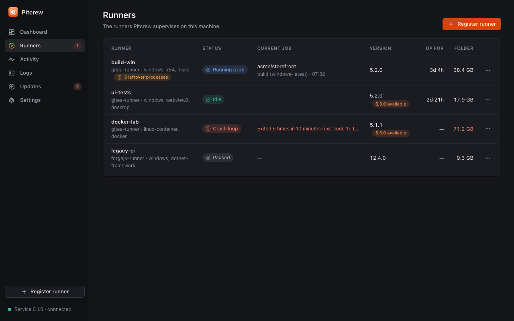

- **A small Rust service owns the runners.** On Windows it is a service under the Service Control Manager (automatic,
  delayed start, recovery actions); on macOS a per-user launch agent registered with `SMAppService`
  ([ADR 0003](adr/0003-service-model.md)); on Linux a systemd user service
  ([ADR 0009](adr/0009-linux-service-and-runner-environment.md)). Installing it is done from the app (**Settings ▸ Service**); elevation prompts
  are the operating system's own, and Pitcrew never handles passwords.
- **Runners get the login shell's `PATH`** (macOS and Linux): launchd and systemd start services with a minimal one, so the service asks the user's login shell for what a terminal has and passes it to each runner at every (re)start. A runner can set its own variables in `pitcrew.toml` (`[runners.env]`, validated: at most 32, `PITCREW_*` and `GITEA_RUNNER_*` reserved).
- **The service replaces itself.** After an update of the app, the service notices that its program changed and restarts when no job or update runs; the new process adopts the runners.
- **The app is optional once the service runs.** Closing the window keeps Pitcrew in the tray; quitting the app never
  stops the runners; the service keeps supervising if the app crashes or is updated.
- **Where a runner runs (Windows).** Each runner runs in the logged-on user's desktop session by default, so jobs that
  need a desktop (WebView2 tests) work, or in the service's own session (without a desktop, before anyone logs on, as
  LocalSystem; the window warns about it). What an interactive runner does while nobody is logged on is a setting: wait,
  or run as the service account until someone logs on.
- **Several runners per machine** (up to 16), each with its own folder, labels, session and policies.
- **Adopting.** An existing registered runner folder is used as it is: no registration happens and the token is not sent.
  Pitcrew refuses to start a runner whose binary already runs outside Pitcrew (for example the old scheduled task) and
  says so.

## Supervision and the watchdog

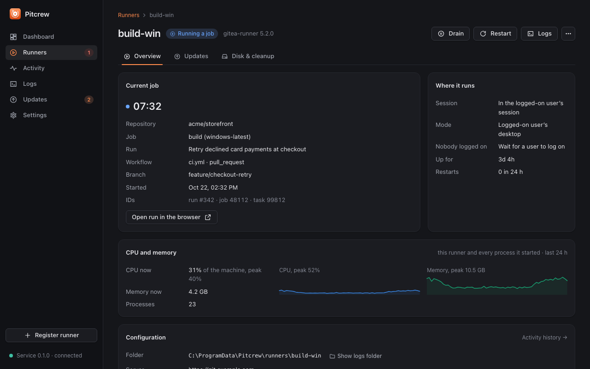

- **One status per runner**, computed by the core from the facts: Idle, Busy, Draining, Stalled, Starting, Degraded,
  Updating, CrashLoop, NotRegistered, WaitingForLogon, Paused and Stopped. The tray and the window show the worst state.
- **Jobs.** The runner's `task started` line gives the repository, job, run and task; because the runner logs nothing when
  a job ends, a job runs while the runner has child processes and for 20 seconds after the last one. The page shows the
  running job with its elapsed time and a link to the run.
- **Stall rule.** At least six "failed to fetch task" polls within 15 minutes while no job runs means the runner is
  stalled: it is stopped gracefully and restarted. A busy runner is never restarted for stalling, and silence is never a
  stall. The threshold and window are settings, per runner.
- **Restart with back-off.** After an unexpected exit the delay starts at 10 seconds and doubles to 5 minutes; it resets
  after 10 minutes of running.
- **Crash-loop protection.** Five exits in ten minutes pause restarts for 30 minutes (or until you press Start) and notify
  you.
- **Between jobs only.** Stop, restart, drain, a session move and an update wait for the current job; the runner is asked
  to stop gracefully (SIGTERM, or Ctrl+Break to its process group on Windows) and is terminated only after the stop
  timeout (120 s) and only while no job runs.
- **Maintenance.** *Drain* finishes the current job, takes no more and pauses the runner; *Resume* starts it again.
  *Start* also clears a crash loop.
- **Recovery.** A runner left running by a previous service instance is adopted and restarted between jobs to get its
  output back.

## Safe updates with roll-back

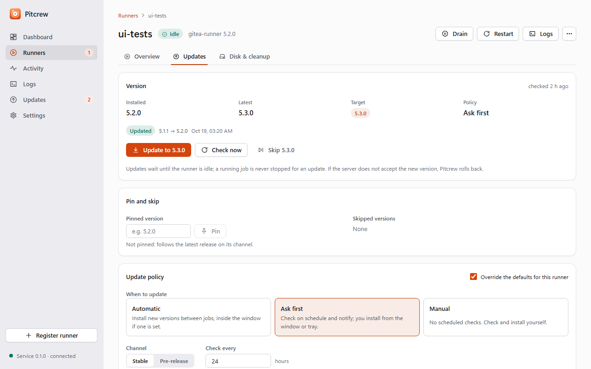

- **Official releases only.** The service reads the latest version from `dl.gitea.com`, downloads the binary for the
  platform over HTTPS (size-capped, with a timeout), and computes its SHA-256 while streaming
  ([ADR 0002](adr/0002-runner-auto-update.md)).
- **Verified from two hosts.** Gitea publishes no signature for the runner, so Pitcrew reads the checksum from both
  `dl.gitea.com` and the gitea.com release and requires them to agree; if the second host cannot be reached the first is
  used and the result says so. The new binary must also report the expected version.
- **Between jobs.** The runner keeps working while Pitcrew waits for its job (up to 3 hours, then the update is
  postponed to the next check), stops it gracefully, swaps the binary (the old one is kept as `<binary>.previous`),
  starts it and waits up to 5 minutes for the server to accept it.
- **Automatic roll-back.** If the new runner exits first or is not accepted in time, Pitcrew puts the previous binary
  back, starts it and records *rolled back* with the reason. With no previous binary, or if the roll-back fails, the update
  *failed* and the runner needs you (tray badge and notification).
- **Policy per runner.** *Automatic* (inside an optional update window, days and time span that may cross midnight),
  *notify only*, or *manual*; stable or pre-release channel; **pin** a version (also how you go back), **skip** a version;
  the check interval (default 24 h, jittered). A binary you provide (`binary_path`) is supervised but never updated.
- **What you see.** Installed and latest version, when the last check ran, the phase of an update in progress with a
  Cancel button until the swap, and the last result with its time and reason.

## Housekeeping

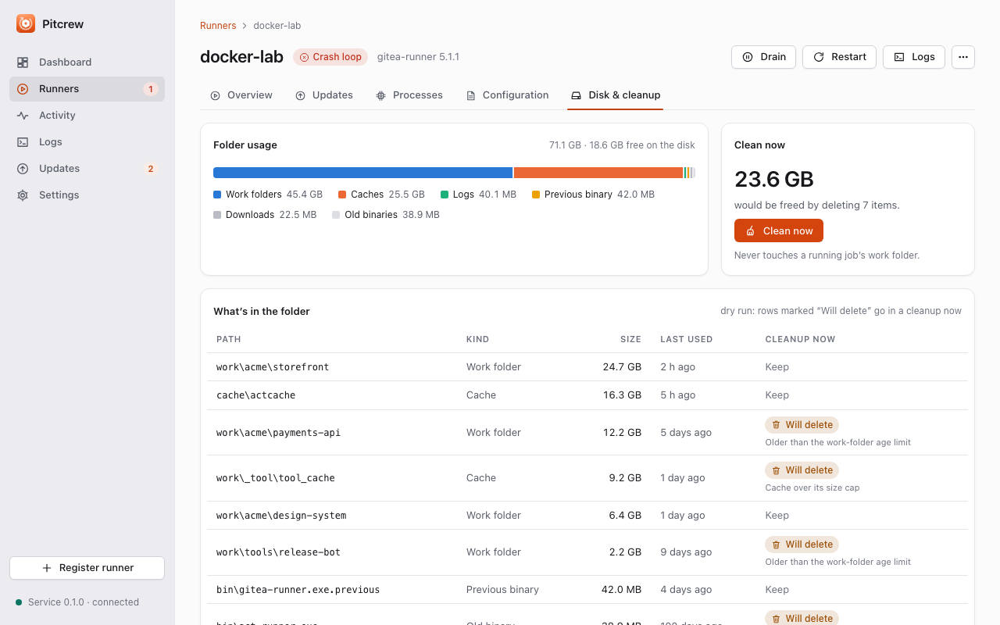

- **Cleans a runner's folder** (`work/`, `cache/`, leftover downloads, old binary names, rotated logs beyond the keep
  count), only while no job and no update runs, never entries changed in the last 10 minutes, and keeps
  `<binary>.previous` unless the policy says otherwise.
- **Triggers:** a schedule (default every 24 hours), free disk below the minimum (default 10 GB), or the folder above its
  cap (default 50 GB); a cleanup is not repeated within 10 minutes.
- **A dry run first.** The Disk panel shows what is in the folder, what a cleanup would delete and why, and the last
  cleanup; *Clean now* runs it between jobs.
- **Defensive deletion.** Long paths and read-only files are handled; what cannot be deleted (a file in use) is reported
  with a reason and tried again next time, never an error for the whole cleanup.
- **Warns when the disk is low** (tile, tray, notification). Every cleanup is a history entry.

## Dashboard

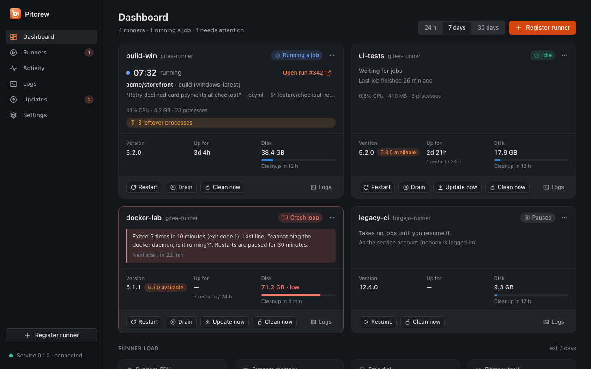

- **Runner cards** with status, the running job (repository, job, elapsed time, link), version, restarts in 24 hours and
  quick actions.
- **Tiles for what the runners use**: CPU and resident memory of each runner and everything it started (shells,
  compilers, test processes, browsers), not the whole machine; free disk stays machine-wide, and a muted line gives the
  machine's totals ([ADR 0007](adr/0007-runner-scoped-metrics.md)). A tile shows what Pitcrew itself costs.
- **History:** CPU and memory with the runners stacked on the rest of the machine, over a range you choose.

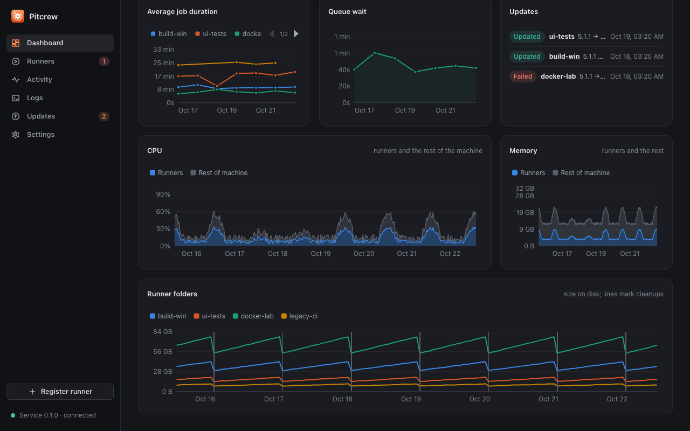

- **Jobs per day (jobs per hour for the 24-hour range), uptime, average job duration, an events feed** (restarts, stalls, updates, cleanups) and **update
  results**. With a read-only Gitea token (kept in the OS credential store) it also shows job outcomes and **queue
  wait**; without one it says what to add.

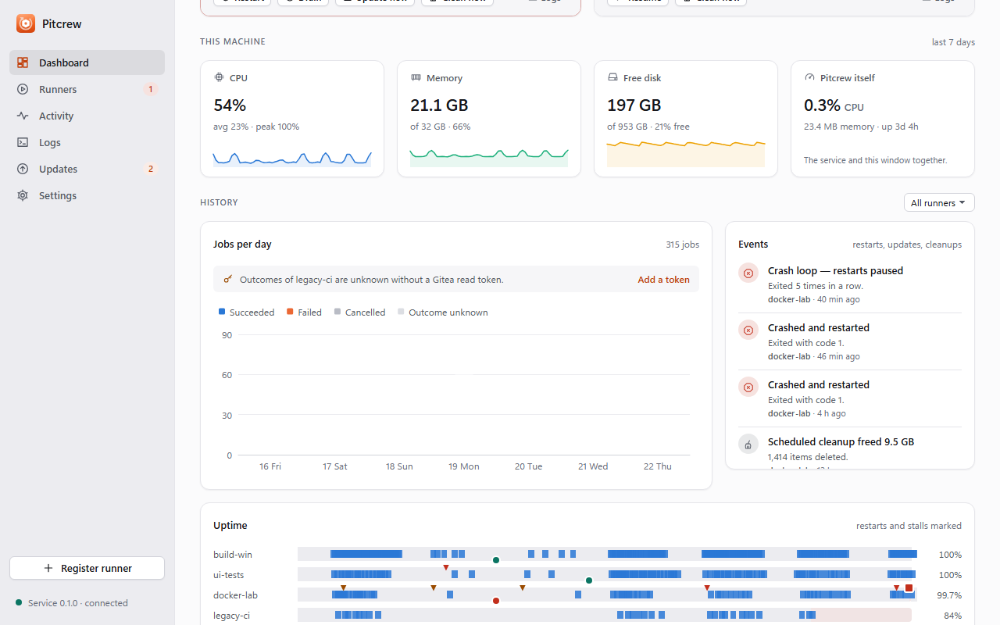

## Runners and a runner's page

- **Runners** lists every runner with its status and actions, and the Register button.
- **A runner's page** shows the current job, where it runs (session, a note when nobody is logged on), CPU and memory
  with trends, the version and update controls, the disk panel and its configuration (folder, labels, server, session),
  with a shortcut to the logs folder and a *Back to runners* link.
- **Per-runner overrides** of the update policy, the stall rule and the cleanup policy; everything else follows the
  defaults in Settings.

## Activity and history

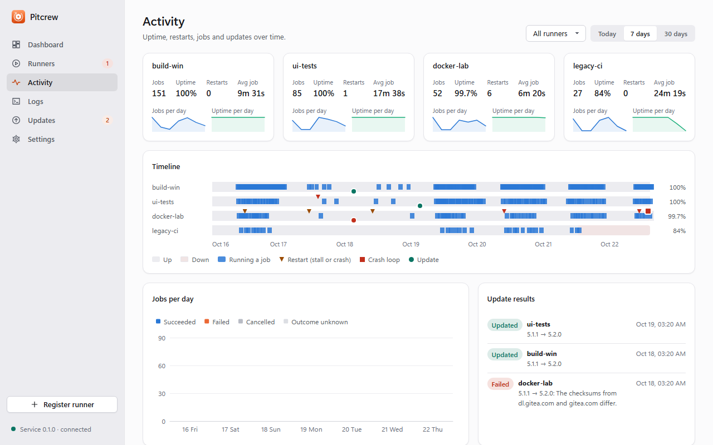

- **A timeline per runner** of when it was up and busy, with marks for crashes, stalls, crash loops, failed launches,
  updates, roll-backs, postponed updates and cleanups.
- **Jobs per day and uptime per day**, update results, and a list of recent jobs, for one runner or all of them over a
  range.
- **History is local and bounded**: at most 4000 events per runner (90 days are summarised per local day), kept in
  `state.json`; the core computes the summaries.

## Logs

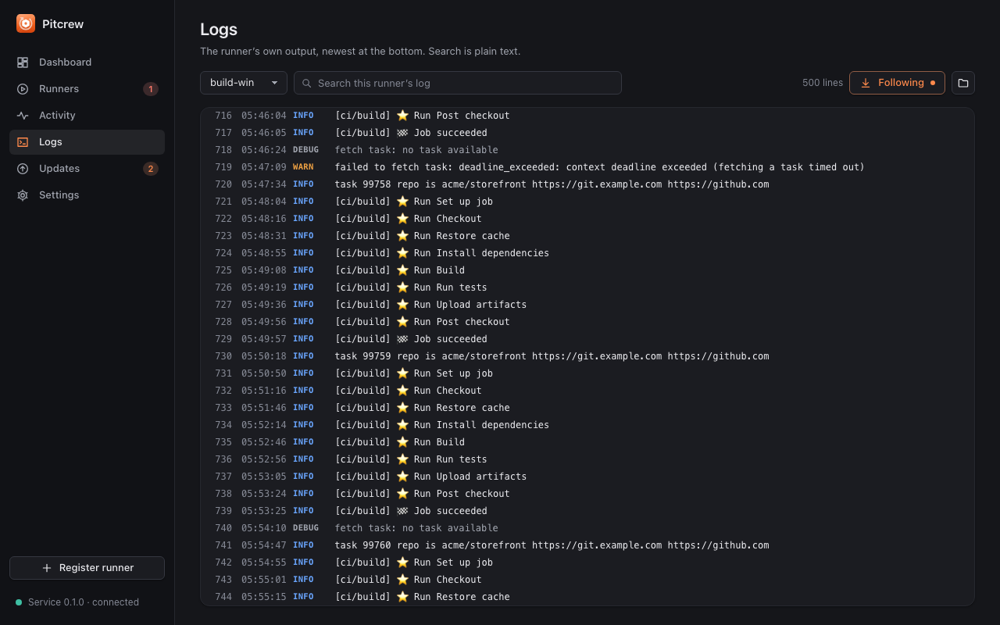

- **The runner's own output**, newest at the bottom, with Pitcrew's `supervisor:` lines (starts, stalls, updates,
  registration) in the same stream.
- **Plain-text search** (never a user-supplied pattern), follow mode, and a bounded tail (5000 lines or 4 MB per runner)
  in memory; the files on disk rotate at 10 MB with five kept.
- Log text is rendered as text, never as HTML.

## Registering and adopting runners

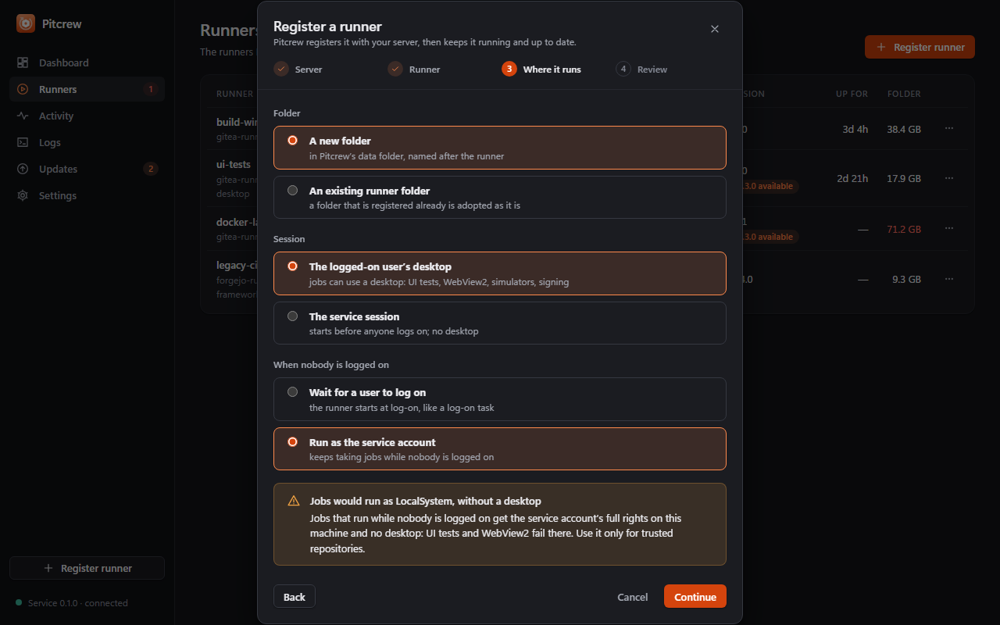

- **A wizard** asks for the server URL, the registration token, a name in Pitcrew and on the server, labels, a new folder
  or an existing runner folder, and (Windows) where the runner runs and what it does while nobody is logged on.
- **Pitcrew installs the runner** (latest release, verified as for updates), writes its configuration so jobs and cache
  live in the runner's folder, runs its `register` command with the token and starts it. The token is passed on and never
  written to Pitcrew's files or logs; "remember" keeps it in the OS credential store for further runners.
- **Adopting** a registered folder skips registration entirely.

## Tray and notifications

- **The tray icon** (Windows notification area, macOS menu bar) shows the worst state of all runners, with a shape per
  state and not only a colour; its tooltip counts the runners and their load; the menu lists each runner with quick
  actions (start, stop, restart, drain, resume, update, clean, open logs).
- **Notifications** for stalls, crash loops, an unreachable server, a runner the server forgot, updates installed,
  rolled back or failed, a new version (notify-only policy), low disk and cleanups. Only transitions are announced: a
  runner that stays stalled is announced once. They can be switched off in Settings.
- **Open at log-in** is a toggle.
- **Window lifecycle.** Closing the window destroys it and frees the webview; the tray's Open item (and the macOS Dock icon) recreate it. Where there is no tray (Linux without a status-notifier host) closing the window quits the app. Tray actions and notifications can deep-link into the app (`pitcrew://navigate`, for example a runner's logs).

## Settings

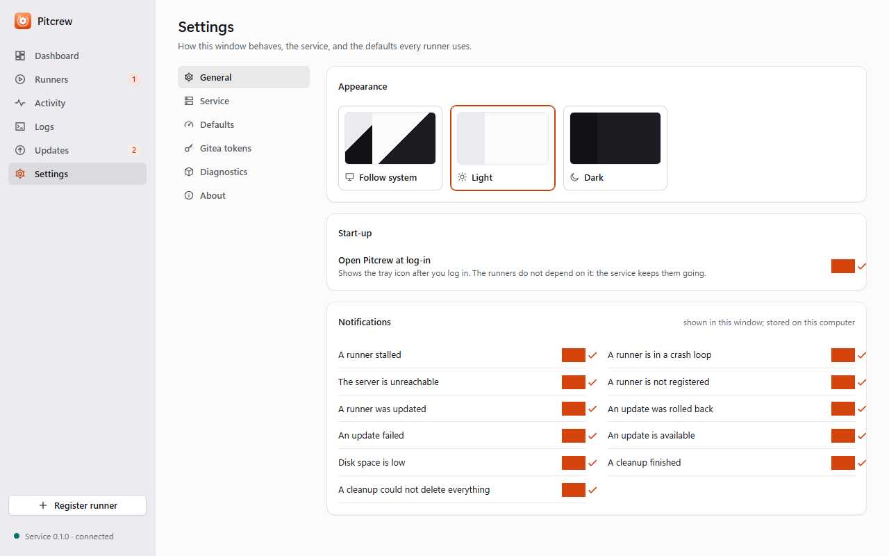

- **General:** theme (dark, light, system), open at log-in, notifications.
- **Service:** whether the service is installed and running, install and remove, and the service's version, uptime and
  data folder.
- **Defaults:** the stall rule, restart policy (first and longest delay, crash-loop limits), update timeouts (wait for
  idle, graceful stop, confirm), log rotation and cleanup policy every runner uses, plus problems found in
  `pitcrew.toml` and a read-only notice when the configuration comes from a newer Pitcrew. The default update schedule is
  on the Updates page.
- **Tokens:** Gitea read tokens per server (set, replace, clear; never shown again).
- **Diagnostics:** a redacted zip (configuration, status, history, the tail of each runner's log, the service log) for
  support.
- **About:** version, licence.

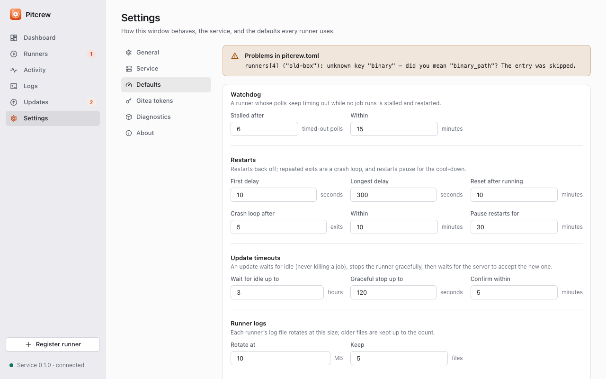

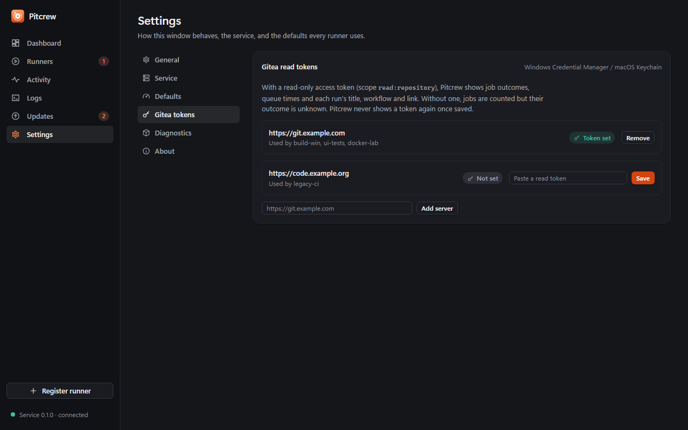

## Pitcrew's own updates

- **Opt-in and signed.** Pitcrew checks only when you ask (Updates page ▸ *Pitcrew* ▸ *Check for updates*); a release is
  verified with a minisign public key built into the app before it is installed, and a build without the key says
  "Updates are not available in this build" ([releasing.md](releasing.md)). *Install and restart* replaces the app; the
  service and the runners keep running.
- The runners' updates are separate (above) and come from the runner projects' releases.

## Security and privacy

- **Native feel.** Text is selectable only where it is meant to be (paths, names, logs), the browser's context menu, reload, zoom and drops are blocked ([ADR 0008](adr/0008-native-feel.md)).
- **Calls time out** and show an inline Retry instead of hanging a panel.
- **Local only.** The app and the service talk over a private local stream; there is no telemetry and no remote content
  in the app.
- **Least privilege.** The webview gets events only; the service re-validates every request; elevation is the OS's own
  prompt; secrets live only in the OS credential store; runner tokens and `.runner` files are never read.
- **Nothing unverified is installed or run:** HTTPS, two checksum hosts, a version check, roll-back.
- **Failures are contained**: a bad configuration entry is skipped, damaged files fall back to a backup, a panel that
  fails shows an inline error with Retry.

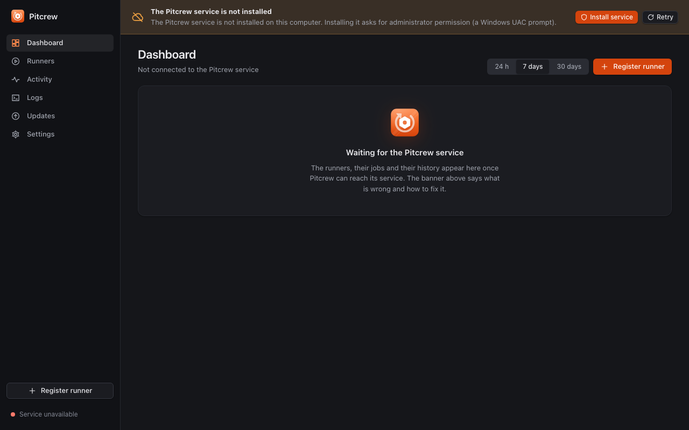

- When the service cannot be reached the window and the tray say so, with the reason and the next step, and the app
  reconnects by itself.

## Platforms

| | Windows 10/11 | macOS 13+ | Linux |
| --- | --- | --- | --- |
| Service | Windows service, LocalSystem | Per-user launch agent (`SMAppService`) | systemd user service (`Restart=always`), no root |
| IPC | Named pipe with an ACL | 0600 Unix socket | 0600 Unix socket in `$XDG_RUNTIME_DIR/pitcrew` |
| Runners | User's desktop session or session 0 | The user's GUI session, login-shell `PATH` | The user's session, login-shell `PATH` |
| Credential store | Credential Manager | Keychain | Secret Service |
| Installer | NSIS | `.dmg` (ad-hoc signed, not notarised) | `.deb` and AppImage |
| Verified | Windows CI runner; not yet on a dedicated build machine | A real Mac, 2026-10-22 | Rust tests and the fake-runner service tests in a Linux container and CI; `systemctl`, the tray and the bundles not yet on a real desktop ([linux.md](linux.md)) |

Runner kinds: Gitea's runner today; Forgejo's runner and GitHub's self-hosted runner are planned
([roadmap](roadmap.md)).
