# Pitwall architecture

How Pitwall is built, in prose. The diagrams are collected in [design.md](design.md); the reasons behind each
decision are in the [architecture decision records](adr/README.md). Everything here describes the code as it is
today; what is only planned is said so, and is collected in the [roadmap](roadmap.md).

Contents: [Overview](#overview) · [The pieces](#the-pieces) · [Decisions at a glance](#decisions-at-a-glance) ·
[Behaviour in text](#behaviour-in-text) · [State and files](#state-and-files) ·
[Security and robustness](#security-and-robustness) · [Extension points](#extension-points) ·
[What is not built yet](#what-is-not-built-yet)

## Overview

Pitwall is the **local-only** LLM server and manager for the app suite (Debrief, Pitcrew, Spotter, Dyno) and for
any tool that speaks the OpenAI, Anthropic or Ollama API. It runs language models on the user's own computer and
gives every app one place to use them. It has four parts:

1. **`pitwall-core`**, a pure Rust library. It decides everything: API translation, what fits, what to release, what
   to run next, which model to choose, which URL may be fetched, what a key may do. It does no I/O; time, memory
   readings and file contents come in as values ([ADR 0002](adr/0002-core-crate-ports-adapters.md)).
2. **`pitwall-server`**, a windowless Rust process built on axum. It carries out the core's decisions: it starts
   engine processes, downloads and verifies files, listens on `127.0.0.1`, and keeps serving when the window is
   closed. The only outbound HTTP client lives in one module (`egress.rs`) ([ADR 0001](adr/0001-local-only.md)).
3. **`pitwall-loopback`**, a tiny HTTP client whose port type can only mean `127.0.0.1`. The server reaches its
   engine processes through it.
4. **`pitwall-cli`**, the `pitwall` command-line tool ([ADR 0015](adr/0015-command-line-tool.md)): a client of the management
   and standard APIs through `pitwall-loopback`, for terminals and scripts.
5. **The app**: a Tauri 2 shell with a tray icon (`app/src-tauri`)
   around an Angular 22 UI (`app/src`) that talks to the server's management API through a backend service injected
   by DI token (a real Tauri backend, or a mock for browser development and tests).

Engines (llama.cpp today) are third-party binaries that Pitwall downloads, checksums and runs as child processes, one
process per loaded model. There is no plugin system ([ADR 0010](adr/0010-no-plugin-system.md)); extension is by
declarative TOML packs ([ADR 0011](adr/0011-declarative-packs.md)).

What leaves the machine: only downloads the user asked for (engine releases from GitHub, models from Hugging Face),
over HTTPS, from an allow-list of hosts, with every redirect hop checked again. Offline mode turns even that off.
Prompts and answers never leave the process tree on `127.0.0.1`.

## The pieces

### Core (`crates/pitwall-core`)

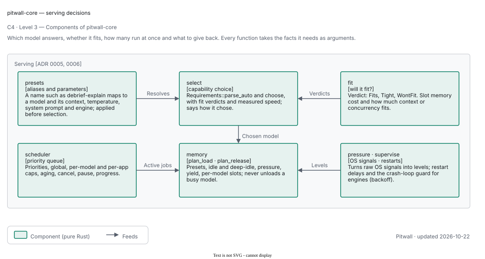

The other parts of the core are in [design.md](design.md#level-3--core-components).

Pure functions and types, 99 % line coverage as a target. The modules, grouped by job (see the crate documentation
in `lib.rs`):

| Group | Modules | What they do |
| --- | --- | --- |
| Wire formats | `api` (`openai`, `anthropic`, `ollama`), `chat`, `llama`, `sse` | Parse each API's requests once into the neutral `ChatRequest`; format answers, stream chunks and errors in each family's own shape; build llama-server's arguments and request bodies |
| Serving | `scheduler`, `memory`, `select`, `backoff` | The priority queue and caps; when to release models and whether a load fits; capability-based model choice; restart delays |
| Models and engines | `gguf`, `quant`, `fit`, `hf`, `runtimes`, `hardware` | GGUF header reading with limits; "will this fit?"; Hugging Face answers; the pinned llama.cpp builds, the automatic build order, engine pins and rollback, and the capability matrix; GPU and RAM facts |
| Security and privacy | `privacy`, `keys`, `limits` | The download allow-list and `DownloadUrl`; `Host`/`Origin` rules; key generation and hashing; per-app permissions, rate and token budgets |
| State | `config`, `metrics`, `events`, `usage`, `discovery`, `mgmt`, `packs`, `tasks`, `tokens`, `cache` | Versioned settings; time series with bounded retention; the events feed; per-app counters; the discovery file; the UI's wire contract; declarative packs; versioned task prompts, token estimates and a cache policy |

Rules the core keeps: no `unwrap`/`expect` on user data, `unsafe` denied, `missing_docs` on, parse-don't-validate
(`DownloadUrl`, `ModelId`, `AppId`, `RepoId`, `Priority::parse` return typed values or errors).

### Server (`crates/pitwall-server`)

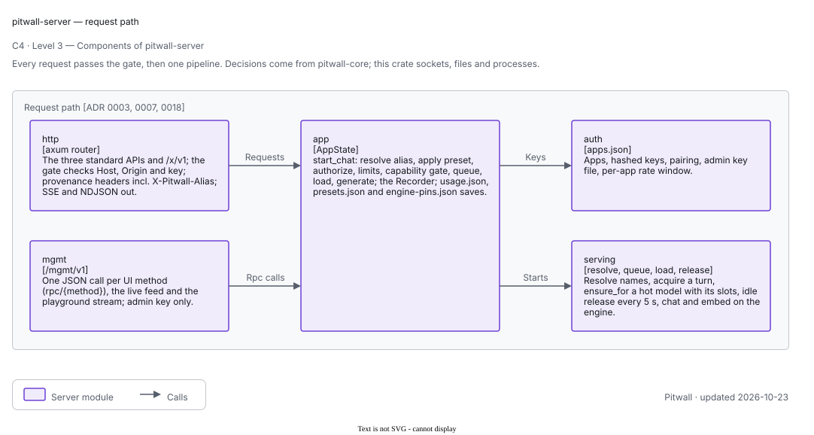

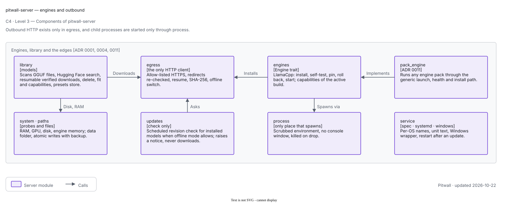

| Module | Responsibility |
| --- | --- |
| `main.rs`, `service/` | Flags (`--port`, `--data-dir`, `--version`, `--help`) and the service verbs the installers and the app call (`install`, `uninstall`, `status`, `print-unit`, `--service` on Windows); binds `127.0.0.1`, writes `discovery.json`, starts the background tasks, stops cleanly on Ctrl-C and SIGTERM |
| `http.rs` | The router: standard APIs, `/x/v1`, and the merged management routes. The gate (Host, Origin, credential), one function per endpoint, streaming in SSE or NDJSON, provenance headers |
| `mgmt.rs` | The management API for Pitwall's own window: `POST /mgmt/v1/rpc/{method}`, the live feed `GET /mgmt/v1/live`, and the playground stream `POST /mgmt/v1/chat`. Admin key only |
| `app.rs` | `AppState` (everything shared), the request pipeline `start_chat`, the background tasks (release loop, live pushes, metrics sampling), packs loading |
| `serving.rs` | The scheduler wrapped for async use, the hot-model table, `ensure` (plan a load, evict, start the engine, wait until healthy), the release `tick`, chat and embedding calls to engines |
| `engines.rs` | The `Engine` trait, `LlamaCpp` (catalog, install, self-test, defensive unpacking, start), `Planned` (placeholder engines that say why they are unavailable) |
| `pack_engine.rs` | `PackEngine`: one generic adapter that runs any engine described by an engine pack |
| `library.rs` | Scanning `models/`, the Hugging Face search and file lists, resumable downloads, GGUF verification, deletion |
| `egress.rs` | The single outbound HTTP client: HTTPS only, no proxy, allow-listed hosts including every redirect, offline switch, resume, SHA-256 check |
| `auth.rs` | Apps, keys, the admin key, pairing; `apps.json` written atomically with a backup |
| `process.rs` | The only place child processes are started: scrubbed environment, no console window, killed on drop |
| `paths.rs`, `system.rs` | Data folders and atomic writes; hardware and memory probes (RAM, GPUs, disk, process RSS) |
| `service/` | Running as an OS service: `spec.rs` (pure functions of a target OS: names, paths, unit text, restart-after-update decision), `systemd.rs`, `windows.rs`, `login_path.rs` (the user's login-shell `PATH` for supervised servers), `watch.rs` (restart itself when its own binary changed and it is idle) |
| `fake_engine.rs` | A test double: a small OpenAI-compatible server run as `pitwall-server --fake-engine` |

### Command line (`crates/pitwall-cli`)

| File | Role |
| --- | --- |
| `args.rs` | Pure parser: the command line becomes an `Invocation` (command, `--json`, `--port`, `--key-file`, `--timeout`); a key option is refused with the safe alternatives |
| `exit.rs` | Pure: the exit codes (0 to 4), `CliError`, and the mapping from the management `ErrorCode` and loopback failures, each with a next step |
| `format.rs` | Pure: tables, decimal sizes, durations, UTC timestamps, the text of every command's output |
| `sse.rs` | Pure, bounded parser for the streamed chat completion |
| `discover.rs` | The decisions about the port (flag, discovery file, 11435), the data folder per OS and the admin key order (`--key-file`, `PITWALL_ADMIN_KEY`, OS credential store, `admin.key`), over a `Sources` trait |
| `api.rs` | The thin edge: `POST /mgmt/v1/rpc/{method}` and the streamed `/v1/chat/completions`, only through `pitwall_loopback::Client` |
| `run.rs`, `main.rs` | One function per command (progress polling for `pull`, key creation, chat streaming) and the process entry point |

### App (`app/`)

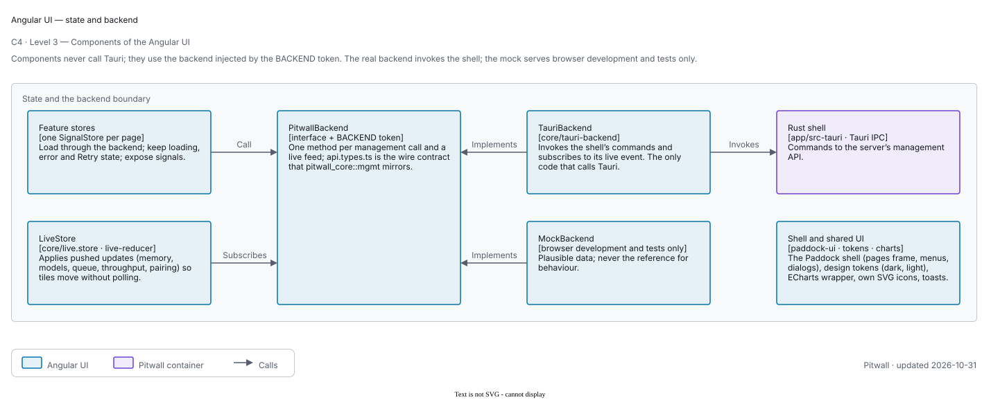

The Angular UI is the presentation layer. Standalone components with signals and OnPush, SignalStores for state,
Angular CDK for behaviour and accessibility, Angular Material selectively, Apache ECharts for charts, and Pitwall's
own SVG icon set in the `pw` namespace. Components never call Tauri `invoke`; they use the backend service injected by
the `BACKEND` token. The screens are `dashboard`, `models`, `engines`, `apps`, `requests`, `playground`, `benchmarks`,
`settings` and the compact `tray` view. The UI does not re-implement domain rules: fit verdicts, release countdowns and
model selection come from the core through the server.

The Tauri shell (`app/src-tauri`, a workspace member) holds no model or request state of its own. It talks to the
server only through a `ServerClient` trait (loopback HTTP to the management API and its live feed; a fake in tests):

| Module | Responsibility |
| --- | --- |
| `server_client.rs`, `live.rs` | The management client and the live feed that is forwarded to the UI and the tray |
| `credentials.rs` | The app's copy of the admin key in the OS credential store (Windows Credential Manager, macOS Keychain, Secret Service), falling back to `admin.key` when the store is unavailable |
| `service_install.rs` | Registering the server with the OS: `SMAppService` and the launch agent inside the bundle on macOS, the NSIS installer's service on Windows, a systemd user unit written by `pitwall-server install` on Linux. Elevation and approval are always the OS's own |
| `window.rs`, `tray.rs`, `tray_model.rs` | Window lifecycle as pure decisions (closing destroys the window, tray Open and Dock reopen rebuild it, only Quit exits, no tray means closing quits) and the tray menu |
| `updater.rs` | The opt-in minisign-verified updater; inert in unsigned builds |
| `native_feel.rs` | [ADR 0012](adr/0012-native-feel.md): selection opt-in, one context-menu policy, browser keys blocked |

Closing or quitting the app never stops the server. The shell has been type-checked and unit-tested; running it on
real Windows and Linux desktops is not verified yet (see the [roadmap](roadmap.md)).

## Decisions at a glance

| Decision | Where |
| --- | --- |
| Local only: no cloud, no telemetry; the request path has no HTTP client, enforced by a test and a CI script | [ADR 0001](adr/0001-local-only.md) |
| Pure core, thin server, ports and adapters | [ADR 0002](adr/0002-core-crate-ports-adapters.md) |
| OpenAI, Anthropic and Ollama shapes unchanged; `/x/v1` for extras; additive versioning; provenance headers | [ADR 0003](adr/0003-api-surface-and-compatibility.md) |
| `Engine` trait; one child process per loaded model; scrubbed environment; self-test and roll back | [ADR 0004](adr/0004-engine-abstraction-and-process-model.md) |
| One priority queue with caps and aging | [ADR 0005](adr/0005-queue-and-scheduling.md) |
| Idle release, pressure release, never unload a busy model, fit check before a load | [ADR 0006](adr/0006-memory-policy.md) |
| Keys hashed, pairing, loopback only, Host and Origin checks, admin key | [ADR 0007](adr/0007-security-model.md) |
| How apps find, pair with and use Pitwall | [ADR 0009](adr/0009-app-integration-contract.md) |
| No plugins | [ADR 0010](adr/0010-no-plugin-system.md) |
| Declarative engine and model packs | [ADR 0011](adr/0011-declarative-packs.md) |
| Parallel slots per model, KV memory per slot, the fit solver | [ADR 0016](adr/0016-parallel-slots.md) |

## Behaviour in text

### A chat request

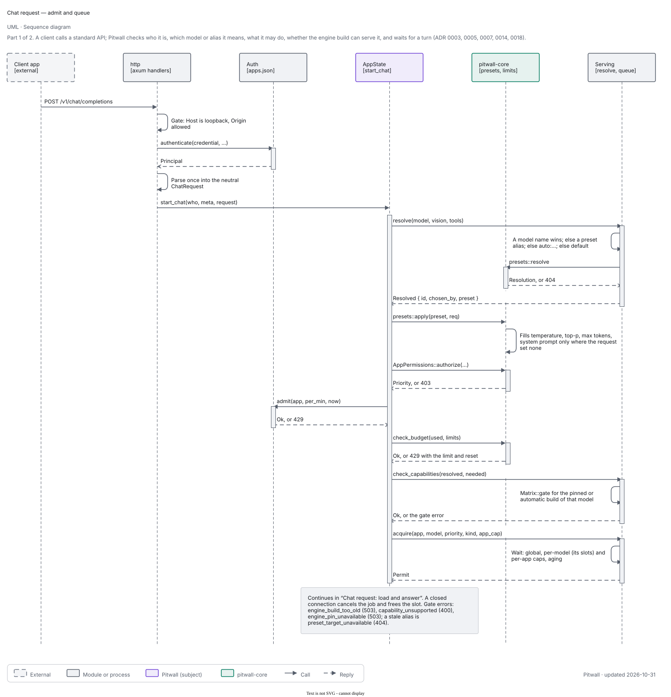

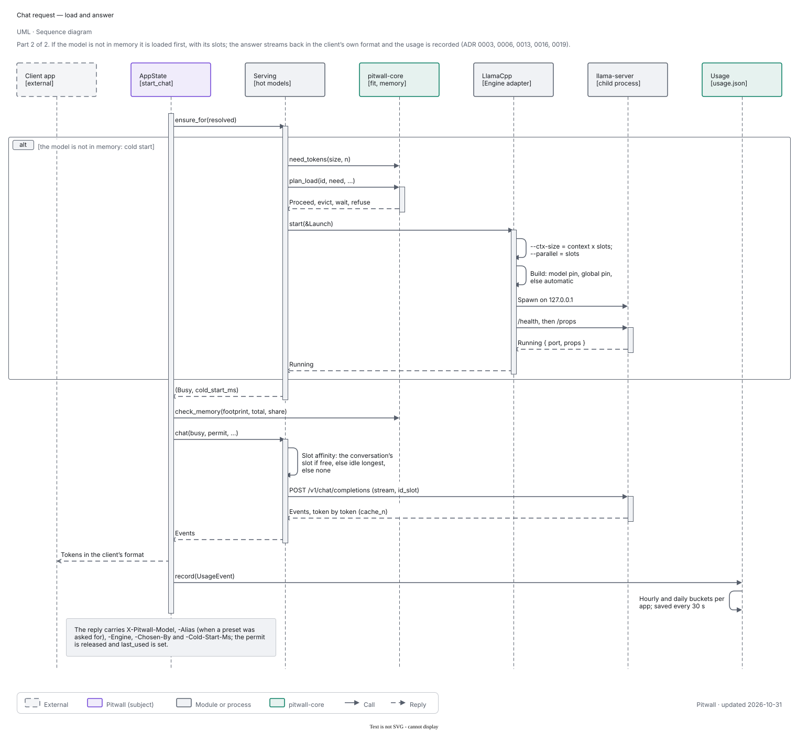

1. **The gate** (`http::gate`). The `Host` header must name this machine (loopback names, or none); a browser
   `Origin` must be loopback or Pitwall's own window; the credential is `Authorization: Bearer pw_...` or
   `x-api-key: pw_...`. A request with no key is refused unless the user turned on `allowKeylessLocal` and the
   request is not from a browser.
2. **Parse once, at the edge.** `api::openai`, `api::anthropic` or `api::ollama` turn the body into the neutral
   `ChatRequest`. A malformed body is answered in that family's error shape.
3. **Resolve the model** (`Serving::resolve`). A named model, a preset (alias, `pitwall_core::presets`, ADR 0014; a real
   model's name wins over an alias), `default`, or `auto:vision,8k,fast`, which the core's `select::choose` evaluates
   against the installed models; a preset with a capability target uses the same selection. The reply says how it was
   chosen (`explicit`, `capabilities`, `default`) and, for a preset, `X-Pitwall-Alias`. `presets::apply` then fills the
   request's missing sampling values and, when it has no system message, the preset's system prompt; the preset's context and
   engine go to the load (`Serving::ensure_for`).
4. **Authorize** (`AppPermissions::authorize`, the per-minute rate window, the daily token budget). Denials are 403
   or 429 with a message that says what to change.
5. **Queue** (`Serving::acquire`). The job enters the scheduler with its priority (the `X-Pitwall-Priority` header,
   capped by the app's maximum). It waits until the global, per-model and per-app caps allow it.
6. **Load if needed** (`Serving::ensure`). If the model is not hot, the core's `plan_load` says proceed, evict idle
   models first, wait for busy ones, or refuse with `insufficient_memory`. The server starts the engine process on a
   free loopback port, polls `/health` for up to five minutes, and reads `/props`. The time this took is the
   *cold start* and is reported in `X-Pitwall-Cold-Start-Ms`.
7. **Generate.** The server sends the request to the engine's own `/v1/chat/completions` over loopback, always
   streamed, and converts the engine's events back into the caller's format (SSE for OpenAI and Anthropic, NDJSON
   for Ollama; a single JSON body when the client did not ask to stream).
8. **Record.** A `Recorder` writes request metadata (never the text unless the user enabled
   `keepRequestContent`) into a bounded list (500), per-app usage and the metrics series. Closing the connection
   cancels the job and frees the slot.

### Model selection

`select::choose` filters installed models by the required capabilities (derived from the GGUF header, the chat
template and the presence of a vision projector), the minimum context and whether the model could fit now, then
prefers by the app's word: *balanced* (a loaded model first, then the fastest), *fast*, *quality* (largest) or *small*.
A typo in an `auto:` list is an error rather than a silent different choice. Measured speeds (stored benchmarks) feed "fast"; a model that
was never benchmarked is estimated from its file size.

### Memory

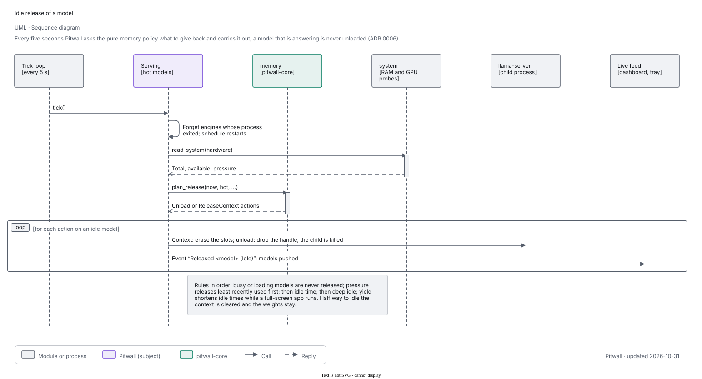

A tick every five seconds reads the OS signals (`os_signals`: Linux PSI, macOS `sysctl` and `pmset`, Windows memory notification and `SHQueryUserNotificationState`; `pitwall_core::pressure` turns them into levels) and asks `memory::plan_release` what to give back. In order of precedence: a model that is
serving or loading is never released; under pressure (available RAM below a percentage of total, or the OS
signals it) the least recently used idle, unpinned models are
unloaded until the threshold is met; a model idle for
its idle time is unloaded; when nothing has been used for the deep-idle time every unpinned model goes. Half way to the idle time the model's context is cleared (the engine's slots are erased) and the weights stay; at the full idle time they go. While a foreground full-screen app is detected (macOS and Windows; not detected on Linux) idle times shrink to a quarter (at least 30 s). The presets (Low memory,
Balanced, Performance) are sets of these values; `custom` is the user's own. The next request after a release
simply reloads the model (a cold start).

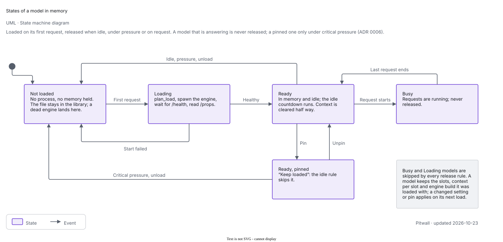

A model's memory is its weights plus one KV cache per parallel slot (ADR 0016, `pitwall_core::slots`). The configured context is per
slot, so the engine is started with `--ctx-size = context x slots` and `--parallel = slots`; the load plan, the loaded footprint and
the fit verdicts use that total, and `slots::solve` answers "how much context or concurrency fits" for the Slots panel. The scheduler's
per-model concurrency is the model's slot count (the count it was loaded with while loaded), so requests beyond the slots queue.

### Engine install and update

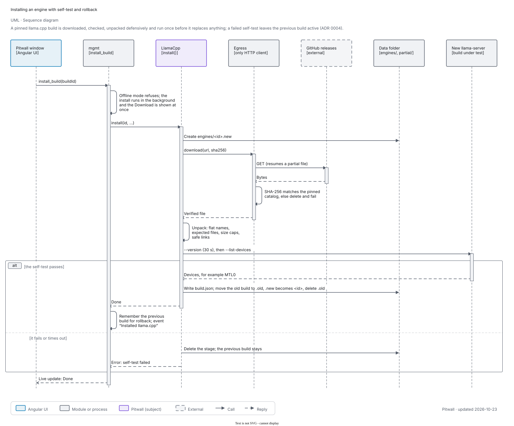

The pinned catalog (`runtimes/llama-runtimes.json`, release tag `b11669` today) lists every official prebuilt
`llama-server` build per platform with URL, size and SHA-256. Installing a build downloads each asset (resumable,
size and SHA-256 checked, hosts allow-listed), unpacks it defensively into `engines/<id>.new` (flat names, only the
files Pitwall expects, bounded sizes, symlinks only to plain siblings), runs `--version` and `--list-devices` under a
30-second timeout, and only when that passes swaps it in, keeping the old copy until the rename succeeds. A failed
self-test discards the new build and the previous one stays active. Pins and rollback sit on top (ADR 0018):
the model's pin, then the global pin, then the automatic order choose the build when a model loads (`pitwall_core::runtimes::pins`,
pure); `rollback_build` pins the previous installed build that passed its self-test. A capability matrix
(`runtimes/capabilities.json`, `runtimes::capabilities::Matrix::gate`, pure) says what each build can serve; the server's
`CapabilityGate` refuses a request the serving build cannot handle with a typed error, and listings and `auto:` selection
leave those capabilities out. The automatic build order is Metal, then CUDA (newest first), then Vulkan, then CPU; ROCm, SYCL
and OpenVINO are only used when chosen.

### Model download

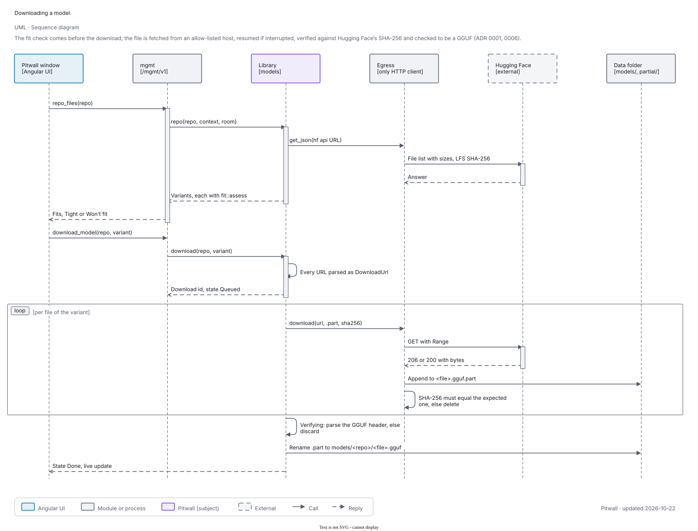

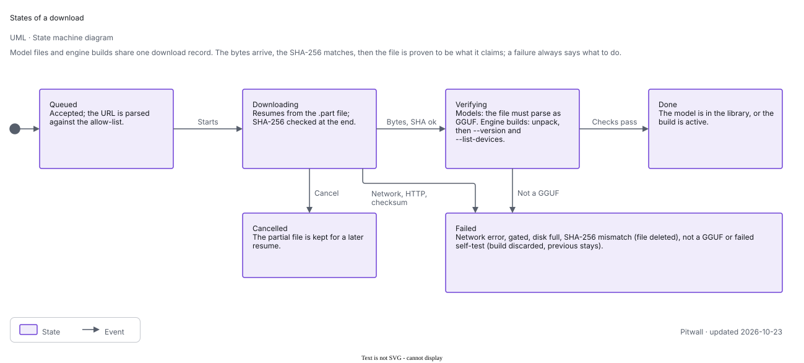

Downloads go to `partial/` or beside the target as `.gguf.part` and resume with an HTTP range request. Hugging Face
publishes a SHA-256 per LFS file; the server passes it to the egress client, which verifies it before the file is
renamed into `models/<repo>/`. The file must also parse as GGUF (`verify_gguf`); otherwise it is discarded. A
mismatch deletes the partial file and reports both digests.

### Apps, keys and pairing

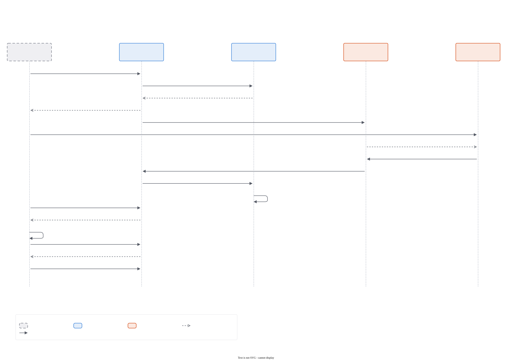

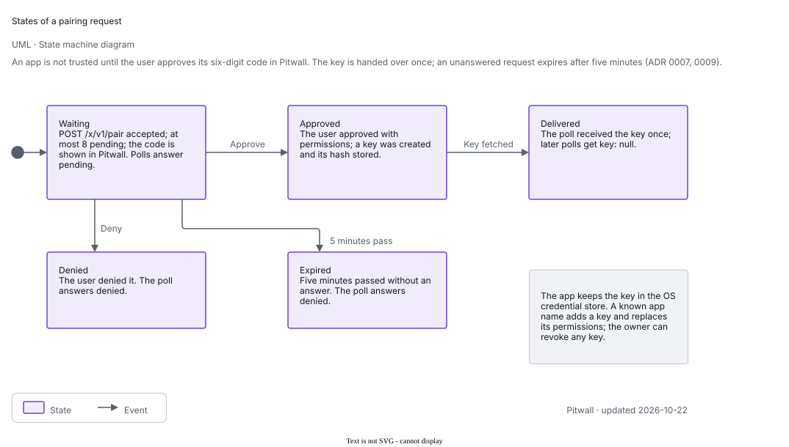

A key is `pw_` plus 32 random bytes (base64url). Pitwall stores the SHA-256 only; the secret is shown once. An app
without a key calls `POST /x/v1/pair`; Pitwall shows a six-digit code that the app also shows; the user approves it
in the UI, choosing the app's permissions; the app polls and receives the key once. A request expires after five
minutes and at most eight can wait. The admin key (used by Pitwall's own window) is a random secret in an owner-only
file next to the data; apps never see it.

### App to server

The window talks to the server's management API: one JSON call per backend method, and a server-sent live feed that
pushes memory samples, the loaded models with their idle countdown, the queue, throughput and pairing requests every
couple of seconds, so the dashboard is pushed rather than polled. The server does not depend on the window; closing
or crashing the app does not stop serving.

## State and files

Everything is in one per-user data folder (override with `PITWALL_HOME`): `%APPDATA%\Pitwall`,
`~/Library/Application Support/Pitwall` or `$XDG_DATA_HOME/pitwall` (`~/.local/share/pitwall`).

| Path | What | Notes |
| --- | --- | --- |
| `settings.toml` | General, server, memory, network, privacy, models, engines | Versioned (`SCHEMA_VERSION`), every key optional with a default, atomic write with `.bak`, damage falls back to the backup, then the defaults |
| `apps.json` | Apps, key hashes, permissions | Versioned, atomic, backup, 1 MB cap, at most 64 apps |
| `admin.key` | The management key | Random `pw_` secret, owner-only |
| `discovery.json` | How apps find a running server | Written at start, removed at stop, holds no secret |
| `models/<repo>/<file>.gguf` | The model library | |
| `engines/<build>/` | Installed llama.cpp builds | With `build.json` (tag, self-test result, devices); `<build>.new` and `<build>.old` exist only during an install |
| `partial/` | Engine archives being downloaded | |
| `packs/` | The user's engine and model packs | At most 64 files of 256 KB |
| `metrics.json` | Time series | Versioned, bounded retention (default 30 days) |
| `engine-pins.json` | Engine build pins and rollback history (`pitwall_core::runtimes::pins`) | Versioned, atomic write with `.bak`, damage falls back to the backup, then no pins; one damaged entry is skipped, at most 256 model pins, 8 remembered builds |
| `presets.json` | Model presets and aliases (`pitwall_core::presets`) | Versioned, atomic write with `.bak`, damage falls back to the backup, then empty; one damaged entry is skipped, at most 64 presets |
| `usage.json` | Per-app usage over time (`pitwall_core::usage`) | Versioned, atomic write with `.bak`, damage falls back to the backup, then empty; hourly buckets 7 days, daily buckets 90 days, at most 256 apps per bucket (the rest count as `other`), saved every 30 s |
| `logs/` | Service log | Never prompts or answers by default |

The events feed (2000 entries) and the request list (500 entries) live in memory.

## Security and robustness

- **Local only**, as a property of the code: one outbound client, clippy forbids HTTP clients and raw process
  spawning elsewhere, a test fails if a request handler can reach the network, and a CI script greps for
  `reqwest` outside `egress.rs`.
- **Never trust the webview or the network.** Every IPC and HTTP argument is parsed and validated in Rust. Management
  calls need the admin key. Only loopback `Host` names are answered (DNS rebinding); browser pages from other origins
  are refused.
- **Engines are contained.** Each model runs in its own process with an empty environment plus an allow-list, a private
  API key, `--offline`, loopback only, killed when the handle is dropped. A crashing engine produces an error for that
  request, is noticed by the next tick and reloaded on demand; it never takes the server down.
- **Never unload a busy model**, never push the machine into swap: a load that cannot fit is queued or answered with a
  typed `insufficient_memory` error.
- **Bounded everything**: request size (32 MiB default), queue length (256), request time (600 s default), line and
  archive limits, result caps, pack counts and sizes.
- **Recoverable state**: versioned files, atomic writes, backups, tolerant loading.
- **Contain failures in the UI** too: each panel has an error boundary with an inline Retry; every backend request has
  a timeout.

## Extension points

- **A new engine** that serves an OpenAI-compatible API needs a TOML pack, not code
  ([ADR 0011](adr/0011-declarative-packs.md)). An engine that needs its own protocol is a new `Engine` implementation
  in the server (planned: MLX, vLLM, whisper.cpp; each currently shows as "not available" with the reason).
- **A model list** is a model catalog pack.
- **A new API family** is a module in `pitwall_core::api` plus routes in `http.rs`.
- **A new platform** needs a build in the runtime catalog and a row in `service/spec.rs`.

## What is not built yet

Said plainly, so nothing in this document is read as a promise:

- Sharing on the local network (LAN with TLS and certificate pinning): the setting and the status fields exist, the
  listener does not.
- The response cache (`pitwall_core::cache` is only the policy; prompt-prefix caching is llama-server's own), knowledge
  collections (RAG), MCP and tool hosting, batch jobs as a resumable feature.
- The task endpoints (`/x/v1/tasks/{task}`: summarize, classify, extract, translate) and token helpers
  (`/x/v1/tokens/count`, `/x/v1/tokens/truncate`) exist and are covered by the server's tests over a fake engine; they
  have not been run against a real model, and the token count is an estimate (about four characters per token), not the
  model's tokenizer.
- Engines other than llama.cpp: MLX, vLLM, whisper.cpp (`/v1/audio/transcriptions` answers 501), and dedicated
  embedding and reranker engine adapters (embeddings work through llama.cpp with an embedding model).
- Published installers, and running the shell and the services on real Windows and Linux machines.
