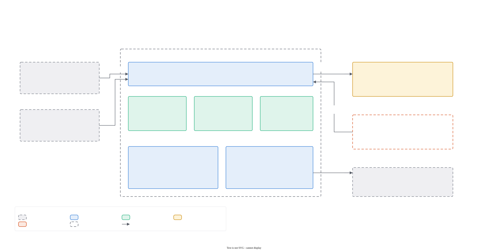
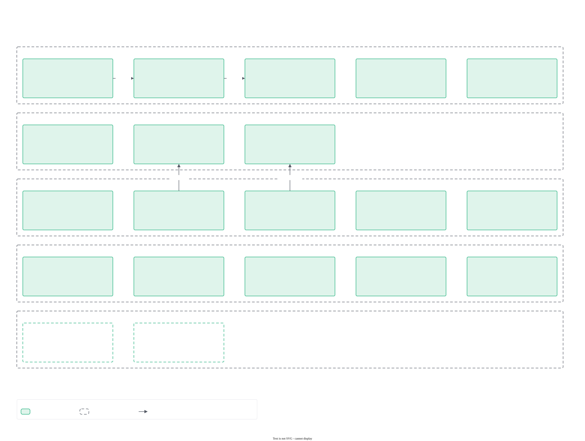
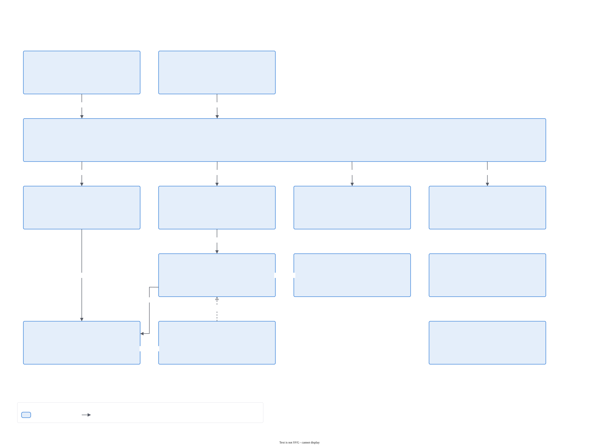
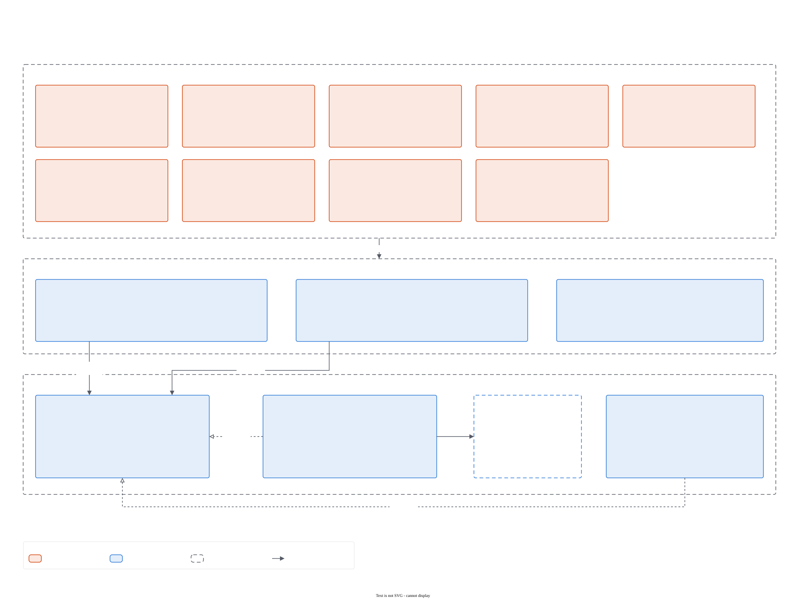
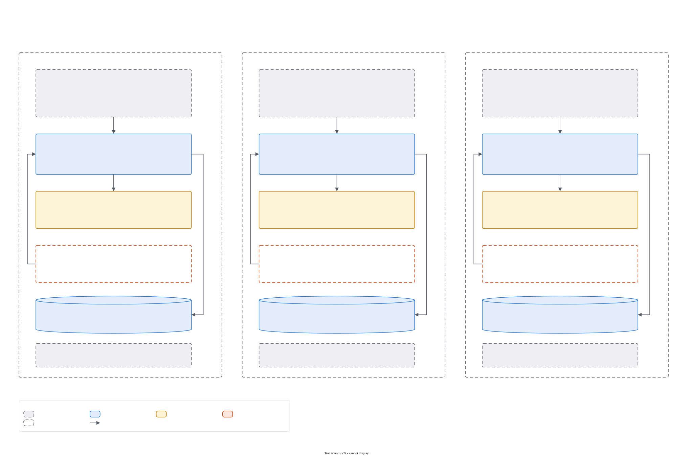
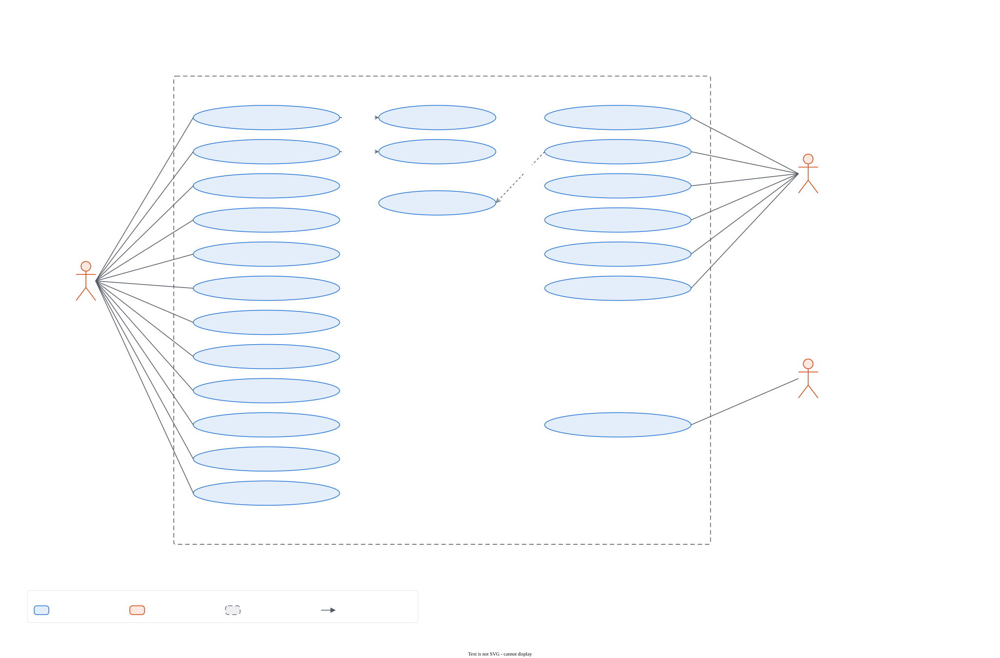
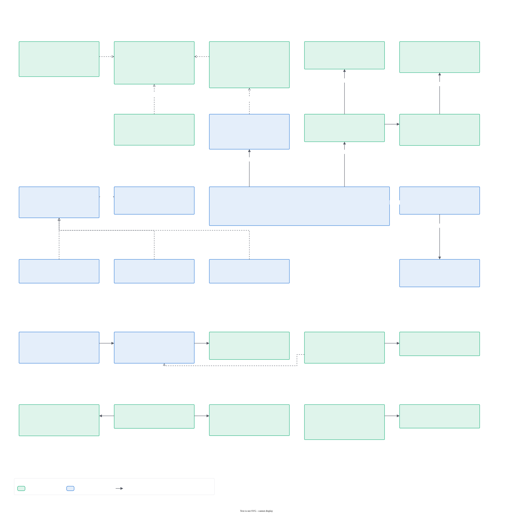
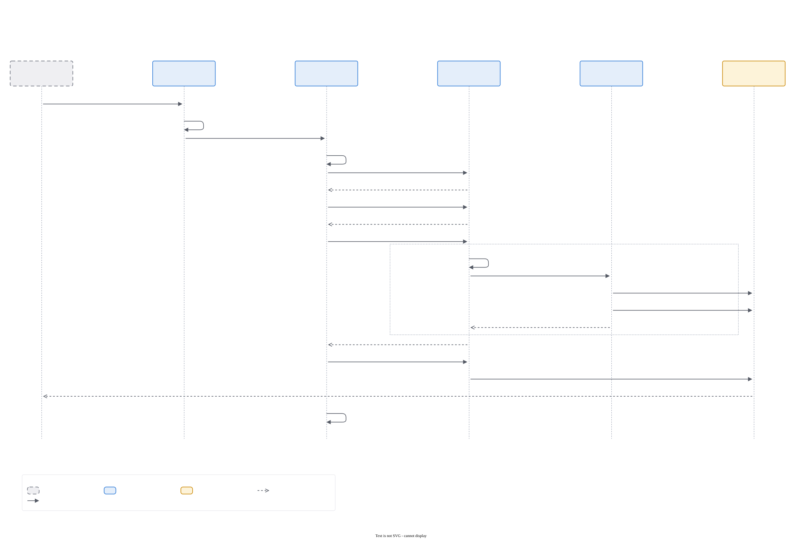

# Pitwall design

All of Pitwall's design diagrams on one page, from the big picture down to individual flows. Each image is exported
from its editable draw.io source (linked under the image) with
[`scripts/export-diagrams.sh`](../scripts/export-diagrams.sh); edit the `.drawio`, then re-run the script. The style
rules are in [diagrams/STYLE.md](diagrams/STYLE.md), the reasoning behind the design in the
[architecture decision records](adr/README.md), and the prose overview in [architecture.md](architecture.md).

Elements drawn dashed and marked "(planned)" are not built yet; the [roadmap](roadmap.md) lists them.

Contents: [Overview](#overview) · [C4 model](#c4-model) · [Deployment](#deployment) · [Use cases](#use-cases) ·
[Domain model](#domain-model) · [Flows](#flows) · [States](#states)

## Overview

Apps and tools talk to one local server on `127.0.0.1:11435`. The server queues their requests, loads models into
engine processes when they fit, gives the memory back when it is idle, and answers in the shape each client expects.
Pitwall's own window and tray manage it. The only outbound traffic is downloads the user asked for.

Source: [pitwall-overview.drawio](diagrams/pitwall-overview.drawio)

## C4 model

### Level 1 — system context

Who uses Pitwall and which outside systems it touches. The suite apps, third-party tools and the user's own scripts
call the APIs; the user manages Pitwall in its window. Pitwall reaches out only to Hugging Face (models) and GitHub
(engine releases), and only when told to ([ADR 0001](adr/0001-local-only.md)).

Source: [c4-1-context.drawio](diagrams/c4-1-context.drawio)

### Level 2 — containers

The runnable units and the processes they run in: the Tauri app with its Angular UI and tray, the windowless
`pitwall-server` that the OS service manager keeps running, and the `llama-server` child processes (one per loaded
model) that the server starts and owns. The server uses `pitwall-core` for every decision and `pitwall-loopback` to
reach engines. See [ADR 0002](adr/0002-core-crate-ports-adapters.md) and
[ADR 0004](adr/0004-engine-abstraction-and-process-model.md).

Source: [c4-2-containers.drawio](diagrams/c4-2-containers.drawio)

### Level 3 — core components

Inside `pitwall-core`: wire formats for the three API families, the scheduler, the memory policy, model selection,
fit, GGUF and Hugging Face parsing, the runtime catalog, privacy rules, keys and limits, settings and the
management DTOs. No component does I/O.

Source: [c4-3-components-core.drawio](diagrams/c4-3-components-core.drawio)

### Level 3 — server components

Inside `pitwall-server`: the HTTP edge (`http`, `mgmt`), the request pipeline and shared state (`app`), serving
(`serving`), engines (`engines`, `pack_engine`), the library, egress, auth, and the thin OS layer (`process`, `paths`,
`system`, `service`).

Source: [c4-3-components-server.drawio](diagrams/c4-3-components-server.drawio)

### Level 3 — UI components

Inside the Angular app: the feature screens, their SignalStores, and the `BACKEND` token that selects the Tauri
backend or the mock.

Source: [c4-3-components-ui.drawio](diagrams/c4-3-components-ui.drawio)

## Deployment

Per OS the server is a supervised background process so it keeps serving with no window open: a Windows service, a
macOS launch agent registered through `SMAppService`, a Linux systemd user service (`pitwall.service`, with
`Restart=always`). The app and tray run in the user's session; the server starts engine processes as its children.
The data folder differs per OS (`PITWALL_HOME` overrides it). See the per-OS guides:
[Windows](windows.md), [macOS](macos.md), [Linux](linux.md).

Source: [uml-deployment.drawio](diagrams/uml-deployment.drawio)

## Use cases

What the people and programs around Pitwall do with it.

Source: [uml-use-cases.drawio](diagrams/uml-use-cases.drawio)

## Domain model

The main types: settings and the memory policy, hot models, jobs and priorities, the `Engine` trait with its
implementations, the library, apps, keys and permissions, packs, and the neutral chat request every API maps to.

Source: [uml-class-domain.drawio](diagrams/uml-class-domain.drawio)

## Flows

### Chat request, including a cold start

From the gate (Host, Origin, key) through parsing, model resolution, authorization, the queue, loading the model
when it is not hot, generation over loopback and the answer in the caller's format with provenance headers.

Source: [uml-seq-chat-request.drawio](diagrams/uml-seq-chat-request.drawio)

### Pairing an app

An app asks, the user compares the six-digit code and approves with permissions, the app polls and receives its
key exactly once ([ADR 0009](adr/0009-app-integration-contract.md), [ADR 0007](adr/0007-security-model.md)).

Source: [uml-seq-pairing.drawio](diagrams/uml-seq-pairing.drawio)

### Downloading a model

Search and file list from Hugging Face, the fit check, a resumable download with the SHA-256 published for the file,
the GGUF check and the move into the library.

Source: [uml-seq-model-download.drawio](diagrams/uml-seq-model-download.drawio)

### Installing an engine

Download and verify each asset, unpack defensively into a staging folder, self-test, swap in or discard, and the
roll-back rules.

Source: [uml-seq-engine-install.drawio](diagrams/uml-seq-engine-install.drawio)

### Idle release

The tick, the memory policy's decisions, why a busy model is never touched, and the reload on the next request.
See [ADR 0006](adr/0006-memory-policy.md).

Source: [uml-seq-idle-release.drawio](diagrams/uml-seq-idle-release.drawio)

## States

### Hot model

A model is loading, ready, busy or released; pinned models are exempt from idle release; an engine that exits is
forgotten and reloaded by the next request.

Source: [uml-state-hot-model.drawio](diagrams/uml-state-hot-model.drawio)

### Download

Queued, downloading, verifying, then done, failed or cancelled.

Source: [uml-state-download.drawio](diagrams/uml-state-download.drawio)

### Pairing request

Waiting, then approved (the key is delivered once), denied or expired after five minutes.

Source: [uml-state-pairing.drawio](diagrams/uml-state-pairing.drawio)
