# Features

What Pitwall does, with screenshots. The [README](../README.md) has the short version, the [user guide](user-guide.md) covers
installing an engine, getting a model and connecting apps ([macOS](macos.md), [Linux](linux.md), [Windows](windows.md)), and
[development](development.md) covers building and testing.

> Every item says whether it **works** today or is **planned**. "Works" means it is implemented and covered by tests in
> this repository; only the macOS Apple Silicon path has also been run for real (see [Verified](#verified-and-not-yet-verified)).
> The screenshots are captured from the UI running against the built-in mock backend (plausible demo data), in light and dark
> themes, by the UI tooling; if an image is missing here it has not been generated yet. The plan is in the [roadmap](roadmap.md).

## Contents

- [Local only](#local-only)
- [llama.cpp, the engine](#llama-cpp-the-engine)
- [Model library](#model-library)
- [Will this fit?](#will-this-fit)
- [Serving: load on first use and release](#serving-load-on-first-use-and-release)
- [The standard APIs](#the-standard-apis)
- [Extras for apps (`/x/v1`)](#extras-for-apps-xv1)
- [Caching](#caching)
- [Apps, keys and pairing](#apps-keys-and-pairing)
- [Command line](#command-line)
- [Queue and priorities](#queue-and-priorities)
- [Model catalog packs](#model-catalog-packs)
- [Dashboard](#dashboard)
- [Models page](#models-page)
- [llama.cpp page](#llamacpp-page)
- [Apps and keys page](#apps-and-keys-page)
- [Requests](#requests)
- [Playground](#playground)
- [Benchmarks](#benchmarks)
- [Tray](#tray)
- [Settings](#settings)
- [Service and updates](#service-and-updates)
- [Security and privacy](#security-and-privacy)
- [Platforms](#platforms)
- [Verified and not yet verified](#verified-and-not-yet-verified)

## Local only

- **Nothing you ask and nothing a model answers leaves the computer.** There are no cloud engines, no telemetry, no crash
  upload ([ADR 0001](adr/0001-local-only.md)). Works.
- **The only outbound traffic is a download you asked for**, over HTTPS, from the allow-listed hosts in
  `pitwall_core::privacy`: Hugging Face (and its CDN and Xet storage hosts) for models and GitHub releases for engines. Every
  redirect hop is checked again; each download shows its host in the UI. Works.
- There is no Offline mode: it was removed in 1.1 ("local first" means the AI models run locally). A 1.0 settings file that
  still has it loads normally; the key is ignored and dropped on the next save.
- **The request path has no HTTP client.** A test fails if a request handler can open an outbound connection, and a script
  (`scripts/ci/privacy-check.sh`) fails the build if the one outbound client (`egress.rs`) is used from anywhere else. Works.

## llama.cpp, the engine

- **llama.cpp is the only engine** ([ADR 0020](adr/0020-llama-cpp-is-the-only-engine.md)): every model is a GGUF file and
  llama.cpp serves GGUF everywhere. Engine packs, llamafile and the placeholder engines (MLX, vLLM, whisper.cpp) are gone. Works.
- **It installs itself.** On start, and whenever a model needs a build and none is installed, Pitwall installs the suggested
  build in the background (checksum and self-test as below). Model loads and model downloads wait for it ("Installing
  llama.cpp...", downloads stay queued); the Dashboard and the llama.cpp page show the progress; a network
  error ends in a message with **Retry**. You can still install, pick or pin another build. Works (tested with a fake installer,
  no network).
- Pitwall installs official prebuilt `llama-server` builds from a pinned catalog
  (release `b11669` today): `cpu`, `vulkan`, `cuda-12`, `cuda-13` on Windows and Linux, `metal` on macOS, with `rocm`, `sycl`
  and `openvino` selectable by hand. The suggested build is chosen for the hardware. Works.
- **Checksummed install with a self-test and roll back.** Each archive is verified against its SHA-256 before it is unpacked
  (defensively: flat file names, size caps, safe links only), the new build must pass `--version` and `--list-devices`, and only
  then replaces the old one. A build that fails its self-test is discarded and the previous build stays active; the llama.cpp page
  can also go back to an earlier build (see the next item). Works.
- **Engine version pins, rollback and capability gating.** Pin a build for all models or for one model; selection is the model's
  pin, then the global pin, then automatic. A pin to a build that is not installed or failed its self-test is refused with
  "Install it on the llama.cpp page". Roll back goes to the previous installed build that passed its self-test (never a failed one) and
  pins it; a loaded model keeps its engine until it is loaded again and the page says so. A capability matrix
  (`capabilities.json`: minimum llama.cpp release and unsupported backends per feature) gates vision, tools, JSON-schema output,
  embeddings and rerank: a request the build cannot serve is refused before the queue with a typed error naming the build
  needed (503 `engine_build_too_old`, 400 `capability_unsupported`, 503 `engine_pin_unavailable`; OpenAI, Anthropic and Ollama
  shapes), and `GET /x/v1/models` and `auto:` selection leave out what the build cannot serve. ADR 0018. Works.
- **One process per model.** Each model runs in its own `llama-server` child process on a loopback port with a private key,
  started with a scrubbed environment and killed with Pitwall. A crashing engine never takes Pitwall down: it is restarted
  after 1 s, 2 s, 4 s and so on (at most 60 s); after five crashes in ten minutes Pitwall stops, the Dashboard shows the model
  with the reason and a Retry button, and requests for it get a clear error instead of another doomed start. Works (tested
  with an engine process that exits by itself).
- **Older installs.** A llamafile folder left by 1.0.1 is listed on the llama.cpp page with "Remove llamafile (size)" and is never
  deleted without that click; a per-model or per-preset engine saved by an older version is ignored. Works.

## Model library

- **Search Hugging Face and download GGUF files**, including split models (all parts) and a vision projector next to the
  model. Works.
- **Resumable, verified downloads.** A partial file resumes with an HTTP range request; the SHA-256 is checked against the one
  Hugging Face publishes for the file (its LFS object id); the finished file must parse as GGUF before it enters the library
  (a bad file is discarded). Downloads can be cancelled. Works.
- **Starter catalog and recommendations.** A built-in catalog pack lists current-generation models only (Qwen3.8 27B, Qwen3.6
  35B-A3B, Gemma 4 26B-A4B, 12B and E4B, Qwen3.5 9B, 4B and 2B for small computers, Qwen3 Coder Next, Qwen3 Embedding 0.6B) with
  a "will this fit" verdict for this machine. Works.
- **Disk usage and cleanup**: the library shows the size of every model and the free disk space; models can be deleted. Works.
- **Per-model preferences**: keep loaded (pin), its own idle time, its own context length, its own parallel slots and engine build (pin). Works.
- **Capabilities are read from the file**: chat, JSON, tools (when the chat template mentions tools), vision (a projector file
  next to it), embeddings and rerank (by architecture and name). Works.

## Will this fit?

Before a download, from the file size and quantisation alone, and after, from the GGUF header, Pitwall estimates the memory
a model needs at a context length (weights, projector, KV cache, compute buffers) and compares it with this machine's free
RAM, the memory idle models could give back and the free video memory. The verdict is **Fits**, **Tight** (fits only by
releasing idle models), **Won't fit** or **Unknown**, with a sentence that says where it would run (all on the GPU, partly on
the CPU, in shared memory on Apple Silicon, on the CPU). The same check runs when a model loads, and a load that cannot fit even
with everything idle released is refused with `insufficient_memory` rather than pushed into swap. Works; the numbers are
estimates and leave margin.

## Serving: load on first use and release

- **Load on first use.** The first request for a model starts its engine and answers when it is ready; the response carries
  `X-Pitwall-Cold-Start-Ms`. Works.
- **Several models at once while they fit**, up to a limit (3 in Balanced). When a new model needs room, the least recently
  used idle models are released first. Works.
- **Release when idle.** Presets: *Low memory* (release after 2 minutes, one model at a time), *Balanced* (10 minutes, the
  default), *Performance* (1 hour, up to 6 models); every value can be edited (the preset becomes *Custom*). After the
  "deep idle" time with no requests at all every unpinned model goes. Works.
- **Release under pressure.** When available memory falls below the preset's percentage of RAM, idle models are released,
  least recently used first. The core also handles the OS's own pressure signals (pinned models go only on critical pressure),
  but the server does not read those signals yet; today only the available-memory threshold triggers it. Works (threshold).
- **Never a busy model.** A model that is answering a request or still loading is never released. Works, tested.
- **Yield to foreground apps** shortens idle times to a quarter (at least 30 seconds) while a full-screen app is detected.
  The decision is implemented and tested in the core, but the server does not detect a foreground app yet, so it never
  triggers today. Planned.
- **Release the context first** (keep the weights, free the KV cache at half the idle time) is decided by the core, but the
  server does not carry it out yet; only whole-model unloading happens. Planned.
- **Pause serving** from the UI: new requests are refused with a clear message while running ones finish. **Release memory
  now** unloads everything idle. Works.
- **Timeouts and limits**: per-request timeout (600 s), largest request (32 MiB), requests at once (4) are settings. Works.

## The standard APIs

Served on `127.0.0.1:11435` (Ollama's port is 11434, so both can run). See [ADR 0003](adr/0003-api-surface-and-compatibility.md).

| Family | Endpoints | Status |
|---|---|---|
| OpenAI | `GET /v1/models`, `GET /v1/models/{id}`, `POST /v1/chat/completions`, `POST /v1/responses`, `POST /v1/embeddings` | Works, streaming (SSE), tool calls, vision (inline images), `response_format` with a JSON schema |
| OpenAI | `POST /v1/audio/transcriptions` | Answers `not_available` (501): the whisper.cpp engine is planned |
| Anthropic | `POST /v1/messages`, `POST /v1/messages/count_tokens` | Works, streaming, tool use, base64 images; `max_tokens` is required as in the real API |
| Ollama | `POST /api/chat`, `POST /api/generate`, `GET /api/tags`, `GET /api/ps`, `POST /api/show`, `POST /api/embed` (and `/api/embeddings`), `GET /api/version` | Works, streaming (NDJSON), `format` as `"json"` or a JSON schema |

Each family gets errors in its own shape (OpenAI `error.type`, Anthropic `{type: "error"}`, Ollama `{error}`). Images must be
inline: Pitwall never fetches a URL on a request's behalf. The request and response shapes are pinned by contract tests
against the official SDKs' documented objects.

## Extras for apps (`/x/v1`)

Versioned by `API_VERSION` (1); changes within a version are additive only ([ADR 0009](adr/0009-app-integration-contract.md)).

- **Health**: `GET /x/v1/health` (name, version, `apiVersion`, serving or paused, loaded models). Works.
- **Pairing**: `POST /x/v1/pair` and `GET /x/v1/pair/{id}`. Works; see [Apps, keys and pairing](#apps-keys-and-pairing).
- **Model by capability**: `model: "auto:vision,8k,fast"` in any chat request, or `POST /x/v1/select` to ask first.
  Capabilities `chat`, `vision`, `tools`, `json`, `embeddings`, `rerank`; a context such as `8k`; and a preference
  `fast`, `quality`, `small` or `balanced` (a loaded model first). The chosen model is reported in `X-Pitwall-Model` and
  `X-Pitwall-Chosen-By`. Works. "Fast" will use measured speeds once benchmark results are kept (see [Benchmarks](#benchmarks)).
- **Model presets and aliases** ([ADR 0014](adr/0014-model-presets-and-aliases.md)): the user gives an app a stable name such as
  `debrief-explain` and decides what serves it: an installed model or a capability selection (`auto:chat,fast`), with optional
  context, temperature, top-p, max tokens, a system prompt and an engine. The alias is listed in `/v1/models` and
  `/api/tags` and works as the `model` field in the OpenAI, Anthropic and Ollama APIs. Values in the request win over the
  preset's; the system prompt is added only when the request has none; context and engine apply when the model is loaded.
  Answers carry `X-Pitwall-Alias`; a removed target model answers 404 `preset_target_unavailable` with the preset's name. A
  real model's name always wins over a preset of the same name. Works.
- **Parallel slots per model** ([ADR 0016](adr/0016-parallel-slots.md)): 1 to 16 requests served at once on one loaded model
  (default 2, `models.default_slots`). The configured context is per slot and each slot keeps its own KV cache, so the memory is
  weights + slots x context x KV bytes per token (from the GGUF header, or a documented estimate). Models > Slots shows what each
  step adds and a fit table (longest context at 1, 2, 4, 8 slots; the most slots at a context; fits, tight, won't fit);
  requests beyond the slots wait in the queue; a change applies on the next load and never interrupts a busy model. Works.
- **Model update notices** ([ADR 0017](adr/0017-model-update-notices.md)): off until you turn it on in Settings > Model updates (weekly or
  daily; Check now always works). A check asks `huggingface.co` for the file lists of the repositories you downloaded from, and
  nothing else, through the one egress client; until you turn the schedule on, no request is made. It finds a newer revision of a file you have
  (by the SHA-256 recorded at download, or by size for older downloads), a better quantisation of the same model that fits this
  machine, or an imatrix build. Notices appear as a banner on Models, a note on the library row, a line on the Dashboard and an
  entry in the tray; Dismiss hides an offer until it changes, Remind me in a week snoozes it. Get it asks for confirmation with
  the host and size and then runs the normal download; nothing is ever fetched automatically. Works (tests use a fake
  Hugging Face).
- **Models and jobs**: `GET /x/v1/models` (capabilities the serving engine build can provide, `unavailable` with the reason and the build needed, maximum context, loaded), `GET /x/v1/jobs` (the queue),
  `DELETE /x/v1/jobs/{id}` (cancel; an app can cancel only its own). Works.
- **Provenance on every answer**: `X-Pitwall-Model`, `X-Pitwall-Engine`, `X-Pitwall-Chosen-By` and, when the model had to be
  loaded, `X-Pitwall-Cold-Start-Ms`. Works.
- **Planned, not built**: resumable batch jobs with progress events, knowledge collections (local retrieval: store, chunk,
  embed, rerank, query), task endpoints (`/x/summarize`, `/x/classify`, `/x/extract`, `/x/translate`) with versioned prompt
  templates, token counting helpers beyond Anthropic's `count_tokens`, and hosting of MCP servers and tools. (Caching is specified in
  [ADR 0019](adr/0019-caching.md) and described under [Caching](#caching).)

## Caching

Three layers, specified in [ADR 0019](adr/0019-caching.md); the engine work is in progress, so each item says what it is.
Everything cached stays on this computer.

- **Prompt-prefix reuse** (always on, llama.cpp only). Requests of one app and conversation go to the same llama-server slot
  (`id_slot`), so the engine's prompt cache skips the shared start; with no free matching slot the slot idle longest is used,
  and with all busy the engine chooses. `--cache-ram` is 1/16 of the RAM clamped to 256 MiB..4 GiB unless set in Settings;
  `--cache-reuse 256` stays. Request details show `cachedTokens` and usage shows `prefixTokens`. Optional per-preset *keep warm*
  saves slot state on unload and restores it on load (`slots/`, bounded, dropped after 30 days unused).
- **Response cache** (exact repeats, **off by default**). Deterministic requests only (temperature 0 or a fixed seed, no tools),
  streaming or not; a hit needs no model load and no queue. Enabled per app and per preset; `X-Pitwall-Cache: hit|miss|bypass`;
  `Cache-Control: no-cache` or `no-store` bypasses. Only completed answers are stored. Expires 7 days after storing by default
  (1 h, 1 day, 7 days, 30 days, 90 days, never); 256 MiB by default.
- **Embeddings cache** (on by default). One vector per input text, 512 MiB, expiry 90 days since last use; a partly cached batch
  computes only the missing inputs.
- **Storage and upkeep.** Memory only or on disk (`cache.sqlite`, owner-only; a damaged file is renamed aside; if it cannot open
  the cache uses memory and says why). Least-recently-used eviction on the size cap; a background sweep at start, hourly and
  when idle; an expired entry is never served. A changed model file, engine or build gives different keys; removing a model,
  changing the engine build or pin, or changing a preset drops the affected entries.
- **Controls.** Settings > Caching: sizes, storage, expiry, oldest entry, expires after, next clean-up, Clear now, and clear per
  app, per model or all. Management commands `cache_info` and `clear_cache`.
- **Statistics.** `cacheHits`, `cacheMisses`, `prefixTokens`, `savedTokens`; the Dashboard shows the hit rate and tokens saved,
  and each app shows its hits.

## Apps, keys and pairing

- **Pairing with a six-digit code.** An app calls `POST /x/v1/pair` with its name; Pitwall shows the request and a code
  in **Apps & keys** (and on the dashboard); the app shows the same code; the user approves and chooses the permissions; the
  app polls and receives its key **once**. Requests expire after 5 minutes and at most 8 wait at once. Works.
- **Keys** are `pw_` plus 32 random bytes. Pitwall stores only the SHA-256 and the first characters (to tell keys apart),
  compares in constant time and writes `apps.json` atomically with a backup. A key can be created in the UI (shown once),
  added to an app, or revoked at any time. A re-pair (`"rePair": true`, ADR 0057 §4) revokes the app's older keys on approval. Works.
- **Permissions and limits per app**: which models, the most urgent priority it may use, tools, the extended APIs, requests
  per minute, requests per UTC day, tokens per UTC day and per month, concurrent requests, and a share of the machine's RAM
  a request's model may occupy. A refusal says what to change; 80 % of a budget raises a warning event. Works.
- **Usage per app over time**: requests, tokens, errors and peak memory (the footprint of the model that served the app)
  in hourly and daily buckets with bounded retention, stored locally; an app detail view (24 h / 7 d / 30 d chart, limits
  with progress, latest requests) and a Dashboard usage-by-app chart. Works.
- **Keyless local access** (for Ollama-style tools that send no key) is a setting, **off** by default, and applies only to
  requests with no `Origin` header. Works.
- **The admin key** (`admin.key`, owner-only: 0600 in a 0700 folder, an owner-only DACL on Windows) is what Pitwall's own window and the
  command line use for the management API; apps never see it. It is the key's only store, on every OS (ADR 0057, rule 72), plain text
  that any program running as the user can read. Works.

## Command line

`pitwall` (crate `pitwall-cli`) controls the local server from a terminal or script: `status`, `ps`, `models`, `load`,
`unload`, `pull` (a download job with progress, resumable, shows the host), `keys`
(list, create, revoke; a new key is shown once), `presets`, `chat` (streams over the standard OpenAI endpoint with a per-app
key from `PITWALL_API_KEY`) and `bench`. `--json` on every read command, a time limit on every call, stable exit codes
(0 ok, 1 error, 2 usage, 3 server not running, 4 refused) and error messages that say what to fix. The admin key comes from
the OS credential store, `PITWALL_ADMIN_KEY` or `--key-file`, never from an argument. It reaches the server only through the
loopback-only client, so it cannot connect anywhere else. Works against the in-process fake server in tests; not yet
packaged inside the installers (see the roadmap).

## Queue and priorities

- Every request is a job with a priority: **interactive** (the default, someone is waiting), **background**, **batch**.
  Apps send `X-Pitwall-Priority`; the app's permission caps how urgent it may be. Works.
- Jobs start highest priority first and in arrival order within a priority, under caps: 4 running overall, 2 per model, 256
  waiting, plus the app's own concurrency cap. A waiting job rises one level every 30 seconds, so batch work does not starve.
  A full queue answers `overloaded` (503, `Retry-After: 5`). Works. See [ADR 0005](adr/0005-queue-and-scheduling.md).
- Cancel by closing the connection or `DELETE /x/v1/jobs/{id}`. Works.

## Model catalog packs

There is no plugin system ([ADR 0010](adr/0010-no-plugin-system.md)). Pitwall reads validated TOML files from
`<data folder>/packs/` ([ADR 0011](adr/0011-declarative-packs.md), narrowed by ADR 0020):

- **Model catalog packs** (`*.models.toml`): curated models with Hugging Face repo, quantisation variants and sizes, context,
  capabilities and tags. Works. Built in: the starter list.
- A bad pack is skipped with a message that says what to fix (on Models > Discover); the others still load. Limited to 64 files of
  256 KB. Works. Engine packs (`*.engine.toml`) no longer exist and are reported as unknown files.

The how-to with a complete example is in the [user guide](user-guide.md#packs-add-a-model-list).

## Dashboard

The home screen. Live tiles for memory (RAM and video memory, with the pressure state), models in memory with their idle
countdown, tokens per second, the queue and per-app usage; history charts with events (loads, releases, failures, pairings)
marked on the timeline; an events feed; pending pairing requests; pause serving and release memory now in the header's "..." menu. The
server pushes updates over a live feed, so nothing is polled. Metrics are kept locally, bounded (30 days by default). Works.

## Models page

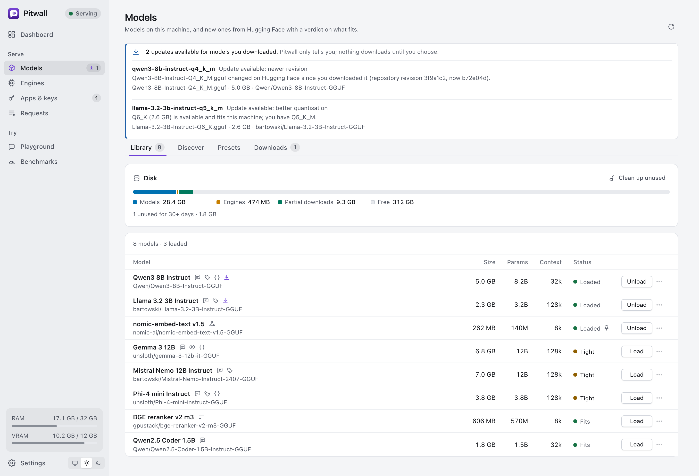

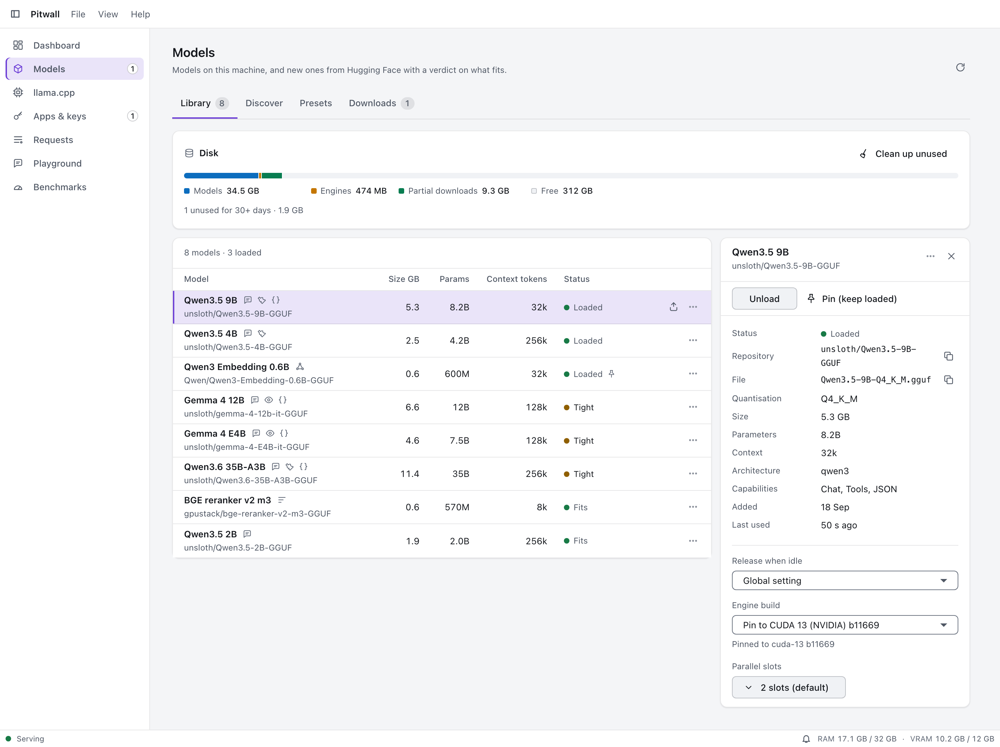

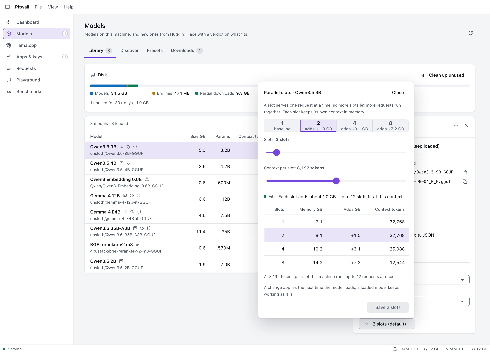

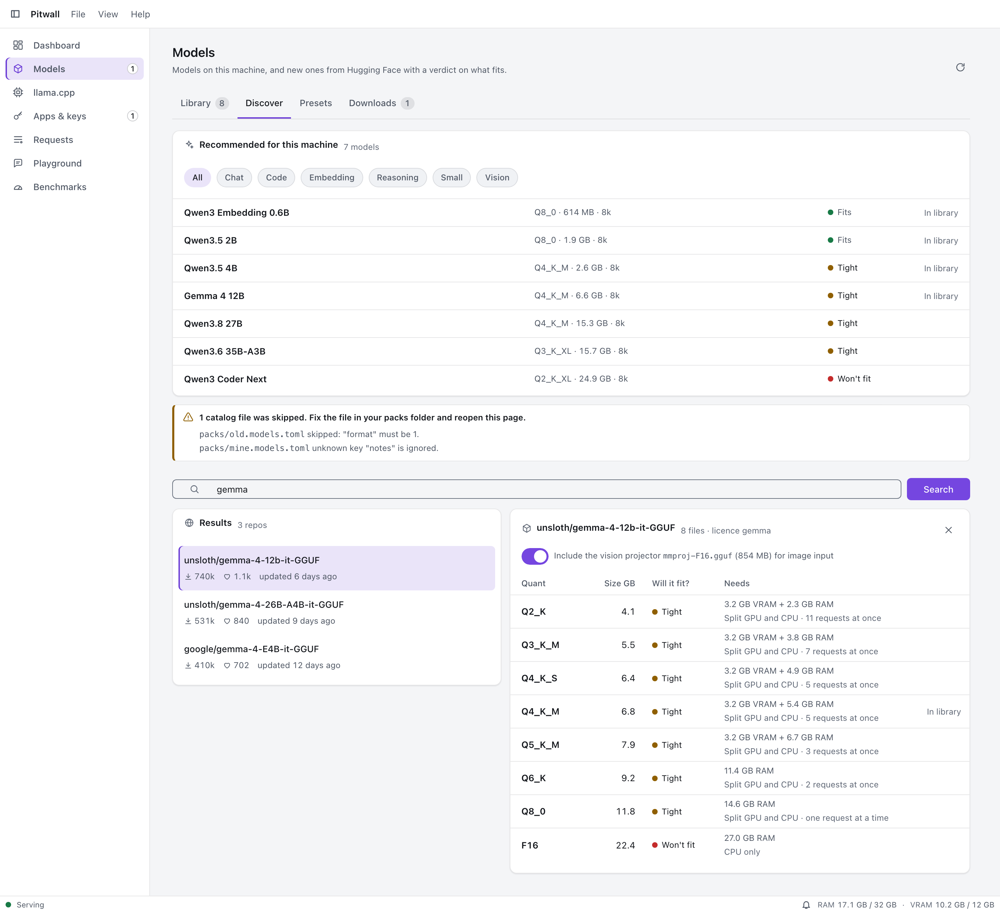

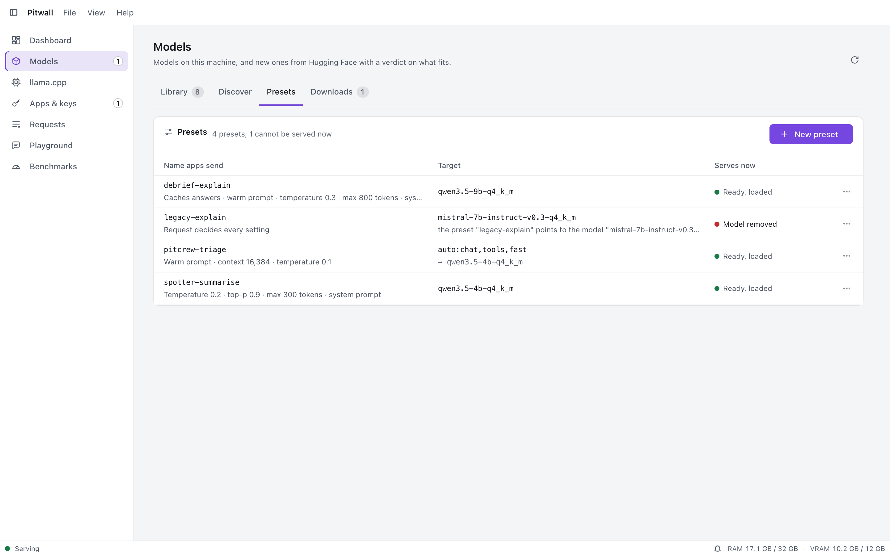

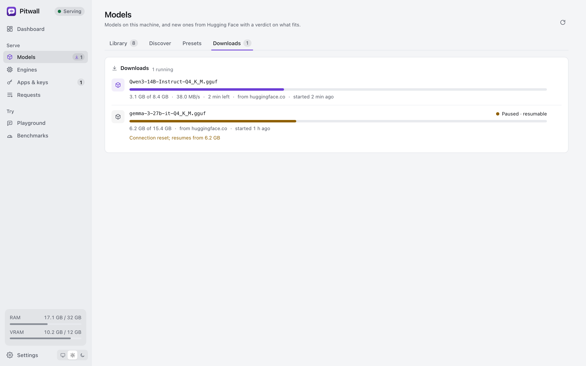

**Library** lists installed models with size, quantisation, capabilities, a Loaded badge and the idle countdown, with pin,
idle time and engine choices, load, unload and delete. **Discover** shows recommendations from the catalog packs and searches
Hugging Face; opening a repository lists its files with a fit verdict for each variant. **Downloads** shows progress, speed,
host and the verification state, with cancel. Works.

## llama.cpp page

On a first start llama.cpp installs the build suggested for this machine; models wait until it is ready.

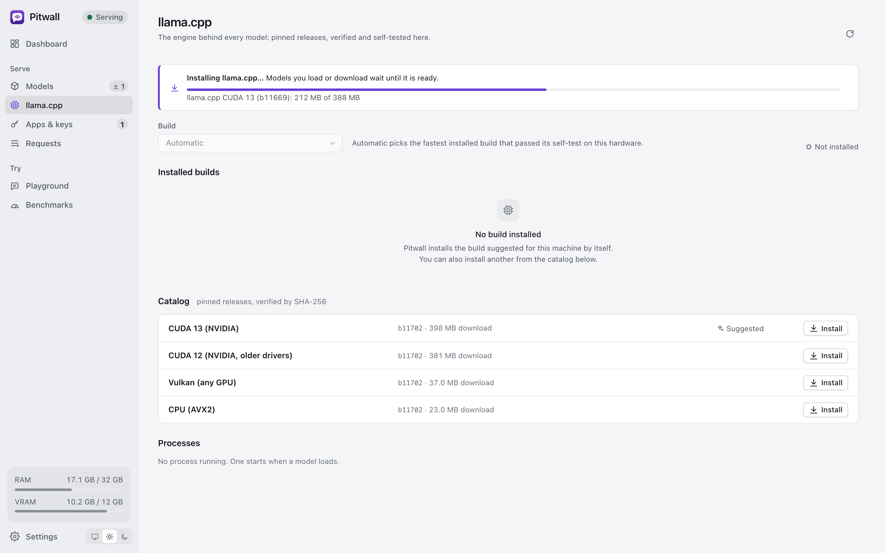

Availability and why, the installed builds with their tag, devices found by the self-test and
self-test result, the catalog of builds to install (the suggested one first), select, remove, **pin** (a Version pin toggle per
build, accent plus the word "Pinned"), **Features** (what each build supports in words: Supported, Needs bNNNN, Not supported,
with the upgrade hint), **Roll back** (names the build it goes to and asks first), and install progress with cancel. Models
shows `pinned to <build>` with a small build menu per model. Leftovers of removed features (the llamafile download) are listed at the bottom with a Remove button. Works.

## Apps and keys page

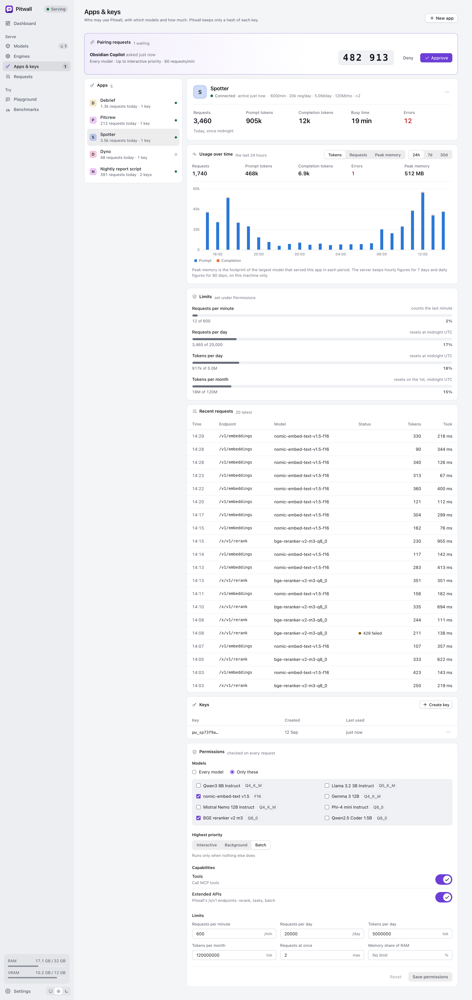

Paired and manually created apps with their keys, last use, today's usage and a permissions editor; the pairing requests
waiting for approval; create app, add key and revoke. A new key is shown once in a dialog. Works.

## Requests

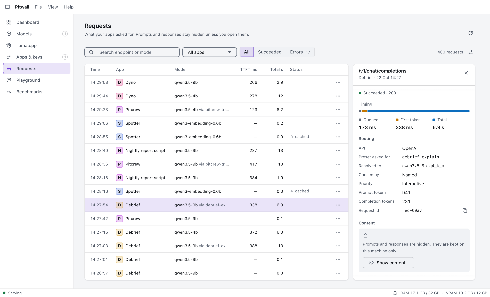

Recent requests with app, endpoint, model, how it was chosen, priority, queue time, time to first token, tokens and speed, cold
start and status. Only metadata is kept by default. With **Keep request content** on (Settings > Privacy) the prompt and the
answer of the latest 50 requests are kept in memory on this computer, with keys and tokens masked, up to 64 KB each, and shown
on demand; they are never written to disk and are gone when Pitwall stops. Works.

## Playground

Chat with any installed model from Pitwall's own window, streamed through the same pipeline apps use (so it queues, loads and
releases exactly like theirs). Works. Side-by-side comparison of two models in one view is a design goal and is not confirmed
yet.

## Benchmarks

Run a short generation on a model to measure tokens per second and time to first token on this hardware. The run works; keeping
results is **built**: they are saved (`benchmarks.json`, versioned, one per model) and "fast" model selection prefers the model
that measured faster on this machine. Works.

## Tray

A small popup from the tray or menu bar that answers "is my local AI working, and what is it doing". You choose its widgets in
Settings > Tray popup (or "Customize widgets…" in the popup's ⋯ menu), with a live preview beside the list: **Server** (serving, paused
or not running, the port, the engines' health), **Activity** (speed, running chats, queue), **Memory** (RAM and video memory, pressure),
**Loaded models** (what is in memory and what each holds), **Downloads** (progress, with Cancel), **Updates** (model updates on offer)
and **Recent errors** (the last day). The default is Server, Activity, Memory and Loaded models; it fits the family's
520 px cap in its worst state. The header has one status pill ("Serving on :11435", "Paused", "1 engine problem", "Not running"); a lost server
or an app waiting to pair is said once above the widgets. The footer has Open Pitwall and a ⋯ menu (Customize widgets…, Pause or Resume
serving, Release memory, Settings…, Quit Pitwall). Every value and rule is Rust (`pitwall_core::widgets`); the layout is kept by the app
(`popup-widgets.json`). Closing the window keeps Pitwall in the tray and the server keeps serving. With no tray (some Linux desktops) closing
the window quits the app, but the service keeps running. The shell and the popover screen exist; they have only been exercised on macOS-style flows in tests, not on real Windows and Linux desktops.

## Settings

When you quit Pitwall: keep serving, stop serving, or ask each time.

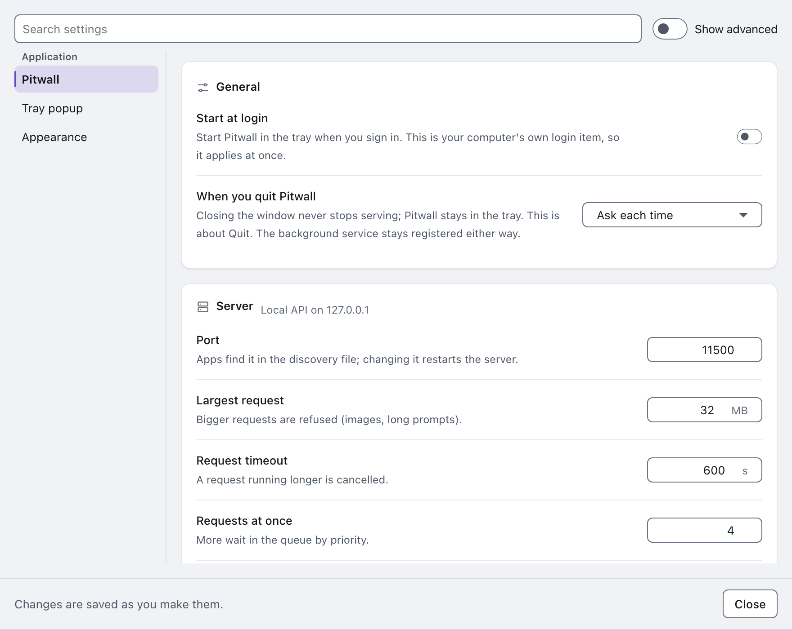

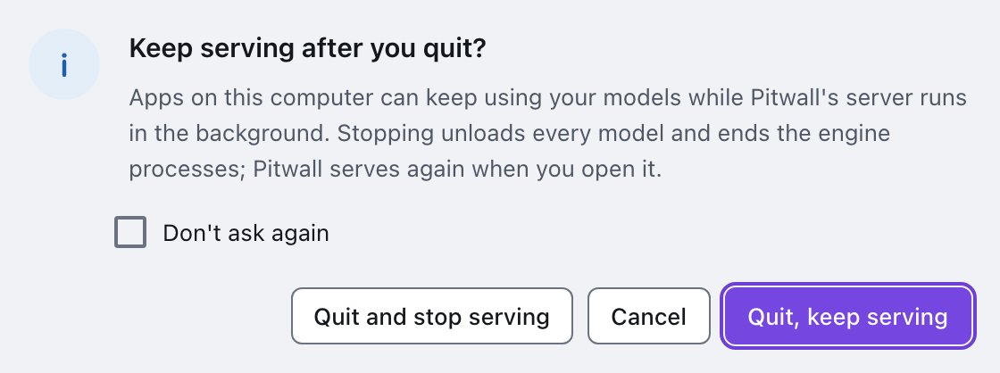

Every change is saved by itself a moment after you make it; there is no Save button. A number out of range says what to fix next
to it and is not saved, and a save the server refuses keeps your change and offers Undo change and Retry. A change still waiting
is saved when the window closes.

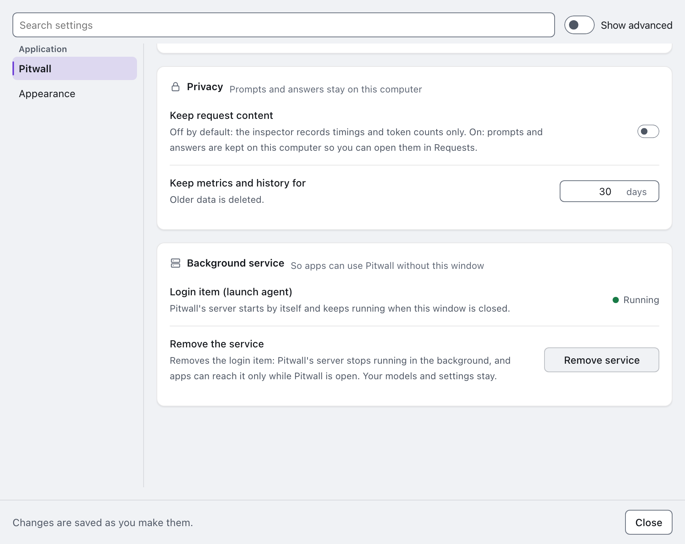

- **General**: start at login, theme (system, light, dark), **When you quit Pitwall** (keep serving in the background, stop
  serving, or ask each time; [ADR 0021](adr/0021-what-quitting-does-about-serving.md)). Works.
- **Server**: port (default 11435), largest request, request timeout, requests at once, allow keyless local access.
- **Memory**: the preset and every value of it (idle release, deep idle, pressure threshold, always keep free, hot models at once,
  memory limit for hot models, yield to foreground, notify on release).
- **Network**: the LAN switch and port are stored but sharing on the local network is **planned** and does nothing
  yet.
- **Privacy**: keep request content (off), how long metrics and history are kept (30 days).
- **Caching**: the three caches (embeddings on, response cache off), sizes, storage (memory or disk), expiry, the oldest entry, when
  entries expire, the next clean-up, Clear now and clear per app, model or all ([Caching](#caching)).

Settings are in `settings.toml`: versioned, every key optional with a default, written atomically with a backup, and damage
falls back to the backup and then the defaults. Works.

## Service and updates

- **The server is a separate, windowless process** (`pitwall-server`) that keeps serving when the window and tray app are
  closed or crash. Per OS: a Windows service named `Pitwall`, a macOS launch agent
  (`net.decryptology.pitwall.service`, registered with `SMAppService`), a Linux systemd user service (`pitwall.service`). The
  server exits after an update of its own program only when idle, and the supervisor brings it back. The service-registration
  logic (`pitwall-server install`, the launch agent, the Windows service) and the app's install action exist and are unit-tested; they have not been run on real Windows and Linux machines.
- **Discovery**: a running server writes `discovery.json` (version, API version, pid, port, base URL, start time) and removes it
  on a clean stop. Works.
- **Updates** are the shell's (Help > Check for updates…): the signed `latest.json` of the `pitwall-latest` release, checked
  only when you ask or, if you turn it on, once a day. Builds
  without the signing key report that updates are not available; see [releasing](releasing.md).

## Security and privacy

- The API listens on **127.0.0.1 only**. `Host` must be a loopback name; a browser `Origin` from any other site is refused;
  a loopback page needs a key. This blocks DNS rebinding and cross-site requests. Works, tested.
- Keys are hashed; the admin key is a file only the owner can read; apps get a key only through the pairing the user approves.
- Engines run with a scrubbed environment (no tokens, proxies or user variables), no console window on Windows, at below-normal
  priority on Windows, and only listen on loopback.
- Logs do not contain prompts or responses by default.
- **Sharing on the local network (TLS with a pinned self-signed certificate)** is **planned** and not built. Today there is no way
  to reach Pitwall from another computer.
- Details: [ADR 0007](adr/0007-security-model.md), [ADR 0001](adr/0001-local-only.md).

## Platforms

Windows, macOS and Linux are first-class targets: [Windows](windows.md), [macOS](macos.md), [Linux](linux.md). Installers
are NSIS (Windows), `.dmg` (macOS) and `.deb` plus AppImage (Linux), unsigned until the signing secrets exist.

## Verified and not yet verified

- **Verified on a real machine (macOS, Apple Silicon M4 Pro):** the Metal llama.cpp build `b11669` installed through the app flow
  with checksum and self-test; Qwen2.5-0.5B-Instruct Q4_K_M downloaded from Hugging Face with its SHA-256 verified against the
  value Hugging Face publishes; OpenAI chat (streaming and not), Anthropic messages, Ollama chat and JSON-schema constrained
  output all answered, at about 213 generated tokens per second. The test model was deleted afterwards.
- **Covered by automated tests only:** everything else, including the fake-engine end-to-end tests in
  `crates/pitwall-server/tests`.
- **Not yet verified:** real runs on Windows and Linux, and the CUDA and Vulkan builds. Treat them as unproven until the
  [manual tests](testing-manual.md) have been run there.
