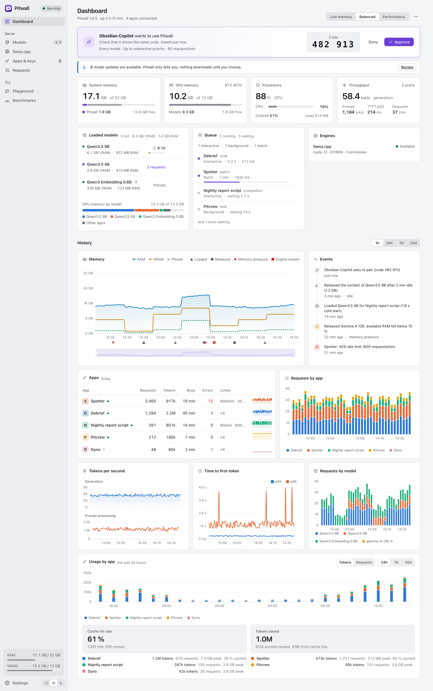
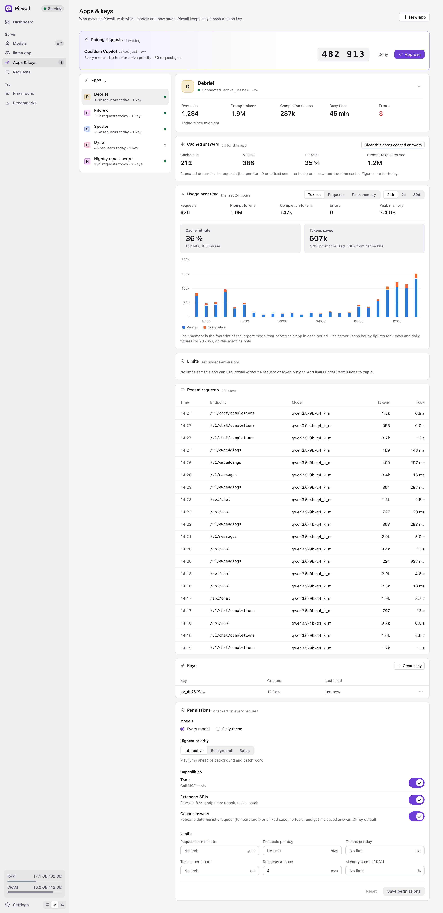
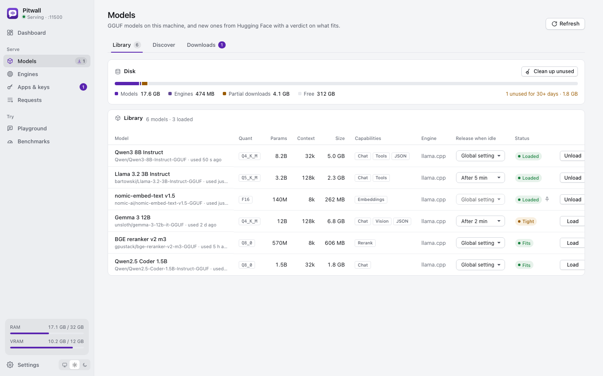
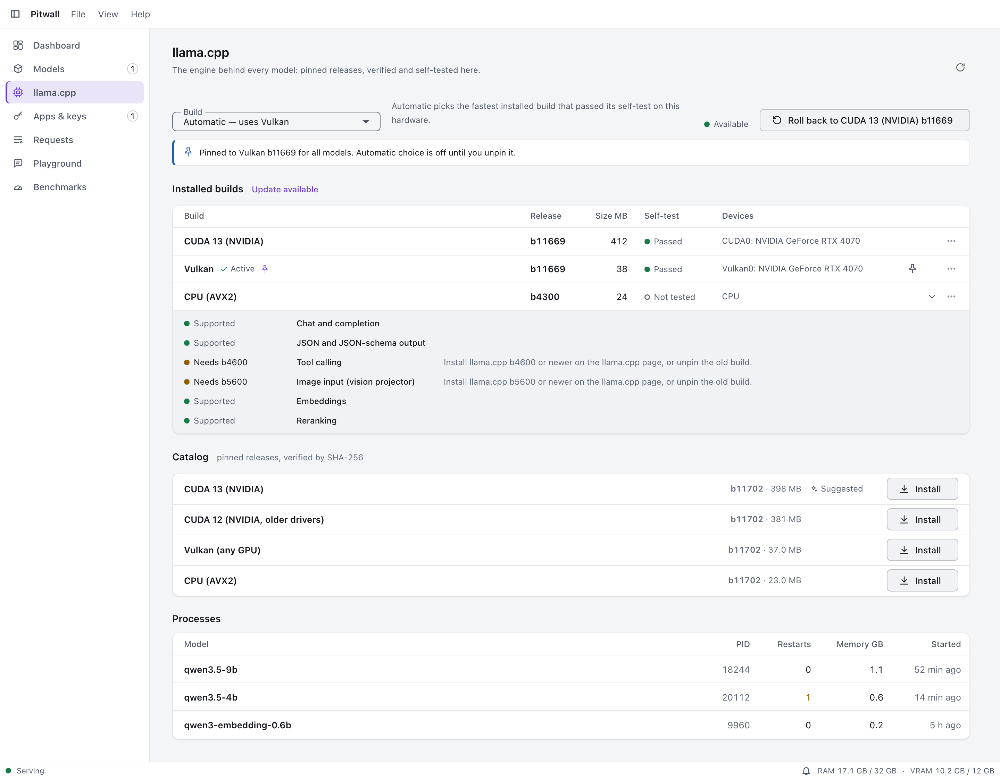
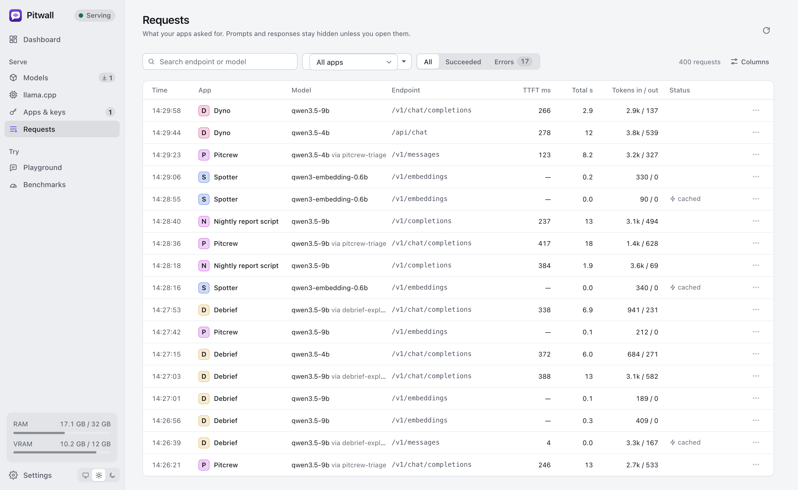
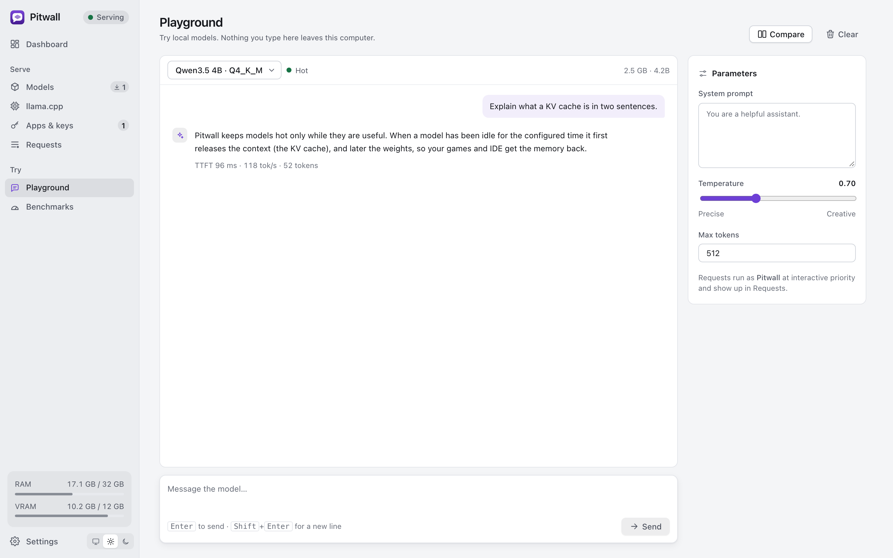
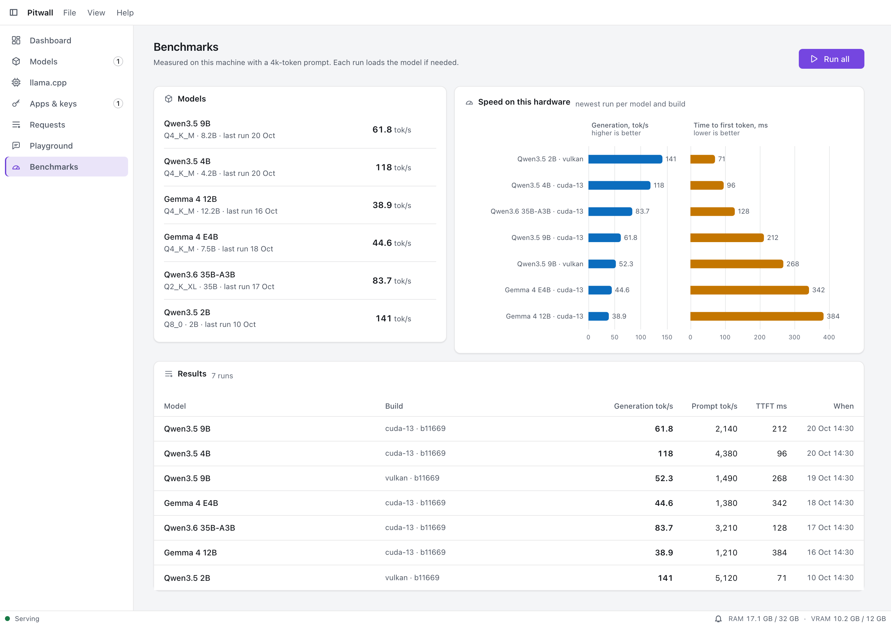
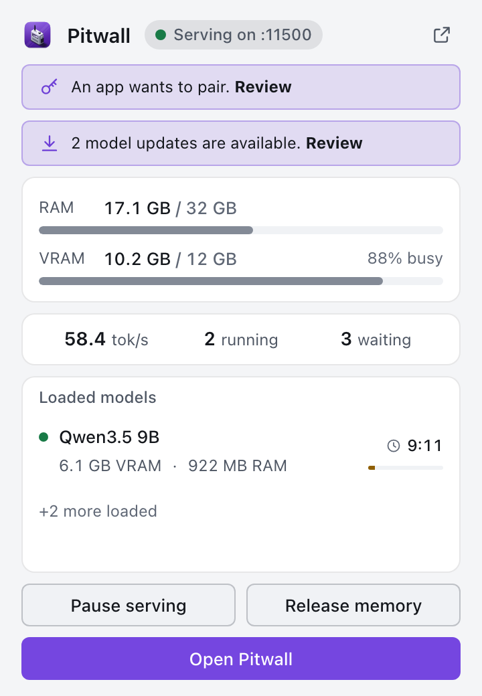
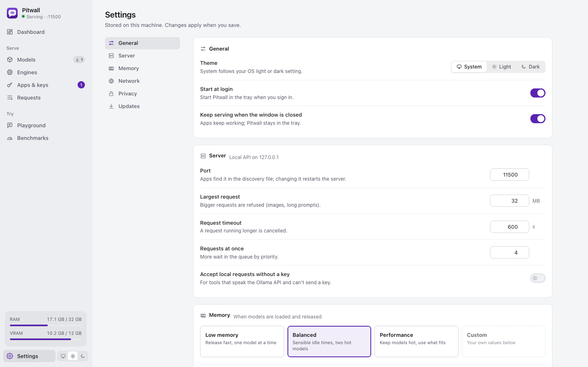

# Features

What Pitwall does, with screenshots. The [README](../README.md) has the short version, the [user guide](user-guide.md) covers
installing an engine, getting a model and connecting apps ([macOS](macos.md), [Linux](linux.md), [Windows](windows.md)), and
[development](development.md) covers building and testing.

> Every item says whether it **works** today or is **planned**. "Works" means it is implemented and covered by tests in
> this repository; only the macOS Apple Silicon path has also been run for real (see [Verified](#verified-and-not-yet-verified)).
> The screenshots are captured from the UI running against the built-in mock backend (plausible demo data), in light and dark
> themes, by the UI tooling; if an image is missing here it has not been generated yet. The plan is in the [roadmap](roadmap.md).

## Contents

- [Local only](#local-only)
- [Engines](#engines)
- [Model library](#model-library)
- [Will this fit?](#will-this-fit)
- [Serving: load on first use and release](#serving-load-on-first-use-and-release)
- [The standard APIs](#the-standard-apis)
- [Extras for apps (`/x/v1`)](#extras-for-apps-xv1)
- [Apps, keys and pairing](#apps-keys-and-pairing)
- [Queue and priorities](#queue-and-priorities)
- [Packs: more engines and model lists without code](#packs-more-engines-and-model-lists-without-code)
- [Dashboard](#dashboard)
- [Models page](#models-page)
- [Engines page](#engines-page)
- [Apps and keys page](#apps-and-keys-page)
- [Requests](#requests)
- [Playground](#playground)
- [Benchmarks](#benchmarks)
- [Tray](#tray)
- [Settings](#settings)
- [Service and updates](#service-and-updates)
- [Security and privacy](#security-and-privacy)
- [Platforms](#platforms)
- [Verified and not yet verified](#verified-and-not-yet-verified)

## Local only

- **Nothing you ask and nothing a model answers leaves the computer.** There are no cloud engines, no telemetry, no crash
  upload ([ADR 0001](adr/0001-local-only.md)). Works.
- **The only outbound traffic is a download you asked for**, over HTTPS, from the allow-listed hosts in
  `pitwall_core::privacy`: Hugging Face (and its CDN and Xet storage hosts) for models and GitHub releases for engines. Every
  redirect hop is checked again; each download shows its host in the UI. Works.
- **Offline mode** turns even that off: every download path answers "Pitwall is in offline mode: downloads are off." Works,
  tested end to end.
- **The request path has no HTTP client.** A test fails if a request handler can open an outbound connection, and a script
  (`scripts/ci/privacy-check.sh`) fails the build if the one outbound client (`egress.rs`) is used from anywhere else. Works.

## Engines

- **llama.cpp** is the built-in engine. Pitwall installs official prebuilt `llama-server` builds from a pinned catalog
  (release `b11669` today): `cpu`, `vulkan`, `cuda-12`, `cuda-13` on Windows and Linux, `metal` on macOS, with `rocm`, `sycl`
  and `openvino` selectable by hand. The suggested build is chosen for the hardware. Works.
- **Checksummed install with a self-test and roll back.** Each archive is verified against its SHA-256 before it is unpacked
  (defensively: flat file names, size caps, safe links only), the new build must pass `--version` and `--list-devices`, and only
  then replaces the old one. A build that fails its self-test is discarded and the previous build stays active; the Engines page
  can also switch back to the previous build. Works.
- **One process per model.** Each model runs in its own `llama-server` child process on a loopback port with a private key,
  started with a scrubbed environment and killed with Pitwall. A crashing engine never takes Pitwall down: the model is forgotten
  and loads again on the next request. Works.
- **Planned engines say so.** MLX (Apple Silicon), vLLM (Linux with an NVIDIA GPU) and whisper.cpp (speech to text) appear
  on the Engines page as "not available" with the reason. Planned, no adapter yet.
- **External and downloadable engines through packs**, for example llamafile (built in, experimental). See
  [Packs](#packs-more-engines-and-model-lists-without-code). Works.

## Model library

- **Search Hugging Face and download GGUF files**, including split models (all parts) and a vision projector next to the
  model. Works.
- **Resumable, verified downloads.** A partial file resumes with an HTTP range request; the SHA-256 is checked against the one
  Hugging Face publishes for the file (its LFS object id); the finished file must parse as GGUF before it enters the library
  (a bad file is discarded). Downloads can be cancelled. Works.
- **Starter catalog and recommendations.** A built-in catalog pack lists small, well-known models and is shown with a "will this
  fit" verdict for this machine. Works.
- **Disk usage and cleanup**: the library shows the size of every model and the free disk space; models can be deleted. Works.
- **Per-model preferences**: keep loaded (pin), its own idle time, its own context length, its own engine. Works.
- **Capabilities are read from the file**: chat, JSON, tools (when the chat template mentions tools), vision (a projector file
  next to it), embeddings and rerank (by architecture and name). Works.

## Will this fit?

Before a download, from the file size and quantisation alone, and after, from the GGUF header, Pitwall estimates the memory
a model needs at a context length (weights, projector, KV cache, compute buffers) and compares it with this machine's free
RAM, the memory idle models could give back and the free video memory. The verdict is **Fits**, **Tight** (fits only by
releasing idle models), **Won't fit** or **Unknown**, with a sentence that says where it would run (all on the GPU, partly on
the CPU, in shared memory on Apple Silicon, on the CPU). The same check runs when a model loads, and a load that cannot fit even
with everything idle released is refused with `insufficient_memory` rather than pushed into swap. Works; the numbers are
estimates and leave margin.

## Serving: load on first use and release

- **Load on first use.** The first request for a model starts its engine and answers when it is ready; the response carries
  `X-Pitwall-Cold-Start-Ms`. Works.
- **Several models at once while they fit**, up to a limit (3 in Balanced). When a new model needs room, the least recently
  used idle models are released first. Works.
- **Release when idle.** Presets: *Low memory* (release after 2 minutes, one model at a time), *Balanced* (10 minutes, the
  default), *Performance* (1 hour, up to 6 models); every value can be edited (the preset becomes *Custom*). After the
  "deep idle" time with no requests at all every unpinned model goes. Works.
- **Release under pressure.** When available memory falls below the preset's percentage of RAM, idle models are released,
  least recently used first. The core also handles the OS's own pressure signals (pinned models go only on critical pressure),
  but the server does not read those signals yet; today only the available-memory threshold triggers it. Works (threshold).
- **Never a busy model.** A model that is answering a request or still loading is never released. Works, tested.
- **Yield to foreground apps** shortens idle times to a quarter (at least 30 seconds) while a full-screen app is detected.
  The decision is implemented and tested in the core, but the server does not detect a foreground app yet, so it never
  triggers today. Planned.
- **Release the context first** (keep the weights, free the KV cache at half the idle time) is decided by the core, but the
  server does not carry it out yet; only whole-model unloading happens. Planned.
- **Pause serving** from the UI: new requests are refused with a clear message while running ones finish. **Release memory
  now** unloads everything idle. Works.
- **Timeouts and limits**: per-request timeout (600 s), largest request (32 MiB), requests at once (4) are settings. Works.

## The standard APIs

Served on `127.0.0.1:11435` (Ollama's port is 11434, so both can run). See [ADR 0003](adr/0003-api-surface-and-compatibility.md).

| Family | Endpoints | Status |
|---|---|---|
| OpenAI | `GET /v1/models`, `GET /v1/models/{id}`, `POST /v1/chat/completions`, `POST /v1/responses`, `POST /v1/embeddings` | Works, streaming (SSE), tool calls, vision (inline images), `response_format` with a JSON schema |
| OpenAI | `POST /v1/audio/transcriptions` | Answers `not_available` (501): the whisper.cpp engine is planned |
| Anthropic | `POST /v1/messages`, `POST /v1/messages/count_tokens` | Works, streaming, tool use, base64 images; `max_tokens` is required as in the real API |
| Ollama | `POST /api/chat`, `POST /api/generate`, `GET /api/tags`, `GET /api/ps`, `POST /api/show`, `POST /api/embed` (and `/api/embeddings`), `GET /api/version` | Works, streaming (NDJSON), `format` as `"json"` or a JSON schema |

Each family gets errors in its own shape (OpenAI `error.type`, Anthropic `{type: "error"}`, Ollama `{error}`). Images must be
inline: Pitwall never fetches a URL on a request's behalf. The request and response shapes are pinned by contract tests
against the official SDKs' documented objects.

## Extras for apps (`/x/v1`)

Versioned by `API_VERSION` (1); changes within a version are additive only ([ADR 0009](adr/0009-app-integration-contract.md)).

- **Health**: `GET /x/v1/health` (name, version, `apiVersion`, serving or paused, offline, loaded models). Works.
- **Pairing**: `POST /x/v1/pair` and `GET /x/v1/pair/{id}`. Works; see [Apps, keys and pairing](#apps-keys-and-pairing).
- **Model by capability**: `model: "auto:vision,8k,fast"` in any chat request, or `POST /x/v1/select` to ask first.
  Capabilities `chat`, `vision`, `tools`, `json`, `embeddings`, `rerank`; a context such as `8k`; and a preference
  `fast`, `quality`, `small` or `balanced` (a loaded model first). The chosen model is reported in `X-Pitwall-Model` and
  `X-Pitwall-Chosen-By`. Works. "Fast" will use measured speeds once benchmark results are kept (see [Benchmarks](#benchmarks)).
- **Models and jobs**: `GET /x/v1/models` (capabilities, maximum context, loaded), `GET /x/v1/jobs` (the queue),
  `DELETE /x/v1/jobs/{id}` (cancel; an app can cancel only its own). Works.
- **Provenance on every answer**: `X-Pitwall-Model`, `X-Pitwall-Engine`, `X-Pitwall-Chosen-By` and, when the model had to be
  loaded, `X-Pitwall-Cold-Start-Ms`. Works.
- **Planned, not built**: resumable batch jobs with progress events, knowledge collections (local retrieval: store, chunk,
  embed, rerank, query), task endpoints (`/x/summarize`, `/x/classify`, `/x/extract`, `/x/translate`) with versioned prompt
  templates, token counting helpers beyond Anthropic's `count_tokens`, a response cache and prompt-prefix cache management,
  and hosting of MCP servers and tools.

## Apps, keys and pairing

- **Pairing with a six-digit code.** An app calls `POST /x/v1/pair` with its name; Pitwall shows the request and a code
  in **Apps & keys** (and on the dashboard); the app shows the same code; the user approves and chooses the permissions; the
  app polls and receives its key **once**. Requests expire after 5 minutes and at most 8 wait at once. Works.
- **Keys** are `pw_` plus 32 random bytes. Pitwall stores only the SHA-256 and the first characters (to tell keys apart),
  compares in constant time and writes `apps.json` atomically with a backup. A key can be created in the UI (shown once),
  added to an app, or revoked at any time. The app keeps its copy in the OS credential store. Works.
- **Permissions and limits per app**: which models, the most urgent priority it may use, tools, the extended APIs, requests
  per minute, tokens per UTC day, and concurrent requests. A refusal says what to change. Works.
- **Keyless local access** (for Ollama-style tools that send no key) is a setting, **off** by default, and applies only to
  requests with no `Origin` header. Works.
- **The admin key** (`admin.key`, owner-only) is what Pitwall's own window uses for the management API; apps never see it. Works.

## Queue and priorities

- Every request is a job with a priority: **interactive** (the default, someone is waiting), **background**, **batch**.
  Apps send `X-Pitwall-Priority`; the app's permission caps how urgent it may be. Works.
- Jobs start highest priority first and in arrival order within a priority, under caps: 4 running overall, 2 per model, 256
  waiting, plus the app's own concurrency cap. A waiting job rises one level every 30 seconds, so batch work does not starve.
  A full queue answers `overloaded` (503, `Retry-After: 5`). Works. See [ADR 0005](adr/0005-queue-and-scheduling.md).
- Cancel by closing the connection or `DELETE /x/v1/jobs/{id}`. Works.

## Packs: more engines and model lists without code

There is no plugin system ([ADR 0010](adr/0010-no-plugin-system.md)). Pitwall reads two kinds of validated TOML files from
`<data folder>/packs/` ([ADR 0011](adr/0011-declarative-packs.md)):

- **Engine packs** (`*.engine.toml`): any local engine with an OpenAI-compatible server, with launch arguments, a health
  path, capabilities, memory hints and a pinned, checksummed download per platform, or none for an engine you installed yourself.
  Works. Built in: **llamafile** (experimental).
- **Model catalog packs** (`*.models.toml`): curated models with Hugging Face repo, quantisation variants and sizes, context,
  capabilities and tags. Works. Built in: a starter list.
- A bad pack is skipped with a message that says what to fix; the others still load. A pack cannot name a download host
  outside the allow-list, must bind `127.0.0.1` and is limited to 64 files of 256 KB. Works.

The how-to with complete examples is in the [user guide](user-guide.md#packs-add-an-engine-or-a-model-list).

## Dashboard

The home screen. Live tiles for memory (RAM and video memory, with the pressure state), models in memory with their idle
countdown, tokens per second, the queue and per-app usage; history charts with events (loads, releases, failures, pairings)
marked on the timeline; an events feed; pending pairing requests; quick actions (pause serving, release memory now). The
server pushes updates over a live feed, so nothing is polled. Metrics are kept locally, bounded (30 days by default). Works.

## Models page

**Library** lists installed models with size, quantisation, capabilities, a Loaded badge and the idle countdown, with pin,
idle time and engine choices, load, unload and delete. **Discover** shows recommendations from the catalog packs and searches
Hugging Face; opening a repository lists its files with a fit verdict for each variant. **Downloads** shows progress, speed,
host and the verification state, with cancel. Works.

## Engines page

One card per engine: availability and why, the installed builds with their tag, devices found by the self-test and
self-test result, the catalog of builds to install (the suggested one first), select, remove and roll back, and install progress
with cancel. The pack engines appear here too. Works for llama.cpp and packs; MLX, vLLM and whisper.cpp show as planned.

## Apps and keys page

Paired and manually created apps with their keys, last use, today's usage and a permissions editor; the pairing requests
waiting for approval; create app, add key and revoke. A new key is shown once in a dialog. Works.

## Requests

Recent requests with app, endpoint, model, how it was chosen, priority, queue time, time to first token, tokens and speed, cold
start and status. Only metadata is kept. The prompt and response are hidden; showing them needs **Keep request content** in
Settings and the inspector for the text is not available yet. Works (metadata); content inspection planned.

## Playground

Chat with any installed model from Pitwall's own window, streamed through the same pipeline apps use (so it queues, loads and
releases exactly like theirs). Works. Side-by-side comparison of two models in one view is a design goal and is not confirmed
yet.

## Benchmarks

Run a short generation on a model to measure tokens per second and time to first token on this hardware. The run works; keeping
results between sessions (and feeding them to "fast" model selection) is **planned**, today the list starts empty.

## Tray

A compact view from the tray or menu bar: serving state, loaded models, memory, queue and live speed, with pause and release
memory. Closing the window keeps Pitwall in the tray and the server keeps serving. With no tray (some Linux desktops) closing
the window quits the app, but the service keeps running. The Tauri shell is being built; the popover screen exists in the UI.

## Settings

- **General**: start at login, theme (system, light, dark), keep serving when the app closes.
- **Server**: port (default 11435), largest request, request timeout, requests at once, allow keyless local access.
- **Memory**: the preset and every value of it (idle release, deep idle, pressure threshold, always keep free, hot models at once,
  memory limit for hot models, yield to foreground, notify on release).
- **Network**: offline mode. The LAN switch and port are stored but sharing on the local network is **planned** and does nothing
  yet.
- **Privacy**: keep request content (off), how long metrics and history are kept (30 days).

Settings are in `settings.toml`: versioned, every key optional with a default, written atomically with a backup, and damage
falls back to the backup and then the defaults. Works.

## Service and updates

- **The server is a separate, windowless process** (`pitwall-server`) that keeps serving when the window and tray app are
  closed or crash. Per OS: a Windows service named `Pitwall`, a macOS launch agent
  (`net.decryptology.pitwall.service`, registered with `SMAppService`), a Linux systemd user service (`pitwall.service`). The
  server exits after an update of its own program only when idle, and the supervisor brings it back. The service-registration
  logic exists as pure, tested functions; the app that installs it is being built. In progress.
- **Discovery**: a running server writes `discovery.json` (version, API version, pid, port, base URL, start time) and removes it
  on a clean stop. Works.
- **Updates** use the Tauri updater against a signed `latest.json`; builds without the signing key are unsigned and report that
  updates are not available. Not configured yet; see [releasing](releasing.md).

## Security and privacy

- The API listens on **127.0.0.1 only**. `Host` must be a loopback name; a browser `Origin` from any other site is refused;
  a loopback page needs a key. This blocks DNS rebinding and cross-site requests. Works, tested.
- Keys are hashed; the admin key is a file only the owner can read; apps get a key only through the pairing the user approves.
- Engines run with a scrubbed environment (no tokens, proxies or user variables), no console window on Windows, at below-normal
  priority on Windows, and only listen on loopback.
- Logs do not contain prompts or responses by default.
- **Sharing on the local network (TLS with a pinned self-signed certificate)** is **planned** and not built. Today there is no way
  to reach Pitwall from another computer.
- Details: [ADR 0007](adr/0007-security-model.md), [ADR 0001](adr/0001-local-only.md).

## Platforms

Windows, macOS and Linux are first-class targets: [Windows](windows.md), [macOS](macos.md), [Linux](linux.md). Installers
are NSIS (Windows), `.dmg` (macOS) and `.deb` plus AppImage (Linux), unsigned until the signing secrets exist.

## Verified and not yet verified

- **Verified on a real machine (macOS, Apple Silicon M4 Pro):** the Metal llama.cpp build `b11669` installed through the app flow
  with checksum and self-test; Qwen2.5-0.5B-Instruct Q4_K_M downloaded from Hugging Face with its SHA-256 verified against the
  value Hugging Face publishes; OpenAI chat (streaming and not), Anthropic messages, Ollama chat and JSON-schema constrained
  output all answered, at about 213 generated tokens per second. The test model was deleted afterwards.
- **Covered by automated tests only:** everything else, including the fake-engine end-to-end tests in
  `crates/pitwall-server/tests`.
- **Not yet verified:** real runs on Windows and Linux, and the CUDA and Vulkan builds. Treat them as unproven until the
  [manual tests](testing-manual.md) have been run there.
