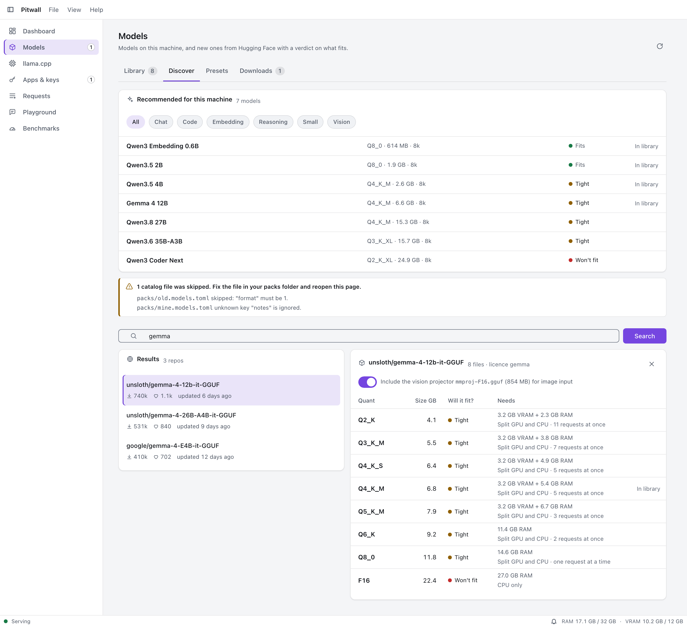
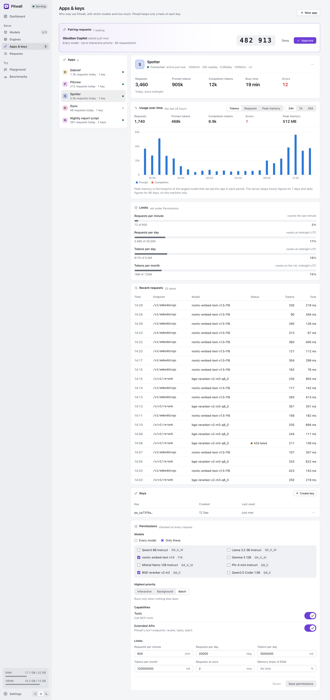
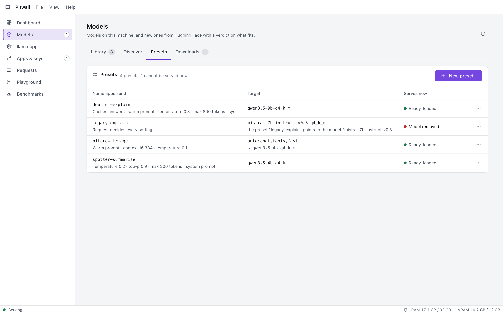
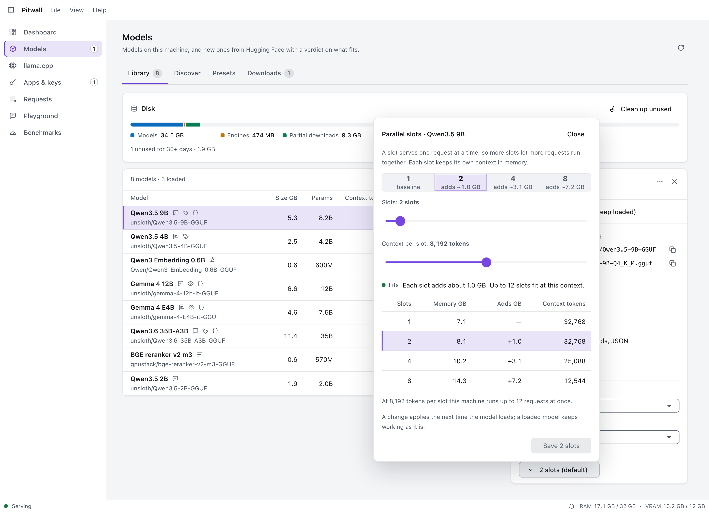
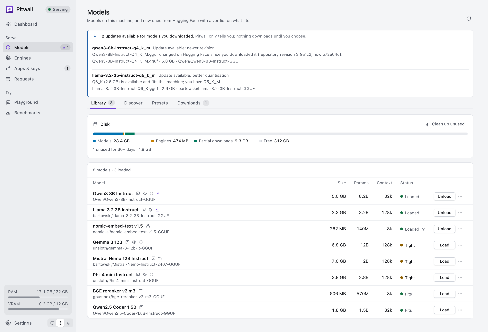

# User guide

How to install Pitwall's engine, get a model, connect your apps and keep memory in check. For what each screen does see
[features](features.md); for platform specifics see [macOS](macos.md), [Linux](linux.md) and [Windows](windows.md).

Pitwall is **local only**: nothing you ask and nothing a model answers leaves your computer. The only network traffic is a
download you start (engines from GitHub, models from Hugging Face)
([ADR 0001](adr/0001-local-only.md)).

## Contents

- [First run](#first-run)
- [llama.cpp](#llama-cpp-the-engine-installed-for-you)
- [Get a model](#get-a-model)
- [Will this fit?](#will-this-fit)
- [Connect an app: pairing](#connect-an-app-pairing)
- [API keys, permissions and limits](#api-keys-permissions-and-limits)
- [Using Pitwall from your tools](#using-pitwall-from-your-tools)
- [The `pitwall` command-line tool](#the-pitwall-command-line-tool)
- [Choosing a model by capability, priority and provenance](#choosing-a-model-by-capability-priority-and-provenance)
- [Model presets and aliases](#model-presets-and-aliases)
- [Chat in the Playground](#chat-in-the-playground)
- [Parallel slots per model](#parallel-slots-per-model)
- [Caching](#caching)
- [Model update notices](#model-update-notices)
- [Memory presets and idle release](#memory-presets-and-idle-release)
- [Packs: add an engine or a model list](#packs-add-an-engine-or-a-model-list)
- [Where Pitwall keeps its files](#where-pitwall-keeps-its-files)
- [Troubleshooting](#troubleshooting)

## First run

1. **Install and open Pitwall** ([macOS](macos.md#install), [Linux](linux.md#install), [Windows](windows.md#install)). The window
   opens on the **Dashboard**. The server is a separate, windowless process that keeps serving when you close the window; the
   tray (menu bar) icon is how you get the window back.
2. On a fresh machine Pitwall installs llama.cpp by itself (the dashboard shows the progress; see
   [llama.cpp](#llama-cpp-the-engine-installed-for-you)), and the dashboard says there is no model yet. Follow
   [Get a model](#get-a-model).
3. **Check the server is up**:

   ```sh
   curl -s http://127.0.0.1:11435/x/v1/health
   ```

   ```json
   {"ok":true,"name":"pitwall","version":"1.0.4","apiVersion":1,"serving":"serving","loadedModels":0}
   ```

   The port is 11435 (next to Ollama's 11434). If another program uses it, Pitwall says "Pitwall cannot listen on ... Is
   another Pitwall (or an Ollama on the same port) running? Change the port in Settings > Server or start with --port."

If you run the server on its own (development, a headless Linux machine) the program is `pitwall-server`; its options are
`--port N` and `--data-dir PATH` (the environment variable `PITWALL_HOME` also sets the data folder).

## llama.cpp: the engine, installed for you

An engine is the program that runs a model. Pitwall has one, **llama.cpp**, which serves every model
([ADR 0020](adr/0020-llama-cpp-is-the-only-engine.md)).

1. **You do not have to install it.** The first time Pitwall starts, and whenever no build is installed, it downloads the
   build suggested for this computer in the background: **Metal** on a Mac, **CUDA 13** or **CUDA 12** with an NVIDIA card,
   **Vulkan** for other GPUs, **CPU** if nothing else works. The Dashboard and the **llama.cpp** page show the progress.
   Models you load or download meanwhile wait ("Installing llama.cpp...") and go on when it is ready. Without a
   network, the page says why and offers **Retry**.
2. The download comes from GitHub (the host is shown); Pitwall checks its SHA-256 against the value pinned in the catalog,
   unpacks only the files it expects, and runs a **self-test** (`--version`, `--list-devices`). The page then shows the tag
   (for example `b11669`), the devices the build found and "Self-test passed".
3. **Another build.** Open **llama.cpp**: the catalog lists the builds for this machine, the suggested one first. Install
   another (ROCm, SYCL and OpenVINO can be chosen by hand but are never chosen automatically), pick which one is used, or pin
   one for all models or for one model.
4. If a self-test fails, the new build is **discarded** and the previous one stays active; the message says why. You can also
   switch back to the previous build later with **Roll back**.
5. **Left over from an older version.** Version 1.0.1 could download a llamafile engine. If its folder is still there the page
   offers **Remove llamafile (size)**; nothing is deleted until you press it.

**Minimum build.** Pitwall always starts llama.cpp with `--jinja` (b4524 and newer) and `--offline` (b5501 and newer), so
**b5501 is the oldest build it runs**. An older build is refused at install and at engine start with "This llama.cpp build
(bNNNN) is older than b5501, which Pitwall needs. Update it on the llama.cpp page." Builds whose number is unknown (a custom
`llama-server`) are trusted.

### Pin a build, roll back, and what a build supports

- **Pin.** In the installed builds table, **Pin** makes a build the one every model uses, even when a better one is installed;
  the button turns violet and says **Pinned**, and the card says automatic choice is off until you unpin. Only builds that passed
  their self-test can be pinned. In **Models**, each model has a build menu to pin just that model (the row then says
  "pinned to cuda-13 b11669"). The order is: the model's pin, then the global pin, then automatic.
- **A pin never silently falls back.** If the pinned build is removed, the llama.cpp page says "Install it on the llama.cpp page, or remove
  the pin", and requests for the affected models answer 503 `engine_pin_unavailable` with that message.
- **Roll back** appears when an earlier installed build passed its self-test. It names the build ("Roll back to Vulkan
  b11669"), asks first, and pins that build for all models until you unpin it. A build that failed its self-test is never offered;
  the card says why roll back is not available.
- **Loaded models keep their engine.** Pinning, unpinning and rolling back never restart a model that is in use; they apply
  the next time the model is loaded, and the message names the models that are still on the old build.
- **Features.** The **Features** button of a build lists vision, tools, JSON-schema output, embeddings and reranking as
  Supported, "Needs b5600" (with what to install) or Not supported. A request that needs something the build lacks is refused
  up front, for example 503 "... needs tool calling, which needs llama.cpp b4600 or newer; the engine build in use (cpu, b4300)
  is older. Install llama.cpp b4600 or newer on the llama.cpp page, or unpin the old build." Models whose features the build cannot serve are
  left out of `capabilities` in `GET /x/v1/models` (they appear under `unavailable`) and of `auto:` selection. The limits live in
  `capabilities.json` (embedded in the app, next to the pinned catalog); they are reviewed when the catalog moves.

Keep **Build: auto** unless a build misbehaves: automatic order is Metal, then CUDA (newest toolkit first), then Vulkan, then
CPU. Only installed builds that work on this machine are considered.

## Get a model



Open **Models** then **Discover**.

- **Recommended** lists models from the built-in starter catalog (and any catalog pack you added) that fit this machine (those that will not fit are left out), such as
  *Qwen3.8 27B*, *Qwen3.6 35B-A3B*, *Gemma 4* (26B-A4B, 12B, E4B), *Qwen3.5* (9B, 4B and 2B for small computers),
  *Qwen3 Coder Next* and *Qwen3 Embedding 0.6B* (embeddings). Only current-generation models are listed.
- **Search Hugging Face** finds GGUF models. Open a repository to see its files, each with a [fit verdict](#will-this-fit).
  Pick a quantisation (Q4_K_M is a good start; Q8_0 is larger and closer to the original), then **Download**.
- A vision model needs its projector file (`mmproj`) in the same folder; download it with the model. Without it the model
  answers "cannot read images".

The **Downloads** list shows progress, speed and the host. A partial file is kept if the connection drops and resumes where it
stopped. When the bytes arrive Pitwall checks the SHA-256 against the one Hugging Face publishes for the file, then checks that
the file is a valid GGUF; a file that fails either check is deleted and the download fails with
"the downloaded file does not match its checksum ... it was discarded".

A model's **id** (what clients put in `"model"`) is its file name without `.gguf`, lowercased with other characters turned into
`-`: `qwen3.5-2b-q4_k_m`. `GET /v1/models` lists them. Clients may also use the Hugging Face repo name
(`unsloth/Qwen3.5-2B-GGUF`) or `repo:quant`.

Gated models (Llama and others) need you to accept the licence on huggingface.co first; Pitwall says so when Hugging Face
answers 401 or 403 ("the file may be gated"). Pitwall does not take a Hugging Face token.

## Will this fit?

Every model and file in **Models** shows a verdict for this machine at the default context length (8192 tokens, a setting):

| Verdict | Meaning |
|---|---|
| Fits | Enough free memory with room to spare. |
| Tight | Fits only if Pitwall releases idle models first, or with little margin. |
| Won't fit | Needs more than this machine can free. Choose a smaller quantisation, a shorter context or close other apps. |
| Unknown | The size is not known. |

The sentence under it says where the model would run: entirely on the GPU, partly on the GPU and partly on the CPU (slower),
in shared memory (Apple Silicon) or on the CPU. The estimate adds the weights, the vision projector, the KV cache for the
context and compute buffers, so a longer context needs more memory. When a model loads for a request the check runs again;
if it cannot fit even with every idle model released, the request fails with `insufficient_memory` instead of swapping.

## Connect an app: pairing

Apps need a key. The easiest way for a suite app (Debrief, Pitcrew, Spotter, Dyno) is **pairing**, which the app does itself:

1. The app calls `POST /x/v1/pair` with its name and shows a six-digit code.
2. In Pitwall, **Apps & keys** (and the dashboard) shows a pairing request with the same code. Check the codes match, choose
   the permissions and click **Approve** (or **Deny**).
3. The app polls and receives its key **once** and keeps it (where depends on the app). A request expires after 5 minutes.

An app that lost its key (Debrief 1.2 after its update) pairs again with `"rePair": true`. Pitwall shows that the request
replaces the keys of the app Pitwall has under that name (it shows that app's name, id and how many keys), and approving
it revokes all of them. A pairing without it, such as a second computer under the same app name, keeps the other keys
working until you revoke them in **Apps & keys**.

You can do the same by hand to try it:

```sh
curl -s -X POST http://127.0.0.1:11435/x/v1/pair \
  -H 'Content-Type: application/json' -d '{"name":"My test tool"}'
# {"pairingId":"pr-3f9a1c...","pollToken":"9be0...","code":"482913","expiresInSecs":300}

# approve it in Pitwall (Apps & keys), then:
curl -s -H 'X-Pitwall-Pair-Token: <pollToken from the answer above>' http://127.0.0.1:11435/x/v1/pair/<pairingId>
# {"status":"pending"}   ... then {"status":"approved","key":"pw_..."}   (or "denied")
```

The key is in the answer exactly once; a second poll says "the key was already delivered". Pairing works only from this
computer and only when the request has no foreign `Origin`.

Prefer to create a key yourself (for `curl`, an editor plugin, a script)? In **Apps & keys** choose **Create app**, give it
a name and the permissions; the key is shown once in a dialog, so copy it then.

## API keys, permissions and limits



A key looks like `pw_` followed by 43 characters. Pitwall keeps only a hash of it and the first characters (`pw_3f9a1c...`)
to tell keys apart, so a lost key cannot be shown again: add a new key to the app and revoke the old one.

Per app (the permissions editor in **Apps & keys**):

| Setting | Effect when exceeded or off |
|---|---|
| Models | Only the listed models; others answer 403 "this app may not use the model ...". Default: all. |
| Highest priority | A request for a more urgent priority is lowered to this one (see [priority](#choosing-a-model-by-capability-priority-and-provenance)). |
| Tools | Off by default: "this app may not use Pitwall's tools". |
| Extended APIs | `/x/v1` calls that need it answer 403 when off. On by default. |
| Requests per minute | 429 "rate limit: at most N requests per minute for this app; retry in a moment". |
| Requests per day | 429 "this app has made its N requests for today; the budget resets at midnight UTC". |
| Tokens per day | 429 "this app has used its N tokens for today; the budget resets at midnight UTC". |
| Tokens per month | 429 "this app has used its N tokens for this month; the budget resets on the 1st at midnight UTC". |
| Memory share | 403 "the model needs N MiB but this app may use at most P% of the machine's memory ...". The share is a percentage of the machine's RAM; it is checked against the footprint (RAM plus video memory) of the model that would serve the request. |
| Concurrent requests | The app's extra requests wait in the queue. |
| Cache responses | Off by default. On: repeated deterministic requests from this app may be answered from the [response cache](#caching). |

Every budget is optional (leave the field empty for no limit) and exists next to the others; a request is refused by the first
one it exceeds. Days and months count in UTC. When an app reaches 80 % of a budget, Pitwall adds a warning to the Dashboard's
events feed (once per period) and the app's detail shows the bar in the "Close to the limit" state.

### Usage per app

Select an app in **Apps & keys** to see its **Usage over time**: requests, prompt and completion tokens, errors and peak memory
for the last 24 hours or 7 days (hourly) or 30 days (daily), the **Limits** with a progress bar and a word for each (Within
limit, Close to the limit, Limit reached) and the app's latest requests (time, endpoint, model, status, tokens, duration;
never the prompt). The Dashboard's **Usage by app** chart shows the same for all apps together; its legend opens the app.

*Peak memory* is the memory Pitwall attributes to the app: for each request, the footprint (RAM plus video memory) of the
model that served it, which includes models its requests loaded or kept hot. In a period it is the largest such value, not a
sum, and not a measurement of the app. Hourly figures are kept 7 days and daily figures 90 days in `usage.json` in the data
folder, on this machine only; the file is rebuilt from nothing if it is damaged.

Send the key as `Authorization: Bearer pw_...` (OpenAI and Ollama clients) or `x-api-key: pw_...` (Anthropic clients).
Without a key you get 401 "a valid Pitwall API key is required. Create one in Pitwall > Apps & keys, or pair the app with POST
/x/v1/pair."

**Tools that cannot send a key** (some Ollama front ends): Settings > Server > **Accept local requests without a key**. It is off by default; it applies only to local requests that carry no browser `Origin`, and those requests are
counted as the app "local".

## Using Pitwall from your tools

The examples use a key in `PITWALL_KEY` and the model from the starter catalog. Replace the model id with one from
`GET /v1/models`. All of them work as written against `http://127.0.0.1:11435`.

```sh
export PITWALL_KEY=pw_...            # from pairing or Create app
export PW=http://127.0.0.1:11435
curl -s $PW/v1/models -H "Authorization: Bearer $PITWALL_KEY"
```

### OpenAI-compatible

```sh
# Not streamed
curl -s $PW/v1/chat/completions \
  -H "Authorization: Bearer $PITWALL_KEY" -H 'Content-Type: application/json' \
  -d '{"model":"qwen3.5-2b-q4_k_m","messages":[{"role":"user","content":"Say hello in five words."}]}'

# Streamed (server-sent events, ends with data: [DONE])
curl -sN $PW/v1/chat/completions \
  -H "Authorization: Bearer $PITWALL_KEY" -H 'Content-Type: application/json' \
  -d '{"model":"qwen3.5-2b-q4_k_m","stream":true,"messages":[{"role":"user","content":"Count to five."}]}'

# JSON-schema constrained output (grammar-enforced by llama.cpp)
curl -s $PW/v1/chat/completions \
  -H "Authorization: Bearer $PITWALL_KEY" -H 'Content-Type: application/json' \
  -d '{"model":"qwen3.5-2b-q4_k_m",
       "messages":[{"role":"user","content":"Name a colour and a fruit."}],
       "response_format":{"type":"json_schema","json_schema":{"name":"pick","schema":{
         "type":"object","properties":{"colour":{"type":"string"},"fruit":{"type":"string"}},
         "required":["colour","fruit"],"additionalProperties":false}}}}'

# Embeddings (needs an embedding model, e.g. qwen3-embedding-0.6b-q8_0)
curl -s $PW/v1/embeddings \
  -H "Authorization: Bearer $PITWALL_KEY" -H 'Content-Type: application/json' \
  -d '{"model":"auto:embeddings","input":["first text","second text"]}'
```

With the official SDKs set the base URL and key, for example in Python `OpenAI(base_url="http://127.0.0.1:11435/v1",
api_key=key)`, or the environment variables `OPENAI_BASE_URL=http://127.0.0.1:11435/v1` and `OPENAI_API_KEY=$PITWALL_KEY`.
`POST /v1/responses` (the Responses API) is served too.

### Anthropic-compatible

`max_tokens` is required, as in Anthropic's API. Images must be base64.

```sh
curl -s $PW/v1/messages \
  -H "x-api-key: $PITWALL_KEY" -H 'anthropic-version: 2023-06-01' -H 'Content-Type: application/json' \
  -d '{"model":"qwen3.5-2b-q4_k_m","max_tokens":128,
       "messages":[{"role":"user","content":"Say hello in five words."}]}'

# streamed
curl -sN $PW/v1/messages \
  -H "x-api-key: $PITWALL_KEY" -H 'Content-Type: application/json' \
  -d '{"model":"qwen3.5-2b-q4_k_m","max_tokens":128,"stream":true,
       "messages":[{"role":"user","content":"Count to five."}]}'
```

For the Anthropic SDK or Claude-style tools set `ANTHROPIC_BASE_URL=http://127.0.0.1:11435` and `ANTHROPIC_API_KEY=$PITWALL_KEY`.
A local model is not Claude: the API shape is compatible, the answers are the local model's.

### Ollama-compatible

```sh
curl -s $PW/api/tags -H "Authorization: Bearer $PITWALL_KEY"          # installed models
curl -s $PW/api/ps   -H "Authorization: Bearer $PITWALL_KEY"          # loaded models and when they expire

curl -s $PW/api/chat -H "Authorization: Bearer $PITWALL_KEY" \
  -d '{"model":"qwen3.5-2b-q4_k_m","stream":false,
       "messages":[{"role":"user","content":"Say hello in five words."}]}'

# JSON-schema constrained output: "format" is "json" or a schema
curl -s $PW/api/chat -H "Authorization: Bearer $PITWALL_KEY" \
  -d '{"model":"qwen3.5-2b-q4_k_m","stream":false,
       "messages":[{"role":"user","content":"Name a colour and a fruit."}],
       "format":{"type":"object","properties":{"colour":{"type":"string"},"fruit":{"type":"string"}},
                 "required":["colour","fruit"]}}'
```

Streaming is the Ollama default (`stream` omitted means newline-delimited JSON). Point Ollama clients at
`OLLAMA_HOST=http://127.0.0.1:11435` (and give them a key, or allow keyless local access).

## The `pitwall` command-line tool

`pitwall` is a small program for terminals and scripts. It is a client of the local server like any other: it calls
Pitwall's management API and the standard OpenAI endpoint on `127.0.0.1` and nothing else, and it can only open a
connection to this machine (it uses the same loopback-only client as the server's engine code). It adds no server
surface and sends nothing off-machine; downloads are done by the server, which shows the host.

```sh
pitwall status                        # version, serving or paused, memory, loaded models, queue, speed
pitwall ps                            # models loaded in memory
pitwall models                        # installed models, size and fit
pitwall load qwen3.5-2b-q4_k_m
pitwall unload qwen3.5-2b-q4_k_m
pitwall pull unsloth/Qwen3.5-2B-GGUF/qwen3.5-2b-q4_k_m.gguf
pitwall keys                          # apps and their keys (ids and prefixes only)
pitwall keys create my-script --new   # a new app and its first key; the key is printed once
pitwall keys create Debrief           # another key for an existing app (by name or id)
pitwall keys revoke Debrief key-1
pitwall presets                       # aliases and where each one resolves now
pitwall presets show debrief-explain
pitwall chat debrief-explain "Explain this error in one sentence"
echo "Summarise this" | pitwall chat fast
pitwall bench qwen3.5-2b-q4_k_m
```

**Finding the server.** The port comes from `--port`, else the discovery file in the data folder, else 11435. If nothing
answers, the tool exits with code 3 and says to start the Pitwall app or service.

**Keys.** Management commands need the admin key. The tool looks for it, in this order, in `--key-file <path>`, the
environment variable `PITWALL_ADMIN_KEY` (for headless machines: copy `admin.key` from the server's data folder), then the
server's `admin.key`, the key's only store (a copy others can read is refused, with what to do). `chat` uses a per-app key from
`PITWALL_API_KEY` instead, so a script holds a key with an app's limits, never the admin key. A key is never a command-line
argument (it would show in process lists and shell history; `--key` is refused), is never printed in output or errors, and
`keys create` prints the new key once, alone on standard output (progress and notes go to standard error), so
`KEY=$(pitwall keys create ci --new 2>/dev/null)` captures it.

**Output.** Read commands print tables for people; add `--json` for the server's JSON (`status`, `ps`, `models`, `keys`,
`presets`, `bench`, and `keys create`). `chat` streams the answer to standard output as it is generated; without a prompt
argument it reads standard input (at most 1 MB). `pull` shows progress on standard error (a live line on a terminal, a line
per 10 % otherwise) and resumes an interrupted download when you run the same command again; `--no-wait` starts the
download and prints its id. Pressing Ctrl-C stops the tool, not the download.

Every call has a time limit: 30 seconds by default, 10 minutes for `load`, `bench` and the first answer of `chat`; change
it with `--timeout <seconds>`.

| Exit code | Meaning |
| --- | --- |
| 0 | Done |
| 1 | An error (not found, wrong key, a failed download, an unexpected answer); the message says what to fix |
| 2 | The command line is wrong (unknown command or option, missing argument, no prompt) |
| 3 | The server is not running (or not on that port); start Pitwall or pass `--port` |
| 4 | The server refused: not enough memory to load, busy, a limit reached, or the model is not loaded |

## Choosing a model by capability, priority and provenance

**Model by capability.** Instead of a model id, an app can ask for what it needs:

```sh
curl -s $PW/v1/chat/completions -H "Authorization: Bearer $PITWALL_KEY" -H 'Content-Type: application/json' \
  -d '{"model":"auto:vision,8k,fast","messages":[{"role":"user","content":"Hi"}]}' -i | grep -i '^x-pitwall'

# ask first, without running anything
curl -s $PW/x/v1/select -H "Authorization: Bearer $PITWALL_KEY" -d '{"model":"auto:tools,32k,quality"}'
# {"model":"qwen3.5-9b-q4_k_m","chosenBy":"capabilities","loaded":false}
```

Words in `auto:` are capabilities (`chat`, `vision`, `tools`, `json`, `embeddings`, `rerank`), a minimum context (`8k`, `32k`,
`16384`) and one preference: `balanced` (default: an already loaded model first, then the fastest), `fast`, `quality` (the
largest that fits) or `small`. A word it does not know is an error, so a typo does not pick another model silently. If no
installed model qualifies, the error lists what is missing ("no installed model offers vision with at least 8192 tokens of
context; download one in Pitwall > Models"). A request that contains images or tools is routed only to models that can handle
them.

**Priority.** `X-Pitwall-Priority: interactive | background | batch`. Interactive (the default) goes first; background is for
work done while the user does something else; batch is for bulk work and runs when nothing more urgent waits, but rises one
level every 30 seconds so it never starves. An app cannot go above its permission.

**Provenance.** Every answer carries headers that say who answered:

| Header | Meaning |
|---|---|
| `X-Pitwall-Model` | The model that answered. |
| `X-Pitwall-Engine` | The engine that served it: `llama.cpp`. |
| `X-Pitwall-Chosen-By` | `explicit` (named), `capabilities` (`auto:`) or `default`. |
| `X-Pitwall-Alias` | Present when the `model` field named a preset: the preset's name (`X-Pitwall-Model` is the model behind it). |
| `X-Pitwall-Cold-Start-Ms` | Present when the model had to be loaded first. |
| `X-Pitwall-Job-Id` | The queue job behind the answer. A streamed request that has to wait answers at once with it; `DELETE /x/v1/jobs/{id}` cancels it (the stream ends with a `cancelled` error frame). An app may cancel only its own jobs. A running job stops when the connection closes. |

With no `model`, Pitwall uses the default model from Settings, else a loaded one, else the first chat model installed.

## Model presets and aliases



A preset gives an app a stable name and lets you decide what serves it. In **Models > Presets** press **New preset**:

| Field | Meaning |
|---|---|
| Name apps send as the model | e.g. `debrief-explain`. Lowercase letters, digits and `-_.`, up to 48. It cannot be the id of an installed model, `auto` or `default`. |
| Serves from | An installed model id, or a capability selection such as `auto:chat,fast` (the same words as above); with a selection Pitwall picks the best installed model for each request. |
| Context, Temperature, Top-p, Max tokens | Defaults used when the request does not set them. Empty means the request (or the model) decides. |
| System prompt | Added in front of the conversation only when the request has no system message of its own. |
| Engine | llama.cpp. |

While you type, the editor asks the engine what the draft would serve ("Would serve qwen3-8b-instruct-q4_k_m") and shows
anything that stops it being saved, in words. The list shows where each preset stands: *Ready*, *Model removed* (its model
was deleted; edit the preset), *No model matches* (nothing installed has the capabilities) or *Shadowed by a model* (an
installed model now has the same name, and requests for that name go to the model).

Apps use the name like a model id, in any of the three APIs; it is also listed in `GET /v1/models` and `GET /api/tags`:

```sh
curl -s $PW/v1/chat/completions -H "Authorization: Bearer $PITWALL_KEY" -H 'Content-Type: application/json' \
  -d '{"model":"debrief-explain","messages":[{"role":"user","content":"What does this error mean?"}]}' -i | grep -i '^x-pitwall'
# x-pitwall-alias: debrief-explain
# x-pitwall-model: qwen3-8b-instruct-q4_k_m
```

Values the app sends (temperature, top-p, max tokens, its own system message) always win over the preset's. Context and
engine apply when the model is loaded for the request; a model that is already loaded keeps its context and engine until it
is released. In **Requests**, a request made through a preset shows "via <name>" and, in the details, the preset asked for and
the model it resolved to. Presets are stored in `presets.json` in the data folder; a damaged file is restored from its backup.

## Chat in the Playground

The Playground has a Chat tab and a Compare tab. Compare sends one text question to two models and shows both answers. Chat
is a full conversation with one model. The chat runs in Pitwall's own window and goes through the same queue as your apps, so
it loads and releases models the same way.

Chat is new in 1.1.

**Pick a model.** The list shows chat models. A model that cannot use tools is marked, because tools need a chat template that
supports them. Stop works at every step: while a model loads, while it writes and while Pitwall waits for you to allow a tool.

**Attach files.** Paste, drop or pick files in the question box. You can attach up to 16 per question.
- Text and code files must be UTF-8 and at most 256 KiB each. Pitwall checks each file again on its own side.
- Pictures (PNG, JPEG, WebP or GIF, up to 25 MiB each) work only with a model that has a vision file. Pitwall checks the
  picture by its content, turns it upright, shrinks it to what the model takes and removes its location and camera data.
  For any other model the chat says so and keeps Send off until you choose a model that can read it.

**Saved chats.** A chat is saved on this computer by default, in `chats/` in the data folder, one file per chat, with
attachments beside them in `chats/attachments/`. They are not encrypted. Anything that can read your files can read them.
Chats are never in Report a problem and never in a log.
- Turn on "Don't save this chat" in the Chat bar and nothing of that chat is written to disk. It is gone when Pitwall closes.
- Settings > Chats sets the default for new chats, shows what the saved chats take and deletes all of them.
- Delete one chat from the chat list. The limits are 1,000 saved chats, 16 MiB for a chat and 2 GiB of attachments. At a
  limit Pitwall refuses the new item and says what to delete. It never deletes anything itself.

**Tools from other apps.** Settings > Connected apps lists the family apps whose tools the chat may use. Today that is Dyno.
- Paste the key that app shows you. Pitwall never shows it again. On macOS it is an owner-only file in `secrets/` in the data
  folder, so an update does not ask for your password. On Windows and Linux it is in the operating system's credential store.
- Pitwall connects over the app's own local listener. Nothing leaves this computer.
- A read-only tool asks the first time. "Allow once" runs it now. "Always allow" remembers it, until the tool changes.
  An action, such as waking a device, asks on every call.
- Every call shows in the chat with its arguments and its result. A result is cut at 16 KiB before the model sees it.
- Pitwall offers the model every connected tool. A chooser for tools per chat is not built yet.

Speech input is coming.

## Parallel slots per model



A model can serve several requests at once. Each running request uses a *slot*, and every slot keeps its own context in memory,
so more slots mean more memory. In **Models > Library**, the **Slots** button of a model opens a panel:

- Pick 1, 2, 4 or 8 slots, or drag the slider (1 to 16). Under each choice the panel says what it adds ("adds ~3.1 GB").
- Drag **Context per slot** to see how much each slot can hold. The table answers, in words, how much memory the model needs at
  each slot count, the longest context each slot can have, and whether it fits, is tight or will not fit on this machine, and
  which is the most slots that fit at the chosen context.
- **Save** stores the choice. It applies the next time the model loads; a model that is loaded keeps its count until then, and
  requests it is serving are never interrupted. **Use the default** returns to `models.default_slots` (2).

The context you set is the context of one slot: with 4 slots of 8,192 tokens Pitwall starts the engine with a 32,768 token cache
(`--ctx-size`, which the engine splits evenly) and `--parallel 4`. If the model file does not describe its layout the memory per
slot is an estimate, and the panel says so. Requests beyond a model's slots wait in the queue. In **Discover**, each variant
also says how many requests at once the machine could run.

## Caching

Pitwall can avoid repeating work. There are three kinds of caching; everything stays on this computer.

| What | Default | What it does |
|---|---|---|
| Prompt reuse | Always on (llama.cpp) | Turns of one conversation go to the same model slot, so the engine does not recompute the start of the prompt. Request details show "cached tokens"; usage shows "prefix tokens". |
| Response cache | **Off** | Answers an exact repeat of a request without running the model. |
| Embeddings cache | On | Remembers the vector of each text, so indexing the same text again is instant. |

**What the response cache stores.** Only deterministic requests: temperature 0 (or a fixed seed) and no tools. Streamed and
non-streamed requests both work; a streamed hit is replayed in pieces. A hit needs no model load and does not wait in the queue.
Only a finished answer is stored (it stopped on its own or reached the length limit; errors and tool calls are not). The key
includes the model file (its size and modification time), the engine and its build, every generation setting and the whole
conversation, so changing any of them is a miss. The app that asked is **not** part of the key: apps that have opted in share
answers.

**Opting in.** Turn on **Cache responses** for an app (Apps & keys > the app > permissions), or for a preset (Models > Presets >
the preset). Either one enables the cache for that request. Nothing else is cached.

**How long.** A cached answer expires 7 days after it was stored. Choose 1 hour, 1 day, 7 days, 30 days, 90 days or Never in
Settings > Caching; with Never only the size limit (256 MiB by default) removes entries, oldest-unused first. Embeddings
expire 90 days after they were last used (using one renews it) and have a 512 MiB limit. An expired entry is never served, even
before the background clean-up deletes it. The clean-up runs when Pitwall starts, every hour and when it is idle.

**Where.** Each cache is kept in **Memory only** (gone when Pitwall stops) or **On disk** (the default for embeddings, and for
answers once you enable them): one file, `cache.sqlite` in the data folder, readable only by you. If the file is damaged Pitwall
renames it aside and starts a new one; if it cannot be opened at all it uses memory and says why in Settings > Caching.

**Seeing and controlling it.** Settings > Caching shows the size in use, the oldest entry, when entries expire and the next
clean-up. **Clear now** empties a cache; you can also clear the entries of one app, one model, or everything. Removing a model,
changing the engine build or pin, or editing a preset drops the entries that depended on it at once. The Dashboard shows the hit
rate and the tokens saved, and each app's page shows its hits.

**Per request.**

```sh
curl -si http://127.0.0.1:11435/v1/chat/completions -H "Authorization: Bearer $PITWALL_API_KEY" -H 'content-type: application/json' \
  -d '{"model":"qwen3-8b-instruct-q4_k_m","temperature":0,"messages":[{"role":"user","content":"Name three primes."}]}' | grep -i x-pitwall-cache
# x-pitwall-cache: miss      (the first time)  ...  hit  (the second time)
# Add -H 'Cache-Control: no-cache' to skip the cache for one request: x-pitwall-cache: bypass
```

`X-Pitwall-Cache` is `hit`, `miss` or `bypass` (the cache was off for the app and preset, the request was not deterministic, or it
carried `Cache-Control: no-cache` or `no-store`).

**Keep warm (optional).** In a preset, Keep warm saves the model's slot state when the model unloads and restores it when it loads,
so the first request after a reload is fast. The saved files are bounded, kept in `slots/`, and dropped when the model, engine
build or preset changes or after 30 days unused (`keepWarmDays`).

**Privacy.** Cached answers contain what your apps asked and what the model replied, so they are cached only for apps and presets
you opted in, never leave this computer, and never include an API key. Turn on Memory only to keep them off the disk, or clear
them whenever you like.

## Model update notices



Hugging Face files change: a model is re-uploaded with a fix, or a better quantisation appears. Pitwall can tell you, and
only tell you. It is **off until you turn it on**: Settings > **Model updates** > *Check for model updates*, then *Every week* or
*Every day*. The first check runs as soon as you turn it on; **Check now** works at any time (once a minute).

- **What is sent.** Only the repository ids (like `owner/name`) of models you already downloaded, to `huggingface.co`, in the
  address of the same file-list request Discover makes. No prompts, usage, file contents or identifiers. A check asks about at most
  40 repositories.
- **What it finds.** *Newer revision*: the file you have changed on Hugging Face (compared by the SHA-256 recorded when you
  downloaded it; for older downloads, by size). *Better quantisation*: the same model in the next higher-quality quantisation
  (up to Q8_0) that fits this machine with room to spare. *Imatrix build*: the same quantisation as an importance-matrix build.
- **Where you see it.** A banner at the top of **Models**, a note ("Update available: newer revision") on the model's row, a line
  on the **Dashboard**, and an entry in the tray window.
- **What you can do.** **Get it** shows the file, its size and the host (`huggingface.co`) and asks you to confirm before the
  normal download starts; a newer revision replaces your copy only after it is downloaded and verified. **Remind me in a week**
  hides the notice for that long. The **x** hides it until Hugging Face offers something different. Nothing is ever downloaded
  without that confirmation.
- **Files.** Notices and dismissals are in `model-updates.json`; each downloaded model has a small `<file>.origin.json` next to it
  recording where it came from. A damaged file is restored from its backup or starts empty (the next check rebuilds it).

## Memory presets and idle release

Pitwall loads a model when the first request needs it and gives the memory back when it is not needed
([ADR 0006](adr/0006-memory-policy.md)). Choose a preset in Settings > Memory:

| Preset | Release a model after | Release everything after | Pressure threshold | Hot models |
|---|---|---|---|---|
| Low memory | 2 minutes idle | 10 minutes without requests | below 25% of RAM available | 1 |
| Balanced (default) | 10 minutes | 1 hour | below 15% | 3 |
| Performance | 1 hour | 8 hours | below 8% | 6 |

Editing any value makes the preset **Custom**. A load never leaves less than a floor free (1.5 GB Balanced). Rules, in order:

1. A model that is answering a request or loading is **never** released.
2. Under pressure, idle models are released least recently used first until the threshold is met.
3. An idle model is released after its idle time; the next request reloads it (a cold start, shown in the response
   header and the Requests page).
4. After the deep-idle time every unpinned model is released.

**Keep loaded** (pin) in the Models page exempts a model from the idle rule; a model can also have its own idle time. **Release
memory now** on the dashboard unloads every idle model; **Pause serving** makes new requests answer "Pitwall has paused serving.
Resume it in Pitwall's window or tray menu." while running ones finish.

**Quitting.** Closing the window never stops serving. **Settings > General > When you quit Pitwall** decides what **Quit**
does: *Keep serving in the background* (the default: the service goes on), *Stop serving*, or *Ask each time* (a dialog with
both choices and "Remember my choice"). Stopping serving unloads every model, asks every engine process to end (killed after
10 seconds if it does not), and pauses serving: the Dashboard and tray say **Stopped**, and requests are refused until you open
Pitwall again, which resumes serving, or press Resume. **Quit and stop serving** in the tray (menu bar) menu and in the macOS
app menu does this whatever the setting says. The background service stays registered
([ADR 0021](adr/0021-what-quitting-does-about-serving.md)).

Two parts of the policy are decided in the core but not acted on yet: yielding to a full-screen foreground app and releasing
only the context before the weights. Operating-system memory-pressure signals are not read yet either; the
available-memory threshold is what works today.

## Packs: add a model list

A catalog pack is a TOML file that you drop in `<data folder>/packs/` (see [where files are](#where-pitwall-keeps-its-files)).
It is data, not code ([ADR 0011](adr/0011-declarative-packs.md)). Packs are read when the server starts, so restart it after
adding or changing one. Only `*.models.toml` files are read (engine packs were removed in 1.0.3: llama.cpp is the only
engine, [ADR 0020](adr/0020-llama-cpp-is-the-only-engine.md)). At most 64 files of 256 KB are read; a pack with the same `id`
as an earlier one replaces it (yours replace the built-in ones). A problem is shown on **Models > Discover** with the file
name and what to fix; unknown keys are warnings.

`<data folder>/packs/team.models.toml`:

```toml
format = 1
id = "team"                # 1-64 letters, digits, - _ .
name = "Team models"

[[model]]
id = "qwen3.5-4b"                    # your name for it
name = "Qwen3.5 4B"
repo = "unsloth/Qwen3.5-4B-GGUF"     # owner/name on Hugging Face
context = 262144                     # 256 to 10000000
capabilities = ["chat", "json", "tools"]   # chat, vision, tools, json, embeddings, rerank, transcription
tags = ["general", "small"]          # lowercase words; the Discover tab can filter by tag
variants = [
  { quant = "Q4_K_M", file = "Qwen3.5-4B-Q4_K_M.gguf", size_bytes = 2740937888 },
  { quant = "Q8_0",   file = "Qwen3.5-4B-Q8_0.gguf",   size_bytes = 4482403488 },
]
```

Each variant needs a `file` ending in `.gguf` and a positive `size_bytes` (the fit check uses it until the real file list is
fetched). Models appear under **Discover > Recommended** with a fit verdict; for each model the largest variant that fits (or is tight) is
recommended, and models that will not fit this machine are left out. Up to 500 models and 32 variants per model.

## Where Pitwall keeps its files

| Platform | Data folder |
|---|---|
| macOS | `~/Library/Application Support/Pitwall` |
| Linux | `$XDG_DATA_HOME/pitwall`, else `~/.local/share/pitwall` |
| Windows | `%APPDATA%\Pitwall` |

`PITWALL_HOME` overrides it. Inside:

| Item | What |
|---|---|
| `settings.toml` (+ backup) | Settings; edit in the app |
| `apps.json` (+ backup) | Apps and the hashes of their keys |
| `presets.json` (+ backup) | Model presets and aliases |
| `engine-pins.json` (+ backup) | Engine build pins and the builds used before (for roll back) |
| `cache.sqlite` | The disk store of the response and embeddings caches (see [Caching](#caching)); deleting it only empties the caches |
| `slots/` | Saved model state for presets with Keep warm |
| `chats/` | Saved Playground chats, one file each, and their attachments in `chats/attachments/`; not encrypted (see [Chat in the Playground](#chat-in-the-playground)) |
| `secrets/` | macOS only: the keys you pasted for connected apps, owner-only files |
| `tool-approvals.json` (+ backup) | Which connected-app tools you chose to always allow |
| `admin.key` | The secret Pitwall's own window and the `pitwall` command use; owner-only. Do not share it |
| `discovery.json` | Written while the server runs: pid, port, base URL |
| `models/<owner>/<repo>/` | Downloaded models |
| `engines/` | Installed engine builds (one folder per build id) |
| `partial/` | Unfinished downloads (resumed later) |

**The admin key is plain text in `admin.key`.** Pitwall keeps no other copy and does not use the macOS Keychain, Windows
Credential Manager or the Secret Service for it (the Keychain cannot be read silently by an app that is not signed by an
Apple developer, so every update would ask for your password). The file is owner-only: mode 0600 in a folder only you can
open on macOS and Linux, an access list that grants only you on Windows. Other users of the computer cannot read it. Any
program that runs as you can read it without asking, the same as `~/.netrc` or `~/.docker/config.json`; a backup or a
copy of your home folder contains it in plain text, and FileVault or BitLocker protects it only while the disk is
encrypted. If you think the key was read, delete `admin.key` and restart Pitwall: the server writes a new one.
| `packs/` | Your model catalog packs |
| `logs/` | Service logs (no prompts or responses) |

## Troubleshooting

The messages below are what Pitwall actually says.

| You see | Why and what to do |
|---|---|
| 401 "a valid Pitwall API key is required. Create one in Pitwall > Apps & keys, or pair the app with POST /x/v1/pair." | The request has no key or an unknown one. Send `Authorization: Bearer pw_...` or `x-api-key`. A revoked key looks the same. |
| 403 "this request's Host header is not a local address; Pitwall only answers on 127.0.0.1" | You reached it through another name (a proxy, a tunnel, a LAN address). Use `127.0.0.1` or `localhost`. Network sharing is not built yet. |
| 403 "requests from web pages on other sites are refused" | A web page tried to call Pitwall. By design. |
| 404 "no models are installed. Open Models in Pitwall, search Hugging Face and download one." | Nothing to serve yet. |
| 404 "there is no model named ... Installed: ..." | Use an id from `GET /v1/models`. |
| 404 "the preset ... points to the model ..., which is no longer installed" (code `preset_target_unavailable`) | The preset's model was deleted. Edit the preset in Models > Presets. |
| 404 "no installed model offers ...; download one in Pitwall > Models" | No installed model has the capabilities in `auto:...`. |
| 503 "... needs ..., which needs llama.cpp bNNNN or newer; the engine build in use (...) is older." (code `engine_build_too_old`) | The active engine build is too old for the feature in the request. Install a newer build on the llama.cpp page, or unpin the old one. |
| 400 "... cannot serve: ..." (code `capability_unsupported`) | No build of that kind (for example that backend) provides the feature. Use another build or model. |
| 503 "The engine build ... is pinned for ... but is not installed. Install it on the llama.cpp page, or remove the pin." (code `engine_pin_unavailable`) | The pinned build was removed or failed its self-test. |
| 400 "the model ... cannot read images. Choose a vision model (one downloaded with its mmproj file)." | Get the model's projector file too. |
| 400 "... is not a capability (chat, vision, tools, json, embeddings, rerank), a context like 8k, or fast/quality/small" | A typo in `auto:...`. |
| 400 "`max_tokens` is required" | Anthropic requests must have it. |
| 500 "llama.cpp is not installed yet. Pitwall installs the build suggested for this machine by itself; try again in a moment." | Pitwall is installing llama.cpp; wait, or see the progress on the Dashboard. If it failed, press Retry on the llama.cpp page. |
| 500 "could not load ...: the engine exited (...)" | The engine failed to start; the last lines of its output are in the message. Try another build on the llama.cpp page, a smaller model or context. |
| 500 "the model did not become ready within 5 minutes" | The load is too slow for this machine (swap, a huge model). Choose a smaller one. |
| 503 "... needs about N GiB of memory but only M GiB can be made free. Close other apps, choose a smaller quantisation or a shorter context." | `insufficient_memory`. Do as it says. |
| 503 "Pitwall is busy: N requests are waiting. Try again shortly or use a lower priority." | The queue is full (`Retry-After: 5`). |
| 503 "Pitwall has paused serving. Resume it in Pitwall's window or tray menu." | Serving is paused. |
| 429 "rate limit: at most N requests per minute for this app" / "has used its N tokens for today" | The app's limits; change them in Apps & keys. |
| 501 "speech-to-text is not available yet: the whisper.cpp engine is planned." | `/v1/audio/transcriptions` is not built. |
| 413 | The request is larger than the limit (32 MiB by default). Settings > Server. |
| Download: "the file may be gated; accept its licence on huggingface.co first" | A 401 or 403 from Hugging Face. |
| Download: "the download failed: ... Check the connection and retry; the part already downloaded is kept." | Retry; it resumes. |
| Download: "Pitwall only downloads from Hugging Face and GitHub over HTTPS; ... is not allowed" | A pack or redirect named another host. |
| Install: "the new engine failed its self-test and was discarded (...); the previous build stays active" | The build does not run here (missing driver, wrong architecture). Pick another build. |
| Start: "Pitwall cannot listen on 127.0.0.1:11435" | The port is taken. Change it in Settings > Server or start with `--port`. |
| A catalog pack is listed with a problem | Read the message on Models > Discover: it names the file and what to fix. |
| "The background service could not start after the update", or "Pitwall's server is not running" right after updating (macOS) | macOS keeps the code signature of the previously registered build and refuses to start the new one (`launchctl print` shows `spawn failed`, exit code 78 `EX_CONFIG`, `has LWCR`). Pitwall repairs this by itself once per version; if it did not, press **Repair service** in the banner, on the error, or in Settings > Background service. It removes the registration, waits until macOS has dropped it and registers again (up to a minute). The Settings section works even when the server is down. If Pitwall is not listed in System Settings > General > Login Items, Repair puts it back; if you switched it off there, Pitwall leaves it off until you switch it on. |
| A model is slow after a pause | It was released when idle and is loading again (cold start). Pin it or use the Performance preset. |
