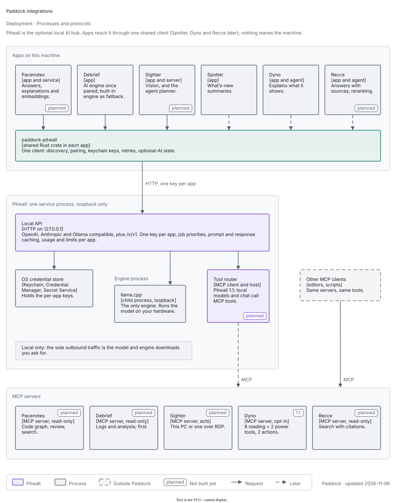

# The Paddock ecosystem

<picture>
  
</picture>

Seven desktop tools for people who keep systems running, built on one shared foundation. Each is useful alone and better with
the others. All run on Windows, macOS and Linux, are written in Rust with a Tauri 2 shell and an Angular UI, and are local
only: no cloud, no account, no telemetry.

Images are generated ([`images/src/ecosystem.mjs`](images/src/ecosystem.mjs),
[`images/src/integrations.mjs`](images/src/integrations.mjs)). PNG exports for places that cannot render SVG:
hero [light](images/paddock-ecosystem-light.png) and [dark](images/paddock-ecosystem-dark.png), integrations
[light](images/paddock-integrations-light.png) and [dark](images/paddock-integrations-dark.png).

## Status

| App | Status |
|---|---|
| Pitcrew | **v1.0.0 released** |
| Debrief | Release in progress; the code is still named IMT while the rename to Debrief lands |
| Pitwall | Feature-complete; release next |
| Dyno | In development |
| Spotter | In development |
| Sighter | In design |
| Pacenotes (codebase tool, working name) | In design |

## The apps

### Debrief
**Purpose.** An IDE for analysing software logs and diagnostic files.
**For.** Support and development teams who receive a zip of logs from several machines and must answer "what happened, in which process, and when?".
- One merged timeline per instance across processes and machines, with a fast filterable grid.
- Format detection from content, editable parsing profiles, charts and analysis views (anomalies, patterns, exceptions).
- Rust engine with a DuckDB store: flat memory on large folders. Safe on hostile input; saved projects open without the original logs.
- Built-in local AI as the offline fallback; can use Pitwall instead.

Status: release in progress. Repo: <https://dev.decryptology.net/decryp7/debrief>

### Pitcrew
**Purpose.** Keeps CI runners alive, updated and clean.
**For.** Anyone running self-hosted Gitea or Forgejo runners.
- A watchdog restarts crashed or stalled runners; a running job is never killed.
- Safe updates between jobs, verified, with roll-back.
- Housekeeping, disk guard, pause windows and notifications, with a dashboard and tray.
- Runs the CI for every app in this family.

Status: **v1.0.0 released**. Repo: <https://dev.decryptology.net/decryp7/pitcrew>

### Pitwall
**Purpose.** The private, local AI hub every other app talks to.
**For.** Anyone who wants AI in their tools without sending data anywhere.
- OpenAI-, Anthropic- and Ollama-compatible APIs over models on your own machine, plus `/x/v1` extensions built for the family.
- Engine and model management with checksums, "will it fit?" guidance, presets and idle unloading.
- One key per app, job priorities (interactive first, batch when idle), prompt-prefix and opt-in response caching, usage and limits per app.
- MCP client and tool router for tool servers such as the codebase tool.
- Local only by design: no cloud models, no telemetry; the only traffic is downloads you asked for.

Status: feature-complete, release next. Repo: <https://dev.decryptology.net/decryp7/pitwall>

### Dyno
**Purpose.** Measures, explains and tunes your PC.
**For.** People who want to know why a machine is slow and to fix it safely.
- A background agent keeps history while the window is closed.
- Plain-words diagnosis with evidence, grouped by application; performance counters and benchmarks.
- Observe first: changes happen only through rules you enable or a click, each with an undo, via a privileged helper.
- Extensible with validated declarative packs, no code.

Status: in development. Repo: <https://dev.decryptology.net/decryp7/dyno>

### Spotter
**Purpose.** Watches for new releases anywhere and tells you the moment one appears.
**For.** People who track software across shares, listings, forges, feeds and web pages.
- Many source kinds, including JavaScript-rendered pages through a supervised Chromium.
- Version schemes, filters and soak time as declarative presets; plugins for the rest.
- Digests, quiet hours and OS notifications; optional "What's new" summaries from Pitwall.

Status: in development. Repo: <https://dev.decryptology.net/decryp7/spotter>

### Sighter
**Purpose.** Finds any UI element by sight: record, label and train vision models that UI tests can query.
**For.** Engineers who test or automate desktop apps, including legacy and custom-drawn ones with no accessibility tree.
- Works from pixels; accessibility is an optional label source.
- A layered resolver (cache, template, OCR, detector, Pitwall vision model, flag for manual) behind a loopback `/v1/locate` API.
- A recorder and a labelling and training studio; redacts recordings before storing them.
- Run bundles (video plus steps) that open next to the app's logs in Debrief.

Status: **in design**. Repo: <https://dev.decryptology.net/decryp7/sighter>

### Pacenotes (working name)
**Purpose.** Understands a codebase and serves it, read-only, to AI tools over MCP.
**For.** Developers who want local models, Debrief and editors to answer questions about real code instead of guessing.
- Symbol, reference and repo-map queries; "explain this stack trace" mapped to files, callers and recent commits.
- A read-only MCP server (no tool writes, executes or fetches), a desktop viewer and a CLI.
- Feeds test plans to Sighter and grounds Pitwall's answers in the code.

Status: **in design**; the name is not final.

## Integration architecture

<picture>
  
</picture>

The apps never depend on each other to do their own job. They meet in a few well-defined places:

| Contract | Between | How it works |
|---|---|---|
| **Pitwall local API** | every app to Pitwall | HTTP on loopback; OpenAI-, Anthropic- and Ollama-compatible, plus `/x/v1`. One key per app (held in the OS credential store), job priorities, prompt and response caching, usage and limits per app. |
| **MCP** | Pitwall to the codebase tool, and any MCP client | The codebase tool is a read-only MCP server; Pitwall is the MCP client and tool router, offering tools to local models. |
| **Deep links** | Pitcrew, Dyno to Debrief; Dyno to Spotter | "Open job log in Debrief", "Open in Debrief", "Watch for updates". The target app opens at the right place; nothing is shared but the link. |
| **Run bundles** | Sighter to Debrief | A file with video, steps and results; Debrief opens it next to the app's logs. |
| **Test plans** | codebase tool to Sighter | A file proposing UI flows to cover a change; Sighter turns them into tests. |
| **CI** | Pitcrew to every repo | Pitcrew keeps the runners that build and test all of these apps alive, updated and clean. |
| **`paddock-pitwall`** (planned) | shared crate in each app | One client for discovery, pairing, keychain keys, retries, priorities, cache headers and capability checks, so no app re-implements Pitwall access. |

## Data and privacy

- Your data stays on your machine. Logs, code, screenshots, prompts and answers are processed locally and never uploaded.
- No telemetry and no crash upload by default. The only network traffic is what you ask for: model and engine downloads in
  Pitwall, release checks you configure in Spotter, updates of the apps themselves (signed, from `latest.json`).
- Pitwall listens on loopback only and requires a key per app; keys live in the OS credential store.
- Apps treat input as hostile: parsers never panic, limits are enforced, UIs never render untrusted text as HTML.
- System changes (Dyno) happen only through a privileged helper on a click or an enabled rule, with an undo.

## Pitwall is optional

Pitwall is the AI hub, never a dependency. Every app's core works without it:

- Without Pitwall, AI features show a clear state, "Needs local AI, set up Pitwall", never an error or a dead button.
- Debrief keeps its built-in local AI as the offline fallback.
- With Pitwall, interactive requests (an Explain click) run first; batch work (labelling, bulk review, extraction) runs at
  batch priority when the machine is idle.
- Install or remove Pitwall at any time; nothing else needs reconfiguring beyond pairing.

## What Paddock provides

- **`@decryp7/paddock-ui`** on the Gitea npm registry: tokens, Angular components, ECharts theme ([`ui/`](../ui/README.md)).
- **Design guide and tokens**: five accents and a colour-vision-safe categorical palette ([design guide](design-guide.md)).
- **Diagram kit**: draw.io shape library, templates and canonical export ([`diagrams/`](../diagrams/README.md)).
- **Icon set**: one icon per app, per platform ([`icons/`](../icons/README.md)).
- **Release practices**: tag-driven CI release, signed updater artefacts, `latest.json`, the release script.
- **Lessons**: what Debrief and Pitcrew taught about build, windows, services, native feel and tests ([lessons](lessons.md)).

## Glossary: why these names

Motorsport vocabulary, because the family is about keeping things running fast and safely.

| Name | In motorsport | Why it fits |
|---|---|---|
| **Paddock** | The area behind the pits where teams work | The shared place under every app |
| **Pitcrew** | The mechanics who service the car mid-race | Keeps CI runners running and serviced |
| **Pitwall** | The gantry where engineers watch data and radio the cars | The hub every app talks to |
| **Debrief** | The review after a session | Analysing what happened afterwards |
| **Dyno** | The rig that measures a car's power | Measures and tunes your PC |
| **Spotter** | Watches the track and calls what is coming | Calls out new releases |
| **Sighter** | A sighting lap before the race | Looks at the UI before tests drive it |
| **Pacenotes** (working name) | The co-driver's notes describing the road ahead | Describes the shape of a codebase to whoever is navigating it |
