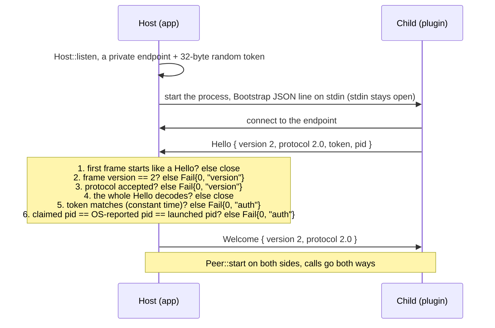
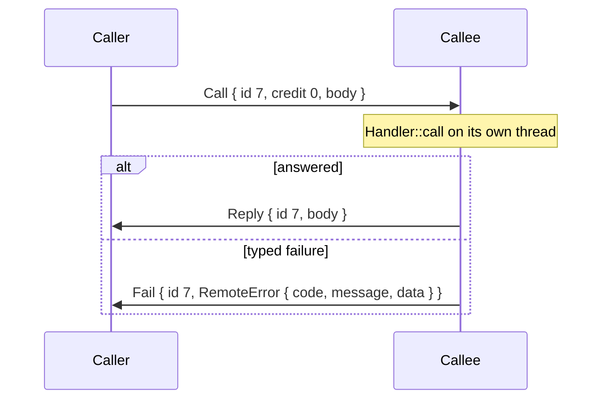
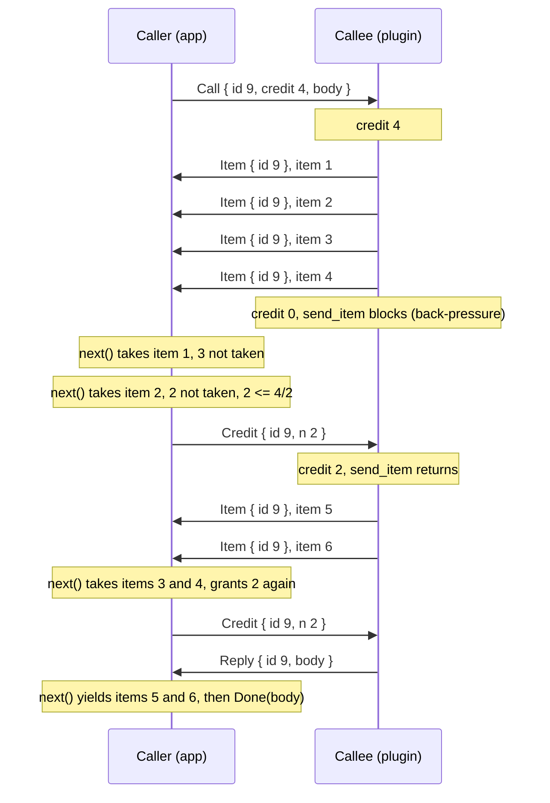
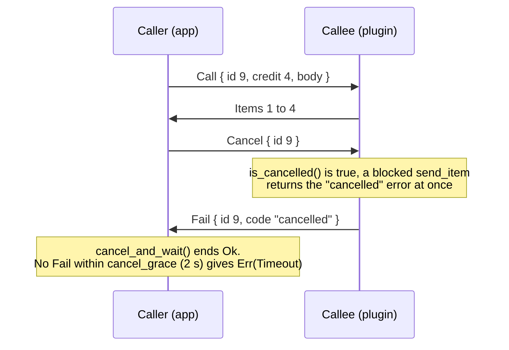

# The IPC wire: postcard frames between an app and its child processes

How a Paddock app talks to the processes it runs beside it: plugins, workers and companions. This is the reference for
the wire itself (transport, framing, encoding, handshake, calls, streams, versioning) and for the plugin protocol that
rides on it. The decisions behind it are [ADR 0001](adr/0001-plugin-platform-crates.md) (the plugin platform) and Debrief
[ADR 0017](../apps/debrief/docs/adr/0017-one-ipc-out-of-process-plugins.md) (one IPC); this document describes what the
code does.

Status: the code read at `origin/main` `dfc9cdc94` (2026-10-30); the design read at the ADR commit as merged,
`286f49dab`, whose decisions are dated 2026-10-31.

- **Built** means it is in the code on `main`; every such statement cites the file and line.
- **Designed** means it is decided in ADR 0001 as revised on 2026-10-31 (branch `docs/adr-plugin-platform` at
  `a7c391053`) or in [ADR 0031](adr/0031-patience-not-wall-clocks.md) (with its 2026-10-31 amendment on that branch), and
  not built yet. Those parts are marked *Designed* where they appear.

Paths are relative to the repository root. `paddock-ipc` is `crates/paddock-ipc/src/`, the plugin API is
`crates/paddock-plugin-api/src/`, the plugin host is `crates/paddock-plugin-host/src/`.

## Contents

1. [Purpose and scope](#1-purpose-and-scope)
2. [Transport](#2-transport)
3. [Framing](#3-framing)
4. [Encoding: postcard](#4-encoding-postcard)
5. [Handshake and versioning](#5-handshake-and-versioning)
6. [Message model](#6-message-model)
7. [Streaming](#7-streaming)
8. [Namespaced extensions](#8-namespaced-extensions)
9. [Liveness and timeouts](#9-liveness-and-timeouts)
10. [Security and robustness](#10-security-and-robustness)
11. [Performance](#11-performance)
12. [Testing](#12-testing)
13. [Alternatives considered](#13-alternatives-considered)
14. [Glossary](#14-glossary)
15. [How to add a new request](#15-how-to-add-a-new-request)
16. [Open points found while writing this](#16-open-points-found-while-writing-this)

## 1. Purpose and scope

One wire carries every byte between an app and the processes it starts or finds on the same machine. There are two
layers, both postcard:

- **The frame layer** (`paddock-ipc`): a length-prefixed `Frame` enum with a handshake, calls, replies, streamed items,
  typed failures, cancels, credits and pushes. It knows nothing of what a call means.
- **The protocol layer**: each kind of child has its own request and reply enums, encoded as the `body` of a frame. The
  plugin platform's protocol is `PlatformRequest` and `HostCall` (`paddock-plugin-api/src/protocol.rs`); an app's own
  contracts ride inside it as opaque `Extension` bodies (section 8).

### Who uses which implementation today

| Process pair | Wire code today | Notes |
|---|---|---|
| App and plugin, shared platform | `paddock-ipc` + `paddock-plugin-api` / `paddock-plugin-host` | built in Paddock 0.3.0 (plan X51); **no app links it yet** on `main` (no `Cargo.toml` under `apps/` names `paddock-ipc`) |
| Debrief and its plugins (protocol 1.1) | `debrief-ipc` + `debrief-plugin-api` | `apps/debrief/crates/debrief-plugin-api/src/protocol.rs:30`; moves to the platform in Debrief 1.2 (ADR 0003, packages PH1 to PH4) |
| Debrief and its store worker | `debrief-ipc` | ADR 0017 §8 |
| Debrief and its AI worker | `debrief-ipc`, `WorkerRequest` (`apps/debrief/crates/debrief-ai/src/worker/frames.rs:56`) | postcard frames, not JSON-RPC (section 13) |
| Dyno and its agent | `dyno-ipc` | Dyno 1.0 ships its own copy; it adopts the platform with tier 3 (ADR 0003, "Who uses what") |
| App and a companion it did not start (agent, service) | `paddock-ipc::link` | discovery file, reconnect with back-off (`link/mod.rs:1`) |

`debrief-ipc` and `paddock-ipc` share the frame layout and frame version 2, but they are **not wire compatible**: Debrief's
`RemoteError::code` is an `i32` (`apps/debrief/crates/debrief-ipc/src/error.rs:10`), Paddock's is a `String`
(`error.rs:37`), and Debrief's `Frame` has no `Push` (`apps/debrief/crates/debrief-ipc/src/frame.rs:91`). They never meet:
each app links one of them, and Debrief replaces `debrief-ipc` with `paddock-ipc` in PH1 (ADR 0003).

### Out of scope

- **No network and no listener.** The endpoint is a private Unix socket or an owner-only named pipe; there is no TCP
  anywhere in `paddock-ipc` (`endpoint/mod.rs:1`). This follows the family's local-first principle: apps are offline by
  default, and a child without a network grant opens no socket at all.
- **Loopback HTTP that exists elsewhere** is not this wire: Debrief's AI worker talks to its own child, the prebuilt
  `llama-server`, over HTTP on 127.0.0.1 with a random key (`apps/debrief/crates/debrief-ai-worker/src/child.rs:1`,
  `http.rs:1`); `paddock-mcp` speaks MCP's JSON-RPC to MCP clients; Pitwall keeps HTTP on loopback for its public API
  (`crates/README.md`, `paddock-ipc` section).
- **In-process plugins.** There are none: plugins run out of process only (ADR 0001, "Decision").

## 2. Transport

**Built.** `paddock-ipc/src/endpoint/`.

### The host listens, the child connects

The host (the app, or a worker that hosts plugins) creates a private endpoint and a token **before** it starts the child,
then starts the child and accepts its connection (`launch.rs:188`). Nothing is inherited: the child learns the endpoint
name and the token from its bootstrap, one JSON line on stdin (`launch.rs:24`, read in `child.rs:22`, at most
`MAX_BOOTSTRAP` = 64 KiB, `child.rs:19`), and connects to it. Stdin stays open as the child's **lifeline**: when it
closes (the host stopped it or died), the child exits (`child.rs:42`).

```text
Bootstrap (JSON, one line on stdin)
{ "endpoint": "<socket path or pipe name>", "token": "<64 hex digits>", "maxFrame": 16777216,
  "role": "", "extra": <app data, e.g. the plugin's SandboxSpec> }
```

`launch` also starts the child through `paddock-proc`: a clean environment (`ChildSpec::clean_env`, on by default), no
console window, its own process group, a kill-on-close job object on Windows, the tree ended when `Child` drops, and an
optional memory cap (`launch.rs:1`, `launch.rs:77`). It waits for the connection only while the child runs and only from
the pid it started (`launch.rs:245`).

### Unix: a socket in a private folder

| What | Value | Where |
|---|---|---|
| Folder | `<base>/paddock-<16 hex digits>/`, created with mode 0700 and set to 0700 again against a permissive umask | `endpoint/unix.rs:36`, `unix.rs:42`, `unix.rs:48` |
| Socket | `s.sock` in that folder | `unix.rs:37` |
| Base, in order | the app's runtime folder (`Listener::bind_in`), then `std::env::temp_dir()`, then `/tmp` | `unix.rs:31` |
| Longest socket path | 100 bytes (`MAX_SOCKET_PATH`; the OS limit is about 104); a longer path tries the next base | `unix.rs:12`, `unix.rs:38` |
| Clean-up | the folder is removed when the listener drops; `launch` keeps the `Host` inside `Child` for that reason | `unix.rs:136`, `launch.rs:121` |
| Peer pid | `SO_PEERCRED` (Linux), `LOCAL_PEERPID` (macOS); other Unixes: unknown, the token still authenticates | `unix.rs:192`, `unix.rs:216`, `unix.rs:235` |
| Peer uid | `SO_PEERCRED` / `getpeereid`, recorded on the `Connection` | `unix.rs:242`, `unix.rs:266`, `handshake.rs:147` |

`launch` uses `Host::listen`, so a launched child's socket lives under the temporary folder (`launch.rs:189`,
`handshake.rs:243`); `Host::listen_in` puts it in the app's runtime folder. Each listener has its own folder, so each
launched child (each plugin process) has a socket folder of its own.

### Windows: an owner-only named pipe

| What | Value | Where |
|---|---|---|
| Name | `\\.\pipe\paddock-<24 hex digits>` | `endpoint/windows.rs:209` |
| Access list | `D:P(A;;GA;;;OW)`: the owner only (`Access::owner_only`) | `endpoint/mod.rs:36` |
| Squatting | the first instance is created with `FILE_FLAG_FIRST_PIPE_INSTANCE`, so a pipe someone created earlier makes it fail | `windows.rs:150`, `windows.rs:177` |
| Remote clients | refused (`PIPE_REJECT_REMOTE_CLIENTS`) | `windows.rs:186` |
| Buffers | 64 KiB each way, byte mode, overlapped I/O (one thread reads while another writes) | `windows.rs:38`, `windows.rs:175` |
| Client | opens with `SECURITY_SQOS_PRESENT | SECURITY_IDENTIFICATION`, so the server cannot act as the client | `windows.rs:300` |
| Peer pid | `GetNamedPipeClientProcessId` | `windows.rs:257` |

A service that serves the logged-on user's app (Pitcrew) uses a fixed endpoint with
`Access::service_for_interactive_users()`: SYSTEM, Administrators and the owner get full access, interactive users read and
write (`endpoint/mod.rs:46`, `Listener::bind_fixed` at `mod.rs:71`).

### Companions the app did not start

An agent or service runs a `LinkServer` on a fixed endpoint and writes a **discovery file** (endpoint, token, pid, build,
protocol), owner-only and atomically; the app's `LinkClient` reads it (at most `MAX_DISCOVERY` = 16 KiB), ignores a stale
or untrusted file, and reconnects with back-off (`link/discovery.rs:1`, `discovery.rs:12`). A `LinkServer` caps
`max_connections` (64) and `max_handshakes` (16) and refuses the rest as `busy` (`link/server.rs:78`, `server.rs:174`).

## 3. Framing

**Built.** `paddock-ipc/src/frame.rs`.

```text
frame = len:u32 little-endian | body:postcard(Frame)       len counts the body only
```

| Constant | Value | Where | Meaning |
|---|---|---|---|
| `LEN_BYTES` | 4 | `frame.rs:24` | the length prefix, a `u32` in little-endian order |
| `VERSION` | 2 | `frame.rs:16` | the frame layout version, sent in `Hello` and `Welcome` |
| `DEFAULT_MAX_FRAME` | 16 MiB (`16 << 20`) | `frame.rs:18` | a connection's limit unless configured |
| `HARD_MAX_FRAME` | 64 MiB (`64 << 20`) | `frame.rs:20` | no connection accepts more, whatever its configuration |
| `MIN_FRAME` | 1 KiB | `frame.rs:22` | no connection is configured below this, so a handshake always fits |
| `HEAD_BYTES` | 16 | `frame.rs:26` | bytes read from an oversized frame to learn which call it belonged to |

`FrameLimit::new` clamps any configured limit to `MIN_FRAME..=HARD_MAX_FRAME` (`frame.rs:34`). The host's limit travels to
the child in `Bootstrap::max_frame` (`launch.rs:224`), so both sides use the same one; the plugin host's is
`HostConfig::max_frame`, 16 MiB by default (`paddock-plugin-host/src/config.rs:66`).

### What a reader does with each length

`read_body` (`frame.rs:419`) reads the prefix, then:

| Announced length | Result | Connection |
|---|---|---|
| at most the limit | the body is allocated at exactly that size and read in full | stays |
| over the limit, at most 64 MiB | read past in small pieces into a sink, never allocated; the first 16 bytes are kept to name the call (`peek_head`, `frame.rs:264`); `FrameError::Skipped` | stays, and only the call it belonged to fails (section 10) |
| over 64 MiB | `FrameError::TooLarge` from the prefix alone | ends |

The writer refuses to send a frame over its limit (`encode`, `frame.rs:331`): nothing is written and the call fails with
`IpcError::TooLarge` (`error.rs:86`).

### Short frames, partial reads and trailing bytes

- The prefix is read in a loop that retries `Interrupted` and accepts partial reads (`frame.rs:422`). End of stream
  before the first byte is `FrameError::Closed` (a clean close); end of stream inside the prefix or the body is
  `FrameError::Io("the stream ended inside a frame")` (`frame.rs:425`, `frame.rs:407`).
- The body is read with `read_exact`, which waits for the rest of a partial read (`frame.rs:414`).
- A body must be **exactly one** `Frame`: trailing bytes are `FrameError::Invalid` (`decode_body`, `frame.rs:360`), as
  are trailing bytes after a protocol body (`wire::decode`, `wire.rs:18`).
- `decode` (`frame.rs:373`) is the buffered form: it returns `Ok(None)` until the buffer holds a whole frame. The fuzz
  target checks that it and the streaming reader agree (section 12).

### The `Frame` enum

Variant indexes matter: they are the first byte of every frame body (section 4), and `peek_head` relies on them.

| Index | Variant | Fields | Sent by | Meaning |
|---|---|---|---|---|
| 0 | `Hello` | `version: u16, protocol: ProtocolVersion, token: [u8; 32], pid: u32` | connecting side, first | frame version, protocol, token and pid (`frame.rs:155`) |
| 1 | `Welcome` | `version: u16, protocol: ProtocolVersion` | listening side | the hello was accepted (`frame.rs:166`) |
| 2 | `Call` | `id: u64, credit: u32, body: Vec<u8>` | either side | a request; `credit` > 0 makes it a streamed call (`frame.rs:174`) |
| 3 | `Reply` | `id: u64, body: Vec<u8>` | callee | the single answer, after any items (`frame.rs:183`) |
| 4 | `Item` | `id: u64, body: Vec<u8>` | callee | one streamed item (`frame.rs:190`) |
| 5 | `Fail` | `id: u64, error: RemoteError` | callee, or the host refusing a handshake with id 0 | a typed failure (`frame.rs:197`) |
| 6 | `Cancel` | `id: u64` | caller | the caller gave up (`frame.rs:204`) |
| 7 | `Credit` | `id: u64, n: u32` | caller | `n` more items allowed (`frame.rs:209`) |
| 8 | `Push` | `body: Vec<u8>` | either side | an unanswered event (`frame.rs:216`); added at the end for Dyno, so older readers never receive it |

## 4. Encoding: postcard

**Built.** Every frame and every protocol body is [postcard](https://docs.rs/postcard/1.1.3/postcard/) 1.x
(`Cargo.toml` asks for `postcard = "1"`; `crates/Cargo.lock` pins 1.1.3), licence MIT OR Apache-2.0 (its `Cargo.toml`).
`wire::encode` and `wire::decode` (`wire.rs:13`, `wire.rs:18`) are the only entry points the protocols use.

### How serde types map to bytes

Measured on 2026-10-30 with a scratch program that links `paddock-ipc` from this commit and encodes invented values
(synthetic data; not a benchmark, the bytes are deterministic):

| Rust value | Bytes (hex) | Rule |
|---|---|---|
| `1u32`, `127u32` | `01`, `7f` | unsigned integers above `u8` are LEB128 varints: 7 bits per byte, high bit = more |
| `128u32`, `300u32` | `80 01`, `ac 02` | |
| `u64::MAX` | `ff ff ff ff ff ff ff ff ff 01` | at most 10 bytes for a `u64` |
| `1u16` | `01` | `u16` is a varint too |
| `200u8` | `c8` | `u8` is one raw byte |
| `-1i32`, `1i32` | `01`, `02` | signed integers are zigzag-encoded, then varints |
| `true` | `01` | one byte, 0 or 1; anything else is an error |
| `0.25f32` | `00 00 80 3e` | floats are raw little-endian IEEE 754 |
| `None::<u32>`, `Some(5u32)` | `00`, `01 05` | a tag byte, then the value |
| `"hi"` | `02 68 69` | a varint length, then UTF-8 |
| `vec![1u8, 2, 3]` | `03 01 02 03` | a varint count, then the elements |
| `[1u8, 2, 3, 4]` | `01 02 03 04` | fixed-size arrays have no length (the 32-byte token is 32 raw bytes) |
| `()` | (nothing) | unit takes no bytes; a reply of `()` is an empty body |
| `Ok::<u32, String>(7)` | `00 07` | `Result` is an enum: `Ok` = 0, `Err` = 1 |
| enum variant 1 with `{ text: "hi" }` | `01 02 68 69` | an enum is its variant **index** as a varint, then the variant's fields |
| a struct `{ major: 2, minor: 0 }` | `02 00` | a struct is its fields in declaration order; **no names, no count** |

And on the wire, prefix included:

| Frame | Bytes (hex) | Size |
|---|---|---|
| `Cancel { id: 1 }` | `02 00 00 00 06 01` | 6 |
| `Credit { id: 1, n: 2 }` | `03 00 00 00 07 01 02` | 7 |
| `Reply { id: 1, body: [] }` (a `()` reply) | `03 00 00 00 03 01 00` | 7 |
| `Call { id: 1, credit: 0, body: [] }` | `04 00 00 00 02 01 00 00` | 8 |
| `Call { id: 1, credit: 4, body: [aa bb cc] }` | `07 00 00 00 02 01 04 03 aa bb cc` | 11 |
| `Item { id: 300, body: [01] }` | `05 00 00 00 04 ac 02 01 01` | 9 |
| `Welcome { version: 2, protocol: 2.0 }` | `04 00 00 00 01 02 02 00` | 8 |
| `Hello { version: 2, protocol: 2.0, token, pid: 4242 }` | `26 00 00 00 00 02 02 00` + 32 token bytes + `92 21` | 42 |

So the frame costs 4 bytes of prefix plus 2 to 20 bytes of envelope (variant, id, credit and the body's length, all
varints: 2 for `Cancel { id: 1 }`, at most 1 + 10 + 5 + 4 for a `Call` with the largest id and credit and a body near
the 64 MiB cap), and the body is the protocol message's own postcard bytes. The body is encoded once on its own and then
copied into the frame (`peer.rs:451`, `frame.rs:332`).

### Why postcard

- **Compact**: varints and no field names, as the tables show.
- **No schema compiler**: the wire types are ordinary `#[derive(Serialize, Deserialize)]` Rust types; no `protoc`, no
  `build.rs`, no generated code (Debrief ADR 0017 removed three `build.rs` files and a `proto/` folder with gRPC).
- **The same types on both sides**: a plugin and its host link the same `paddock-plugin-api` crate, so the request a
  host encodes is the type the plugin decodes. Plugins are Rust only (Debrief ADR 0017, ADR 0001).
- **A stable format**: postcard documents its wire format as stable since 1.0.0 (its `README.md`, "Format Stability";
  the specification is at <https://postcard.jamesmunns.com>, not re-read for this document).
- **Fast**: not measured for this wire yet; see section 11.

### Its limits, and the rules they impose

postcard is **not self-describing**: the bytes carry no field names, no types and no lengths for structs. A reader must
know the exact type the writer used. That gives the rules in `lib.rs:13` and `wire.rs:3`:

- Wire types never use `#[serde(untagged)]`, `#[serde(flatten)]`, internally tagged enums or `skip_serializing_if`
  (each needs a self-describing format or changes the number of fields written).
- A wire type cannot hold a bare `serde_json::Value` (it needs `deserialize_any`). Values that are JSON by nature (tool
  arguments and results, settings, view documents) are wrapped in `Json`, which crosses as JSON **text** inside postcard and
  as the value itself in human-readable formats (`wire.rs:29`, `wire.rs:51`). `serde_json` is built with
  `float_roundtrip` so a number crosses unchanged (`Cargo.toml`, found by the fuzz target).
- **Field order is the format.** Reordering fields or variants, inserting one in the middle, or changing a field's type
  changes the meaning of every byte after it (section 5 shows what that does).

## 5. Handshake and versioning

**Built.** `paddock-ipc/src/handshake.rs`, `frame.rs:50` to `frame.rs:148`; the plugin policy in
`paddock-plugin-api/src/compat.rs`.

### Two version numbers

| Number | Type | Today | Meaning |
|---|---|---|---|
| Frame version | `u16` | `VERSION = 2` (`frame.rs:16`) | the layout of `Frame` itself; any difference is refused |
| Protocol version | `ProtocolVersion { major: u16, minor: u16 }` (`frame.rs:56`) | plugin platform: `PLATFORM_PROTOCOL = 2.0` (`protocol.rs:20`); Debrief's own plugins: `PROTOCOL = 1.1` (`apps/debrief/crates/debrief-plugin-api/src/protocol.rs:30`); unversioned links: `0.0` (`frame.rs:65`) | the bodies' protocol |
| Namespace minor | `u16`, the major is in the namespace's name | per contract (`extension.rs:39`) | an app contract inside `Extension` (section 8) |

### The exchange



- The host reads the two version numbers **before** decoding the rest of the `Hello` (`handshake_versions`,
  `frame.rs:386`), because a peer of another version may lay the rest out differently. Then it decodes the whole frame
  and checks the token in constant time (`token.rs:53`, using `subtle`), the claimed pid against the OS's
  (`handshake.rs:209`) and, for a launched child, against the pid it started (`handshake.rs:217`).
- A refusal is `Fail { id: 0, error }` with code `version` or `auth` (`handshake.rs:157`, codes at `error.rs:28` and
  `error.rs:30`); the client maps them to `IpcError::Version` and `IpcError::Auth` (`handshake.rs:390`). A `LinkServer`
  over its connection cap answers `busy` the same way (`handshake.rs:132`).
- Each handshake is bounded by `HANDSHAKE_TIMEOUT` = 10 s on an injected clock; a watchdog thread closes the stream when
  it passes, so a silent client holds only its own handshake (`handshake.rs:22`, `handshake.rs:81`).

### The version gate

`ProtocolVersion::accepts` (`frame.rs:74`) is the one rule, used for the platform protocol and for each namespace:

```text
host accepts child  <=>  host.major == child.major  and  child.minor <= host.minor
```

`skew` (`frame.rs:81`) says who must update, and `mismatch` (`frame.rs:106`) words it:

| Host | Child | Result | Who updates |
|---|---|---|---|
| 2.0 | 2.0 | accepted | |
| 2.3 | 2.1 | accepted: the host serves older minors | |
| 2.1 | 2.3 | refused, `Skew::HostBehind` | the app ("needs a newer Debrief") |
| 2.0 | 1.1 | refused, `Skew::ChildBehind` | the plugin ("is too old") |
| 2.0 | 3.0 | refused, `Skew::HostBehind` | the app |

On top of the handshake, the plugin host judges a plugin's manifest and `Describe` with `HostInfo`
(`compat.rs:73`, `compat.rs:111`, `compat.rs:148`) and words a `Refusal` (`compat.rs:254`):

| `Refusal` | When | Text (from `compat.rs`) |
|---|---|---|
| `Legacy` | built for protocol 1 (Debrief's own, before the platform) | "plugin X was built for an older contract (protocol 1.1; this Debrief speaks 2.0); update it" |
| `PluginTooOld` | built for an older major other than 1 | the same text |
| `AppTooOld` | a newer minor or major, or a namespace the app does not serve | "plugin X needs Debrief 1.4 or newer" when the release that introduced it is known (`introduced_in`, `frame.rs:93`) |
| `Mismatch` | `Describe` disagrees with the verified manifest (tools, views, settings, MCP tools, namespaces, version, protocol) | names the difference |

A refusal is not a fault: the supervisor sets the plugin's status to `Refused` and counts nothing
(`supervisor.rs:408`). *Designed:* PH3 rewords the texts: `PluginTooOld` to "install a version built for this app", `Legacy` to
"was built for an older Debrief and is no longer supported" (ADR 0001, "Versioning and compatibility").

### Evolution rules

What the code and its doc comments state (`lib.rs:13`, `wire.rs:5`, `frame.rs:57`):

- **Minor change:** adding a variant **at the end** of an enum. A newer host may then send a request an older child does
  not know, so the host must not send a variant newer than the child's minor (the child's minor is known from its
  `Hello` and, for a namespace, from its manifest; `Supervisor::remote` sends the plugin's declared minor,
  `supervisor.rs:798`). A child that receives an unknown variant anyway answers `Fail { code: "invalid" }`
  (`peer.rs:908`): one call fails, the process is fine.
- **Major change:** anything else.

The evolution of every kind of change, measured with invented `v1` and `v2` types through `wire::encode` and
`wire::decode` (the same scratch program as section 4):

| Change from v1 to v2 | v2 bytes read by v1 | v1 bytes read by v2 | Verdict |
|---|---|---|---|
| Variant appended at the end of an enum | the new variant: error ("not valid"); the others decode | decodes | **minor**, as long as nobody sends the new variant to a v1 reader |
| Field appended at the end of a top-level struct | error: "1 trailing bytes" | error: "Hit the end of buffer", even with `#[serde(default)]` | **major** |
| Field appended to a struct nested before other data | error **or a silent misread**: v2 `(Opts { n: 1, verbose: true }, vec![])` = `01 01 00` decodes in v1 as `(Opts { n: 1 }, [0])` | error ("Found a bool that wasn't 0 or 1") **or a silent misread**: the new field takes the next value's bytes | **major**, and dangerous in both directions |
| Variants reordered, or one inserted in the middle | every later variant changes meaning | the same | **major** |
| A field's type changed | misread or error | misread or error | **major** |
| A field added to a type that crosses as `Json` (for example `Described`) | serde_json ignores unknown fields | decodes only if the new field is an `Option` or has `#[serde(default)]` | **minor** under that condition |

So, on this wire, **appending a struct field is not a compatible change**: postcard has no field count, and
`#[serde(default)]` does not help because the reader runs out of bytes or finds extra ones. To add data compatibly, add a
new variant at the end that carries the new fields (`Echo` stays, `EchoWith { text, verbose }` is appended), or put the
extensible part in a `Json` value. Section 16 lists two places whose doc comments say otherwise.

### Policy before v1, and the support window

- **No compatibility before v1** (rule set and user decision, recorded in ADR 0001 "Versioning and compatibility"):
  `PLATFORM_PROTOCOL` stays 2.0 while no app has shipped it, even when variants are appended (*Designed:*
  `HostCall::Extension` and ADR 0031's `Progress` frame are added without a protocol bump; the frame version goes to 3
  for the handshake's capabilities, section 9). The minor rule applies from the first
  release that ships 2.0.
- **No compatibility across a major, binary or source.** A plugin built for an older major is refused at the handshake
  and from its manifest (`Refusal::PluginTooOld`), and Debrief's protocol 1 is refused as no longer supported
  (`Refusal::Legacy`). There is no binary legacy mode and no source shim; Debrief removes old installed plugins on the
  first start of 1.2 (ADR 0001 and ADR 0003 at `docs/adr-plugin-platform` `a7c391053`, user decision 2026-10-31). The
  frozen protocol-1 program `paddock-plugin-fixture-v1` keeps the refusal tested
  (`crates/paddock-plugin-test/src/bin/fixture_v1.rs`; the expected text is asserted in
  `crates/paddock-plugin-host/tests/it/faults.rs:240`).
- **Support window for the previous major: none before v1.** Whether a later major keeps the previous one working for a
  while is to be decided by an ADR once the platform has shipped a major to third parties (same source). An earlier draft
  of that revision kept a source-level shim for two minor releases; it was withdrawn on 2026-10-31.

## 6. Message model

**Built.** `paddock-ipc/src/peer.rs`.

After the handshake both sides are symmetric `Peer`s: either side may call the other, stream from it, cancel, and push.
Threads, not async (`peer.rs:6`): a reader thread dispatches incoming frames and never blocks on them, a writer thread
sends queued frames, each incoming call runs on a thread of its own (`peer.rs:558`), and pushes go to a push thread.

### Calls and ids

- The caller picks the id: a counter per peer starting at 1 (`peer.rs:238`, `peer.rs:367`). Id 0 is never a call; it is
  the handshake refusal. Ids are **per direction**: the calls I made (`pending`) and the calls I serve (`served`) are
  separate maps (`peer.rs:174`), so both sides can use id 5 at once.
- `Reply`, `Item` and `Fail` frames go to my pending calls; `Call`, `Cancel` and `Credit` frames to the calls I serve
  (`on_frame`, `peer.rs:640`). An answer for an id I no longer wait for (it timed out or was cancelled) is dropped
  (`peer.rs:494`).

### A unary call



`Peer::call` (`peer.rs:421`) sends the call and waits for the answer, at most the timeout it is given (`None`: as long as
the connection lives). `Peer::request` is the typed form (`peer.rs:446`); on the other side `typed` turns a function of
typed request and reply into a `Handler`, and a request that does not decode is answered `invalid` (`peer.rs:64`,
`peer.rs:908`).

### Concurrency and `busy`

`PeerOptions::max_concurrent_calls` (default **64**, `peer.rs:110`) is how many calls of the other side this side
handles at once. Call 65 is answered at once with `Fail { code: "busy" }` and not run (`peer.rs:542`). A call whose
thread cannot be started is refused the same way (`peer.rs:587`). The plugin host keeps the default: a plugin process can
run up to 64 calls at once, each on its own thread (ADR 0001, "Parallelism and cost" says this is a ceiling, and the app's
executor decides real parallelism).

### Cancelling

There are two different things:

- **`Cancel` frame (built):** the caller gave up on one call. The callee's `CallCtx::is_cancelled()` becomes true
  (`peer.rs:654`, `peer.rs:839`); a handler that checks it returns `CallCtx::cancelled_error()` (`cancelled`,
  `peer.rs:849`). A caller whose timeout passes sends `Cancel` and then waits `cancel_grace` (`CANCEL_GRACE` = 2 s,
  `peer.rs:32`) for the call to end; if it does not, or ends with a cancellation, the result is `IpcError::Timeout`, which
  the plugin host counts as a hang (`peer.rs:425`, `supervisor.rs:561`). Closing the connection cancels every served call
  (`peer.rs:343`).
- **`PlatformRequest::Stop { task }` (built):** a plugin-level request that stops a **background task** the plugin
  announced with `HostCall::TaskStarted` (`protocol.rs:84`). It is an ordinary call, not a frame.

### Errors: a typed failure versus a crash

| What happened | The caller sees | Process failure? (`is_process_failure`, `error.rs:120`) | Plugin host (`supervisor.rs:539`) |
|---|---|---|---|
| The callee answered `Fail` | `IpcError::Remote(RemoteError)` | no | `HostError::Remote`, nothing counted; `cancelled` is `HostError::Cancelled` |
| The handler panicked (caught) | `Remote` with code `panic` | no for the IPC | a **fault** (`Crash`), process kept |
| One frame over the limit | `IpcError::TooLarge`, or `Remote` with code `tooLarge` | no | the host's own request: `Invalid`, nothing counted; the plugin's answer: the SDK will not send it and answers `tooLarge` instead (`peer.rs:576`), a **fault** (`Garbled`); see section 16 for a plugin that sends one anyway |
| No answer within the timeout plus `cancel_grace` | `IpcError::Timeout` | yes | a **fault** (`Hang`), process ended |
| Garbage, a repeated handshake, items beyond credit | `IpcError::Protocol`, connection closed | yes | a **fault** (`Garbled`), process ended |
| The connection ended | `IpcError::Closed` | yes | a **fault** (`Crash`), process ended |

`RemoteError` is `{ code: String, message: String, data: Option<Json> }` (`error.rs:35`). The IPC's own codes are
`unimplemented`, `invalid`, `internal`, `panic`, `cancelled`, `busy`, `tooLarge`, `version` and `auth` (`error.rs:12`);
a protocol adds its own (the plugin host answers a missing grant with `denied`, `protocol.rs:37`). The plugin protocol
also has its own typed failure **inside** a successful reply: most replies are `Result<Json, Fail>`, where `Fail` has an
optional `FailureReason` (`protocol.rs:172`); the host turns it into `HostError::Failed`. Faults count toward quarantine:
3 within 10 minutes by default (`crates/paddock-guard/src/quarantine.rs:31`).

### Calls from the child to the parent

Because the peer is symmetric, a plugin calls the app back **while it answers** a request, through `CallCtx::peer()`
(`peer.rs:834`); the reader never blocks, so this cannot deadlock the connection (test
`handlers_may_call_back_while_they_answer`, `tests/it/peer.rs:300`). The plugin protocol's calls back are `HostCall`
(`protocol.rs:110`), answered by `HostServices` (`paddock-plugin-host/src/services.rs:126`, `services.rs:233`):

| `HostCall` | Reply | Plugin-side timeout (`paddock-plugin-api/src/serve.rs`) | Limits |
|---|---|---|---|
| `ReadFile { id, offset, len }` | `Vec<u8>` | 60 s (`serve.rs:25`) | `len` at most `READ_CHUNK` = 1 MiB (`protocol.rs:23`); only files the app opened for this plugin |
| `Report { task, progress, note }` | `()` | 10 s (`serve.rs:23`) | |
| `TaskStarted`, `TaskFinished` | `()` | 10 s | |
| `Output { name, bytes, last }` | `Option<SavedOutput>` | 120 s (`serve.rs:27`) | pieces at most `OUTPUT_CHUNK` = 256 KiB, files at most `MAX_OUTPUT_BYTES` = 8 GiB, at most `MAX_OUTPUTS` = 8 open, names at most 200 characters (`protocol.rs:25` to `protocol.rs:31`) |
| `Elevated { tool, op, args, timeout_ms }` | `Result<Json, Fail>` | the operation's timeout + 10 s (`serve.rs:113`) | capped at `MAX_ELEVATED` = 1 h by the host (`services.rs:18`); only ops the manifest lists and the user granted |
| `Log { lines, dropped }` | `()` | 10 s | at most `MAX_LOG_BATCH` = 64 lines of `MAX_LOG_LINE` = 4096 bytes (`protocol.rs:33`, `protocol.rs:35`) |
| `Extension { ns, minor, body }` | the contract's reply bytes | | *Designed* (ADR 0001, package 2.6b): appended at the end of `HostCall`; an `ns` the app does not serve or the manifest does not list is `denied` |

### Pushes

`Peer::push` sends an event that is never answered (`peer.rs:482`). The receiver hands pushes to its push callback through
a bounded queue (`push_queue`, default 64, `peer.rs:112`); when the callback falls behind, newer pushes are **dropped and
counted** (`dropped_pushes`, `peer.rs:671`), so a slow listener never blocks the reader. The plugin protocol does not use
pushes; Dyno's agent link does.

## 7. Streaming

**Built** in `paddock-ipc` (`Peer::stream`, `CallStream`, `CallCtx::send_item`). *Designed* for plugins: the typed
`Remote<C>::stream` and `StreamContract` in ADR 0001 (package 2.6b). Today's plugin host has only unary calls
(`Remote::call`, `supervisor.rs:935`); Debrief's protocol-1 host streams through `debrief-ipc` with `CREDIT = 4`
(`apps/debrief/crates/debrief-plugin-host/src/process.rs:43`).

### Credits and back-pressure

- A streamed call is a `Call` with `credit` > 0: the callee may send that many `Item`s before the caller's first
  `Credit` (`frame.rs:172`). `Peer::stream` raises a credit of 0 to 1 (`peer.rs:459`). The default is `DEFAULT_CREDIT` =
  **4** (`peer.rs:34`).
- The callee's `CallCtx::send_item` **blocks** while it holds no credit, and fails once the call is cancelled or the
  connection closes (`peer.rs:855`). This is the back-pressure: a parser that produces faster than the app consumes
  waits inside `send_item`.
- The caller grants more only when its code **takes** items (`CallStream::next`, `peer.rs:757`), not when they arrive:
  after each item taken, if the items granted but not taken have fallen to half the window or less, it grants the
  difference back up to the window (`peer.rs:767`). With credit 4 that is `Credit { n: 2 }` after every second item;
  with credit 1, `Credit { n: 1 }` after every item.
- The caller counts items per call; an item beyond what it granted, or an item for a call that does not stream, is a
  protocol error that **closes the connection** (`peer.rs:497`, `peer.rs:507`).
- At most `credit` items of one call are in flight, each at most one frame. Debrief's protocol 1 caps an event item at
  `MAX_EVENTS_PER_ITEM` = 8,192 events or about `ITEM_BYTES` = 4 MiB
  (`apps/debrief/crates/debrief-plugin-api/src/protocol.rs:33`, `:35`), so a credit-4 import stream holds at most about
  16 MiB in flight.

### A stream, with the actual numbers (credit 4)



The stream ends with exactly one `Reply` (`StreamEvent::Done`) or one `Fail` (an `Err` from `next`), `peer.rs:774`. A
`next` with a timeout that passes yields `StreamEvent::Idle` and the call keeps running (`peer.rs:741`).

### A slow consumer

Nothing is buffered beyond the credit: the app's side holds at most the granted items in its channel, and the plugin
waits in `send_item` until the app takes some. Test: `a_slow_consumer_holds_the_producer_back`
(`tests/it/peer.rs:149`).

### Cancelling mid-stream



`CallStream::cancel` sends the `Cancel` (`peer.rs:790`); `cancel_and_wait` also waits up to `cancel_grace` for the end
(`peer.rs:797`). **Dropping** a `CallStream` before its end cancels the call and forgets it, so later items are dropped
(`peer.rs:816`).

*Designed (ADR 0001, package 2.6b):* `Remote<C>::stream(&request, credit) -> RemoteStream<C>` under the supervisor's guard,
where `C: StreamContract` adds `type Item`; a plugin registers `Contributions::add_stream_extension::<C>` and gets an
`ItemSink<C::Item>` whose `send` blocks without credit. A garbled item, more items than credits, or a stall is a fault of
the plugin. Each item counts as call progress for ADR 0031.

## 8. Namespaced extensions

**Built** for the app-to-plugin direction (`PlatformRequest::Extension`, `protocol.rs:89`; `extension.rs`;
`Remote<C>`, `supervisor.rs:912`). *Designed* for plugin-to-app (`HostCall::Extension`, section 6).

The platform knows nothing of an app's domain. An app defines a contract crate with its own request and reply enums and
implements `Contract` (`extension.rs:35`):

```rust
pub trait Contract: 'static {
    const NS: &'static str;   // namespace, major version in the name: "debrief.import.v1"
    const MINOR: u16;         // the newest minor this code knows
    type Request: Serialize + DeserializeOwned;
    type Reply: Serialize + DeserializeOwned;
}
```

- **Opaque bodies.** The app encodes `C::Request` with postcard and sends
  `PlatformRequest::Extension { ns, minor, body }` (`supervisor.rs:946`). The plugin's `serve` routes by `ns` and never
  decodes `body` itself; the registered handler decodes it as its own `C::Request` (`extension.rs:90`,
  `extension.rs:103`). The reply is `C::Reply`'s postcard bytes, passed through as they are.
- **Majors are names.** `debrief.import.v2` is a different namespace, which a host serves or does not (`compat.rs:5`).
- **Minors inside a namespace** follow the same rule as the protocol (`compat.rs:123`): the manifest lists each
  namespace with its minor (`ns = "debrief.import.v1/0"`), `HostInfo::check_extension` refuses a plugin that needs a newer
  minor than the app serves (`compat.rs:111`), `Supervisor::remote` refuses a plugin whose declared minor is newer than
  `C::MINOR` and otherwise sends the **plugin's** declared minor (`supervisor.rs:808`, `supervisor.rs:825`), and the
  plugin refuses a request for a newer minor than it knows with code `version` and "update it" (`extension.rs:117`).
  Conformance checks that last refusal (`crates/paddock-plugin-test/src/conformance.rs:145`).
- An unknown namespace is `unimplemented` (`extension.rs:111`).

The same evolution rules as section 5 apply inside a namespace: appending a variant to `C::Request` or `C::Reply` raises
`MINOR`; anything else is a new namespace (`.v2`). Debrief's planned namespaces (`debrief.describe.v1`, `.import.v1`,
`.config.v1`, `.annotate.v1`, `.view.v1`, `.transform.v1`, `.profile.v1`, `.document.v1`) and the mapping from protocol 1
are in ADR 0003 (*Designed*, package 0.5 fixes the enums).

## 9. Liveness and timeouts

### Today: fixed time limits (built)

| Bound | Value | Where | ADR 0031 class |
|---|---|---|---|
| Handshake, each side | 10 s | `HANDSHAKE_TIMEOUT`, `handshake.rs:22` | L (liveness) |
| Connect retry while a pipe is busy | 10 s | `handshake.rs:379` | L |
| Accept slice (how often the accept loop rechecks) | 50 ms | `ACCEPT_SLICE`, `handshake.rs:25` | not a bound |
| A child's start (`ChildSpec` default) | 30 s | `launch.rs:90` | L |
| A plugin's start and `Describe` | 15 s | `HostConfig::start_timeout`, `config.rs:64` | L |
| A plugin call without its own budget | 30 s | `HostConfig::call_timeout`, `config.rs:62` | L |
| Extra wait past timeout and cancel grace before a call is abandoned | 5 s | `HostConfig::hang_grace`, `config.rs:63` | L |
| Longest wait for a call without a budget | 1 h | `NO_BUDGET`, `supervisor.rs:41` | C (cap) |
| Cancel grace | 2 s | `CANCEL_GRACE`, `peer.rs:32` | S (shutdown) |
| Stop grace | 2 s | `HostConfig::stop_grace`, `config.rs:65` | S |
| Plugin waits for `Report`, `TaskStarted`, `TaskFinished`, `Log` | 10 s | `serve.rs:23` | L |
| Plugin waits for `ReadFile` | 60 s | `serve.rs:25` | L |
| Plugin waits for `Output` | 120 s | `serve.rs:27` | L |
| Elevated operation | the op's timeout, at most 1 h | `services.rs:18` | C |

All of `paddock-ipc`'s and the plugin host's waits run on an injected `Clock`, so tests use a `FakeClock` and never
sleep (`PeerOptions::clock`, `peer.rs:89`; `Host::with_clock`, `handshake.rs:289`; `HostConfig::clock`, `config.rs:16`).
A call's wait for its answer is event driven: an arriving frame ends the wait at once (`peer.rs:392`).

### Designed: stalls judged on progress (ADR 0031)

ADR 0031 replaces the liveness bounds (class L above) with a **stall judgement**; ADR 0001's revision lists the plugin
host's instances and assigns them to packages 2.6c and 2.6d. Nothing of it is built yet.

- The host's monitor thread wakes every beat (1 s by default); each wake-up is one **host tick**, however late, so a
  paused machine spends no patience (ADR 0031 §2).
- Per call, at each tick, it reads **call progress** (an item streamed, a host call answered, a lent file read, a
  `Report`), the child's **CPU time** and its **run state**. A blocked call with no progress gains a blocked tick; a
  running one with no progress gains spin CPU time; a stopped, starved or I/O-waiting child gains nothing; and while the
  host owes the child an answer (a `HostCall` in flight) nothing counts. Any progress resets the counters. Stuck = N
  blocked ticks or C CPU-seconds of spin; N starts from today's values (15 ticks for a start), C is measured per call kind.
- The plugin SDK sends a new **`Progress`** frame from progress points only, never from a keep-alive timer
  (ADR 0031 §2). Whether a peer sends them is a **capability** agreed in the handshake, so a peer without it is judged
  on CPU time and run state alone (ADR 0031 §9).
- *Designed (ADR 0001 at `a7c391053`, "Capabilities in the handshake: frame version 3", package 2.6d):* a field cannot
  simply be appended to `Hello`, and a new `Hello` variant is refused by an older host (section 16, point 6). Instead
  `frame::VERSION` becomes 3, and in version 3 `Hello` and `Welcome` end with `caps: u32`, a bit set whose bit 0 is
  `progress`; later capabilities are new bits, never a layout change. A version-3 host reads the versions first
  (`handshake_versions`), accepts a version-2 `Hello` and answers with a version-2 `Welcome`, without capabilities. A
  version-3 client that a version-2 host refuses with `version` reconnects once with a version-2 `Hello`. A refusal is
  never a fault. Package 2.6d tests the four pairings of versions 2 and 3.
- A simpler route exists for peers that are always built together (a plugin and the app that ships its protocol): the
  protocol minor the `Hello` already carries says which frames the peer knows, so "minor at least N" can stand for
  "sends `Progress`" with no frame change. It does not cover peers whose protocol is unversioned (`0.0`) or that update
  separately, which is why the ADR chose the frame version.
- `call_timeout`, `hang_grace` and the fixed start window go; `NO_BUDGET` stays only as a cap where an operation declares
  one; `stop_grace` and `CANCEL_GRACE` stay (shutdown).

## 10. Security and robustness

The child is **not trusted**. A plugin parses untrusted files and may be third-party code; everything it sends is input
at the edge.

### What the child is trusted with

- The endpoint name and the token of **its own** connection (each launch has a fresh endpoint and a fresh 256-bit
  token, `token.rs:8`, `token.rs:16`). The token is never printed (`Debug` shows `Token(..)`, `token.rs:58`).
- Its bootstrap's `extra`: for a plugin, its `SandboxSpec` (`supervisor.rs:398`).
- Host files only by id and by range (`ReadFile`), never by path; only those the app opened for it
  (`HostFiles`, ADR 0017 §4).
- Nothing else: no app memory, no other plugin's connection, no listener.

### Bounds and parse-don't-validate

- **Size caps before allocation:** a length over the limit is never allocated (`frame.rs:437`); a length over 64 MiB
  ends the connection from the prefix alone. Bodies are decoded from that bounded slice, so a varint length that claims
  more than the frame holds is a decode error. (serde's derived sequence visitors also cap what they preallocate from a
  declared length, `size_hint::cautious`; that is serde's code, read but not tested here.)
- **One decode at the edge:** `decode_request` turns the bytes into the typed `PlatformRequest` or `HostCall` once
  (`peer.rs:908`, `serve.rs:432`, `services.rs:235`); handlers work with types. JSON inside (`Json`) is validated where
  it matters: tool arguments against the operation's schema, settings against the section, views by `paddock-view`.
- **Protocol caps** on top: `READ_CHUNK`, `OUTPUT_CHUNK`, `MAX_OUTPUTS`, `MAX_LOG_BATCH`, `MAX_LOG_LINE`,
  `MAX_ELEVATED`, `McpBudget` (section 6), `MAX_BOOTSTRAP` and `MAX_DISCOVERY` (section 2).
- **Queues:** the push queue is bounded and drops (section 6); streamed items are bounded by credits; served calls by
  `max_concurrent_calls`. The writer's outgoing queue is an unbounded channel (`peer.rs:225`); what can fill it is
  bounded in practice by those limits, but not for pushes and calls this side starts (section 16).
- **No panics on input:** decoding returns errors, never panics; a handler's panic is caught and answered `panic`
  (`peer.rs:564`); poisoned locks are recovered (`peer.rs:186`).

### A malformed frame ends only that peer

- One frame over the limit fails **one call**, and the connection stays: an oversized `Call` is answered `tooLarge`; an
  oversized `Reply`, `Item` or `Fail` fails the call waiting for it (and cancels it if it streams); an oversized `Push` is
  dropped and counted (`on_skipped`, `peer.rs:594`). This differs from `debrief-ipc`, which closes the connection on any
  oversized frame (Debrief ADR 0017 §1).
- Garbage, a frame that does not decode, a second `Hello`, items beyond credit, or a length beyond 64 MiB **close that
  connection**; every call on it fails with `Protocol` (`read_loop`, `peer.rs:702`). Other plugins' connections are
  untouched, and the supervisor counts a fault and restarts the process with back-off.

### Fuzz targets

| Target | What it checks | Where |
|---|---|---|
| `frame` | every frame decoder (`handshake_versions`, `peek_head`, `decode_body`, `decode`, `read_frame`) on arbitrary bytes: no panic, no allocation beyond the limit, whatever decodes encodes back to the same frame, the buffered and streaming decoders agree | `crates/paddock-ipc/fuzz/fuzz_targets/frame.rs` |
| `decode` | `paddock-view` documents, patches and actions from postcard and JSON, and the validator | `crates/paddock-view/fuzz/fuzz_targets/decode.rs` |
| `manifest`, `package` | the plugin manifest parser and the `.paddockplugin` archive reader | `crates/paddock-plugin-package/fuzz/fuzz_targets/` |

There is no fuzz target for `PlatformRequest` or `HostCall` bodies yet, and no CI workflow runs the shared crates' fuzz
targets (`debrief-fuzz.yml` and `app-fuzz.yml` take an app's fuzz folder; nothing passes `crates/paddock-ipc/fuzz`).
Property tests cover random bytes through the frame decoder (`tests/it/frame.rs:382`). See section 16.

### The sandbox

The wire is the child's only sanctioned channel to the app, which is why its endpoint is private and its token per
launch. What else the child can touch is the OS sandbox's job:

- **Built:** the host computes the plugin's `SandboxSpec` from manifest and grants (pure, `grants.rs`), passes it in
  `Bootstrap::extra`, enforces the memory cap through `paddock-proc` (default 1 GiB, 64 MiB to 4 GiB, `grants.rs:145`),
  grant-checks file reads and tool paths, and verifies the installed program's hash before every start
  (`supervisor.rs:369`).
- *Designed (ADR 0001, PH1):* `paddock-sandbox` enforces the spec at the OS level (AppContainer and job object on Windows,
  landlock and seccomp on Linux, `sandbox-exec` on macOS) through a new `ChildSpec::contain` port, and `serve` locks the
  child down before it handles any request. Debrief 1.2 does not ship without it.

## 11. Performance

### Per-call overhead: pending (rule 48)

No benchmark of this wire is recorded in [benchmarks.md](benchmarks.md) or an app's `performance.md`, so no number is
quoted here (rule 48). ADR 0001 ("Parallelism and cost") assigns the measurement to package 2.6b: an empty unary
`Extension` round trip, and a streamed call of N 64 KiB items at credits 1, 4 and 16, in-process fake against a real
child, on each OS; the default credit is chosen from it. The only IPC timing in `benchmarks.md` is a hang guard (Dyno IPC
under 280 ms), not a budget.

What each call costs, from the code (not timed):

- **Bytes:** 4 bytes of prefix plus 2 to 20 bytes of envelope (section 4), plus the body. A `Json` value is
  serialised to JSON text and parsed again on the other side.
- **Copies:** the body is encoded, then copied into the frame buffer (`frame.rs:332`); the reader allocates the body at
  its announced size and decodes from it.
- **Threads and hops:** one channel hop to the writer thread per frame (`peer.rs:360`), one OS thread started per served
  call (`peer.rs:558`), and one channel hop from the reader to the waiting caller.

### Batching guidance

- Never one call per record: stream batches. Debrief's protocol 1 sends up to 8,192 events or about 4 MiB per item
  (`MAX_EVENTS_PER_ITEM`, `ITEM_BYTES`); ADR 0001 keeps that as the 1.2 bound, and package 2.6b's benchmark may lower it.
- Lend files by range (`ReadFile`, 1 MiB pieces) instead of sending them whole; push outputs in 256 KiB pieces.
- Keep contract bodies postcard; use `Json` only where the value is JSON by contract.
- Keep items well under the frame limit: an item over 16 MiB fails the call.

### Threads and priority classes

- A plugin child serves live requests, so it is launched at normal priority: the plugin host leaves
  `ChildSpec::lower_priority` off (`supervisor.rs:391` to `supervisor.rs:404`). `lower_priority`, where a child uses it,
  is below-normal on Windows and nice 10 elsewhere (`crates/paddock-proc/src/command.rs:59`), not a starvable level.
- *Designed (ADR 0001, rule 52):* each contract request declares a role, `Contract::role(&Request) -> WorkRole`, default
  **Live**. **Bulk** calls (an import) run at the gentle level (`QOS_CLASS_UTILITY` on macOS, nice 10 on Linux,
  `THREAD_PRIORITY_BELOW_NORMAL` on Windows); **Live** calls (a sniff, a tail someone watches) at normal level. Nothing a
  person waits on runs at a starvable level (`QOS_CLASS_BACKGROUND`, `PRIO_DARWIN_BG`, `SCHED_IDLE`). Rule 52 is not on
  `main` yet; its text is on `fix/dyno-bundle-ui`.
- *Designed (ADR 0001, ADR 0024 §1):* a plugin that parses in parallel sizes its pool with
  `paddock_proc::threads(kind, class)`;
  CPU work gets cores minus one **in total**, so the app limits concurrent bulk calls across plugins.

## 12. Testing

### What exists

| Test | What | Where |
|---|---|---|
| Frame codec | every frame round-trips, every prefix asks for more bytes, limits clamp, oversized frames are skipped in step, lengths beyond the hard cap are refused from the prefix, garbage and trailing bytes are errors, random bytes never panic | `crates/paddock-ipc/tests/it/frame.rs` |
| Handshake and endpoints | token and pid checks, a client of another protocol is told which side to update, a non-hello first frame or another frame version is refused, private endpoints | `tests/it/basics.rs:293`, `:332`, `:347` |
| Peer | calls both ways, typed errors and contained panics, many calls matched to callers, credits, a slow consumer, drop cancels, deadlines, callbacks during a call, `busy`, pushes, oversized requests and replies fail one call, garbage closes | `tests/it/peer.rs` |
| Real child processes | launch, lifeline, stop, wrong token, environment and memory watch, bootstrap parsing, through the `paddock-ipc-test-child` binary | `tests/it/child.rs`, `src/bin/test_child.rs` |
| Fake clock | timeouts, cancel grace, idle streams, accept and handshake limits, all on a `FakeClock` | `tests/it/clocked.rs` |
| Plugin wire bodies | every `PlatformRequest` and `HostCall` round-trips through postcard; `Described` through JSON | `paddock-plugin-api/src/protocol.rs:310`, `:409` |
| Fake host | `FakeHost` calls a plugin in this process over a real `paddock-ipc` pair, answers its host calls from memory and records them | `crates/paddock-plugin-test/src/fake.rs:165` |
| Conformance | one line in every plugin's tests (`assert_conforms`): unknown requests refused, a newer namespace minor refused with "update it", malformed arguments never break the connection, views, limits, still alive afterwards | `crates/paddock-plugin-test/src/conformance.rs:53`, `:269` |
| Protocol-1 refusal | the frozen `paddock-plugin-fixture-v1` connects as protocol 1.1 and is refused | `crates/paddock-plugin-test/src/bin/fixture_v1.rs`, `crates/paddock-plugin-host/tests/it/faults.rs:240` |
| Fuzz | section 10 | `crates/*/fuzz/` |

### Checklist: adding a message type safely

1. Decide the layer: a platform request (`PlatformRequest`, `HostCall`) only if every app needs it; otherwise a variant of
   the app's own contract (section 8).
2. **Append** the variant at the end of its enum. Never insert, reorder, rename-by-moving, or change an existing field.
3. Need more data in an existing request? Append a **new variant** with the new fields, not a field on the old one.
4. Use only postcard-safe types: no `untagged`, `flatten`, internal tags, `skip_serializing_if`, bare `serde_json::Value`
   (wrap JSON in `Json`).
5. Bound every unbounded input: a byte or item cap as a named constant next to the type, checked on the receiving side.
6. Document the reply on the variant, as the existing variants do (`protocol.rs:39`).
7. Raise the minor (`Contract::MINOR`, or `PLATFORM_PROTOCOL.minor` after v1), and record the app release that
   introduced it (`NamespaceSupport::since`, `HostInfo::protocol_since`) so refusals can say "needs X 1.4 or newer".
8. On the sending side, never send the new variant to a peer whose minor is older.
9. Tests: extend the round-trip test (`protocol.rs:310` or the contract's), add a handler test through `FakeHost`, a
   test that an older peer answers the new variant with `invalid` and survives, and a test that over-limit input is
   refused.
10. Update this document's tables.

## 13. Alternatives considered

The decision is ADR 0001 ("Alternatives considered") and Debrief ADR 0017, which replaced gRPC. In short:

| Option | Why not |
|---|---|
| **gRPC** (protobuf over HTTP/2) | brings an HTTP/2 stack, an async runtime and code generation into every plugin and host for a link between two local processes; gRPC over TCP needs sockets the sandbox would have to allow, and a gRPC server is a listener, which local-first apps do not open. Debrief ran gRPC before ADR 0017 and needed HTTP/2 window tuning, a token interceptor, a trailer for typed errors and a 4 GiB message limit (ADR 0017, "Context"). |
| **protobuf** without gRPC | a schema compiler and generated code; its field tags would give real append-only field evolution, which postcard lacks. Plugins are Rust only, so a language-neutral schema buys nothing today. If non-Rust plugins come, protobuf can travel inside `Extension` bodies, in the same frames, without HTTP/2 (ADR 0001). |
| **FlatBuffers** | a schema compiler and generated code; zero-copy reads gain little for items of tens of KiB to a few MiB (ADR 0001; to be confirmed by package 2.6b's benchmark). |
| **Cap'n Proto** | considered and kept out in Debrief ADR 0002 (2026-10-17); the same weight argument as FlatBuffers (schema compiler, generated code) applies. ADR 0001 does not discuss it separately. |
| **JSON-RPC** | self-describing and easy to read, but larger and slower to parse, and every value is untyped until validated. See below. |
| **An async runtime in `paddock-ipc`** | not chosen: a synchronous core on threads with bounded queues (ADR 0001). `debrief-ipc` uses tokio; `paddock-ipc` does not. |

### JSON-RPC and the AI worker

The AI worker does **not** speak JSON-RPC on the wire today. Debrief ADR 0002 once planned "versioned JSON-RPC over stdio"
for workers; ADR 0017 replaced that. The worker's requests are a postcard `WorkerRequest` enum over `debrief-ipc` frames
(`apps/debrief/crates/debrief-ai/src/worker/frames.rs:1`, `:56`), and `Chat` streams token deltas as items with credits.
What remains of JSON-RPC is naming: the transport trait takes a method name and `serde_json::Value` parameters
(`apps/debrief/crates/debrief-ai/src/worker/transport.rs:27`), and the worker's error codes keep JSON-RPC's numbers "for readability" (`-32600`, `-32601`, ...,
`apps/debrief/crates/debrief-ai/src/worker/protocol.rs:23`). JSON over HTTP exists only between the worker and its own
child, `llama-server`, an external program whose API is HTTP (section 1).

**Convergence:** yes, as part of Debrief's move to `paddock-ipc` (PH1): the worker's frames move with `debrief-ipc`, and
its `i32` codes then need a mapping to `RemoteError`'s string codes. Replacing the `Value`-based transport trait with the
typed `WorkerRequest` is a separate, optional clean-up. The only real JSON-RPC in the family is MCP (`paddock-mcp`), which
is JSON-RPC by its specification and talks to clients we do not ship.

## 14. Glossary

| Term | Meaning |
|---|---|
| Body | the protocol's own postcard bytes inside a `Call`, `Reply`, `Item` or `Push` frame |
| Bootstrap | the one JSON line a launched child reads on stdin: endpoint, token, frame limit, role, extra |
| Call id | a `u64` the caller picks, unique per direction on a connection; 0 is the handshake refusal |
| Contract | an app's own request and reply enums for its plugins, named by a namespace (`Contract`) |
| Credit | how many more items the callee may send on a streamed call |
| Endpoint | a private Unix socket path or owner-only named pipe name |
| Extension | `PlatformRequest::Extension { ns, minor, body }`: a contract's request, opaque to the platform |
| Fault | a misbehaviour of the plugin (crash, panic, hang, garbled or oversized frame) counted toward quarantine |
| Frame | one length-prefixed, postcard-encoded `Frame` value |
| Frame limit | the largest frame body a connection accepts (`FrameLimit`, 16 MiB default, 1 KiB to 64 MiB) |
| Host | the side that listens: the app, or a worker that hosts plugins |
| Host call | a call from the plugin back to the app while it answers (`HostCall`) |
| Lifeline | the child's stdin, kept open by the host; the child exits when it closes |
| Namespace | a contract's name with its major version, such as `debrief.import.v1` |
| Peer | one side of an authenticated connection; calls go both ways |
| Push | an unanswered event frame; dropped and counted when the receiver lags |
| Refusal | a typed reason a plugin cannot be served, worded for the user; not a fault |
| Stall judgement | ADR 0031's replacement for liveness timeouts: progress, CPU time and run state per host tick |
| Token | 32 random bytes per launch, checked in constant time in `Hello` |
| Typed failure | a `Fail` frame or a `Fail` inside a reply: the call failed on purpose, the process is fine |

## 15. How to add a new request

A walkthrough for the most common case: a new request in an app's own contract. The example adds a `Count` request to an
invented contract `example.notes.v1` at minor 0.

**1. The contract crate (the app's, shared by host and plugin):** append the variant and raise the minor.

```rust
pub struct Notes;
impl Contract for Notes {
    const NS: &'static str = "example.notes.v1";
    const MINOR: u16 = 1; // was 0: Count was added
    type Request = NotesRequest;
    type Reply = NotesReply;
}

#[derive(Debug, Clone, PartialEq, Serialize, Deserialize)]
pub enum NotesRequest {
    /// Reply: `NotesReply::Found`.
    Find { text: String, limit: u32 },
    /// Reply: `NotesReply::Counted`. Minor 1.
    Count { text: String },               // appended at the end, never inserted
}

#[derive(Debug, Clone, PartialEq, Serialize, Deserialize)]
pub enum NotesReply {
    Found { ids: Vec<u64> },
    Counted { n: u64 },                   // appended at the end
}

/// Longest search text, checked by the plugin.
pub const MAX_TEXT: usize = 4096;
```

**2. The plugin:** handle it, check the bounds, honour cancel.

```rust
use paddock_plugin_api::prelude::*;
// `codes` and `CallCtx` are not re-exported by paddock-plugin-api today, so the plugin also depends on paddock-ipc
// directly (section 16, point 10; IP1 adds the re-exports).
use paddock_ipc::{CallCtx, codes};

contributions.add_extension::<Notes>(|ctx: &ExtCtx, req: NotesRequest| match req {
    NotesRequest::Find { text, limit } => find(ctx, &text, limit),
    NotesRequest::Count { text } => {
        if text.len() > MAX_TEXT {
            return Err(RemoteError::new(codes::INVALID, "the text is too long"));
        }
        let mut n = 0;
        for chunk in index_chunks() {
            if ctx.is_cancelled() {
                return Err(CallCtx::cancelled_error()); // code "cancelled"
            }
            n += chunk.count(&text);
        }
        Ok(NotesReply::Counted { n })
    }
});
```

The manifest declares the new minor: `ns = "example.notes.v1/1"`.

**3. The app:** serve the new minor, then call it only when the plugin's declared minor has it.

The app's `HostInfo` must list the namespace at the new minor. Otherwise the plugin, whose manifest now says minor 1, is
refused as `AppTooOld` at install (`installed.rs:302`) and in its status (`supervisor.rs:894`), and is never started:

```rust
let info = HostInfo::new("Notes app")
    .serving(NamespaceSupport::new("example.notes.v1", 1).since(1, "1.4")); // the app release that adds minor 1
```

Then, at the call site:

```rust
let notes: Remote<Notes> = supervisor.remote::<Notes>()?;   // refuses a plugin newer than Notes::MINOR
let declared = supervisor
    .manifest()                                             // supervisor.rs:130
    .namespaces()
    .find(|n| n.ns() == Notes::NS)
    .map_or(0, |n| n.minor);
if declared >= 1 {
    let reply = notes.call(&NotesRequest::Count { text })?; // a fault is attributed to the plugin
} else {
    // an older plugin: fall back (Find and count) or tell the user to update it
}
```

`Remote` sends the plugin's declared minor (`supervisor.rs:825`), but it does not stop the app from sending `Count` to a
plugin declared at minor 0; that plugin answers `invalid`. Hence the check above, until requests carry their own minor
(section 16, point 5).

**4. Tests:** round-trip `NotesRequest::Count` and `NotesReply::Counted` through `paddock_ipc::wire`; a `FakeHost` test
of the handler, including over-long text and cancel; a test that a minor-0 handler answers `Count` with `invalid` and the
plugin stays up; and `assert_conforms` still passes (it checks that minor 2 is refused with "update it").

A new **platform** request (`PlatformRequest` or `HostCall`) follows the same steps in `paddock-plugin-api/src/protocol.rs`,
with the handler in `serve.rs` (plugin side) or `services.rs` (host side), the round-trip test at `protocol.rs:310`, a
conformance check if every plugin must handle it, and the minor of `PLATFORM_PROTOCOL` (after v1).

## 16. Open points found while writing this

Found by reading the code at `dfc9cdc94` and by the scratch program of section 4. None is fixed on `main`. Ranked by
severity; the owner is the package of the [Debrief 1.2 plan](plans/debrief-1-2.md) (branch `docs/adr-plugin-platform`
at `a7c391053`) that takes it.

| # | Severity | Open point | Owner |
|---|---|---|---|
| 1 | high | **An oversized reply from a plugin is not counted as its fault.** The SDK never sends one (it answers `tooLarge` instead, `peer.rs:576`), but a plugin that bypasses it and sends a `Reply` over the limit makes the host's `Peer::call` return `IpcError::TooLarge` (`on_skipped`, `peer.rs:613`), which `classify` treats as the host's own request being too large: `HostError::Invalid("the request is N bytes ...")`, nothing counted (`supervisor.rs:558`). The host reads past up to 64 MiB per such reply, and since nothing is counted the plugin is never quarantined: it can make the host do that on every call, forever. Found by reading; no test yet. | IP1 |
| 2 | high | **"Append a field" is documented as compatible in two places, and it is not.** `PLATFORM_PROTOCOL`'s doc comment says a minor change is "a request, call, reply or description field was added at the end (older plugins keep working)" (`crates/paddock-plugin-api/src/protocol.rs:18`), and Debrief's `PROTOCOL` says the same (`apps/debrief/crates/debrief-plugin-api/src/protocol.rs:24`). For postcard bodies an appended field breaks both directions and, nested, can be misread silently (section 5). `paddock-ipc`'s own wording (`wire.rs:5`) and ADR 0001 now state the correct rule. | IP1 |
| 3 | high | **No fuzz target for plugin bodies** (`PlatformRequest`, `HostCall`, contract bodies), and **no CI job runs the shared crates' fuzz targets**. | IP1 |
| 4 | medium | **The writer queue is unbounded** (`mpsc::channel`, `peer.rs:225`), while `lib.rs:2` says queues are bounded. Credits, `max_concurrent_calls` and the push queue bound most traffic; pushes and calls this side starts are not bounded if the other side stops reading. | IP1 |
| 5 | medium | **Nothing stops a host from sending a variant newer than the peer's minor**: `Remote` knows the plugin's minor but does not check requests against it. A per-variant minor (for example a `fn minor(&self) -> u16` on the request enum) would make it checkable. | IP1 |
| 6 | medium | **The `progress` capability in `Hello`.** ADR 0031 §9 said a capability bit needed no frame version bump. Adding a field to `Hello` makes its full decode fail on an older host with "1 trailing bytes" (measured: `handshake_versions` still reads the versions, `decode_body` fails), reported as "the hello is not valid" and counted by the plugin host as a crash (`supervisor.rs:409`); an older `Hello` read by a newer host fails with "Hit the end of buffer". A `Hello` variant appended at the end of `Frame` does not work either: an older host closes with "the first frame was not a hello" (`handshake.rs:179`), also a crash (found by the independent review). **Resolved in the ADR** (*Designed*, ADR 0001 at `a7c391053`, "Capabilities in the handshake: frame version 3", package 2.6d): see section 9. | 2.6d |
| 7 | low | **A repeated call id from the other side is not detected**: `serve_call` replaces the entry in `served` (`peer.rs:554`), so a misbehaving peer can only confuse its own calls; a check would turn it into a protocol error. | IP1 |
| 8 | low | **The handshake does not compare the peer's uid** with the host's own: it records it (`handshake.rs:147`); the 0700 folder and the owner-only pipe are the gate. | IP1 |
| 9 | low | **Stale shim wording.** `PLATFORM_PROTOCOL`'s doc comment says "the shim that serves such plugins is the app's" (`crates/paddock-plugin-api/src/protocol.rs:16`, which also links a non-existent `crate::error::Refusal::Legacy`), and `Refusal::Legacy` says "the app's compatibility shim may serve it" (`crates/paddock-plugin-api/src/compat.rs:255`); the ADRs now decide there is no shim, binary or source (section 5). | IP1 |
| 10 | low | **`codes` and `CallCtx` are not re-exported by `paddock-plugin-api`**, although a plugin is meant to depend on that crate alone (`lib.rs:2` of the API). A contract handler that answers `invalid` or `cancelled` needs `paddock-ipc` as a direct dependency (section 15). | IP1 |
| 11 | low | **The `crates/README.md` row for `paddock-ipc` lists users "Debrief, Dyno, Pitcrew"**; on `main` no app links it yet. | IP1 |
| 12 | resolved | **ADR 0001 said the endpoint is "inherited at launch".** It is not inherited: the child receives its name and token in the bootstrap and connects (section 2). **Resolved in the ADR** at `a7c391053` ("Alternatives considered" now says so). | done |
| 13 | resolved | **Item size:** ADR 0001 said items carry "about 64 KiB of events"; Debrief's protocol 1 allows 8,192 events or about 4 MiB per item. **Resolved in the ADR** at `a7c391053`: the 1.2 bound is Debrief's (8,192 events or about 4 MiB, whichever first); package 2.6b's benchmark may lower it. | done |
