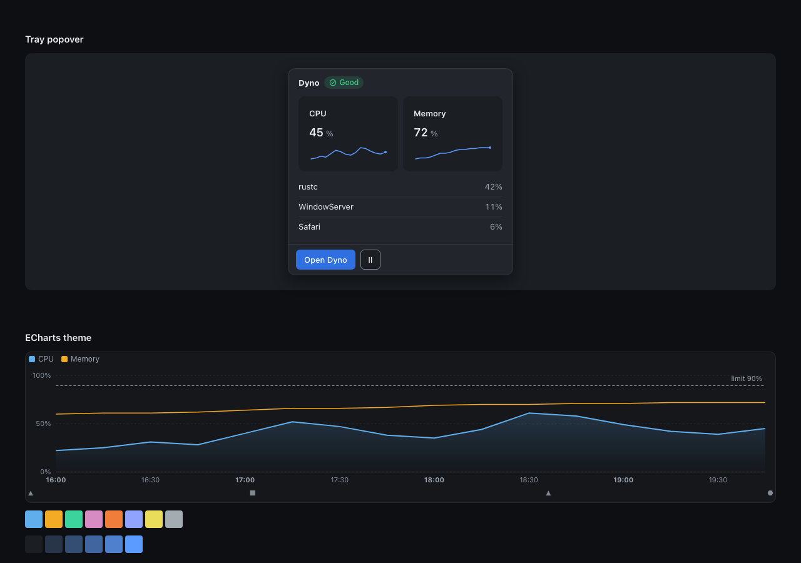
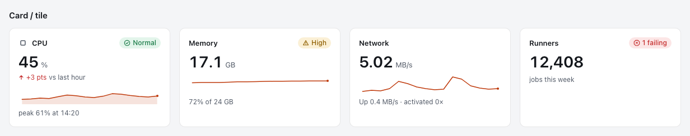
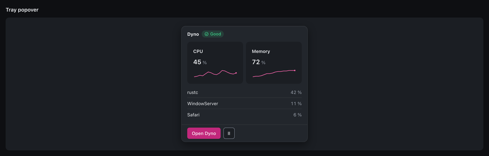
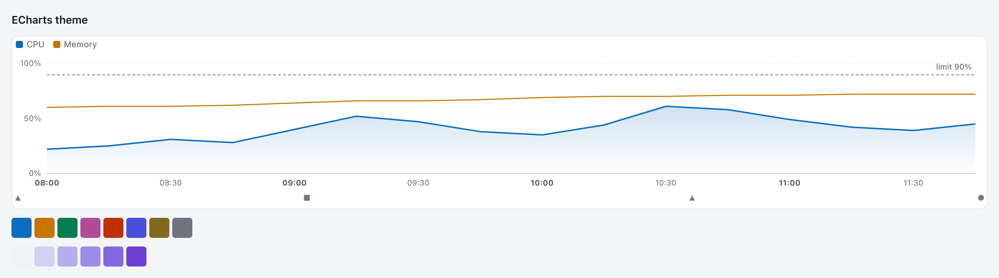

# @decryp7/paddock-ui

The shared design system of the Paddock app family (Debrief, Pitcrew, Pitwall, Dyno, Spotter, Pacenotes, Sighter): design tokens, base styles,
Angular components and an ECharts theme. Part of [paddock](../README.md); versioned with the repo.



## Install

The package is published to the Gitea npm registry. In the app, add an `.npmrc` next to `package.json`:

```ini
@decryp7:registry=https://dev.decryptology.net/api/packages/decryp7/npm/
```

```json
"dependencies": {
  "@decryp7/paddock-ui": "^0.2.0"
},
"devDependencies": {
  "@decryp7/paddock-e2e": "^0.2.0"
}
```

The package is public, so installing needs no token; `npm ci` verifies the integrity hash from `package-lock.json`, and nothing
is built in the app's CI. Peer dependencies: `@angular/core` and `@angular/common` 22 (echarts 6 is optional, only for the
chart theme); the shell entry points add `@angular/router`, `@angular/localize` and, optional per entry point,
`@angular/cdk`, `@angular/forms` and `@ngrx/signals`. Pre-1.0 the caret range accepts patches of the same minor only
(`^0.2.0` is `>=0.2.0 <0.3.0`): a minor may break, and its changelog section says how to migrate. To upgrade, bump the
range (and the Rust crates, below) and run `npm install`. `@decryp7/paddock-e2e` (plain Node, Playwright) is the e2e half
of the test kit; it carries the same version.

### Adopting the shell (ADR 0012)

The shell is adopted as one pair: this package's `shell` entry points in the UI and the `paddock-shell` Tauri plugin in
the app's Rust side (`crates/README.md`, "Consuming the crates"). Both carry **one version**: `paddock-shell` 0.2.0 goes
with `@decryp7/paddock-ui` 0.2.0. The UI asks the plugin once at start-up and logs a plain error when they differ:

```ts
import { provideShellVersionCheck, shellInvoke } from '@decryp7/paddock-ui/shell';
import { invoke } from '@tauri-apps/api/core';

// The shell's commands are plugin commands (`plugin:paddock-shell|health_snapshot`); the shell's backends name them
// plainly, so give every shell backend this IPC. The app's own commands pass through unchanged.
const ipc = { invoke: shellInvoke(invoke), listen: (event, cb) => listen(event, (e) => cb(e.payload)) };
providers: [provideShellVersionCheck(ipc.invoke) /* never holds the start-up */, ...]
```

The app's checks over its own registry, in its specs: `assertContributionsValid` (the lint), the boot-every-dialog
harness and `dialogTableProblems` with `{ ...APP_COMMANDS, ...SHELL_COMMANDS }`, `dialog-contracts.json` and
`paddock-manifest.json` written from the registry (`dialogContractFile`, `buildManifest`; written in write mode, compared
otherwise) and checked in Rust by `paddock_shell::Builder::problems` (see `crates/README.md`).

## Use

`angular.json` (the app's styles; tokens and base styles are plain CSS, SCSS sources ship too):

```json
"styles": ["node_modules/@decryp7/paddock-ui/css/paddock.css", "src/styles.scss"]
```

(`css/tokens.css` alone gives only the tokens; `scss/_tokens.scss` and `scss/_base.scss` can be `@use`d by path.)

Select the look on `<html>`; nothing else is app-specific:

```ts
import { applyPaddockAppearance } from '@decryp7/paddock-ui';
applyPaddockAppearance(document.documentElement, { theme: 'system', accent: 'pitcrew', density: 'standard', contrast: 'system', motion: 'system' });
// <html data-theme="dark|light" data-accent="debrief|pitcrew|pitwall|dyno|spotter|pacenotes|sighter"
//       data-density="comfortable|standard|compact" data-contrast="more|off" data-motion="reduce|full">
```

No `data-theme` follows the OS (`prefers-color-scheme`); `data-contrast="more"` (or the OS setting, unless `off`) maps
hairlines to strong borders and removes translucency (opaque scrim, outlined popovers); `data-motion="reduce"` (or the OS
setting, unless `full`) shortens every duration to 100 ms, sets `--pd-motion-scale: 0` and stops animations. Apps on the
shell use `provideAppearance` instead (below), which also follows the user's choice across windows. Components are standalone with `pd-` selectors:

```ts
import { SuCard, SuMetric, SuSparkline, SuStatusPill } from '@decryp7/paddock-ui';
```
```html
<pd-card heading="CPU">
  <pd-status-pill slot="status" status="success" label="Normal" />
  <pd-metric [value]="45" unit="%" [delta]="3" deltaUnit=" pts" deltaLabel="vs last hour" goodDirection="down" />
  <pd-sparkline slot="sparkline" label="CPU, last hour" [values]="cpu" [area]="true" />
  <span slot="caption">peak 61% at 14:20</span>
</pd-card>
```

| Component | Selector | Notes |
|---|---|---|
| Card / tile | `pd-card` | slots `icon`, `status`, hero (default), `sparkline`, `caption`; `interactive` makes it a button; `flat` inside bordered surfaces |
| Status pill | `pd-status-pill` | icon shape per status + the word + tint; never colour alone |
| Metric | `pd-metric` | tabular, unit as muted sibling, delta with arrow, sign and spoken text; colour only when `goodDirection` is set |
| Sparkline | `pd-sparkline` | inline SVG, 1.5 px, 4 px end dot, gaps break the line, shared `min`/`max` for rows |
| Empty / error state | `pd-empty-state`, `pd-error-state` | error has Retry (`busy` disables it) and an optional secondary action |
| Skeleton | `pd-skeleton` | text, block, circle; shimmer 1.6 s, static under reduced motion |
| Segmented control | `pd-segmented-control` | radio group, arrows/Home/End, `[(value)]` |
| Tray popover | `pd-tray-popover` | 360 px, fitted height, header / content / footer slots, per-platform radius, Escape emits `dismissed` |

Add `class="pd-tray"` to `<html>` in the tray window for a transparent page. A plain splash (`.pd-splash`) styled from
`paddock.css` goes in `index.html` (see the gallery's).

### ECharts

```ts
import * as echarts from 'echarts';
import { areaGradient, eventLaneFragment, readPaddockTokens, registerPaddockTheme } from '@decryp7/paddock-ui';

const tokens = readPaddockTokens();              // re-read after a theme/accent change
const chart = echarts.init(el, registerPaddockTheme(echarts, tokens));
```

The theme: system font, 11 px axis labels, no axis lines except the baseline, hairline dashed horizontal gridlines,
1.5 px lines without symbols, `connectNulls: false`, `sampling: 'lttb'`, bars from zero with a 4 px top radius, top-left
legend, surface-3 crosshair tooltip, 300 ms draw animation and none on live updates, no `dataZoom` slider (use brush plus
a "Reset zoom" chip). `areaGradient(color)` is the 28% to 0 fill; `eventLaneFragment(events, tokens, gridIndex, { shapes })`
returns a 14 px lane grid with shape-coded markers to merge under the plot (see `projects/gallery/src/app/gallery.ts`).
`sequentialRamp(tokens)` is the six-step heatmap ramp.

## Entry points (app shell and workbench)

Besides the root entry, the package has secondary entry points for the app shell (ADR 0012) and the workbench (ADR 0013),
so a manager app never bundles the workbench:

| Entry point | Content | Plan |
|---|---|---|
| `@decryp7/paddock-ui/shell` | contributions, `ShellContext`, frame parts, widgets; the plugin's command names (`SHELL_COMMANDS`, generated from `paddock_shell::COMMANDS`), `shellInvoke`, `checkShellVersion` / `provideShellVersionCheck`, `SHELL_VERSION` | S2, S14, S17 |
| `/shell/jobs` | jobs over the `paddock-jobs` adapter: `JobsBackend` (Tauri, memory), `JobsStore`, `pd-jobs-list`, `pd-jobs-status` (a lazy chunk: exported as a type), `JobFollow`, `provideShellJobs`, `JOBS_CONTRIBUTIONS` | S9 |
| `/shell/notify` | notifications and service health over the `paddock-health` adapter: backends (Tauri, memory), `ServiceHealthStore`, `NotificationsStore`, `pd-notification-host`, `pd-service-status` and `pd-notifications-status` (lazy chunks: exported as types), `pd-waiting-for`, `provideShellNotify` | S4 |
| `/shell/store` | shared SignalStore features: `withRequestStatus` (rule 30) | S4 |
| `/shell/menu` | menus and keys: `defineSubmenu`, the menu model, `AppMenu`, `pd-menu-bar`, `pd-context-menu`, `Keymap` with user overrides, `NativeMenuBridge` over `paddock-menu` | S13 |
| `@decryp7/paddock-ui/shell` (theme) | theme packs (`defineTheme`, `provideThemes`, `themeProblems`), the window's appearance (`provideAppearance`, `AppearanceStore`, `applyStoredAppearance`, browser and IPC backends), colour maths | S15 |
| `/shell/i18n` | `initI18n`, `LanguageStore`, locale, plural and number helpers; the shell's XLIFF catalog and pseudo-locale in `i18n/`; the `paddock-i18n` bin | S15 |
| `/shell/pages` | the pages frame of the manager apps: `provideShellPages`, `pd-shell-frame`, the sidebar of contributed pages (expanded, rail or over the page by `planLayout`), routed lazy pages with their own providers, `ShellPages` | S14 |
| `/shell/settings` | settings over the `paddock-settings` adapter, what a main window imports: `SettingsBackend` (Tauri, memory), `SettingsStore`, the model, `provideShellSettings`, `SETTINGS_CONTRIBUTIONS` | S10 |
| `/shell/settings/window` | the Settings window, loaded only by it: `pd-settings-window`, `pd-settings-section`, `pd-setting-field`, `SettingsDrafts` (Signal Forms), `settingsWindowProviders` | S10, S16 |
| `/shell/testing` | the TestBed half of the test kit: `provideShellTesting`, `RecordingShellPorts`, `ManualIdle`, `ManualClock`, `settle`, `render`, the contributions, registration and lazy-export lints, the boot-every-dialog harness | S2, S6, S16 |
| `/shell/startup`, `/shell/dialogs`, `/shell/about` | one shell part each | S5-S11 |
| `/shell/diagnostics` | report a problem over the `paddock-diag` adapter: `DiagnosticsBackend` (Tauri, memory), `DiagnosticsStore`, the Report a Problem decision dialog (description, every file with its size, Save through the engine's native dialog), `diagnosticsContributions` (Help item, the Logging settings page), `provideShellDiagnostics`, `provideWebviewLog` (the page's errors in the engine's log) | X2 |
| `@decryp7/paddock-ui/workbench`, `/workbench/dock`, `/workbench/panels`, `/workbench/palette`, `/workbench/explorer`, `/workbench/assistant`, `/workbench/testing` | the workbench | W1-W7 |

They are scaffolds until their work packages in [docs/plans/workbench.md](../docs/plans/workbench.md) land. Each lives in
`projects/paddock-ui/<entry>/` with an `ng-package.json` and a `public-api.ts`; specs next to the code run with `npm test`.
A new entry point needs only those two files (the publish dry run fails if the built package does not export one).
`projects/shell-demo` is the shell's reference app (mock backend): every shell change shows up there first, with its e2e in
`e2e/shell-demo*.spec.ts`, which use only `@decryp7/paddock-e2e` (`projects/paddock-e2e`, plain Node, versioned with this
package; see its README): `test` with the Chrome for Testing guard, page objects, axe, layout scenarios, the fake Tauri
IPC, settled screenshots and the retried-test reporter. Lazy chunks stay lazy: a module a contribution loads with
`import()` is never re-exported as a value by its entry point (`lazyExportProblems`, run over every entry point).

### Pages frame (`/shell/pages`, plan S14)

A manager app's main window (Pitwall, Pitcrew, Spotter, Dyno) is one component and one provider call; everything in it
comes from contributions:

```ts
import { provideContributions, provideShellContext } from '@decryp7/paddock-ui/shell';
import { PdShellFrame, provideShellPages } from '@decryp7/paddock-ui/shell/pages';

@Component({ selector: 'pw-root', imports: [PdShellFrame], template: `<pd-shell-frame />` })
export class App {}

bootstrapApplication(App, {
  providers: [
    provideContributions<PitwallContext>(PITWALL_CONTRIBUTIONS), // pages, status items, commands, menus, keys, dialogs
    provideShellContext<PitwallContext>(() => import('./app-context').then((m) => m.pitwallContext)),
    provideShellPages({
      appName: 'Pitwall',
      icon: PwIcon, // a component with a `name` input, e.g. wrapping <mat-icon [svgIcon]>; default: the shell's pd: set
      notify: { health: () => new TauriServiceHealthBackend(ipc), notifications: () => new TauriNotificationsBackend(ipc) },
      jobs: { backend: () => new TauriJobsBackend(ipc) },
      startup: { backend: () => new TauriStartupBackend(ipc), checkpoint: () => inject(UiState).checkpoint },
      nativeMenu: tauriNativeMenuPort(ipc),
      dialogs: { io: () => tauriDialogIo(bridge) },
      routes: [{ path: 'tray', loadComponent: () => import('./tray').then((m) => m.Tray) }], // besides the pages
    }),
  ],
});
```

- **Pages** are `definePage` contributions: `pw.models` is routed at `#/models` (`paths` overrides), loaded on first show
  with its `providers` loader in an injector of its own that ends with the page (`pd-part-outlet`: skeleton while loading,
  an error with Try again if it fails). `when` hides a page (and its route; a page that stops being offered gives way to
  the first page), `badge` draws a neutral count, `section: 'bottom'` pins it at the sidebar's foot. Window titles read
  "Models – Pitwall". `ShellCore.showPage(id)` navigates.
- **Sidebar** 216 px, a 56 px icon rail, or over the page with a scrim, decided by `planLayout` (now in the root entry,
  ADR 0011) from the frame's width: expanded from 776 px, rail from 400 px (`sidebar` option to change the sizes). The
  title bar's button collapses it (kept per machine), or opens it over the page as a modal (scrim over the page and the
  status bar, both inert); Escape, the scrim or a page closes it. The title bar is 40 px; on macOS in Tauri the menus
  are native only and the title bar keeps 78 px for the window buttons. Pages lay out by `@container pd-page`.
- **Status bar** (`pd-status-bar`, root entry): contributed status items, `start` and `end`, highest priority first. When
  the full forms do not fit, every item gets its compact form first (`STATUS_COMPACT`: the chip says only the state,
  jobs only the count, the full text in the tooltip and name); then the lowest unpinned items are hidden behind a
  counted "More status (n)" button that wraps the bar. `pinned` items (the service chip and the bell) are never hidden.
  The frame contributes the service chip and the notifications (S4) and, with `jobs`, the jobs item (S9).
- **Keys**: F6 / Shift+F6 cycle title bar, sidebar, page and status bar (reserved, so a user binding cannot take them);
  arrow keys, Home and End move between pages; "Skip to page" link. Slots: `[slot=title-end]`, `[slot=sidebar]`.
- The frame places `pd-notification-host` and `pd-dialog-host` itself; do not mount them again.

### Start-up contract (`/shell/startup`, plan S7)

Each window's config (main, other windows, pop-outs, dialogs):

```ts
import { invoke } from '@tauri-apps/api/core';
import { listen } from '@tauri-apps/api/event';
import { MockStartupBackend, provideStartupBackend, provideStartupContract, provideUiCheckpoint, TauriStartupBackend } from '@decryp7/paddock-ui/shell/startup';

const ipc = { invoke, listen: (event: string, h: (p: unknown) => void) => listen(event, (e) => h(e.payload)) };
providers: [
  provideStartupBackend(() => (isTauri() ? new TauriStartupBackend(ipc) : new MockStartupBackend())),
  provideStartupContract(),                                       // window_ready after the first render, then pings answered
  provideUiCheckpoint(() => inject(QueryStore).checkpoint),       // main window only: what a recovery reload restores
]
```

`main.ts` starts `startBootErrorForwarding(ipcBootErrorSender(ipc))` before anything else and passes bootstrap failures
to `reportBootstrapFailure`; start-up reads the window depends on go through `retryUntilAnswered(call, STARTUP_RETRY)`.
After a recovery reload the window shows a calm notice through the shell's notify port and restores its checkpoint.
`index.html` keeps the `.pd-splash` (`role="status"`) inside the root element; `splashProblems(html, 'app-root')` checks it.
In the browser build `MockStartupBackend` plays a recovery reload when `sessionStorage['paddock.mock.recover']` is set.

### Menus and keys (`@decryp7/paddock-ui/shell/menu`, plan S13)

One model from the contributions feeds the in-app menu bar, context menus and (macOS app) the native menu bar:

```ts
import { invoke } from '@tauri-apps/api/core';
import { getCurrentWebviewWindow } from '@tauri-apps/api/webviewWindow';
import { provideKeyboardShortcuts, provideMenus, provideNativeMenu, provideSubmenus, tauriNativeMenuPort } from '@decryp7/paddock-ui/shell/menu';

providers: [
  provideMenus({ appName: 'Pitwall' }),                     // the app menu's title; registers the submenu kind
  provideSubmenus(defineSubmenu({ id: 'pw.models.recent', menu: 'file', title: msg('pw.models.recent', 'Open recent'), order: 300 })),
  provideKeyboardShortcuts(),                               // key presses run commands (Keymap.dispatch)
  provideNativeMenu({                                       // main windows; active only in the macOS desktop app
    port: tauriNativeMenuPort({ invoke, listen: (e, h) => getCurrentWebviewWindow().listen(e, (ev) => h(ev.payload)) }),
    gate: () => windowReady,                                // optional: the app's "reported ready" signal
  }),
]
```

- Menu items are `defineMenuItem({ menu, command, group, order })`: groups become separators, a toggle is a command with
  `checked`, a disabled item a command whose `enabled` is false; unavailable commands, hidden entries and empty submenus
  are left out. A namespaced menu id that is not a submenu is a context menu: `<pd-context-menu menu="pw.models.row">`.
  A command sits in one menu-bar menu (the native menu bar shows an id once; the lint reports a second one).
- `<pd-menu-bar>` (ARIA menubar on `@angular/cdk/menu`, renders nothing in the macOS app) and `<pd-context-menu>` show
  shortcut hints (`⇧⌘P` on macOS, `Ctrl+Shift+P` elsewhere) and `aria-keyshortcuts`.
- `Keymap`: the effective bindings (declared, with the user's overrides by command id under
  `localStorage['paddock.keybindings']`, version 1, followed across windows), `conflicts`, `bind(command, key, { force })`
  (refuses an invalid key, and a key another command or a `RESERVED_KEYS` entry has in that scope), `reset`, `resetAll`,
  `suspend`/`resume` while recording (`recordKey`). Key presses run the innermost scope's binding first
  (`pdKeyScope` / `data-pd-key-scope`, then `window`); text fields keep typing and their editing chords.
- `NativeMenuBridge` sends the model once the gate opens (default: the app's context loaded), coalesces changes to the
  next idle moment, sends again on focus, and ignores the native echo of a shortcut that just ran.

### Jobs (`@decryp7/paddock-ui/shell/jobs`, plan S9)

Per window (rule 34), with the app's IPC passed in (the package does not depend on `@tauri-apps/api`):

```ts
import { invoke } from '@tauri-apps/api/core';
import { listen } from '@tauri-apps/api/event';
import { JOBS_CONTRIBUTIONS, provideShellJobs, TauriJobsBackend } from '@decryp7/paddock-ui/shell/jobs';

providers: [
  provideContributions(JOBS_CONTRIBUTIONS), // status item `pd.jobs` (lazy), notification kinds pd.jobs.finished / failed
  provideShellJobs({
    backend: () => new TauriJobsBackend({ invoke, listen: (event, cb) => listen(event, (e) => cb(e.payload)) }),
    stillWorkingAfterMs: 10_000, // the default
  }),
]
```

- `JobsStore` (SignalStore, `protectedState`): the newest snapshot per job (highest `seq`; listens before it reads the list,
  so nothing is missed), `requestStatus` (`'idle' | 'loading' | 'loaded' | { error }`), `list` (active first), `activeCount`,
  `lead`, `stalledIds` ("Still working" after `stillWorkingAfterMs` without an event, refreshed by a clock that ticks only
  while a job runs), `load()` (also Retry), `cancel(id)`, `follow(id)`. A job that ends is a notice through
  `SHELL_PORTS.notify` (done, failed, deadline; not a user cancel; not while someone follows it; never for the first list).
- `<pd-jobs-list>` (the list with `pd-job` rows, Cancel, error with Retry, empty state) and `<pd-jobs-status>` (the status
  item: "2 running: Reading", "Still working"; opens the list in an in-app popover, Escape and outside click close it).
- `JobFollow.run(start, destroyRef)` / `follow(id, destroyRef)`: a dialog waits for its job; closing it stops waiting only.
- `MemoryJobsBackend` plays the engine in the browser build and tests; `parseJobSnapshot` checks every payload at the edge.
- Nothing times out a job (rule 12): `uiTimeoutProblems(path, source)` is the check `shell/testing`'s reference-sources spec
  runs over every shell and reference-app source: a timer that gives up on work (`Promise.race` against a timer,
  `AbortSignal.timeout`, `...timeout...(` helpers, a `setTimeout`/`setInterval` whose callback rejects, aborts, cancels or
  fails). Debounce, retry and tick timers are fine (plan §12).
- `@ngrx/signals` (^22) is an optional peer dependency, needed by the shell entry points that hold stores.

### Notifications and service health (`@decryp7/paddock-ui/shell/notify`, plan S4)

Per window (rule 34), with the app's IPC passed in:

```ts
import { NOTIFY_CONTRIBUTIONS, provideShellNotify, TauriNotificationsBackend, TauriServiceHealthBackend } from '@decryp7/paddock-ui/shell/notify';

const ipc = { invoke, listen: (event, cb) => listen(event, (e) => cb(e.payload)) };
providers: [
  provideContributions(NOTIFY_CONTRIBUTIONS), // status items `pd.health` (the chip) and `pd.notifications` (the centre), lazy
  provideShellNotify({
    health: () => new TauriServiceHealthBackend(ipc),
    notifications: () => new TauriNotificationsBackend(ipc),
    // mountHost: false when the frame places <pd-notification-host> itself; ports: false when the window provides its own
    // SHELL_PORTS (use `notify: notifyPort()` there).
  }),
  { provide: OPEN_SETTINGS, useValue: (section) => ... }, // optional: the `openSettings` repair and notice action
  provideNoticeAction({ type: 'installUpdate', label: () => 'Install', run: (a) => ... }), // the app's notice buttons
]
```

- One display rule (`visibleNotifications`): one toast per cause (a repeat updates it in place with `(×N)`), at most
  three, and never a `health:<service>` cause: the chip states outages. Errors and critical failures stay until
  dismissed or resolved; the rest go after 8 s, held while the pointer or focus is on them. The host owns the time
  (`NOTIFY_CLOCK`, a port); sources (`provideNotificationSource`) only post, update and resolve.
- `SHELL_PORTS.notify` (every `ShellNotice`, e.g. a failed command or a finished job) goes to the engine's centre
  (`notifications_post`: validated and bounded, keyed by the engine as `ui:<kind>:<title>`), which lists it for every
  window and sends each its toast (rule 34). When the engine cannot take it (no centre, a notice out of its bounds), the
  window keeps it itself for the session, merged by kind and text.
- `ServiceHealthStore`: the newest snapshot (by `revision`); `isServing(service)` is false until the first snapshot.
  `pd-service-status` appears when a service is not working, opens the cause, the next step, technical details and the
  Repair button (served by the shell, never by the service), and offers Try again when the state could not be read.
- Panels show `<pd-service-error summary="…" service="engine" (retry)="load()">`: while the service is down it is
  `<pd-waiting-for>` ("Waiting for the engine", "See what happened" opens the chip), and it emits `retry` once when the
  service is back.
- The wire types are the ts-rs output of `paddock-health`, written into this entry point (`shell/notify/generated/`);
  `NotifyCommand` is a subset of the generated `HealthCommand`, so a command that is not in the table does not compile.
### Settings (`/shell/settings`, plan S10)

Settings are the engine's (rule 21): `paddock-settings` holds the sections the shell and the app register, validates every
value in Rust, applies, saves and announces it on `paddock://settings`; the UI renders the schema and sends values. The
Settings window is a modeless `tool` dialog the app declares itself, so its contract is in the app's registry:

```ts
// app.contributions.ts: static data and loaders only
export const SETTINGS_DIALOG = defineDialog({
  id: 'pd.settings', kind: 'tool', title: msg('pd.settings.title', 'Settings'), width: 880, height: 620,
  commands: ['settings_overview', 'settings_reset', 'settings_set'],                  // SETTINGS_DIALOG_COMMANDS
  providers: () => import('./settings-window.providers').then((m) => m.SETTINGS_WINDOW),
  load: () => import('@decryp7/paddock-ui/shell/settings/window').then((m) => m.PdSettingsWindow),
});
export const APP_SETTINGS_PAGES = [
  // Without `load` the page is its Rust section in the generic form; `load` names a page of its own.
  defineSettingsPage({ id: 'pw.models', group: 'features', title: msg('pw.settings.models', 'Models'), order: 100 }),
];
// settings-window.providers.ts: what the Settings window boots with (rule 34); imports shell/settings/window
export const SETTINGS_WINDOW = settingsWindowProviders({ backend: () => new TauriSettingsBackend(ipc), pages: APP_SETTINGS_PAGES });
// main window
provideContributions(SETTINGS_CONTRIBUTIONS),          // Settings… (Mod+,) in the app menu, the shell's Appearance page
provideContributions({ settingsPages: APP_SETTINGS_PAGES, dialogs: [SETTINGS_DIALOG] }),
provideShellSettings({ backend: () => new TauriSettingsBackend(ipc), appearance: { gate: windowReady } }),   // OPEN_SETTINGS; follows Appearance once ready
```

- A page's id is the id of its Rust section; `PdSettingsSectionPage` (or `<pd-settings-section section="...">` inside a
  page of the app's own) renders it from the schema: one native control per field kind (switch, select, text, path,
  number with its unit and limits, duration and size in their unit, list), help, "Needs restart", Reset to default,
  Reset section, advanced fields behind "Show advanced". Sections without a page are listed under Advanced, so nothing
  is unreachable. Every page is listed (a Settings window has no app context, so `when` is not evaluated there).
- Edits are Signal Forms (`SettingsDrafts`, rule 37): a switch or a choice applies at once, typed values on Enter or on
  leaving the control. The pre-check (types, ranges) only gives early feedback; the engine's refusal shows at the field
  while the refused value is there. An edit that is not applied stays unsaved, is marked in the navigation, survives
  moving between pages, and closing the window (Close, Escape, a close request) asks Discard changes / Keep editing.
- Search covers every field's label, help, key, unit, choices and section title, and pages without a section by title,
  however written (parts, joins, separators, case, one typo; rule 20). Escape clears a filled search.
- The restart bar counts restart-only changes (Restart now when the app provides `restart`); a settings file that could
  not be used at start-up is one notification (posted by Rust) and a note in the window.
- Generated in `shell/settings/generated/`: `settings.ts` (wire types, `SETTINGS_EVENT`, `APPEARANCE_SECTION`, limits),
  `settings-commands.ts` (`SETTINGS_COMMANDS`) and `settings-fixtures.ts` (an overview with every field kind, a refusal, a
  change and a start-up problem, written by Rust; the shell demo's in-memory engine serves them).
- `/shell/settings/window` needs `@angular/forms` (^22, an optional peer dependency); a main window never loads it.

### Dialogs (`/shell/dialogs`, plan S6)

Dialogs are real OS windows (ADR 0009, rule 17). Declare each with `defineDialog` in a registration file; the kind decides
modality, size, keys and buttons:

```ts
export const RENAME_DIALOG = defineDialog({
  id: 'pw.rename', kind: 'form', modality: 'modal', title: msg('pw.dialog.rename', 'Rename'), width: 440,
  result: type<string>(), commands: ['app_rename'],                           // what its window may call
  providers: () => import('./rename.providers').then((m) => m.RENAME_PROVIDERS), // its own providers only
  load: () => import('./rename-dialog').then((m) => m.RenameDialog),
});
```

- Main window: `provideDialogs({ io: () => tauriDialogIo({ invoke, listen, emitTo }) })` (without `io` dialogs open in the
  page), `<pd-dialog-host />` in the root template, `openDialog: openDialogPort()` in `SHELL_PORTS`. Open with
  `inject(DialogService).open(RENAME_DIALOG, { inputs: { current } }).closed` (resolves to `string | undefined`; the inputs
  are typed from the content component's `input()`s).
- Content: inject `DIALOG_REF` and call `close(result)`; inputs set the component's `input()`s; `dialogCanClose()` may
  keep it open; mark a Close/Cancel with `data-dialog-close` (else the shell adds one) and the default with `data-default`.
- Dialog window: in `main.ts`, `parseDialogRoute(location.hash)`; for a dialog route `mountDialogWindowHost()` and
  `bootstrapApplication(DialogShell, dialogWindowConfig({ dialogs, providers: dialogBase(), io, route }))`.
- Contracts: a spec writes `serializeDialogContracts(dialogContractFile(dialogs, { base }))` to `src-tauri/dialog-contracts.json`
  and compares it on every run; Rust reads it with `paddock_dialogs::Dialogs::from_json`.
- Checks every app runs (`shell/testing`): `assertDialogBoots(def, { dialogs, providers: dialogBase(), inputs })` per dialog
  (missing provider, empty or failed body, undeclared command sent at start, Close/Escape per kind, fit per kind),
  `dialogTableProblems(dialogs, APP_COMMANDS, base)`, and `npx paddock-check-dialog-commands --config paddock-dialog-commands.json`
  (what a click could send, in both directions; see the header of `bin/paddock-check-dialog-commands.mjs`). The shell
  demo runs all three (`npm run check:dialogs`).

### Theme and language (`@decryp7/paddock-ui/shell`, `/shell/i18n`, plan S15)

The look is the user's choice, the same in every window of the app: scheme (system, dark, light), contrast (system,
standard, more), motion (system, reduce, full), density and an optional theme pack; the accent is the app's.

```ts
// main.ts: the stored look before the first paint, then the language, then the window (each window its own bootstrap)
applyStoredAppearance(document.documentElement, 'pitwall');
initI18n({ loaders: { 'en-XA': () => import('./locale/messages.en-XA.json').then((m) => m.default.translations) } })
  .then(() => import('./main-window').then((m) => m.bootMainWindow()));

// every window's providers (dialog windows too, so an open dialog follows a change)
provideAppearance({ accent: 'pitwall', backend: () => new IpcAppearanceBackend({ emit, listen }) }), // browser: default backend
provideThemes(CONSOLE_THEME),                                                                          // optional packs
```

- With Settings (`/shell/settings`), `provideShellSettings` makes the engine's Appearance settings the source of the look
  (`APPEARANCE_SOURCE`): every window's store follows their changes and writes there; dialog windows add
  `provideSettingsAppearance({ settings, read: 'events' })` to their base providers. The store is the only writer of the
  look on `<html>` (checked by `e2e/shell-demo-theme.spec.ts`).
- `AppearanceStore`: `theme()`, `contrast()`, `motion()`, `density()`, `pack()`, `resolved()` (`scheme`, `highContrast`,
  `reducedMotion` against the OS) and `setTheme`/`setContrast`/`setMotion`/`setDensity`/`setPack`. A change is saved and
  announced (`paddock://appearance` in the desktop build, a `BroadcastChannel` in the browser); the other windows apply it
  at once. Stored under `paddock.appearance` (versioned; a corrupt value is the default).
- Theme packs: `defineTheme({ id, name: msg(...), tokens: { common, dark, light } })` overrides `--pd-*` tokens only
  (inline on `<html>`, `data-pack`), never in high contrast; `themeProblems(def)` (also the `themes` kind's lint) refuses
  non-`--pd-*` names, unsafe values and pairs below the token targets.
- i18n (ADR 0012 §6): `$localize` with runtime-loaded translations, one build for every language. Install
  `@angular/localize/init` in the app's `polyfills` and `"types": ["@angular/localize"]`. The shell's messages use `@@pd.`
  ids; contributions' `msg(id, text)` read their text through the loaded translations, so they need nothing else.
  `LanguageStore` keeps the choice (`paddock.language`: system, en, pseudo) and says when a restart is needed.
- Translation files: the package ships `i18n/messages.pd.xlf` (the shell's catalog) and `i18n/messages.pd.en-XA.json`
  (its pseudo-locale). An app builds its own catalog (its `msg()` and `$localize` messages with `@@id`s, scanned from the
  sources) and loader files with the bin:

  ```sh
  npx paddock-i18n catalog --out src/locale/messages.xlf --src src --prefix pw. [--json extracted.json] [--manifest paddock.manifest.json]
  npx paddock-i18n merge --locale en-XA --out src/locale/messages.en-XA.json \
    node_modules/@decryp7/paddock-ui/i18n/messages.pd.en-XA.json src/locale/messages.xlf
  ```

  `--check` writes nothing and fails on drift (CI). Here `npm run i18n` (after `npm run build`) regenerates the package's
  files and the shell demo's; CI runs `npm run i18n:check`. The shell demo's View > Appearance switches theme, a sample
  pack, high contrast, reduced motion and the pseudo-locale; `e2e/shell-demo-locale.spec.ts` finds no unmarked English
  in any shell part in the pseudo-locale, `e2e/shell-demo-theme.spec.ts` checks switching across windows.

Screenshots for review: [dark](docs/screenshots/shell-demo/theme-dark.png), [light](docs/screenshots/shell-demo/theme-light.png),
[high contrast dark](docs/screenshots/shell-demo/theme-high-contrast-dark.png),
[high contrast light](docs/screenshots/shell-demo/theme-high-contrast-light.png),
[pseudo-locale](docs/screenshots/shell-demo/theme-pseudo-locale-dark.png) (`SCREENSHOTS=1 npx playwright test shell-demo-theme`).

## Tokens

All values live in `projects/paddock-ui/scss/_tokens.scss` and compile to `css/tokens.css`: neutral roles (bg, surface-1..3,
hairline, border-strong, border-control, text, muted, subtle), status (success, warning, danger, info, neutral, each with a
tint), the seven accents (`--pd-accent` for text/links/focus, `--pd-accent-fill` for buttons with white text), the 8-colour
chart palette `--pd-chart-1..8`, the diverging scale, the sequential ramp `--pd-seq-1..6`, spacing (2 to 48), radii
(6/10/14), type scale with tabular numerals, elevation, motion (100/180/260 ms; `--pd-motion-scale`), layout, the three
densities, high contrast (`data-contrast`) and reduced motion (`data-motion`).

## Tests and gates

```sh
cd ui
npm ci
npm run test:tokens      # WCAG contrast of every pair (standard and high contrast) + colour-vision separation (289 tests)
npm test                 # component and helper specs (Vitest via ng test), 100% lines
npx playwright test      # gallery: axe (both themes), keyboard, native feel, CSP; SCREENSHOTS=1 rewrites docs/screenshots
npm run build            # ng-packagr build to dist/paddock-ui (every entry point)
npm run build:e2e        # @decryp7/paddock-e2e to dist/paddock-e2e
npm run shell-demo       # the shell's reference app on http://localhost:4301 (SHELL_DEMO_PORT for Playwright)
npm run test:scripts     # node tests of ../scripts (publish plan, CI coverage of every crate)
npm run release          # dry run: builds and lists every crate, npm package and entry point (CI publishes on a v* tag)
```

### What the token test checks

- Text (AAA 7:1) on bg, surface-1, surface-2 and surface-3 in both themes; muted text AA (and 6.5:1 on surface-1/2); subtle text AA.
- Status text AA on every surface and on its own tint; neutral too.
- Every pair above again in high contrast; there hairlines are 3:1 boundaries, translucency is gone and subtle text is
  muted text; the OS preference applies it unless the app turned it off.
- Accent text AA on every surface for all seven accents in both themes and both contrast modes; white on every accent fill
  AA; the accent as focus ring 3:1 (WCAG 2.4.11); the accent fill 3:1 against surface-1; the seven fills dE >= 15 apart.
- Reduced motion: every duration at most 100 ms and `--pd-motion-scale: 0`, by the OS setting unless the app chose full motion.
- Input and control boundaries (`--pd-border-control`) 3:1 (WCAG 1.4.11); chart marks 3:1 on surface-1 and surface-2.
- Chart palette under protanopia, deuteranopia and tritanopia (Machado 2009, severity 1.0, CIE76 Lab distance): adjacent
  series dE >= 20; the first five (recommended) series pairwise >= 14; normal-vision pairs >= 20; the diverging ends
  >= 30 under every deficiency; success vs danger >= 10 (icon and word carry the meaning).
- No accent hue within 20 degrees of the warning hue.

### Changes to the design guide's starting values

The guide marked its hexes as starting values; these failed and were changed (also written back to `docs/design-guide.md`):

| Token | Guide | Now | Why |
|---|---|---|---|
| text-subtle dark | #7F8794 | #8B93A0 | 4.2:1 on surface-3 (menus) |
| text-subtle light | #6B7380 | #5F6775 | 4.4:1 on the window bg |
| text-muted light | #565E6B | #4F5764 | 5.8:1 on surface-2; guide's "aim 7:1" for dense views |
| neutral status light | #565E6B | #4F5764 | follows muted |
| success light | #1A7F4B | #187A46 | 4.48:1 on the window bg |
| chart-neutral-bar | #5B6472 / #AEB6C2 | #5E6775 / #868F9D | chart marks must reach 3:1 (the Debrief review's light value was 2.0:1) |
| Pitwall fill | #6D3FD6 | #7546E0 | the dark button needs 3:1 against surface-1 and white text needs 4.5:1 |
| Chart palette (both themes) | Okabe-Ito tuned | see below | adjacent 3-4 under deuteranopia was dE 15; light orange missed 3:1; four pairs were near-identical under CVD |
| (new) border-control | - | #838B98 / #6B7380 | the guide's input border (border-strong, about 1.3:1 on dark) fails WCAG 1.4.11; border-strong stays for dividers |
| (new) danger-fill | - | #C42B2B | the danger button needed a defined fill (white text 5.6:1) |

Chart palette, dark: `#60AEEB #F3AA25 #3DD39D #D68CC2 #F07D3A #8FA3FF #E8DC5A #A2ACB1`; light:
`#0C6DBE #C47600 #087D51 #B04C95 #BE3108 #494FDB #816A1D #6F737D` (found by a bounded local search that keeps each hue
family and maximises the worst CVD pair). Known limits, measured: orange (2) vs yellow (7), 4 vs grey (8) and sky (1) vs
periwinkle (6) stay under 14 dE under some deficiencies, so use series 6-8 sparingly and direct-label or shape-code them.
Diverging scale now reuses series 1 and 2.

## Gallery

`npm run gallery` serves a demo app at http://localhost:4300 with every component and the chart theme; the toolbar switches
theme, accent and density, or use `?theme=light&accent=dyno&density=compact`. Playwright screenshots of every component
(10 sections) in both themes and each of the five accents are in [`docs/screenshots/<theme>/<accent>/<component>.png`](docs/screenshots),
plus `gallery-*.png` overviews and `density/`.





## Migration notes per app

Apps adopt the package one by one in their design passes; nothing here edits them.

- **Pitcrew** (reference implementation): `styles/_tokens.scss` maps almost one to one: `--surface` to `--pd-surface-1`,
  `--text-2` to `--pd-text-muted`, `--border` to `--pd-hairline`, `--accent` to `--pd-accent`, `--accent-bg` to
  `--pd-accent-fill`, `--chart-1..4` to `--pd-chart-1..8`. Pitcrew's accent changes from #c2410c/#ff8a4c to the guide's
  #bf3a0c/#ff7a45 (fill #d2420f). Drop `pc-load-state`/`pc-empty-state` for `pd-skeleton`/`pd-empty-state`/`pd-error-state`.
  Keep `_controls` and `_surfaces` until their parts have `pd-` equivalents.
- **Debrief**: keep ADR 0018's mechanism (tokens + traits) but make `calm` read the paddock tokens (system font, cobalt accent);
  use `pd-status-pill` for finding severity, `pd-segmented-control` for the level filter, `pd-sparkline` in the Errors tile.
  Debrief's event-level colours stay the status set plus shape; the Events chart takes the theme and `eventLaneFragment`.
- **Dyno**: tray window gets `html.pd-tray` and `pd-tray-popover` (the transparent page, fitted height and per-platform
  radius it already has); tiles become `pd-card` with `pd-metric` + `pd-sparkline`; sparklines neutral unless a threshold is
  crossed; the history chart uses the theme and the event lane instead of dashed verticals.
- **Pitwall**: models table and tray adopt `pd-tray-popover`, `pd-status-pill` (neutral for "Not installed"), `pd-metric` for
  the four hero tiles; the violet fill is now #7546E0; VRAM/RAM bars use the neutral track.
- **Spotter** (no UI yet): start from `paddock.css`, `data-accent="spotter"`, `pd-empty-state` for the first-run page,
  `pd-status-pill` (shape-coded severity) in the feed, `pd-tray-popover` for the tray.

All apps: remove copied `_tokens`/`_base` rules as components move over; keep the CSP rule (`inlineCritical: false`, no
inline style attributes: the components only bind styles through Angular's CSSOM bindings, and the gallery test checks
`index.html` has none).
